# Bericht – Aufräumen 2026-11, Karten verständlicher, Logo HMR

Auftrag: `prompts/25_cleanup_logo.md`. Branch `cleanup/2026-11` (von `redesign/2026-11`). Stand 15.11.2026.
**Lokal in `redesign/2026-11` gemergt (15.11.2026), nicht veröffentlicht.**

**Entscheidung (15.11.2026):** Legende **Variante a**, Kopf **Variante B**, **Rasterlogo** (kein SVG-Nachbau). Die nicht
gewählten Varianten, die Vorschau-Schalter `?kopf=`/`?legende=` und die SVG-Datei sind entfernt; die Abschnitte unten
dokumentieren den Vergleich.

Vorschau lokal: `npm --prefix web run build && npm --prefix web run preview`, dann http://localhost:4173/.

Liste aller Fundstellen: [fundstellen.md](fundstellen.md).

## Varianten (entschieden: a und B)

### Legende „Abweichung“ (5)

**Was die Ansicht zeigt.** Je Abschnitt prüft der Entwurf drei Dinge (`pipeline/lib/discrepancy.py`, Regeln D-SPD-01,
D-DES-01, D-USE-01): Tempo heute über dem Ziel, Gestaltung passt nicht zur Aufgabe, zu viel Verkehr in einer
Hauptstraße mit Tempo 30. Jede Prüfung gibt eine Stärke 0–3 (bei der Gestaltung in halben Stufen). Die Karte zeigt:

- die **Art** (`disc_type`): D1 = „zu viel Hauptstraße“ (zu schnell, zu sehr auf Durchgang gebaut), D2 = „zu wenig
  Hauptstraße“ (Gestaltung fehlt, z. B. kein Radweg bei Tempo 50), D3 = beides;
- die **Stärke** (`disc_max`, höchste der drei Stufen) als Linienbreite.

Bisher erklärte die Legende nur die Art, mit Fachwörtern („gebaut wie eine Hauptstraße“, „Mischform“), und zeichnete
alle Arten gleich breit. Die Stärke stand nur im Erklärsatz. Halbe Stufen (2,5) wurden schmal gezeichnet wie Stufe 1.

**Verteilung** (Länge in km, ganz Hamburg ohne ländliche Stadtteile):

| Art \ Stärke | 0,5–1 | 1,5–2 | 2,5–3 |
| --- | ---: | ---: | ---: |
| D1 zu viel Hauptstraße | 167 | 1 266 | 57 |
| D2 Gestaltung fehlt | 96 | 22 | 5 |
| D3 beides | 12 | 43 | 15 |

Dazu 2 345 km „passt“ und 970 km „nicht prüfbar“. **Fazit zur Feinheit:** Die drei Arten bleiben sinnvoll, weil sie
unterschiedliche Maßnahmen bedeuten. D3 ist klein (70 km). Die Stärke in sieben halben Stufen ist zu fein für eine
Karte; ich fasse sie für die Darstellung zu drei Breiten zusammen: unter 1,5 schmal, 1,5 bis unter 2,5 mittel, ab 2,5
breit. Regeln und Daten bleiben unverändert.

| | Variante a – Aussagen | Variante b – Frage und Skala |
| --- | --- | --- |
| Bild | 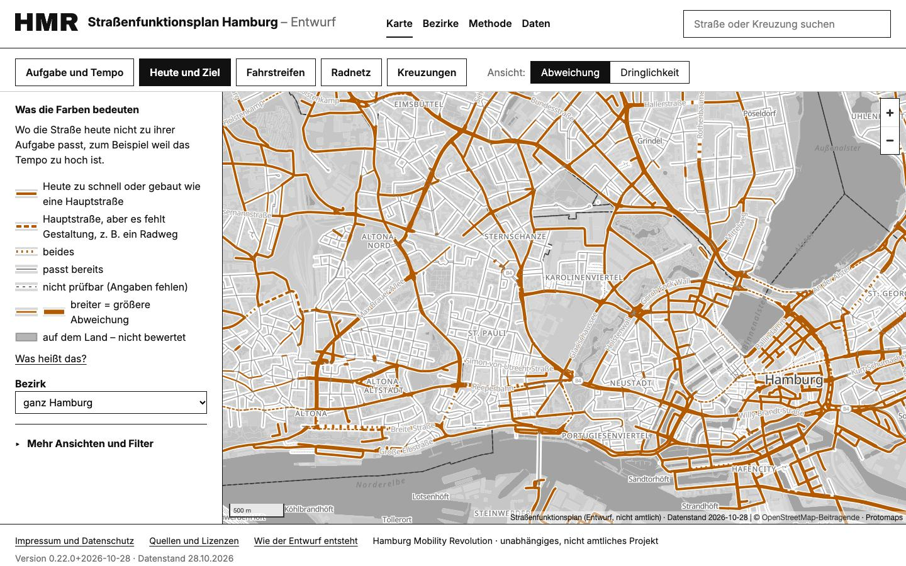 | 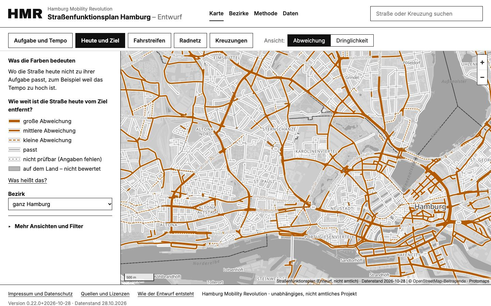 |
| Überschrift | Erklärsatz wie bisher | „Wie weit ist die Straße heute vom Ziel entfernt?“ |
| Klassen | „Heute zu schnell oder gebaut wie eine Hauptstraße“ · „Hauptstraße, aber es fehlt Gestaltung, z. B. ein Radweg“ · „beides“ · „passt bereits“ · „nicht prüfbar (Angaben fehlen)“ + Zeile „breiter = größere Abweichung“ | „große / mittlere / kleine Abweichung“ · „passt“ · „nicht prüfbar (Angaben fehlen)“ |
| Zweite Kodierung | Art = Strichart (durchgezogen, gestrichelt, gepunktet), Stärke = Breite | Stärke = Breite, „klein“ zusätzlich gestrichelt |
| Was verloren geht | – | Die Art steht nur noch im Filter „Art der Abweichung“ und im Steckbrief |
| „Was heißt das?“ | Link auf `#methode/abweichung` | Link auf `#methode/abweichung` |

**Empfehlung: a.** Die Art sagt, *was* zu tun ist (Tempo senken oder Radweg bauen), und genau das fragt man an der
Karte. Variante b ist ruhiger, beantwortet aber nur „wie viel“. Auf der Karte sieht man in a die gestrichelten
D2-Abschnitte gut, in b verschwinden sie unter der Stärke.

### Kopfbereich und Name (7/8)

| | Variante A – Name im Kopf | Variante B – Name in Fußzeile und Metadaten |
| --- | --- | --- |
| Desktop |  |  |
| Mobil | 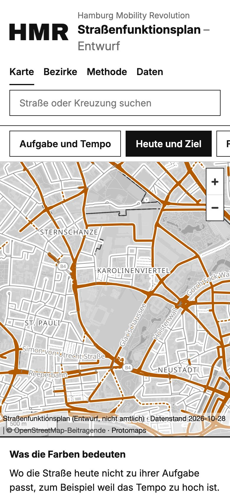 | 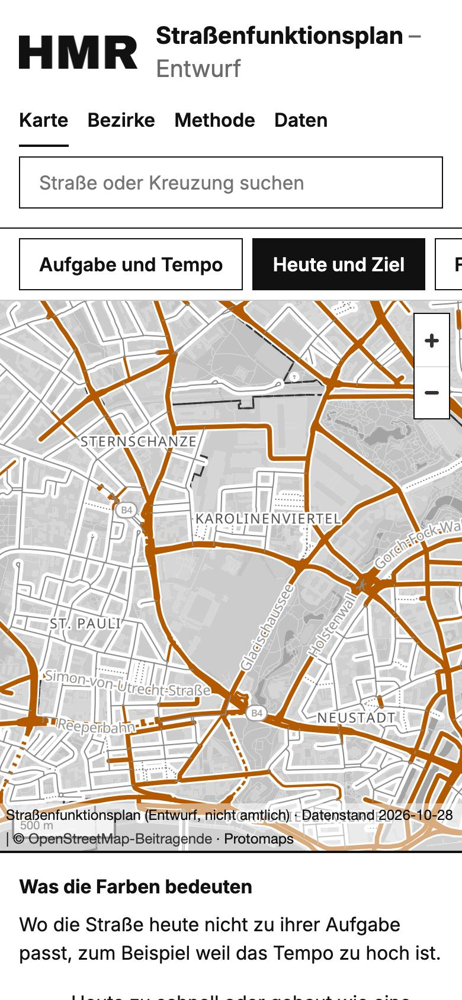 |
| Kopf | Logo, daneben zweizeilig „Hamburg Mobility Revolution“ (14 px, `--muted`) über dem Titel (20 px) | Logo und Titel |
| Name außerdem | Fußzeile, `<title>`, Meta/Open Graph | Fußzeile, `<title>`, Meta/Open Graph, Alternativtext des Logos |

**Empfehlung: B.** Das Logo trägt den Namen schon (Alternativtext „HMR – Hamburg Mobility Revolution“). Eine dritte
Zeile im Kopf ist mehr Text ohne neue Information, und der Kopf bleibt in B eine Zeile hoch (auf dem Smartphone mehr
Karte). A passt, wenn der Name „Hamburg Mobility Revolution“ ausgeschrieben bekannt werden soll.

**Option SVG-Logo** (nicht eingebaut): „HMR“ aus der Hausschrift Inter (Gewicht 800) als Vektor,
3 KB, gestochen scharf in jeder Größe (nach der Entscheidung wieder entfernt). Es ist aber **nicht dasselbe Zeichen**:
Die Vorlage ist breiter und kräftiger. Empfehlung: beim Raster-Logo bleiben, solange die Vorlage das Markenzeichen ist;
liegt die Vorlage als Vektor (SVG/PDF) vor, diese einsetzen.

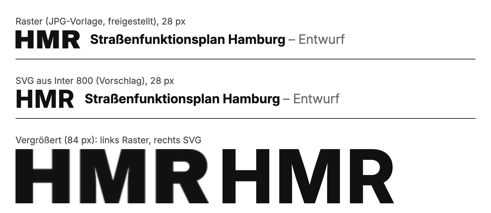

## Änderungen im Einzelnen

### 1. Kopfband entfernt
- `web/index.html`, `web/src/main.js`, `web/src/style.css`: Band und Code entfernt.
- Kennzeichnung bleibt unaufdringlich: Titelzusatz „– Entwurf“; Fußzeile „Hamburg Mobility Revolution · unabhängiges,
  nicht amtliches Projekt“ und „Version … · Datenstand …“; Hinweis in Methode und Impressum; Kartenzuschreibung.
- Leitlinien angepasst, damit spätere Aufträge das Band nicht zurückbringen: `docs/redesign/03_design_system.md`,
  `tokens.json`, `02_information_architecture.md`, `prompts/24_…md`; Analyse-Skripte warten auf die Fußzeile.

### 2. Changelog nicht mehr auf der Webseite
- Seite `#methode/neu` und Link „Was ist neu“ entfernt; alte Links führen auf `#methode`.
- `config/plain_language.yaml` 0.12.0: `method.news` gestrichen. `pipeline/s09_export.py` kopiert `CHANGELOG.md`
  nicht mehr nach `data/out`. `CHANGELOG.md` bleibt im Repository (neuer Eintrag).

### 3. und 4. Ansichten ausgeblendet
Siehe Tabelle unten. „Platz in der Straße“ heißt jetzt **„Fahrstreifen“** (Thema-ID `platz` bleibt, Links bleiben
gültig) und hat keinen Umschalter mehr. Der Erklärtext sagt: „Wie viele Fahrstreifen für Autos die Straße im Ziel hat –
und wo es weniger sind als heute.“ Die Machbarkeit steht weiter im Steckbrief, jetzt mit Überschrift „Hat das Ziel
Platz?“ und einem Satz, was gezählt wird. Radnetz zeigt nur noch „Ziel“ (und auf Ebene 3 „amtliches Netz“).

| | vorher | nachher |
| --- | --- | --- |
| Fahrstreifen | 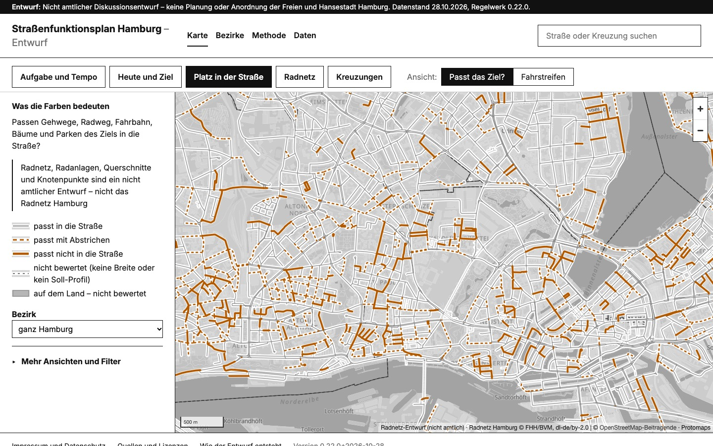 | 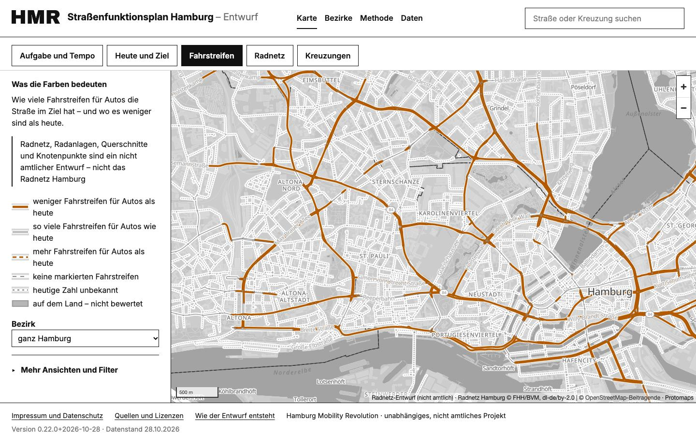 |
| Radnetz | 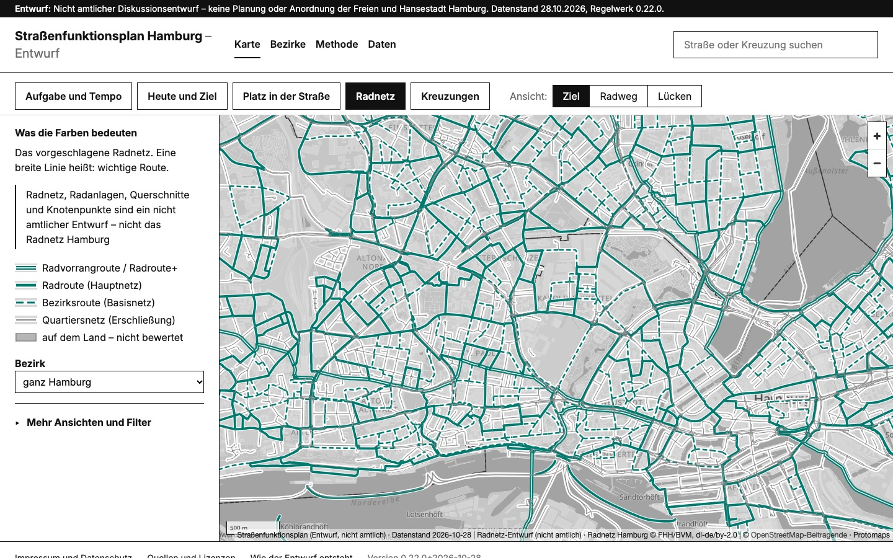 | 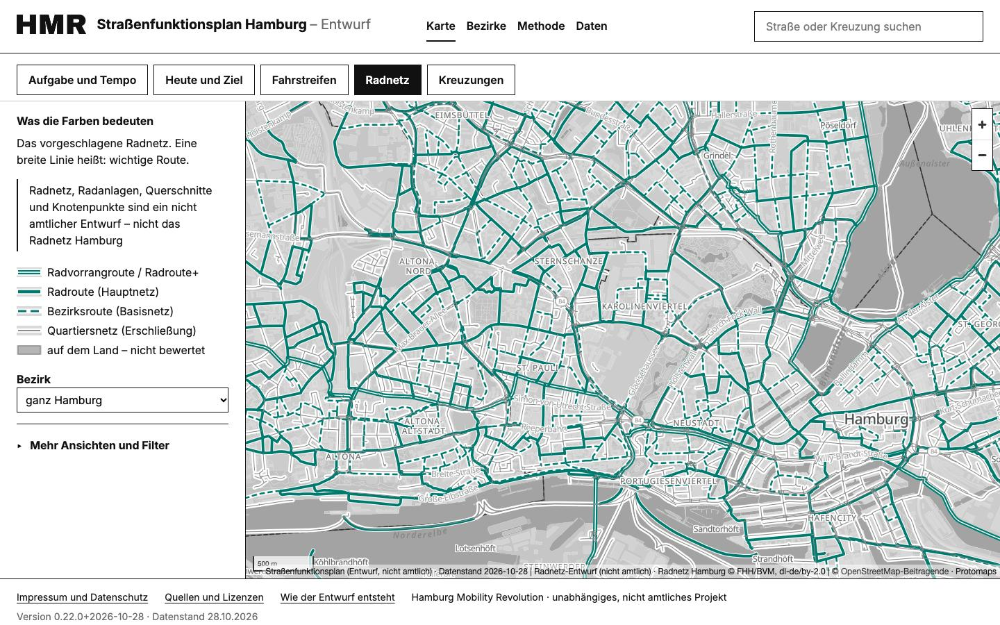 |
| Fahrstreifen mobil | | 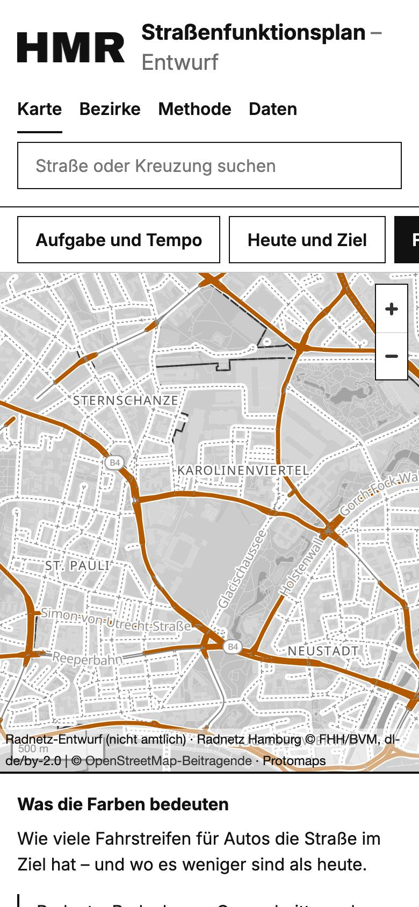 |

### 5. Legende „Abweichung“
Siehe oben. Code: `web/src/layers.js` (`discGroups`, `legendHtml`).

### 6. Stadtteilnamen sichtbar
- **Ursache:** Alle Datenebenen wurden ohne `beforeId` hinzugefügt, lagen also über allen Beschriftungen der
  Grundkarte.
- **Lösung** (`web/src/map.js`, `web/src/layers.js`): Datenebenen werden unter der ersten Beschriftungsebene der
  Grundkarte (`address_label`) eingefügt, bei allen Karten. Nur die Kreuzungssymbole bleiben oben, weil sie selbst die
  Daten sind. Stadt- und Stadtteilnamen bekommen einen weißen Halo (2 px), Stadtteilnamen dunklere Schrift (#4a4a4a).
  Straßennamen: Halo weiß; Nebenstraßen erst ab Zoom 15 (wie bisher). Linien bei kleinem Zoom dünner zu machen, war
  nicht nötig.

| Zoom | vorher | nachher |
| --- | --- | --- |
| 11 | 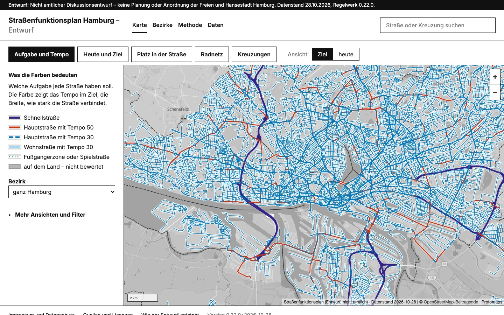 | 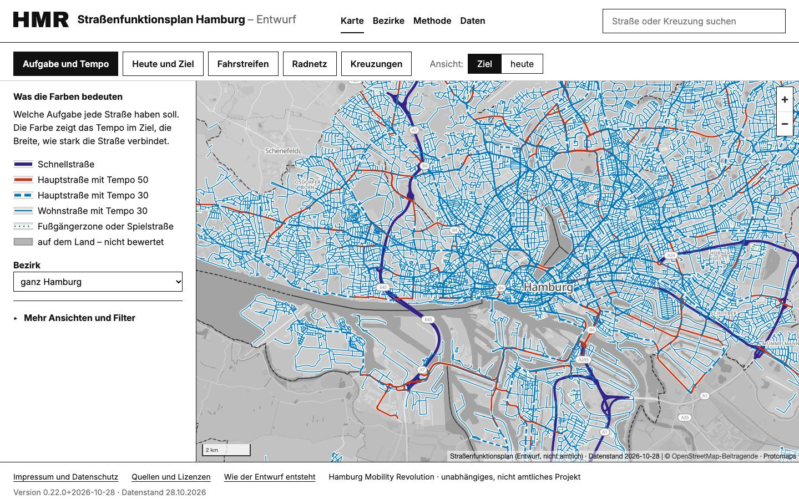 |
| 13 | 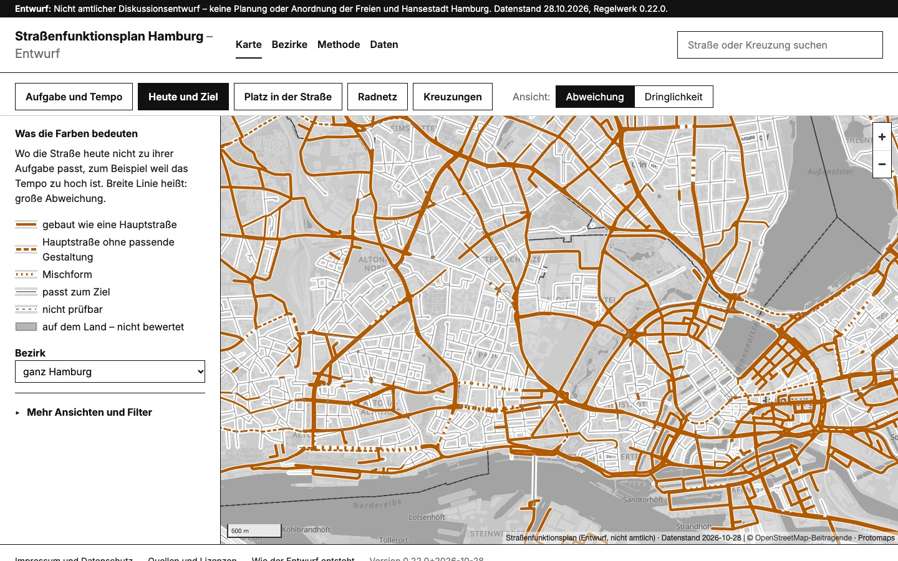 |  |
| 15 | 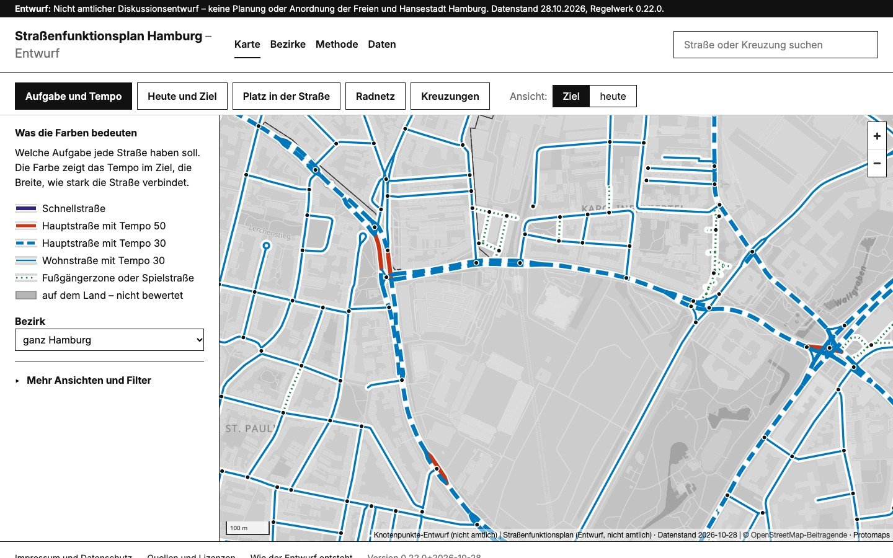 | 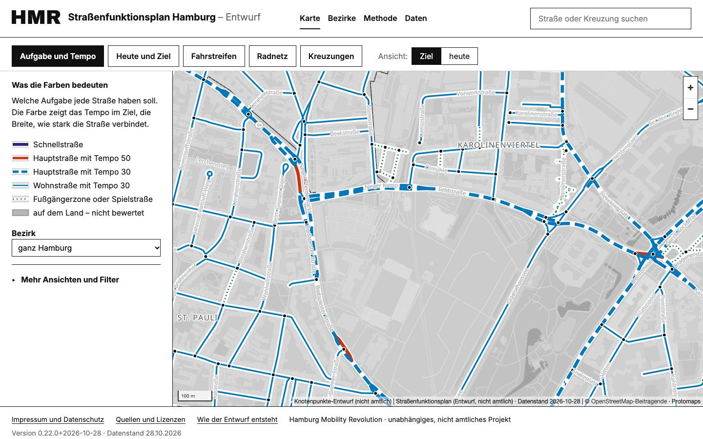 |

Alle Karten, Desktop und Mobil, Zoom 11/13/15 (vorher, nachher, Varianten): lokal in `docs/cleanup/2026-11/img/alle/`
(nicht in Git, 120 Bilder), neu erzeugen mit `node web/scripts/screenshots.mjs <Ordner> <Präfix> [Adresse] [Auswahl]`.

### 7. Logo
- Quelle: `assets/brand/C6B1….JPG`, kopiert als `assets/brand/hmr-logo-source.jpg` (Original unverändert; beide nicht
  in Git, siehe `.gitignore`).
- `web/scripts/brand_assets.py` (Pillow): auf die Buchstaben getrimmt (Rahmen 752 × 212 px), JPEG-Rauschen entfernt,
  Farbe auf Tinte #111111, freigestellt mit Transparenz (ohne Artefakte geprüft: Rand des gepolsterten Logos Alpha 0).
  Schutzraum 25 % der Buchstabenhöhe.
- Dateien in `web/src/brand/`: Kopf `hmr-header.png` / `@2x` (Buchstabenhöhe 28 px = Zeilenhöhe des Titels), Logo
  mit Schutzraum `hmr-logo.png` / `@2x`, Favicons 16/32, Apple Touch Icon 180, Open-Graph-Bild 1200 × 630
  (`dist/og-image.png`, fester Pfad).
- Platzierung: links an Spalte 1, Abstand 16 px (`--s3`) zum Titel, kein Schatten, kein Rahmen. Logo und Titel sind
  *ein* Link auf die Karte. Mobil heißt der Titel „Straßenfunktionsplan – Entwurf“.
- Kopfraster: Titel 5 Spalten, Navigation 4, Suche 3 (bisher 3/6/3), damit Logo und Titel in eine Zeile passen.

### 8. Name „Hamburg Mobility Revolution“
In beiden Varianten: `<title>` („… · Hamburg Mobility Revolution“), `meta description`, `og:site_name`, Fußzeile.
Variante A zusätzlich im Kopf. Nur vorhandene Tokens (Farbe `--muted`, Größe 14/20 px), keine neue Farbe.

## Ausgeblendete Ansichten und wie man sie wieder einschaltet

Datei `web/src/state.js`, Objekt `THEMES`. Zum Wiedereinschalten bei der Ansicht `enabled: false` löschen.

| Karte | Ansicht | Zeile in `THEMES` |
| --- | --- | --- |
| Radnetz | Radweg | `radweg: { label: "Radweg", layer: "cfac", enabled: false },` |
| Radnetz | Lücken | `luecken: { label: "Lücken", layer: "cgap", enabled: false },` |
| Fahrstreifen | Passt das Ziel? | `ziel: { label: "Passt das Ziel?", layer: "cfit", enabled: false },` |
| Fahrstreifen | Breite der Straße (Ebene 3) | `breite: { …, layer: "width", level: 3, enabled: false },` |
| Fahrstreifen | Regelprofil (Ebene 3) | `regelprofil: { …, layer: "feas", level: 3, enabled: false },` |

Wer „Passt das Ziel?“ wieder einschaltet, sollte auch den Kartentitel `platz.title` zurück auf „Platz in der Straße“
setzen. Ausgeblendete Ansichten laden keine Daten (`cycle_mesh_gaps.geojson` nur bei „Lücken“); geteilte Links auf
sie öffnen die Standardansicht der Karte (Tests in `web/test/state.test.js` und `web/e2e/site.spec.js`).

## Prüfung

- Unit-Tests: `make test` grün (Python 1775 bestanden, 2 xfail; Web 129 bestanden, davon neu `web/test/cleanup.test.js`
  und die Weiterleitungstests in `state.test.js`).
- Playwright-Smoke- und axe-Tests: 62 von 62 bestanden (Desktop und Mobil), neue Tests für „kein Band“, „keine
  News-Seite“ und Weiterleitung ausgeblendeter Ansichten.
- Build ohne Warnungen.
- Link- und Barrierefreiheitsprüfung (Agent `link-und-a11y-check`): axe-core 4.13 (WCAG 2.2 A/AA), 28 Seitenprüfungen
  Desktop und Mobil: 0 Befunde (kritisch, ernst, mittel, gering); Bericht `reports/web_accessibility.md`. Keine toten
  Links auf 10 Seiten (alle Downloads HTTP 200), keine Konsolenfehler, Favicons und `og-image.png` erreichbar.
  Kontraste: Logo #111111 18,9:1; Abweichung #B35900 4,8:1; „passt“-Grau #8a8a8a 3,5:1 (nur Linie, Grafik ≥ 3:1
  erfüllt); Fußzeile und Name im Kopf #6b6b6b 5,3:1.
- Unabhängige Prüfung (Agent `review`, Sonnet): alle Punkte 1–8 umgesetzt, kein blockierender Fehler. Behoben nach
  der Prüfung: Analyse-Skripte, die noch auf Band, `#methode/neu` oder `method.news` zugriffen
  (`heuristics.mjs`, `p3_method.mjs`, `p3_readability.py`, `readability.py`, `screenshots.mjs`); Verweis auf
  „Passt das Ziel?“ im Text der ausgeblendeten Ansicht „Regelprofil“; Absicherung, dass jede Karte eine aktive Ansicht
  behält (mit Test); Stärkeklassen in Variante b nur bei vorhandener Stärke; breitere weiße Unterlage unter den
  breiten Abweichungslinien. Bewusst so gelassen: `og:image` zeigt auf die Live-Adresse (in der Vorschau erst nach dem
  Deployment erreichbar); die Vorschau-Schalter `?kopf=`/`?legende=` haben keine eigenen Tests, weil sie nach der Wahl
  entfallen.

## Wer hat was gemacht

| Agent | Modell | Aufgabe |
| --- | --- | --- |
| Hauptsitzung | Opus 5.5 | Plan, Zuordnung der Namen, Code, Legendentexte und Varianten, Layout und Kartenstil, Tests, Leitlinien, Bericht |
| `fundstellen-suche` | Haiku | Fundstellen zu Band, Changelog, Kopf, Tokens, Playwright (die Karten-/Ansichtssuche lief als zweite Lese-Suche mit dem Hauptmodell) |
| `screenshot-runner` | Haiku | vorher (54), nachher (54), Varianten (24) |
| `asset-processor` | Haiku | `brand_assets.py`: Zuschnitt, Freistellung, Favicons, Open-Graph-Bild |
| `link-und-a11y-check` | Haiku | axe-Bericht, Linkprüfung, Kontraste |
| `review` | Sonnet | unabhängige Prüfung des Diffs gegen die Liste 1–8 und die Fundstellen |

Die Agenten sind in `.claude/agents/` angelegt (lokal, `.claude/` ist über `.git/info/exclude` nicht in Git). Diese
Sitzung konnte sie noch nicht als eigene Typen laden; sie liefen deshalb als Unteragenten mit dem jeweiligen Modell.

## Nächste Schritte (nach OK)
1. ~~Varianten wählen, nicht gewählte entfernen~~ (erledigt: a, B, Rasterlogo).
2. ~~Merge in `redesign/2026-11`~~ (erledigt, lokal). Offen: `redesign/2026-11` nach `main` und Deployment.
3. Kurzer Check der Live-Seite (Screenshots).
