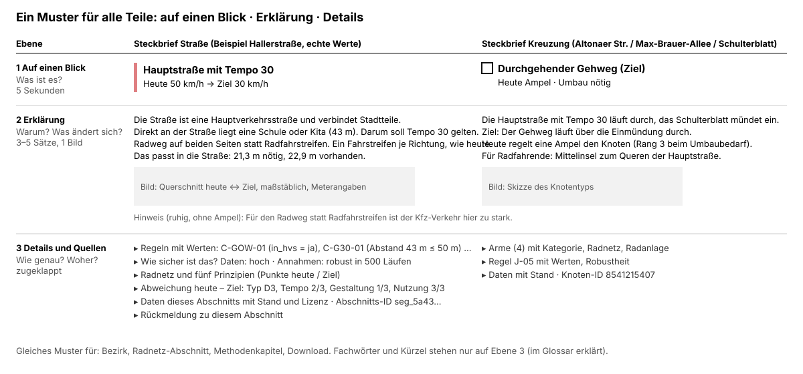
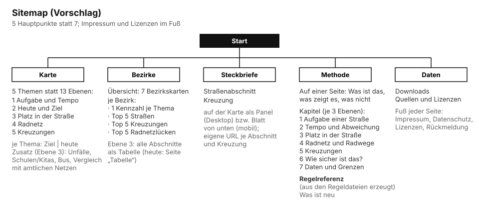
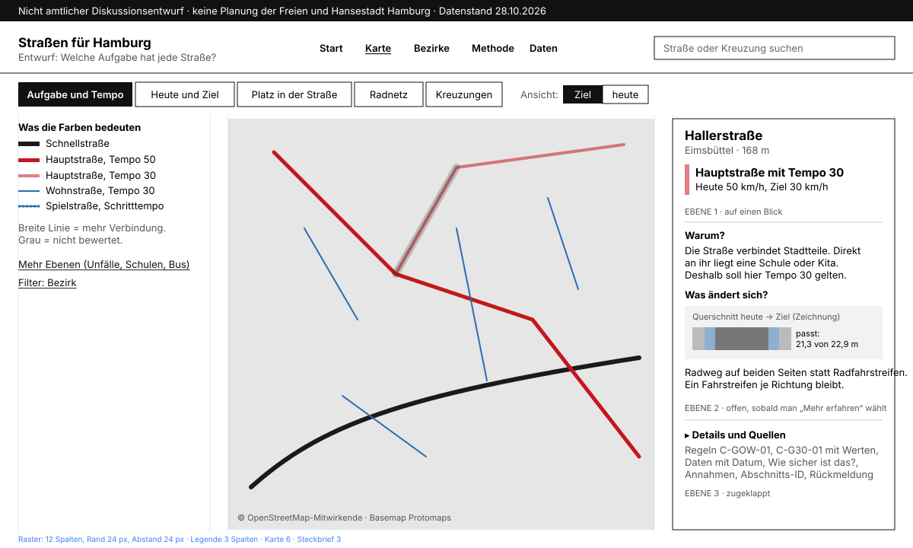
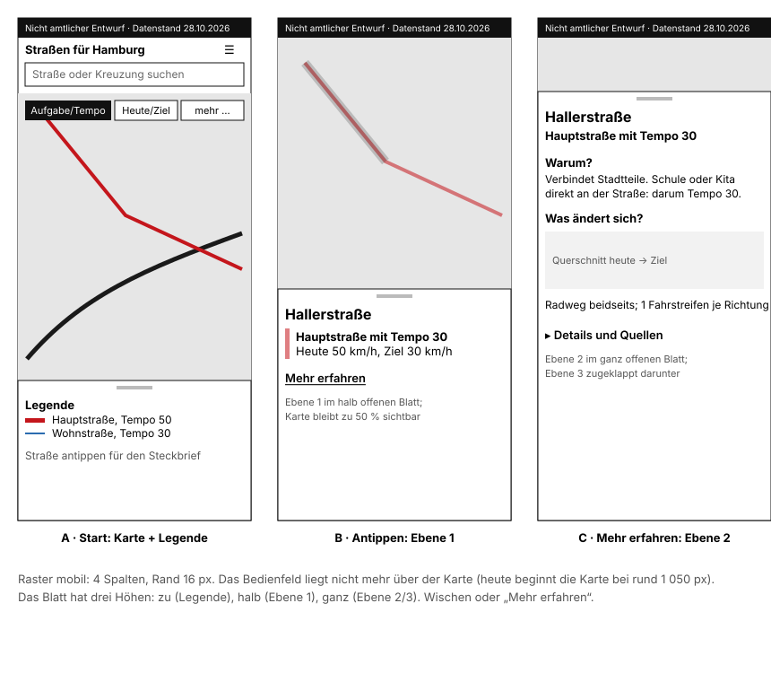

# Redesign 2026-11 · A2 Informationsarchitektur: erst der Überblick, dann Details auf Wunsch

Grundlage: Befunde aus `01_inventory.md`. Dieses Dokument ist ein Vorschlag. Was davon umgesetzt wird, entscheidet
`decisions.md` (Zeilen E2 bis E4).

## Das Muster: drei Ebenen überall

| Ebene | Frage | Form | Regel |
|---|---|---|---|
| 1 Auf einen Blick | Was ist es? | ein Satz, eine Bezeichnung mit Farbe, höchstens eine Kennzahl | in 5 Sekunden lesbar; keine Kürzel, keine IDs |
| 2 Erklärung | Warum? Was ändert sich? | 3–5 kurze Sätze, ein kleines Bild (Querschnitt heute ↔ Ziel, Minikarte, Balken) | Einfache Sprache (A4); Fachbegriffe nur mit Erklärung |
| 3 Details und Quellen | Wie genau? Woher? | Regeln mit Werten, Daten mit Stand, Unsicherheit, Annahmen, Links zu Regelwerk und Downloads | Fachsprache erlaubt, Kürzel mit Glossar-Link |

Bedienung, gleich für alle Teile:

- **Ebene 1** ist immer sichtbar.
- **Ebene 2** öffnet sich mit „Mehr erfahren“. Am Desktop ist sie im Steckbrief schon offen, wenn der Platz reicht.
- **Ebene 3** steht unter „Details und Quellen“ (`
`) und ist immer zugeklappt.
- Der Zustand steht in der URL. So zeigt ein geteilter Link dieselbe Ebene.

## Sitemap

Die Seite hat heute 7 gleichrangige Menüpunkte. Vorgeschlagen sind 5: **Start, Karte, Bezirke, Methode, Daten**.
Impressum, Datenschutz und Lizenzen stehen im Fuß jeder Seite. Die Seite „Tabelle“ wird Ebene 3 der Bezirksseite. Die
Seite „Radnetz“ wird Kapitel 4 der Methode. Steckbriefe bleiben Panels der Karte, bekommen aber je eine eigene URL wie
heute (`seg=`, `jct=`).

**Start (neu).** Am Smartphone landet man heute direkt auf einer Karte unter einem Bedienfeld von 1 180 px. Die neue
Startseite hat:

- Ebene 1: einen Satz, was das ist („Ein Vorschlag, welche Aufgabe jede Straße in Hamburg hat – und was sich dafür
  ändern müsste“), den Hinweis auf den Entwurfsstatus (seit prompts/25 als Titelzusatz und in der Fußzeile, kein Band) und eine Suche nach Straße oder Kreuzung.
- Drei Einstiege: „Meine Straße“ (Suche), „Mein Bezirk“ (Bezirkskarten), „Radnetz“ (Karte, Thema Radnetz).
- Ebene 2: „Was ist das, was zeigt es, was nicht“ (dieselben drei Absätze wie die Methoden-Zusammenfassung, eine Quelle).

## Was wohin wandert

### Karte

| heute | neu |
|---|---|
| 13 Ebenen als Radioknöpfe in zwei Gruppen | **5 Themen** als Umschalter über der Karte, je Thema eine Ansicht „Ziel“ und eine Ansicht „heute“ (Tabelle unten) |
| Erklärsatz und Legende unter allen Radioknöpfen (Desktop ab rund 700 px, mobil nie im ersten Bildschirm) | Legende in Worten **neben der Karte** (Desktop: linke Spalte, mobil: Blatt von unten, zugeklappt sichtbar) |
| 4 Zusatzebenen als Kästchen (Bus, Radnetz Hamburg, Schulen/Kitas, Unfälle) | Ebene 3 „Mehr Ebenen“; das amtliche Radnetz wird eine Vergleichsansicht im Thema Radnetz |
| Filter: Bezirk, Soll-Kategorie, Diskrepanztyp, Priorität mindestens | Bezirk bleibt sichtbar (auch als Einstieg über Bezirke). Kategorie, Diskrepanztyp und Priorität kommen in Ebene 3 „Filter“ |
| Suche nur nach Straßen, öffnet keinen Steckbrief | Suche nach Straße **und Kreuzung**; bei einem Abschnitt öffnet sich Ebene 1 des Steckbriefs, bei mehreren die längste oder eine Auswahl |
| Knoten nur in der Ebene „Knotenpunkte“ anklickbar | Kreuzungen in jedem Thema ab Zoom 14 als kleine Punkte antippbar (heute ab Zoom 12 nur in einer Ebene) |

**Themen und ihre Ansichten** (aus 13 Ebenen werden 5 Themen mit je 2–3 Ansichten. Kein Inhalt fällt weg, aber nur
noch 5 Entscheidungen beim Einstieg):

| Thema (Ebene 1) | Ansicht „Ziel“ (Standard) | Ansicht „heute“ / weitere | aus den heutigen Ebenen |
|---|---|---|---|
| **Aufgabe und Tempo** | Soll-Kategorie | heute: Ist-Tempo; Vergleich (Ebene 3): Hauptverkehrsstraßen der BVM | cat, speed, hvs |
| **Heute und Ziel** | Abweichung heute – Ziel (Stärke als Linienbreite) | Priorität (Abweichung × Risiko) | disc |
| **Fahrstreifen** (früher „Platz in der Straße“) | Fahrstreifen heute ↔ Ziel | – (seit prompts/25 per `enabled: false` ausgeblendet: „Passt das Ziel?“, Breite, Regelprofil) | lanes (cfit, width, feas ausgeblendet) |
| **Radnetz** | Radnetz Ziel (4 Stufen) | amtliches Radnetz (Vergleich); „Radweg“ und „Lücken“ seit prompts/25 vorläufig ausgeblendet | cnet, coff (cfac, cgap ausgeblendet) |
| **Kreuzungen** | Kreuzungstyp Ziel, Umbau nötig hervorgehoben | heute (OpenStreetMap) | jct |

\* Heute gibt es zwei Machbarkeitsaussagen: „Machbarkeit“ (feas, Regelprofil der Kategorie) und „Querschnitt passt?“
(cfit, vollständiger Soll-Querschnitt mit Radanlage, Bäumen, Parken). Beide stehen auch im Steckbrief (Aufgabe t2).
Vorschlag: Sichtbar bleibt nur cfit, feas wandert auf Ebene 3 der Methode. Das ist Entscheidung E3b.

**Netzlücken im Radnetz:** Heute zeigt sie keine Ebene. Die Maschen mit Lücke (`cycle_mesh_gaps.parquet`) liegen aber
vor. Vorschlag: Die Ansicht „Lücken“ im Thema Radnetz zeigt zu große Maschen als schraffierte Fläche und fehlende oder
falsche Radwege als Linie. Dafür ist ein neuer Export der Kacheln nötig (Teil B, Paket 2).

### Steckbrief Straßenabschnitt

| heute (Abschnitte, Wörter bei GOW30) | neu |
|---|---|
| Titel, Bezirk, Länge, **segment_id** | Ebene 1: Name, Bezirk, Länge; die ID kommt auf Ebene 3 |
| Soll-Kategorie (19): „Stadtstraße 30 (GOW30)“ und Klartext | Ebene 1: Bezeichnung mit Farbe ohne Kürzel, dazu eine Kennzahl, die das Thema trägt (z. B. „Heute 50 km/h → Ziel 30 km/h“) |
| Begründung (31) mit Regel-IDs | Ebene 2 „Warum?“: dieselben Bausteine ohne IDs, als Sätze; IDs und Werte auf Ebene 3 |
| Datenunsicherheit (16), Robustheit der Einstufung (11), Robustheit Radverkehr (21) | **ein** Abschnitt „Wie sicher ist das?“ auf Ebene 3; in Ebene 2 nur dann ein ruhiger Satz, wenn der Abschnitt unsicher ist (siehe unten) |
| Ist-Zustand (21) | Ebene 2 „Was ändert sich?“ (heute → Ziel als Paare: Tempo, Radweg, Fahrstreifen, Parken) |
| Querschnitt (24), Radverkehr und Soll-Querschnitt (75), Soll-Querschnitt (40) | Ebene 2: **ein** Bild Querschnitt heute ↔ Ziel mit **einer** Aussage „passt / passt nicht (nötig x m, vorhanden y m)“; Radnetzstufe, Breiten und fünf Prinzipien auf Ebene 3 |
| Diskrepanz und Priorität (53) | Ebene 2: ein Satz („Heute passt das Tempo nicht zum Ziel“), Ebene 3: Typ, Stärken, Unfälle, Priorität |
| Hinweise (68) | Ebene 2 nur die Hinweise, die eine Maßnahme nennen (z. B. „Verkehrsmenge senken“); alle anderen auf Ebene 3 |
| Datenquellen (160, bei allen Abschnitten gleich) | Ebene 3: nur die Quellen, die in diesem Abschnitt einen Wert geliefert haben, mit Stand; die allgemeine Liste auf der Seite „Daten“ |
| Rückmeldung (13) | Ebene 3, dazu ein kleiner Link „Stimmt etwas nicht?“ am Ende von Ebene 2 |

Ziel: Ebene 1 hat höchstens 25 Wörter, Ebene 1 und 2 zusammen höchstens 120 (heute 380–560 Wörter auf einer Ebene).

### Steckbrief Kreuzung

Ebene 1 enthält:

- den Typ des Ziels mit Symbol (Form und Farbe wie auf der Karte)
- „heute: Ampel“ bzw. den Ist-Typ
- „Umbau nötig ja/nein“

Ebene 2 hat 3–4 Sätze:

- Welche Straßen treffen sich?
- Was ist das Ziel?
- Was ist heute?
- Was ändert sich für Radfahrende (JC-Text in Klartext)?

Dazu kommt eine Skizze des Knotentyps (8 Typen, je eine SVG-Zeichnung). Auf Ebene 3 stehen die Arme, die Regel mit
Werten, Zufluss und Platz, die Robustheit, die Daten und die Knoten-ID.

### Bezirk (neu, ersetzt die Seite „Tabelle“ als Einstieg)

Ebene 1 ist eine Karte je Bezirk mit Name und einer Kennzahl je Thema, z. B. „x km Straßen mit großer Abweichung“, „y
Kreuzungen mit Umbaubedarf“, „z km Radnetz ohne passenden Radweg“. Ebene 2 hat drei Listen mit je den 5 wichtigsten
Einträgen:

- Straßen nach Priorität
- Kreuzungen nach `priority_rank`
- Radnetzlücken nach Länge × Radnachfrage

Jeder Eintrag ist ein Satz ohne Kürzel und verlinkt den Steckbrief. Ebene 3 ist die bisherige Tabelle mit allen
Abschnitten, Spalten in Klartext (Kürzel als Tooltip) und CSV-Download. Heute fehlen dort Radverkehr und Knoten
(Aufgabe t3). Das heißt: Die Antwort auf „Wo ist der Handlungsbedarf am größten?“ steht auf Ebene 2 der Bezirksseite
und nicht mehr in einer Kürzeltabelle.

### Methode

| Teil | Ebene 1 | Ebene 2 | Ebene 3 |
|---|---|---|---|
| **Zusammenfassung** (eine Seite) | „Was ist das?“ (2 Sätze) · „Was zeigt es?“ (3 Punkte) · „Was zeigt es nicht?“ (3 Punkte: keine Planung der Stadt, keine Messung vor Ort, keine Verkehrsprognose) | je Punkt ein Absatz | Links in die Kapitel |
| Kapitel 1 Aufgabe einer Straße | ein Satz je Kategorie mit Farbe | Kaskade als Schritte in Sätzen | Regelreferenz C-*, H-STR-01 |
| Kapitel 2 Tempo und Abweichung | „Wo heute schneller gefahren werden darf als im Ziel“ | Typen der Abweichung in Klartext | D-*, P-RISK-01 |
| Kapitel 3 Platz in der Straße | „Passt der Ziel-Querschnitt in die Straße?“ | Bausteine und Reihenfolge des Rückbaus (D1–D7 als Sätze) | L-*, PRF-*, PL-* |
| Kapitel 4 Radnetz und Radwege | vier Netzstufen | fünf Prinzipien, Trennung nach Tempo und Menge | C-NET-*, S-*, C-FAC-*, P-* |
| Kapitel 5 Kreuzungen | acht Knotentypen mit Skizze | Entscheidungstabelle als Sätze | J-*, JC-* |
| Kapitel 6 Wie sicher ist das? | ein Satz (siehe unten) | Daten und Annahmen getrennt erklärt | C-CONF-01, V-SENS-*, Annahmen-Liste |
| Kapitel 7 Daten und Grenzen | „Woher die Daten kommen“ | Grenzen je Datenquelle | sources.yaml, Lizenzen |
| **Regelreferenz** | `label_plain` je Regel | `explain_plain`, `why` | technische Felder, Schwellen mit Quelle, source_type, status, Tests, Häufigkeit im Lauf (aus `01_rules_inventory.csv`) |
| ~~Was ist neu~~ | entfallen (prompts/25): keine Changelog-Seite auf der Webseite; `CHANGELOG.md` bleibt im Repository, Version und Datenstand stehen in der Fußzeile | | |

Die Regelreferenz wird beim Export aus den Regeldateien erzeugt (`label_plain`, `explain_plain`, `why`, siehe A5). Der
Kaskadentext der Methode kommt aus derselben Quelle. Heute ist er in `web/src/pages.js` von Hand nachgeschrieben.

## Unsicherheit ehrlich, aber ruhig zeigen

Heute hat der Steckbrief eine Ampel „Datenunsicherheit“ mit grün, gelb und rot. Dazu kommen zwei getrennte Abschnitte
„Robustheit“. Messung im aktuellen Lauf (Abschnitte mit Kategorie, Länge):

| Daten (confidence) | robust | unsicher (V-UNC-01) |
|---|---:|---:|
| hoch | 855 km | 10 km |
| mittel | 3 213 km | 5 km |
| niedrig | 75 km | 230 km |

„mittel“ ist der Normalfall (73 % der Länge). Grund ist meist ein Wert, der stadtweit gleich ersetzt wird: Gewichte im
Verbindungswert werden umgelegt, weil die Verkehrsmenge nur auf Hauptstraßen vorliegt. Eine gelbe Ampel auf drei
Vierteln der Karte warnt, ohne etwas zu sagen.

Vorschlag:

1. **Ein** Merkmal „Wie sicher ist das?“ mit drei Stufen, berechnet aus beiden Größen:
   - **unsicher**, wenn confidence niedrig ist oder V-UNC-01 zutrifft: 7,3 % der Länge (3 116 Abschnitte)
   - **eher sicher**, wenn confidence mittel ist: 73,2 %
   - **sicher**, sonst: 19,5 %
   Diese Zusammenfassung ändert keine Regel. Sie ist eine Darstellung auf Ebene 2 und 3.
2. **Ebene 1** zeigt nichts davon. **Ebene 2** zeigt nur bei „unsicher“ einen Satz in normaler Schrift, ohne Farbe:
   „Diese Einstufung ist unsicher: Ein entscheidender Wert fehlt oder liegt nahe an einer Grenze. Bitte prüfen.“ Bei
   „eher sicher“ und „sicher“ steht nichts.
3. **Ebene 3** zeigt beide Größen getrennt: Daten (welcher Wert fehlt oder ist ersetzt) und Annahmen (in wie vielen von
   500 Läufen wechselt die Kategorie). Dazu kommt der Link zu den Annahmen in der Regelreferenz.
4. **Karte:** eine Ansicht „unsicher“ (gestrichelte Überlagerung) in Ebene 3 „Mehr Ebenen“, nicht standardmäßig.
5. **Annahmen** heißen überall „Annahme“ (statt `assumption`) und verlinken die Regelreferenz. Die Zusammenfassung der
   Methode sagt einmal, wie viele Werte Annahmen sind (aus `source_type`).
6. **Entwurfsstatus:** ~~Der Hinweis bleibt dauerhaft sichtbar als Zeile.~~ Seit prompts/25_cleanup_logo.md kein
   Kopfband mehr: Titelzusatz „– Entwurf“, Zeile in der Fußzeile, Hinweis in Methode und Impressum.

## Wireframes

Karte am Desktop mit Steckbrief (Ebene 1 und 2 offen, Ebene 3 zu). Das Raster hat 12 Spalten: Legende 3, Karte 6,
Steckbrief 3.

Karte am Smartphone mit Blatt von unten in drei Höhen:

## Alte Links bleiben gültig

Geteilte Links verwenden heute `#<seite>?layer=…&ov=…&cat=…&dt=…&pr=…&bz=…&seg=…&jct=…&map=z/lat/lon`
(`web/src/state.js`). Neue Parameter: `theme`, `view`, `level`. Alte Parameter werden beim Laden umgeschrieben
(`replaceState`, keine Weiterleitung über einen Server):

| alt | neu |
|---|---|
| `#karte?layer=cat` | `#karte?theme=aufgabe` |
| `layer=speed` | `theme=aufgabe&view=heute` |
| `layer=hvs` | `theme=aufgabe&view=hvs` |
| `layer=disc` | `theme=abweichung` |
| `layer=width` | `theme=platz&view=breite` |
| `layer=feas` | `theme=platz&view=regelprofil` (Ebene 3) |
| `layer=cfit` | `theme=platz` |
| `layer=lanes` | `theme=platz&view=fahrstreifen` |
| `layer=cnet` | `theme=rad` |
| `layer=cfac` | `theme=rad&view=radweg` |
| `layer=cgap` | `theme=rad&view=luecken` |
| `layer=coff` | `theme=rad&view=amtlich` |
| `layer=jct` | `theme=knoten` |
| `ov=bus,cyc,fac,acc` | unverändert (`ov=cyc` → `theme=rad&view=amtlich`, wenn kein Thema gesetzt ist) |
| `cat`, `dt`, `pr`, `bz`, `seg`, `jct`, `map` | unverändert |
| `#tabelle` | `#bezirke` (mit `bz` → `#bezirke/<Bezirk>`, Tabelle offen) |
| `#radnetz` | `#methode/radnetz` |
| `#downloads`, `#quellen` | `#daten` (Anker `#daten/downloads`, `#daten/quellen`) |
| `#impressum` | unverändert |

Ein Test in `web/test/` prüft jede Zeile dieser Tabelle (Teil B, Paket 2).

## Was dafür nötig ist (Aufwand in Teil B)

- **Paket 1:** Design-System und Layout (A3).
- **Paket 2:** Themen statt Ebenen, Steckbrief in drei Ebenen, Bezirksseite, Startseite, Weiterleitungstabelle. Neu im
  Export (`s09_export.py`) sind Bezirkskennzahlen und Top-5-Listen, die Lücken-Kacheln und das Merkmal „Wie sicher ist
  das?“. Neue Daten aus der Pipeline braucht es nicht, alle Werte liegen in `data/interim` vor.
- **Paket 3:** Methode als Zusammenfassung mit Kapiteln, Regelreferenz aus den Regeldateien (setzt A5 voraus).

Die Schätzung je Paket steht in `proposals.md`.
