# Redesign 2026-11 · A3 Design-System nach Schweizer Typografie

Vorschlag. Die Tokens stehen in [`tokens.json`](tokens.json), die Prototypen in `prototypes/redesign/`. Gestartet wird
mit `cd web && npx vite --config ../prototypes/vite.config.mjs`, dann `http://localhost:5180/redesign/` öffnen. Was
übernommen wird, entscheidet `decisions.md` (E1, E5).

## Grundsätze und was sie hier bedeuten

| Grundsatz (International Typographic Style) | Umsetzung |
|---|---|
| Modulares Raster | 12 Spalten am Desktop (ab 1 200 px), 8 am Tablet, 4 am Smartphone. Rand 24/24/16 px, Abstand 24/16/16 px, Grundlinie 4 px. Kartenseite: Legende 3, Karte 6, Steckbrief 3 Spalten (ohne Steckbrief Karte 9). |
| Eine Grotesk, wenige Größen | Inter (variabel, selbst gehostet, SIL OFL 1.1). Fünf Größen: 14, 16, 20, 28 und 40 px. Hierarchie nur über Größe und Gewicht (400/600/700), keine Versalien und keine Farbe als Auszeichnung. |
| Linksbündig, Flattersatz | kein Blocksatz, keine Silbentrennung im Fließtext, Zeilen höchstens 68 Zeichen |
| Objektivität, Inhalt zuerst | keine Schatten, keine Verläufe, keine Rundungen (Radius 0), Linien 1 px ink. Farbe nur für Daten. Links schwarz und unterstrichen. |
| Weißraum und klare Ausrichtung | Abstände aus der Skala 4/8/16/24/32/48/64 px. Jedes Element sitzt an einer Rasterlinie. |
| Zurückhaltende Bewegung | nur das Blatt am Smartphone (150 ms). Bei `prefers-reduced-motion` gibt es keine Bewegung, auch kein Fliegen der Karte. |

## Typografie

- **Schrift:** Inter 4.1 von Rasmus Andersson und The Inter Project Authors. Lizenz ist die SIL Open Font License 1.1.
  Sie erlaubt Einbetten und Selbsthosten, verlangt aber die Lizenzdatei neben der Schrift und verbietet den Verkauf der
  Schrift allein.
  - Quelle: offizielles Release <https://github.com/rsms/inter/releases/tag/v4.1>, Archiv `Inter-4.1.zip`, SHA-256
    `9883fdd4…6b11e`.
  - Abgelegt sind `prototypes/redesign/fonts/InterVariable.woff2` (352 KB) und `OFL-Inter.txt`.
  - Für Teil B empfohlen: auf Latin plus Zeichen wie `→ · ≤ ≥ –` reduzieren (pyftsubset), Ziel unter 120 KB.
  - Kein externer Schriftdienst (Prüfung im Prototyp: keine Anfragen außer an `localhost`).
- **Tabellenziffern:** `font-variant-numeric: tabular-nums` in Tabellen, Kennzahlen und Maßen, damit Zahlen untereinander
  stehen.
- **Kartenbeschriftung:** Die Grundkarte nutzt weiter die selbst gehosteten Noto-Sans-Glyphen (`data/out/basemap/fonts`,
  OFL). Strenger wären Inter-Glyphen als PBF für MapLibre (z. B. mit `font-maker`). Das ist ein Zusatzschritt für
  Paket 1 und wäre dann eine Schriftfamilie für alles.

| Token | Größe / Zeile | Gewicht | Verwendung |
|---|---|---|---|
| small | 14 / 20 | 400 | Quellen, Fußzeile, Bildlegenden, Ebene 3 |
| body | 16 / 24 | 400 | Fließtext, Legende, Bedienung |
| lead | 20 / 28 | 600 | Satz auf Ebene 1, Zwischenüberschriften |
| title | 28 / 36 | 700 | Seitentitel, Name im Steckbrief |
| display | 40 / 48 | 700 | nur Startseite und Kennzahlen |

## Farbe: eine Bedeutung je Farbe

**Befund heute** (`web/src/palette.js`, gezählt in `data/scenarios/redesign/palette_meanings.json`): Acht Farben werden
in 13 Ebenen mit je anderer Bedeutung verwendet.

| Farbe | Bedeutungen heute | Beispiele |
|---|---:|---|
| `#CC3311` rot | 10 | GOW50, 50 km/h, D1, passt nicht, schmal, Radroute HAUPT, Radanlage fehlt, mehr Fahrstreifen, Ampel |
| `#0077BB` blau | 10 | ETW30, 30 km/h, D2, breit, BASIS, Radfahrstreifen, teilweise, gleiche Fahrstreifen, Kreisverkehr |
| `#117733` grün | 10 | ETW_ERF, bis 20 km/h, passt, baulicher Radweg, keine Lücke, weniger Fahrstreifen, Gehwegüberfahrt |
| `#AA4499` magenta | 8 | GOW30, 40 km/h, D3, mittel breit, Fahrradstraße, zu schmal, Vorfahrt |
| `#332288` indigo | 6 | SW, über 50 km/h, RSV, eigener Weg, rechts vor links |

Rot heißt also in einer Ebene „Hauptstraße“ und in der nächsten „passt nicht“. Grün heißt einmal „Spielstraße“ und
einmal „passt“.

**Vorschlag:** Jede Datenfarbe trägt genau ein Konzept auf der ganzen Seite. Hierarchie zeigt die Linienbreite, die Art
zeigt die Strichart oder Form.

| Konzept | Farbe(n) | Zweites Merkmal | Wo |
|---|---|---|---|
| **Tempo** (heute und Ziel, gleiche Skala) | grün ≤ 20, blau 30, magenta 40, rot 50, indigo > 50 km/h, grau unbekannt | Breite und Strich je Tempo | Aufgabe und Tempo (Ziel und heute), Steckbrief (Farbbalken Ebene 1) |
| **Aufgabe der Straße** | keine eigene Farbe: Die Kategorie wird in der Farbe ihres Ziel-Tempos gezeichnet | **Breite** = wie stark die Straße verbindet (SW 7, GOW 5, ETW 2,5 px), Strich: GOW30 gestrichelt, Fußgängerzone gepunktet | Thema Aufgabe und Tempo |
| **Handlungsbedarf** | ein Orange `#B35900` | stark = breit und durchgezogen, teilweise = gestrichelt; ohne Bedarf grau und dünn (nicht grün) | Abweichung, Dringlichkeit, Passt das Ziel, Fahrstreifen, Radweg-Lücken, Umbau an Kreuzungen |
| **Radverkehr** | ein Petrol `#007A6E` | Breite = Netzstufe, Strich = Art | Radnetz |
| **Kreuzungstyp** | schwarz, bei Umbau orange | Form = Typ (Kreis, Quadrat, Dreieck, Raute, Ring, Balken) | Kreuzungen |
| **unbekannt / nicht prüfbar** | grau `#767676` | gepunktet | überall |
| **Bedienung und Text** | nur Schwarz, Grautöne, Weiß; Fokus gelb `#ffbf47` mit schwarzem Rand | – | überall |

Ein Vorteil des Tempo-Konzepts: „heute“ und „Ziel“ haben dieselben Farben. Wer zwischen den Ansichten umschaltet, sieht
direkt, wo aus Rot (50) Blau (30) wird. Heute hat GOW30 Magenta, und Magenta heißt in der Tempo-Ebene 40 km/h.

**Kontrast** (`analysis/redesign/tokens_check.py`, WCAG 2.2): Alle Prüfungen sind bestanden. Ausschnitt:

| Paar | Kontrast | nötig |
|---|---:|---:|
| Text ink auf weiß | 18,9 | 4,5 |
| Text muted `#6b6b6b` auf weiß / auf surface `#f2f2f2` | 5,3 / 4,8 | 4,5 |
| Datenfarben gegen die weiße Umrandung (schwächste: grau „kein Bedarf“ `#8a8a8a`) | 3,45 | 3,0 |
| Handlungsbedarf `#B35900` gegen weiß | 4,8 | 3,0 |
| Petrol `#007A6E` gegen weiß | 5,2 | 3,0 |

**Farbsehschwäche** (`analysis/redesign/ui/cvd.mjs`): kleinster Farbabstand ΔE76 je Legende, simuliert nach
Machado, Oliveira und Fernandes (2009).

| Legende | normal | Protanopie | Deuteranopie | Tritanopie | zweites Merkmal bei engen Paaren |
|---|---:|---:|---:|---:|---|
| Aufgabe und Tempo (Ziel) | 48,6 | 10,6 (GOW50/ETW_ERF) | 25,5 | 15,0 | ja (Breite, Strich) |
| Tempo heute | 38,9 | 10,6 (≤ 20/50) | 22,2 | 15,0 | ja (neu: Breite, Strich je Tempo) |
| Handlungsbedarf | 7,8 (kein Bedarf/unbekannt) | 7,8 | 7,8 | 7,8 | ja (Strich) |
| Radnetz | 33,8 | 9,8 | 14,2 | 32,6 | ja (Breite) |

Zum Vergleich der heutige Stand aus dem Review: In der Ebene Ist-Tempo haben ≤ 20 und 50 km/h bei Protanopie
ΔE 10,6 bei gleicher Linie. Bei „Machbarkeit“ haben „knapp“ und „passt nicht“ bei Deuteranopie ΔE 0,3.

Simulation mit Chromium, Thema „Aufgabe und Tempo“ in Eimsbüttel:

| normal | Deuteranopie | Protanopie | ohne Farbe |
|---|---|---|---|
|  | 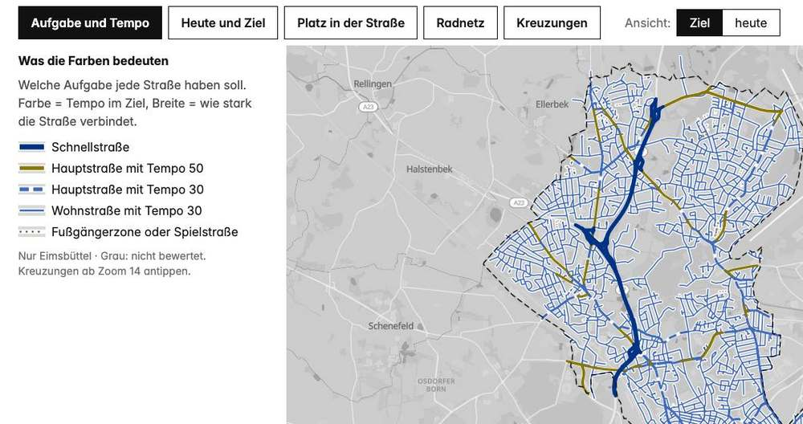 |  | 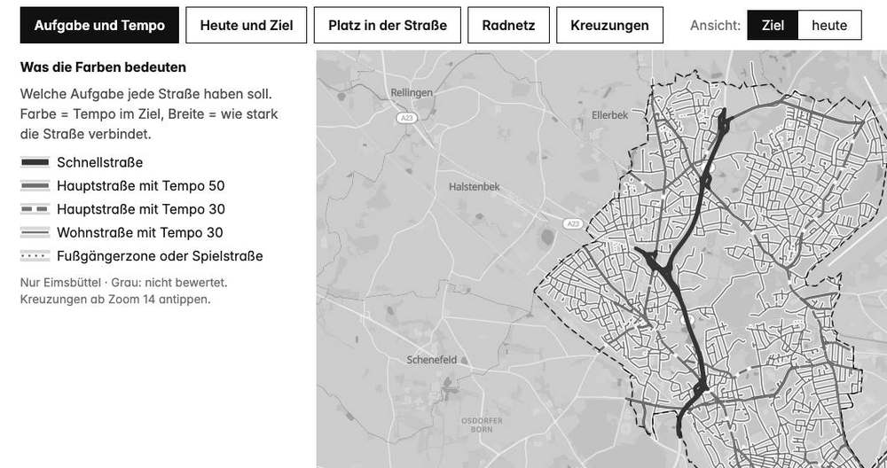 |

## Karte

- **Grundkarte:** Protomaps „grayscale“, ruhig und ohne Farbe. Daten liegen mit weißer Umrandung darüber.
- **Hierarchie:** über die Linienbreite (Zoom 14: 7 / 5 / 2,5 px), wie auf der Seite schon angelegt.
- **Legende in Worten neben der Karte:**
  - Überschrift „Was die Farben bedeuten“, ein Satz zum Thema, Linienprobe mit Klartext (keine Kürzel).
  - Desktop: linke Spalte. Smartphone: unter der Karte, nicht über ihr. Im Prototyp hat eine Legende *über* der Karte
    die Zeichenfläche von MapLibre gestört.
- **Ohne Bedarf heißt grau:** In bewertenden Ansichten fällt nur auf, was zu tun ist.
- **Kreuzungen:** in jedem Thema ab Zoom 14 als kleine Punkte antippbar, im Thema Kreuzungen als Formen.

## Komponenten

Alle Komponenten sind im Prototyp umgesetzt (`prototypes/redesign/shared/tokens.css`, `mapview.js`, `profile.js`).

| Komponente | Regel |
|---|---|
| Hinweis Entwurfsstatus | eine Zeile, schwarz, immer sichtbar, nicht schließbar. Am Smartphone abgeschnitten mit „…“, ganzer Text im Impressum und als `title`. |
| Kopf | Name und Untertitel (3 Spalten), 5 Menüpunkte (5 Spalten), Suche (4 Spalten); aktive Seite 2 px unterstrichen; am Smartphone Menü-Schaltfläche und Suche in voller Breite |
| Themen-Umschalter | 5 Schaltflächen (44 px hoch), gewählt = schwarze Fläche; daneben „Ansicht: Ziel/heute“ als Segment-Schalter mit `aria-pressed`; am Smartphone waagerecht scrollbar |
| Legende | siehe Karte; Region mit `tabindex=0` (axe: scrollbarer Bereich muss per Tastatur erreichbar sein) |
| Steckbrief | Desktop rechte Spalte, Tablet Seitenblatt, Smartphone Blatt von unten (halb = Ebene 1, ganz = Ebene 2/3) |
| Ebene 2/3 | `
`: „Mehr erfahren“, „Details und Quellen“, Pfeil ▸/▾, Trennlinie 1 px |
| Bezirkskarte | Name (title) und drei Kennzahlen (display, Tabellenziffern) mit je einem Satz, Linie 2 px darüber |
| Top-Liste | nummeriert, Name als Link, ein Satz ohne Kürzel |
| Tabelle | Tabellenziffern, Zahlen rechtsbündig, Kopflinie 2 px, Zeilenlinie grau |
| Querschnitt | maßstäbliche SVG aus `web/src/panel.js` (wiederverwendet), darunter **eine** Aussage „Passt: 21,3 m nötig, 22,9 m vorhanden“ |
| Hinweis | ohne Farbfläche: 2 px schwarze Linie links |

## Zwei Varianten

Beide Varianten nutzen dasselbe Raster, dieselben Tokens und denselben Steckbrief, mit echten Daten für Eimsbüttel
(Export 0.21.0, `analysis/redesign/district_data.py`). Sie unterscheiden sich in der Startseite.

### Variante A „Karte zuerst“ (`prototypes/redesign/karte-zuerst/`)

Die Karte ist die Startseite: Themen über der Karte, Legende links, Steckbrief rechts.

| Desktop | Smartphone |
|---|---|
| 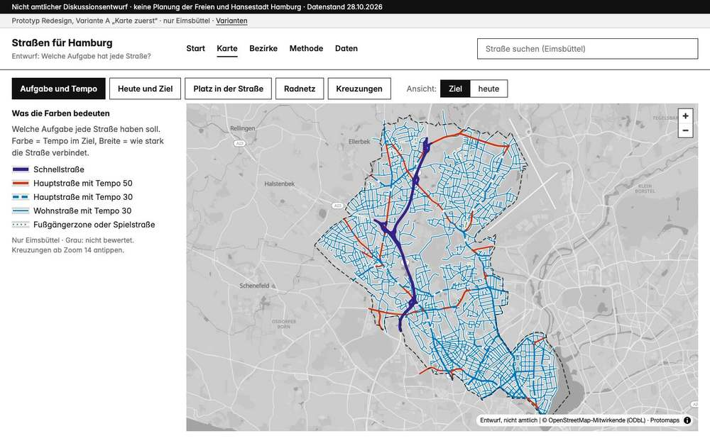 | 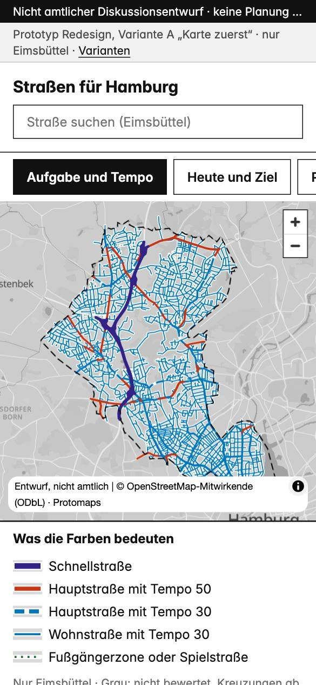 |
| 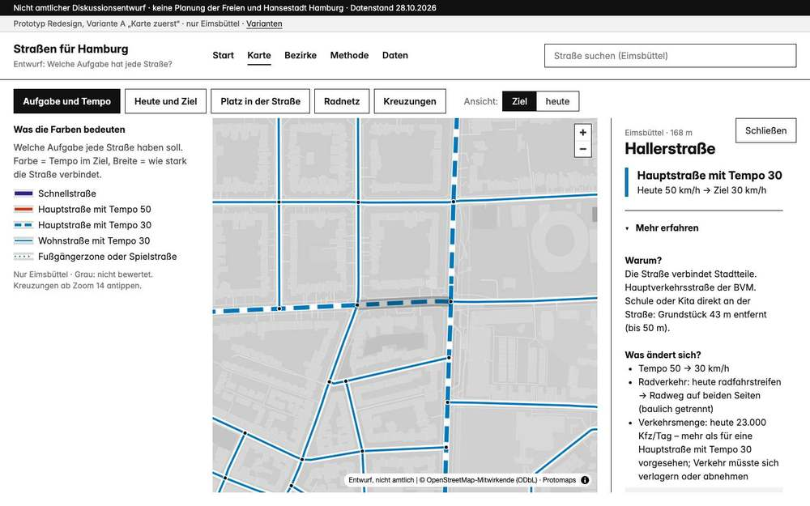 | 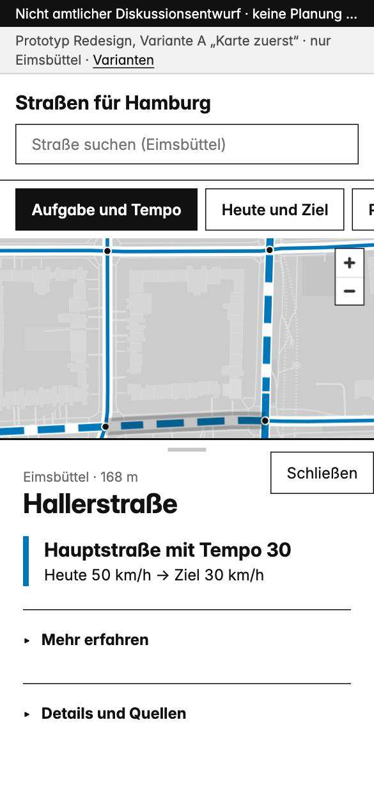 |
| 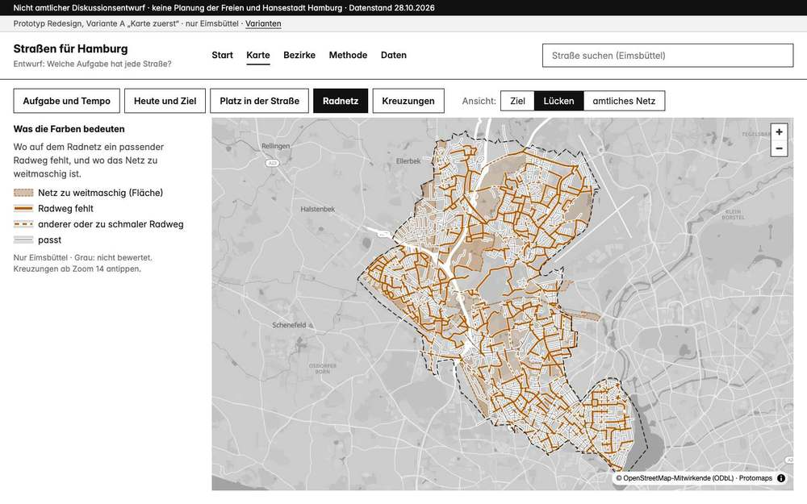 | 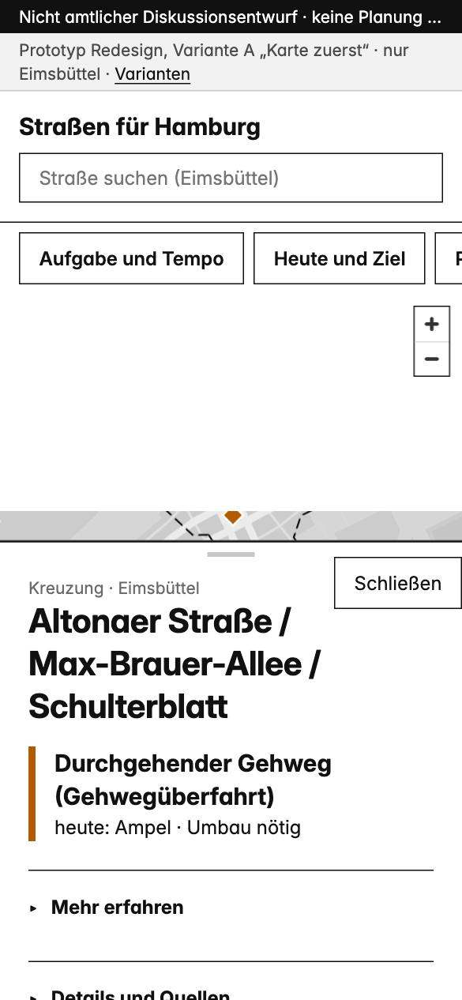 |

Weitere Zustände:

- [Tempo heute](img/p-a-desktop-tempo-heute.jpg)
- [Ebene 3 offen](img/p-a-desktop-steckbrief-ebene-3-offen.jpg)
- [Kreuzung Desktop](img/p-a-desktop-kreuzung.jpg)
- [alter Link `layer=cgap` → Radnetz/Lücken](img/p-a-desktop-alter-link-layer-cgap.jpg)

### Variante B „Überblick zuerst“ (`prototypes/redesign/ueberblick-zuerst/`)

Der Bezirk ist die Startseite:

- Ebene 1: ein Satz und drei Kennzahlen
- Ebene 2: drei Top-5-Listen
- Ebene 3: alle Bezirke im Vergleich

Jeder Eintrag öffnet die Karte (dieselbe wie in A) mit dem Steckbrief.

| Desktop | Smartphone |
|---|---|
| 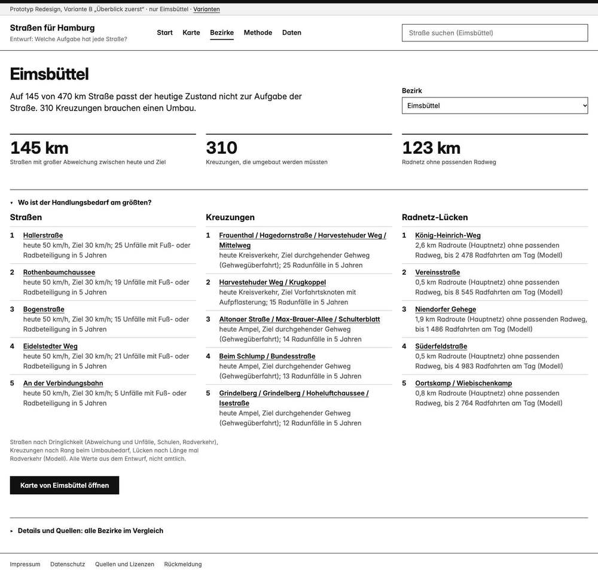 | 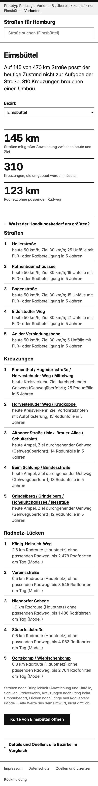 |
| 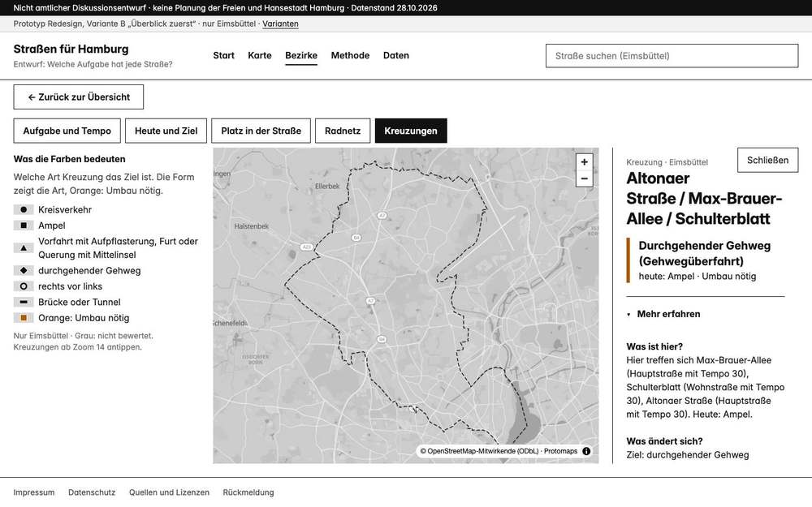 | 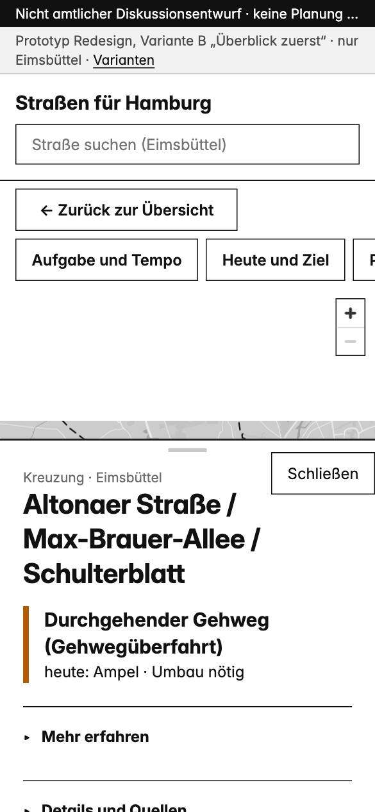 |

### Prüfung der Prototypen

`analysis/redesign/ui/prototypes.mjs` prüft 10 Zustände je Gerät (Desktop 1440 × 900, Smartphone 390 × 844):

- **JavaScript-Fehler:** 0.
- **axe-core** (Regeln wcag2a/aa, wcag21a/aa, wcag22aa): 0 Verstöße in allen 20 Zuständen. Im ersten Lauf hatte die
  Legende am Smartphone einen Verstoß (scrollable-region-focusable, serious). Er ist mit `tabindex=0` behoben.
- **Alter Link:** `layer=cgap` wird zu `theme=rad&view=luecken`.
- **Steckbrief Hallerstraße:** Ebene 1 hat 16 Wörter, Ebene 2 hat 108 Wörter. Heute stehen 558 Wörter auf einer Ebene.
  Ziel aus A2: höchstens 25 bzw. 120 Wörter.
- **Kreuzung:** 17 bzw. 62 Wörter (heute 162).

Klickpfade der fünf Aufgaben im Prototyp (gezählt am Entwurf, nicht mit Menschen gemessen):

| Aufgabe | heute (A1.2) | Variante A | Variante B |
|---|---|---|---|
| t1 Meine Straße | 5 Schritte, Linie treffen | Suche, Vorschlag → Ebene 1 offen (2) | gleich (2) |
| t2 Passt der Querschnitt? | 4–6× scrollen, 304 Wörter, zwei Aussagen | Ebene 2 am Desktop offen (0), mobil „Mehr erfahren“ (1); eine Aussage | gleich |
| t3 Handlungsbedarf im Bezirk | Tabelle mit Kürzeln, ohne Rad und Knoten | Menü „Bezirke“ (1) | auf der Startseite (0) |
| t4 Radnetz und Lücken | Lücken nicht darstellbar | Radnetz, Lücken (2) | Karte öffnen, Radnetz, Lücken (3) oder Top-Liste (1) |
| t5 Kreuzung | 7 Schritte, Ebene wechseln | Punkt antippen ab Zoom 14 (1) oder Thema Kreuzungen (2) | Top-Liste (1) oder wie A |

### Vor- und Nachteile, Aufwand

| | Variante A „Karte zuerst“ | Variante B „Überblick zuerst“ |
|---|---|---|
| Stärken | schneller Weg für Kundige und für die Frage „meine Straße“; nah an der heutigen Seite, weniger Umbau | beantwortet „Wo ist es am dringendsten?“ ohne Klick; erklärt den Entwurf mit drei Zahlen; am Smartphone ohne Karte lesbar und schnell geladen (keine Kacheln beim Start) |
| Schwächen | Neue Besuchende sehen zuerst eine Karte voller Linien; die Antwort auf t3 liegt einen Klick weg | ein Schritt mehr bis zur Karte; braucht die Bezirkskennzahlen im Export und eine Bezirkswahl |
| Aufwand Teil B (Schätzung) | Paket 1 Design-System: 2–3 Tage. Paket 2 Themen, Steckbrief, Bezirksseite als Unterseite: 4–6 Tage | Paket 1: gleich. Paket 2: 5–7 Tage (Bezirksseite als Startseite, Bezirkswahl für alle 7 Bezirke, Kennzahlen und Top-Listen im Export) |

**Empfehlung:** Variante B als Startseite, Variante A als Karte. Die Bezirksseite braucht die IA ohnehin (A2), der
Mehraufwand ist also klein (rund 1 Tag). B beantwortet die Aufgabe, die heute am schlechtesten gelöst ist (t3), und
lädt am Smartphone schneller. Wer direkt zur Karte will, hat die Suche und den Menüpunkt „Karte“.

## Offene Punkte

- **Inter-Glyphen für die Kartenbeschriftung:** siehe Typografie. Ohne sie bleibt Noto Sans in der Karte.
- **Dunkelmodus:** nicht vorgesehen. Die Seite setzt heute `color-scheme: light`.
- **Steckbrief am Smartphone:** Beim Fliegen zum Abschnitt soll die Karte die Höhe des Blatts berücksichtigen (Padding
  unten). Im Prototyp liegt der Abschnitt teils hinter dem Blatt.
- **Zeichnung „Querschnitt heute“:** Ein maßstäbliches Ist-Profil gibt es in den Daten nicht. Der Review-Prototyp hat
  es mit angenommenen Breiten gezeichnet. Hier wird nur das Ziel gezeichnet, mit „nötig/vorhanden“.
