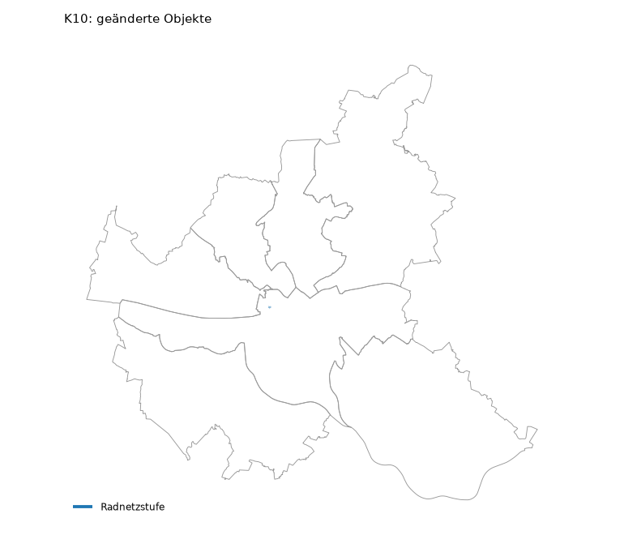
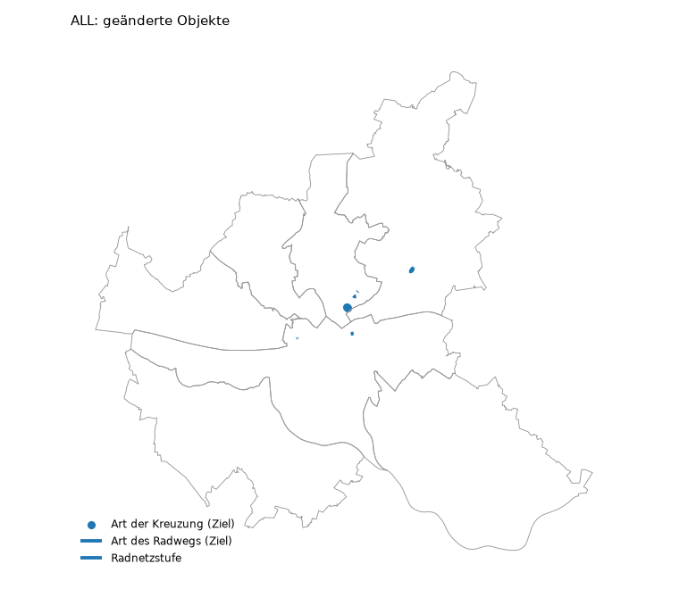

# Redesign 2026-11 · A6 Weniger Regeln? (braucht deine Freigabe je Regel)

**Nichts davon ist angewendet.** Jeder Vorschlag hat in `decisions.md` eine eigene Zeile mit freigeben / ablehnen /
überarbeiten. Grundlage ist das Regelinventar (`01_rules_inventory.csv`, A1.5).

## Ergebnis vorab

Von 196 Regeln sind 17 in 11 Gruppen Kandidaten. Sie fallen unter vier Arten:

- **Zusammenlegen (5 Gruppen: K1–K5):** Zwei Regeln tun dasselbe oder greifen immer zusammen.
- **Streichen (4 Gruppen: K6, K7, K8, K10):** Die Regel greift nie oder ist nur ein Verweis.
- **Vereinfachen (2 Gruppen: K9, K11):** Die Regel bleibt, wirkt aber anders.

Die meisten Vorschläge ändern **kein einziges Ergebnis**. Sie machen das Regelwerk kürzer und leichter zu erklären.
Messbar wirken nur K10 und K11 (Radnetz):

- **K10:** 5 Kanten, 0,07 km
- **K11:** 2,27 km Radnetzstufe, 0,36 km Fahrradstraße, 2 Kreuzungen

Beide empfehle ich abzulehnen. Freigabe von K1–K9 ergibt 196 → 188 Einträge (8 fallen weg, K9 behält zwei inaktive Einträge) ohne
jede Änderung an Kategorie, Radnetz, Radweg, Fahrstreifen, Querschnitt oder Kreuzungsart.

**Wenn alles angenommen wird:**

- 196 → 187 Einträge: 5 Zusammenlegungen und 4 Streichungen. C-NET-10 bleibt als Hinweisregel, P-COM-03 und
  P-ATT-02 bleiben als inaktive Einträge.
- Weniger Code: C-NET-10 (Wegsuche, rund 80 Zeilen in `lib/cycle_network.py` und `c03_cycle_network.py`), C-NET-11, N6 als eigener Berichtsteil, J-11 als Sonderfall „any
  with tram“.
- Wirkung auf die Ergebnisse: siehe Probelauf „ALL“ unten.

Alte IDs bleiben in jedem Fall als Alias erhalten. `rule_trace` schreibt bei zusammengelegten Regeln die neue ID mit
der alten als `alias`. So bleiben alte Links, Steckbriefe und Overrides lesbar. Kein Override in
`overrides/*.csv` nennt eine der betroffenen Regeln (geprüft mit `grep`). Es entstehen keine verwaisten Einträge.

## Wie gemessen

- **Probelauf** (nur Änderungen in den Regeldateien): Patch in einem eigenen Worktree, Neurechnung mit
  `make rerun FROM=…`, Vergleich mit dem aktuellen Lauf (`analysis/redesign/consolidation_effects.py`).
  - Gezählt werden km und Knoten, deren Kategorie, Radnetzstufe, Art des Radwegs, Fahrstreifenzahl, Querschnitt oder
    Kreuzungsart sich ändert, nach Bezirk, mit Beispielen und Karte.
  - Patches: `data/scenarios/redesign/<K>/<K>.patch`, erzeugt von `analysis/redesign/make_consolidation_patches.py`.
- **Durch Konstruktion ohne Wirkung:** K1, K2, K4–K7 und K9 benennen nur um, verschieben einen Wert oder streichen
  einen Text. Kein Code liest daraus eine Entscheidung, die sich ändern könnte. Für diese Fälle steht der Beleg aus den
  Daten in der Tabelle (z. B. gleiche Menge an Objekten, gleicher Faktor). Ein Probelauf bräuchte hier Code-Änderungen
  am Pipeline-Code. Die gehören in Teil B (Paket 5, „erst Tests, dann Code“).

## Übersicht der Probeläufe

Basis ist der aktuelle Lauf in `data/interim`. Ein Neulauf ohne Änderung gibt ihn hashgleich wieder (A1).

<!-- table:cons_runs -->
| Probelauf | Kategorie | Radnetzstufe | Radweg (Ziel) | Fahrstreifen | Querschnitt passt | Art der Kreuzung | entscheidende Zeile |
|---|---|---|---|---|---|---|---|
| K3 | 0 | 0 | 0 | 0 | 0 | 0 | 522 Knoten |
| K8 | 0 | 0 | 0 | 0 | 0 | 0 | 0 |
| K10 | 0 | 0,07 km (5) | 0 | 0 | 0 | 0 | 0 |
| K11 | 0 | 2,27 km (22) | 0,36 km (5) | 0 | 0 | 2 Knoten | 2 Knoten |
| ALL | 0 | 2,34 km (27) | 0,36 km (5) | 0 | 0 | 2 Knoten | 524 Knoten |
<!-- /table:cons_runs -->

„entscheidende Zeile“ zählt Knoten, an denen sich nur die ID der Zeile ändert (bei K3: J-02 → J-01). Die Art der
Kreuzung bleibt dort gleich.

## Die Vorschläge im Einzelnen

### K1 · N7 in N2 aufnehmen (zusammenlegen)

- **Problem:** N2 meldet kurze Inseln, N7 schlägt für genau diese Inseln die Nachbarkategorie vor. Beide markieren
  dieselben 74 Abschnitte (4,7 km, Jaccard 1,00). N7 ändert keine Kategorie: Zwischen Harmonisierung und `cat_final`
  unterscheiden sich nur 2 Abschnitte, beide durch ein freigegebenes Override. Eines davon übernimmt einen
  N7-Vorschlag, wie vorgesehen.
- **Vorschlag:**
  ```diff
   - id: N2
     rule: Kategoriewechsel < min_run_m zwischen gleichen Kategorien markieren
  +  proposal: "Insel erhält die Kategorie der gleichen Nachbarn (nur Vorschlag; Übernahme über overrides.csv)"
  +  aliases: [N7]
  -- id: N7
  -  rule: 'Glättungsvorschlag: Insel aus N2 erhält die Kategorie der gleichen Nachbarn …'
  ```
- **Wirkung:** keine Kategorie, kein Flag weniger. Der Hinweis im Steckbrief heißt „N2“ mit Vorschlag statt zweier
  Zeilen.
- **Was verloren geht:** nichts. Der Vorschlag bleibt sichtbar.
- **source_type:** unverändert (N2 assumption).

### K2 · JC-05 in JC-02 aufnehmen (zusammenlegen)

- **Problem:** JC-05 „Freies Rechtsabbiegen für Rad an LSA“ hat dasselbe `applies_to` wie JC-02 (signal_protected). Es
  wird an allen 840 Knoten gemeinsam mit JC-02 vergeben (Jaccard 1,00). Beides beschreibt die geschützte
  Ampelkreuzung.
- **Vorschlag:** JC-05 wird Baustein von JC-02:
  `rule: '… Aufstellfläche vor Kfz, indirektes Linksabbiegen; freies Rechtsabbiegen für Rad, wo sicher'`,
  `aliases: [JC-05]`. Der Baustein trägt sein eigenes `source_type: assumption` (JC-02 bleibt swov_crow für die übrigen
  Bausteine).
- **Wirkung:** keine Kreuzungsart. Die Behandlungsformen werden erst nach dem Typ vergeben (`pipeline/lib/junctions.py`,
  `treatments(jtype, …)`). In `cyclist_treatment` steht an 840 Knoten „JC-02“ statt „JC-02|JC-05“.
- **Was verloren geht:** Die Annahme „freies Rechtsabbiegen“ ist nicht mehr als eigene Zeile sichtbar. Sie bleibt aber
  als Baustein mit eigener Quelle erhalten.

### K3 · J-02 in J-01 aufnehmen (zusammenlegen, Probelauf)

- **Problem:** J-02 (GOW50+GOW30) ist `same_as: J-01` und steht in der Reihenfolge direkt nach J-01. Es unterscheidet
  sich nur im Armpaar.
- **Vorschlag:**
  ```diff
  -  - {id: J-01, legs: 'GOW50+GOW50', if: …}
  -  - {id: J-02, legs: 'GOW50+GOW30', same_as: J-01, status: draft}
  +  - {id: J-01, legs: 'GOW50+GOW50|GOW30', aliases: [J-02], if: …}
  -  evaluation_order: [… J-14, J-01, J-02, J-03, …]
  +  evaluation_order: [… J-14, J-01, J-03, …]
  ```
- **Wirkung (Probelauf):**

<!-- table:cons_K3 -->
- **entscheidende Zeile der Kreuzungstabelle**: 522 Knoten. Nach Bezirk: Hamburg-Mitte 124, Wandsbek 116, Hamburg-Nord 81, Altona 63, Eimsbüttel 60, Harburg 58, Bergedorf 20. Wechsel: J-02 → J-01: 522.
  - [`10050503018`](https://hamburgmobility.de/#karte?layer=jct&jct=10050503018) · [OSM](https://www.openstreetmap.org/?mlat=53.569504&mlon=10.041094#map=18/53.569504/10.041094) · [Luftbild](https://geoportal-hamburg.de/?MAP/PROJECTION=EPSG:25832&MAP/CENTER=[568944,5936130]&MAP/ZOOMLEVEL=10&MAP/LAYERIDS=19968): J-02 → J-01
  - [`10068545356`](https://hamburgmobility.de/#karte?layer=jct&jct=10068545356) · [OSM](https://www.openstreetmap.org/?mlat=53.627309&mlon=10.085560#map=18/53.627309/10.085560) · [Luftbild](https://geoportal-hamburg.de/?MAP/PROJECTION=EPSG:25832&MAP/CENTER=[571791,5942605]&MAP/ZOOMLEVEL=10&MAP/LAYERIDS=19968): J-02 → J-01
  - [`10075239396`](https://hamburgmobility.de/#karte?layer=jct&jct=10075239396) · [OSM](https://www.openstreetmap.org/?mlat=53.459919&mlon=9.892098#map=18/53.459919/9.892098) · [Luftbild](https://geoportal-hamburg.de/?MAP/PROJECTION=EPSG:25832&MAP/CENTER=[559230,5923805]&MAP/ZOOMLEVEL=10&MAP/LAYERIDS=19968): J-02 → J-01
<!-- /table:cons_K3 -->

- **Was verloren geht:** nichts. Die Regel ist dieselbe. Der goldene Fall `j03_gow50_gow30_signal` erwartet dann J-01
  (Alias J-02).

### K4 · C-IMP-06 in C-IMP-05 aufnehmen (zusammenlegen)

- **Problem:** Beide haben den Faktor `gow30_cycle_lane` (1,25). Die Notiz von C-IMP-06 nennt die Regel selbst eine
  vorläufige Kopie, weil `routing_impedance` keinen eigenen Faktor für „Hauptstraße 30 ohne Radstreifen“ hat. Daten:
  C-IMP-05 hat 52 Kanten, C-IMP-06 259 Kanten, alle mit Grundfaktor 1,25 (die 1,323 einiger Kanten entstehen durch
  Zuschläge).
- **Vorschlag:** `{id: C-IMP-05, when: low_speed_main_road, factor: gow30_cycle_lane, aliases: [C-IMP-06]}` mit
  Bedingung „Ist-Tempo ≤ 30 und Hauptstraße, mit oder ohne Radstreifen“. Die offene Frage nach einem eigenen Faktor
  bleibt in `docs/open_questions.md`.
- **Wirkung:** Kein Widerstand ändert sich, also auch keine Route und keine Radnachfrage.
- **Was verloren geht:** Der Platzhalter für einen späteren eigenen Faktor ist nicht mehr als eigene Regel sichtbar.
  Kommt der Faktor, entsteht C-IMP-06 neu.

### K5 · C-FAC-03 in S-04 aufnehmen (zusammenlegen)

- **Problem:** C-FAC-03 beschreibt nur, *wie* S-04 geprüft wird (Spitzenstundenanteil 0,10). In `rule_trace_facility`
  erscheint immer S-04, nie C-FAC-03 (13 539 Abschnitte mit Ergebnis S-04, 0 mit C-FAC-03).
- **Vorschlag:** `motor_peak_hour_share` und die Flags (`mixed_over_s04`, `dtv_unknown`, `filter_needed`) zu S-04,
  `aliases: [C-FAC-03]`. Der Wert bleibt 0,10 mit seinem `source_type`.
- **Wirkung:** keine. Gleicher Wert, gleiche Prüfung.
- **Was verloren geht:** nichts.

### K6 · N6 streichen

- **Problem:** Seit Review 2026-11 F09 ist N6 nur noch ein Verweis: „Soll-Knotentyp aus design_rules.junctions“. N6
  greift nie selbst. Behalten wird nur `category_rank`, das J-M-04 braucht.
- **Vorschlag:** `category_rank` zu J-M-04 verschieben, N6 streichen (`aliases` bei J-M-04). Der Berichtsteil „N6“ in
  `reports/junctions.md` heißt dann „Übergänge (N5)“.
- **Wirkung:** keine.
- **Was verloren geht:** nichts.

### K7 · PRF-07 streichen

- **Problem:** PRF-07 ist keine Regel, sondern der Hinweis, dass PL-02 und PL-05 mit den Daten nicht prüfbar sind.
  PL-02 ist inaktiv, das Flag `pl02_unchecked` kommt im Lauf 0-mal vor.
- **Vorschlag:** Den Hinweis zu PL-05 in die `note` schreiben („mit den vorhandenen Daten nicht prüfbar; Haltestellen
  nicht im Streckenprofil“), PRF-07 streichen.
- **Wirkung:** keine.
- **Was verloren geht:** nichts.

### K8 · J-11 streichen (Probelauf)

- **Problem:** „any with tram“. Hamburg hat keine Straßenbahn: `tram_present` ist an allen 16 244 Knoten falsch, und
  der GTFS-Feed enthält keine Straßenbahnroute. J-11 greift an 0 Knoten.
- **Vorschlag:** Zeile und Eintrag in `evaluation_order` streichen. Die Bedingung `not tram_present` in J-01/J-03 bleibt
  (sie schadet nicht).
- **Wirkung (Probelauf):**

<!-- table:cons_K8 -->
Keine Änderung an Kategorie, Radnetz, Radweg, Fahrstreifen, Querschnitt oder Kreuzungsart.
<!-- /table:cons_K8 -->

- **Was verloren geht:** Kommt eine Stadtbahn, muss die Zeile neu entstehen. Option „behalten“ ist gleichwertig, wenn
  das Regelwerk für andere Städte gedacht ist.

### K9 · P-COM-03 und P-ATT-02 auf inaktiv setzen (vereinfachen)

- **Problem:** Steigung und Lärm haben keine Datengrundlage: kein Höhenmodell, keine Lärmkarte, C-PRI-16 `unavailable`.
  Im Lauf sind `p_com_03_*` und `p_att_02_*` an allen 33 913 Routenabschnitten leer. Die Seite nennt sie trotzdem
  unter den Prüfungen der fünf Prinzipien.
- **Vorschlag:** `status: inactive`. Sie bleiben in C-PRI-16 `unavailable`, damit die Datenlage gleich gerechnet wird.
- **Wirkung:** keine Punktzahl, keine Datenlage. Auf der Seite stehen sie nur noch auf Ebene 3 („nicht geprüft, keine
  Daten“).
- **Was verloren geht:** nichts. Die Prüfung ist bereit, sobald Daten da sind.
- **Nicht vorgeschlagen:** sie aus der Datenlage herauszunehmen. Das würde die Datenlage der Routen erhöhen, also ein
  Ergebnis ändern.

### K10 · C-NET-11 streichen (Probelauf)

- **Problem:** Die Kontinuitätsregel hebt kurze schwächere Stücke einer Route an. Sie entscheidet an 5 Kanten (0,1 km)
  und hat eigenen Code und Test. Die Kontinuität (P-COH-04) wird weiter gemessen und gemeldet.
- **Vorschlag:** C-NET-11 streichen. Im Probelauf ist sie mit `max_gap_m: 0` ausgeschaltet.
- **Wirkung (Probelauf):**

<!-- table:cons_K10 -->
- **Radnetzstufe**: 5 Abschnitte/Kanten, 0,07 km. Nach Bezirk: Hamburg-Mitte 0,07. Wechsel: RSV → HAUPT: 5.
  - `ce_4c4193dcc0ce0a46` · [OSM](https://www.openstreetmap.org/?mlat=53.549918&mlon=9.973377#map=18/53.549918/9.973377) · [Luftbild](https://geoportal-hamburg.de/?MAP/PROJECTION=EPSG:25832&MAP/CENTER=[564490,5933888]&MAP/ZOOMLEVEL=10&MAP/LAYERIDS=19968): RSV → HAUPT
  - `ce_792b4849239c9bb9` · [OSM](https://www.openstreetmap.org/?mlat=53.549591&mlon=9.973513#map=18/53.549591/9.973513) · [Luftbild](https://geoportal-hamburg.de/?MAP/PROJECTION=EPSG:25832&MAP/CENTER=[564499,5933852]&MAP/ZOOMLEVEL=10&MAP/LAYERIDS=19968): RSV → HAUPT
  - `ce_cb8b32dc319ff0cb` · [OSM](https://www.openstreetmap.org/?mlat=53.549515&mlon=9.973630#map=18/53.549515/9.973630) · [Luftbild](https://geoportal-hamburg.de/?MAP/PROJECTION=EPSG:25832&MAP/CENTER=[564507,5933843]&MAP/ZOOMLEVEL=10&MAP/LAYERIDS=19968): RSV → HAUPT


<!-- /table:cons_K10 -->

- **Empfehlung: ablehnen.** Der Gewinn ist klein (eine kurze Funktion, ein Test). Ohne die Regel entsteht eine
  70 m lange Lücke in einem Radschnellweg in Hamburg-Mitte, und gerade solche Lücken sehen auf der Karte wie Fehler aus.
- **Was verloren geht:** Einzelne Routen wechseln über wenige Meter die Stufe. Das ist im Steckbrief als Wechsel
  sichtbar und widerspricht dem Prinzip „Route bleibt gleich“ (P-COH-04).
- **source_type:** assumption (`max_gap_m` 200 m).

### K11 · C-NET-10 nur noch als Hinweis (vereinfachen, Probelauf)

- **Problem:** Die Parallelregel verlegt eine Hauptroute, die lange an einer stark befahrenen Straße liegt, auf einen
  ruhigen Weg daneben. Sie greift an 20 Kanten und entscheidet an 10 (1,3 km). Dafür gibt es eine eigene Wegsuche
  (`pipeline/lib/cycle_network.py`, `c03_cycle_network.py`).
- **Vorschlag:** keine automatische Umlegung mehr. Das Flag `patt_main_street` („Route an stark befahrener Straße,
  ruhige Alternative prüfen“) bleibt und erscheint im Steckbrief. Im Probelauf ist sie mit `min_run_m: 1e9`
  ausgeschaltet.
- **Wirkung (Probelauf):**

<!-- table:cons_K11 -->
- **Radnetzstufe**: 22 Abschnitte/Kanten, 2,27 km. Nach Bezirk: Wandsbek 1,02, Hamburg-Nord 0,85, Hamburg-Mitte 0,40. Wechsel: HAUPT → BASIS: 11; BASIS → HAUPT: 10; HAUPT → ERSCHL: 1.
  - `ce_09850f714a12dfcf` · [OSM](https://www.openstreetmap.org/?mlat=53.552461&mlon=10.038988#map=18/53.552461/10.038988) · [Luftbild](https://geoportal-hamburg.de/?MAP/PROJECTION=EPSG:25832&MAP/CENTER=[568832,5934232]&MAP/ZOOMLEVEL=10&MAP/LAYERIDS=19968): BASIS → HAUPT
  - `ce_0e6534b4184bb942` · [OSM](https://www.openstreetmap.org/?mlat=53.571470&mlon=10.033603#map=18/53.571470/10.033603) · [Luftbild](https://geoportal-hamburg.de/?MAP/PROJECTION=EPSG:25832&MAP/CENTER=[568445,5936342]&MAP/ZOOMLEVEL=10&MAP/LAYERIDS=19968): HAUPT → BASIS
  - `ce_26c2c1b3b197bb55` · [OSM](https://www.openstreetmap.org/?mlat=53.552648&mlon=10.040484#map=18/53.552648/10.040484) · [Luftbild](https://geoportal-hamburg.de/?MAP/PROJECTION=EPSG:25832&MAP/CENTER=[568931,5934254]&MAP/ZOOMLEVEL=10&MAP/LAYERIDS=19968): HAUPT → ERSCHL
- **Art des Radwegs (Ziel)**: 5 Abschnitte/Kanten, 0,36 km. Nach Bezirk: Hamburg-Nord 0,36. Wechsel: cycle_street → mixed: 5.
  - [`seg_1a7aed480f35455f`](https://hamburgmobility.de/#karte?seg=seg_1a7aed480f35455f) · [OSM](https://www.openstreetmap.org/?mlat=53.571643&mlon=10.033827#map=18/53.571643/10.033827) · [Luftbild](https://geoportal-hamburg.de/?MAP/PROJECTION=EPSG:25832&MAP/CENTER=[568460,5936361]&MAP/ZOOMLEVEL=10&MAP/LAYERIDS=19968): cycle_street → mixed
  - [`seg_220dd594fa41f038`](https://hamburgmobility.de/#karte?seg=seg_220dd594fa41f038) · [OSM](https://www.openstreetmap.org/?mlat=53.571704&mlon=10.032723#map=18/53.571704/10.032723) · [Luftbild](https://geoportal-hamburg.de/?MAP/PROJECTION=EPSG:25832&MAP/CENTER=[568386,5936367]&MAP/ZOOMLEVEL=10&MAP/LAYERIDS=19968): cycle_street → mixed
  - [`seg_8d845b1bc66138f5`](https://hamburgmobility.de/#karte?seg=seg_8d845b1bc66138f5) · [OSM](https://www.openstreetmap.org/?mlat=53.571523&mlon=10.033546#map=18/53.571523/10.033546) · [Luftbild](https://geoportal-hamburg.de/?MAP/PROJECTION=EPSG:25832&MAP/CENTER=[568441,5936348]&MAP/ZOOMLEVEL=10&MAP/LAYERIDS=19968): cycle_street → mixed
- **Art der Kreuzung (Ziel)**: 2 Knoten. Nach Bezirk: Hamburg-Nord 2. Wechsel: priority_raised → equal_right_before_left: 2.
  - [`10778377510`](https://hamburgmobility.de/#karte?layer=jct&jct=10778377510) · [OSM](https://www.openstreetmap.org/?mlat=53.571210&mlon=10.034074#map=18/53.571210/10.034074) · [Luftbild](https://geoportal-hamburg.de/?MAP/PROJECTION=EPSG:25832&MAP/CENTER=[568477,5936313]&MAP/ZOOMLEVEL=10&MAP/LAYERIDS=19968): priority_raised → equal_right_before_left
  - [`1332569445`](https://hamburgmobility.de/#karte?layer=jct&jct=1332569445) · [OSM](https://www.openstreetmap.org/?mlat=53.571952&mlon=10.033290#map=18/53.571952/10.033290) · [Luftbild](https://geoportal-hamburg.de/?MAP/PROJECTION=EPSG:25832&MAP/CENTER=[568424,5936395]&MAP/ZOOMLEVEL=10&MAP/LAYERIDS=19968): priority_raised → equal_right_before_left
- **entscheidende Zeile der Kreuzungstabelle**: 2 Knoten. Nach Bezirk: Hamburg-Nord 2. Wechsel: J-07 → J-06: 2.
  - [`10778377510`](https://hamburgmobility.de/#karte?layer=jct&jct=10778377510) · [OSM](https://www.openstreetmap.org/?mlat=53.571210&mlon=10.034074#map=18/53.571210/10.034074) · [Luftbild](https://geoportal-hamburg.de/?MAP/PROJECTION=EPSG:25832&MAP/CENTER=[568477,5936313]&MAP/ZOOMLEVEL=10&MAP/LAYERIDS=19968): J-07 → J-06
  - [`1332569445`](https://hamburgmobility.de/#karte?layer=jct&jct=1332569445) · [OSM](https://www.openstreetmap.org/?mlat=53.571952&mlon=10.033290#map=18/53.571952/10.033290) · [Luftbild](https://geoportal-hamburg.de/?MAP/PROJECTION=EPSG:25832&MAP/CENTER=[568424,5936395]&MAP/ZOOMLEVEL=10&MAP/LAYERIDS=19968): J-07 → J-06


<!-- /table:cons_K11 -->

- **Empfehlung: ablehnen.** Die Regel wirkt sichtbar: Ohne sie verlieren in Hamburg-Nord 5 Abschnitte (0,36 km) ihre
  Fahrradstraße, und 2 Kreuzungen fallen auf „rechts vor links“ zurück. 2,27 km wechseln zwischen Radroute und
  Bezirksroute. Sie ist aufwendig, aber sie setzt ein Prinzip (Attraktivität) um, das sonst nur gemeldet würde.
  Die Option „überarbeiten“ wäre: die Regel behalten, aber ihren Code vereinfachen (Teil B).
- **Was verloren geht:** Die Attraktivität (P-ATT-03) wirkt nicht mehr automatisch auf das Netz. Fachleute müssen die
  Alternative von Hand übernehmen (cycle_network_overrides).
- **source_type:** assumption.

## Alle Vorschläge zusammen

Probelauf „ALL“ = K3 + K8 + K10 + K11. Alle übrigen Vorschläge sind durch Konstruktion ohne Wirkung.

<!-- table:cons_ALL -->
- **Radnetzstufe**: 27 Abschnitte/Kanten, 2,34 km. Nach Bezirk: Wandsbek 1,02, Hamburg-Nord 0,85, Hamburg-Mitte 0,47. Wechsel: HAUPT → BASIS: 11; BASIS → HAUPT: 10; RSV → HAUPT: 5; HAUPT → ERSCHL: 1.
  - `ce_09850f714a12dfcf` · [OSM](https://www.openstreetmap.org/?mlat=53.552461&mlon=10.038988#map=18/53.552461/10.038988) · [Luftbild](https://geoportal-hamburg.de/?MAP/PROJECTION=EPSG:25832&MAP/CENTER=[568832,5934232]&MAP/ZOOMLEVEL=10&MAP/LAYERIDS=19968): BASIS → HAUPT
  - `ce_0e6534b4184bb942` · [OSM](https://www.openstreetmap.org/?mlat=53.571470&mlon=10.033603#map=18/53.571470/10.033603) · [Luftbild](https://geoportal-hamburg.de/?MAP/PROJECTION=EPSG:25832&MAP/CENTER=[568445,5936342]&MAP/ZOOMLEVEL=10&MAP/LAYERIDS=19968): HAUPT → BASIS
  - `ce_26c2c1b3b197bb55` · [OSM](https://www.openstreetmap.org/?mlat=53.552648&mlon=10.040484#map=18/53.552648/10.040484) · [Luftbild](https://geoportal-hamburg.de/?MAP/PROJECTION=EPSG:25832&MAP/CENTER=[568931,5934254]&MAP/ZOOMLEVEL=10&MAP/LAYERIDS=19968): HAUPT → ERSCHL
- **Art des Radwegs (Ziel)**: 5 Abschnitte/Kanten, 0,36 km. Nach Bezirk: Hamburg-Nord 0,36. Wechsel: cycle_street → mixed: 5.
  - [`seg_1a7aed480f35455f`](https://hamburgmobility.de/#karte?seg=seg_1a7aed480f35455f) · [OSM](https://www.openstreetmap.org/?mlat=53.571643&mlon=10.033827#map=18/53.571643/10.033827) · [Luftbild](https://geoportal-hamburg.de/?MAP/PROJECTION=EPSG:25832&MAP/CENTER=[568460,5936361]&MAP/ZOOMLEVEL=10&MAP/LAYERIDS=19968): cycle_street → mixed
  - [`seg_220dd594fa41f038`](https://hamburgmobility.de/#karte?seg=seg_220dd594fa41f038) · [OSM](https://www.openstreetmap.org/?mlat=53.571704&mlon=10.032723#map=18/53.571704/10.032723) · [Luftbild](https://geoportal-hamburg.de/?MAP/PROJECTION=EPSG:25832&MAP/CENTER=[568386,5936367]&MAP/ZOOMLEVEL=10&MAP/LAYERIDS=19968): cycle_street → mixed
  - [`seg_8d845b1bc66138f5`](https://hamburgmobility.de/#karte?seg=seg_8d845b1bc66138f5) · [OSM](https://www.openstreetmap.org/?mlat=53.571523&mlon=10.033546#map=18/53.571523/10.033546) · [Luftbild](https://geoportal-hamburg.de/?MAP/PROJECTION=EPSG:25832&MAP/CENTER=[568441,5936348]&MAP/ZOOMLEVEL=10&MAP/LAYERIDS=19968): cycle_street → mixed
- **Art der Kreuzung (Ziel)**: 2 Knoten. Nach Bezirk: Hamburg-Nord 2. Wechsel: priority_raised → equal_right_before_left: 2.
  - [`10778377510`](https://hamburgmobility.de/#karte?layer=jct&jct=10778377510) · [OSM](https://www.openstreetmap.org/?mlat=53.571210&mlon=10.034074#map=18/53.571210/10.034074) · [Luftbild](https://geoportal-hamburg.de/?MAP/PROJECTION=EPSG:25832&MAP/CENTER=[568477,5936313]&MAP/ZOOMLEVEL=10&MAP/LAYERIDS=19968): priority_raised → equal_right_before_left
  - [`1332569445`](https://hamburgmobility.de/#karte?layer=jct&jct=1332569445) · [OSM](https://www.openstreetmap.org/?mlat=53.571952&mlon=10.033290#map=18/53.571952/10.033290) · [Luftbild](https://geoportal-hamburg.de/?MAP/PROJECTION=EPSG:25832&MAP/CENTER=[568424,5936395]&MAP/ZOOMLEVEL=10&MAP/LAYERIDS=19968): priority_raised → equal_right_before_left
- **entscheidende Zeile der Kreuzungstabelle**: 524 Knoten. Nach Bezirk: Hamburg-Mitte 124, Wandsbek 116, Hamburg-Nord 83, Altona 63, Eimsbüttel 60, Harburg 58, Bergedorf 20. Wechsel: J-02 → J-01: 522; J-07 → J-06: 2.
  - [`10050503018`](https://hamburgmobility.de/#karte?layer=jct&jct=10050503018) · [OSM](https://www.openstreetmap.org/?mlat=53.569504&mlon=10.041094#map=18/53.569504/10.041094) · [Luftbild](https://geoportal-hamburg.de/?MAP/PROJECTION=EPSG:25832&MAP/CENTER=[568944,5936130]&MAP/ZOOMLEVEL=10&MAP/LAYERIDS=19968): J-02 → J-01
  - [`10068545356`](https://hamburgmobility.de/#karte?layer=jct&jct=10068545356) · [OSM](https://www.openstreetmap.org/?mlat=53.627309&mlon=10.085560#map=18/53.627309/10.085560) · [Luftbild](https://geoportal-hamburg.de/?MAP/PROJECTION=EPSG:25832&MAP/CENTER=[571791,5942605]&MAP/ZOOMLEVEL=10&MAP/LAYERIDS=19968): J-02 → J-01
  - [`10075239396`](https://hamburgmobility.de/#karte?layer=jct&jct=10075239396) · [OSM](https://www.openstreetmap.org/?mlat=53.459919&mlon=9.892098#map=18/53.459919/9.892098) · [Luftbild](https://geoportal-hamburg.de/?MAP/PROJECTION=EPSG:25832&MAP/CENTER=[559230,5923805]&MAP/ZOOMLEVEL=10&MAP/LAYERIDS=19968): J-02 → J-01


<!-- /table:cons_ALL -->

## Bewusst nicht vorgeschlagen

| Regel | warum behalten |
|---|---|
| C-GOW-01 + C-G50-01 | Das Zusammenlegen der Kaskadenstufen spart nichts. Es würde 20 + 10 goldene Fälle und den Text jedes Steckbriefs ändern. |
| L-02 / L-03 / L-06 | L-03 (Mittelstreifen) folgt immer aus L-02 (Überschneidung 100 %), hat aber eine eigene Quelle (CROW, swov_crow) statt einer Annahme. Zusammenlegen würde Quellenarten mischen. |
| S-01, S-02 | Sie erscheinen nicht im Trace, weil die Trennungsmatrix sie umsetzt. Sie sind aber die lesbare Begründung der Matrix und stehen in 4 bzw. 2 goldenen Fällen. |
| C-RUR-01, PL-02, S-03 | inaktiv bzw. nur außerorts. Sie bleiben für GOW80/ETW60 (Ziel in CLAUDE.md). |
| J-08, J-09, J-10, J-15 | greifen selten (6, 1, 0, 0 Knoten), decken aber sicherheitsrelevante Sonderfälle ab |
| V-* | Prüfregeln, keine Entscheidungsregeln; auf der Seite nur Ebene 3 |
