# Redesign 2026-11 · Teil B, Paket 1: Design-System und Layout

Branch `redesign/2026-11-p1-design` (von `redesign/2026-11`). Umgesetzt sind die Zeilen **E1** (Raster und Layout der
Variante A, soweit ohne neue Inhalte möglich), **E6** (Farbkonzept) und **E7 b** (Inter selbst gehostet) aus
`decisions.md`. **Nicht live:** nur lokale Vorschau (`npm run build && npm run preview`). Deployment erst nach deinem OK.

## Was sich ändert

| Bereich | vorher | nachher | Dateien |
|---|---|---|---|
| Schrift | Systemschrift | Inter 4.1 variabel, auf Latin reduziert (61 KB statt 352 KB), selbst gehostet mit Lizenz (SIL OFL 1.1) | `web/src/fonts/`, `style.css` |
| Typografie | freie Größen | 5 Größen (14/16/20/28/40 px), Hierarchie über Größe und Gewicht, Tabellenziffern in Tabellen und Werten | `style.css` |
| Raster | Flexbox, feste rem-Breiten | 12/8/4 Spalten, Rand 24/24/16 px; Kopf: Titel 3, Menü 6, Suche 3 Spalten; Bedienfeld 3 Spalten, Steckbrief 3 Spalten | `style.css` |
| Komponenten | blaue Flächen, Rundungen, Schatten | schwarz/weiß, Linien 1–2 px, keine Rundungen, keine Schatten; Links schwarz unterstrichen; Hinweise mit Linie statt gelber Fläche | `style.css` |
| Farben der Karte | 8 Farben mit je bis zu 10 Bedeutungen | eine Bedeutung je Farbe (siehe unten) | `palette.js`, `layers.js`, `map.js` |
| Lizenzen | Noto Sans genannt | dazu Inter auf „Quellen & Lizenzen“ (mit dem nächsten Export) und im Impressum | `docs/licenses.md`, `pages.js` |

**Farbkonzept** (`web/src/palette.js`, wie `tokens.json`):

- **Tempo:** heute und Ziel mit derselben Skala. Kategorien in der Farbe ihres Ziel-Tempos, Aufgabe als Breite und
  Strich. GOW30 ist jetzt blau, breit und gestrichelt (vorher magenta, und magenta hieß in „Ist-Tempo“ 40 km/h).
- **Ist-Tempo:** Jede Stufe hat zusätzlich eine eigene Breite und einen eigenen Strich. Bei Rotschwäche waren ≤ 20 und
  50 km/h vorher nur über die Farbe zu trennen.
- **Handlungsbedarf** (Diskrepanz, Machbarkeit, Radanlagen Soll/Ist, Fahrstreifen, Querschnitt, Umbau an Knoten): ein
  Orange `#B35900`. „Passt / kein Bedarf“ ist grau und dünn, nicht grün.
- **Radverkehr** (Radnetz, Radanlagen): ein Petrol `#007A6E`, Hierarchie über Breite, Art über Strich.
- **Kreuzungen:** Form = Typ in Schwarz. Orange und größer = Umbau nötig. Vorher zeigte die Farbe den Typ und nur die
  Größe den Umbau.
- **Vergleich und Messung** (Hauptverkehrsstraßen, amtliches Radnetz, Straßenraumbreite, Busse, Schulen): schwarz bzw.
  dunkelgrau. Bei der Breite heißt eine breitere Linie eine breitere Straße.

**Bewusst noch nicht geändert** (kommt in Paket 2, weil Inhalt oder Struktur betroffen ist):

- Menü mit 7 Punkten (Paket 2: 4 Punkte, Karte als Start, Kasten „Was ist das?“)
- 13 Ebenen als Radioknöpfe (Paket 2: 5 Themen)
- Texte, Kategorienamen, Kürzel in Legenden (E4)
- Ampel „Datenunsicherheit“ und rotes „unsicher“ (E3c). Sie behalten ihre Farben, weil der Steckbrieftext „Ampel grün“
  nennt.
- Bedienfeld am Smartphone über der Karte (Paket 2)

## Vorher und nachher

| | vorher | nachher |
|---|---|---|
| Karte, Soll-Kategorie (Desktop) | 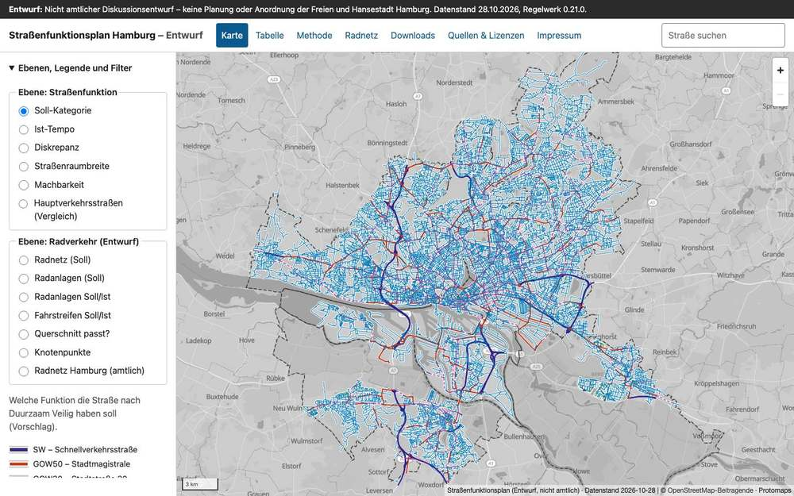 | 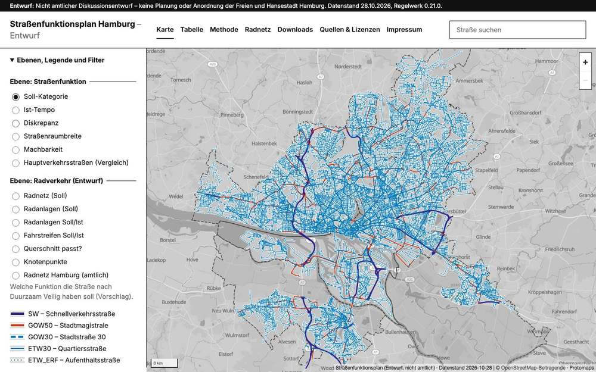 |
| Radanlagen Soll/Ist | 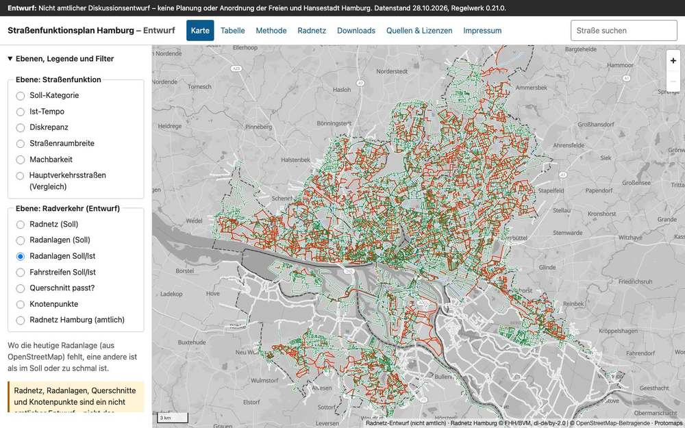 | 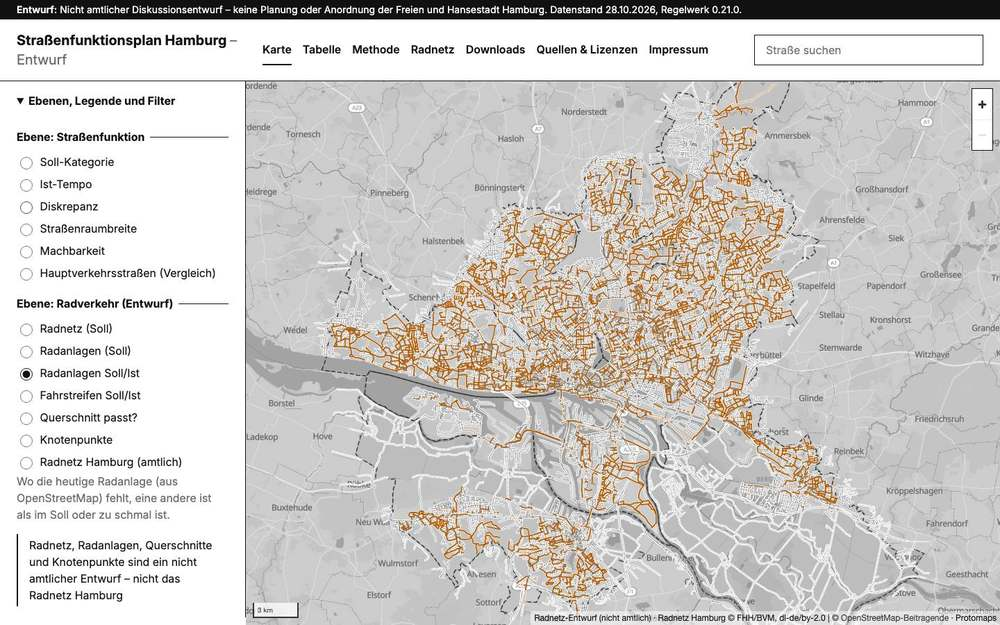 |
| Ist-Tempo | 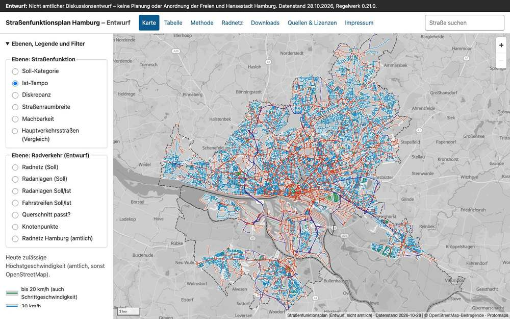 | 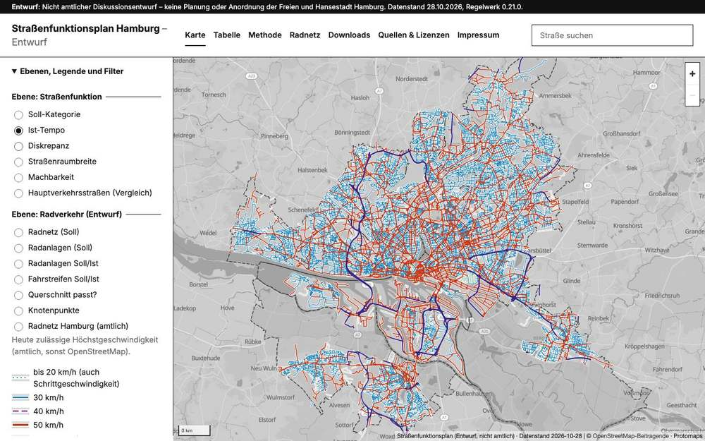 |
| Knotenpunkte | 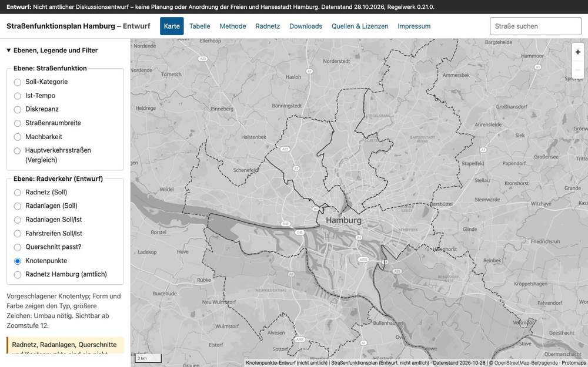 | 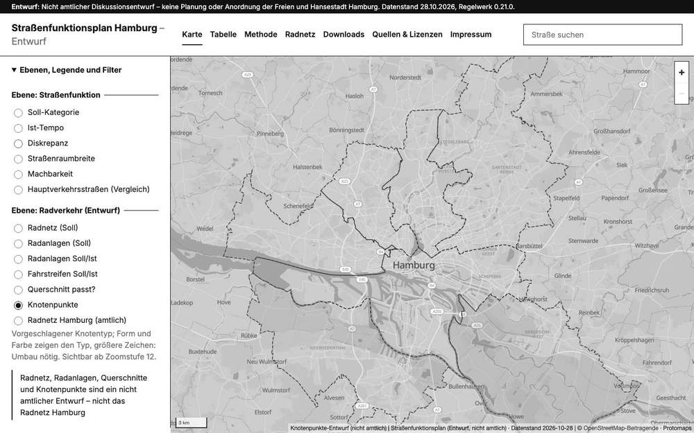 |
| Steckbrief Kieler Straße | 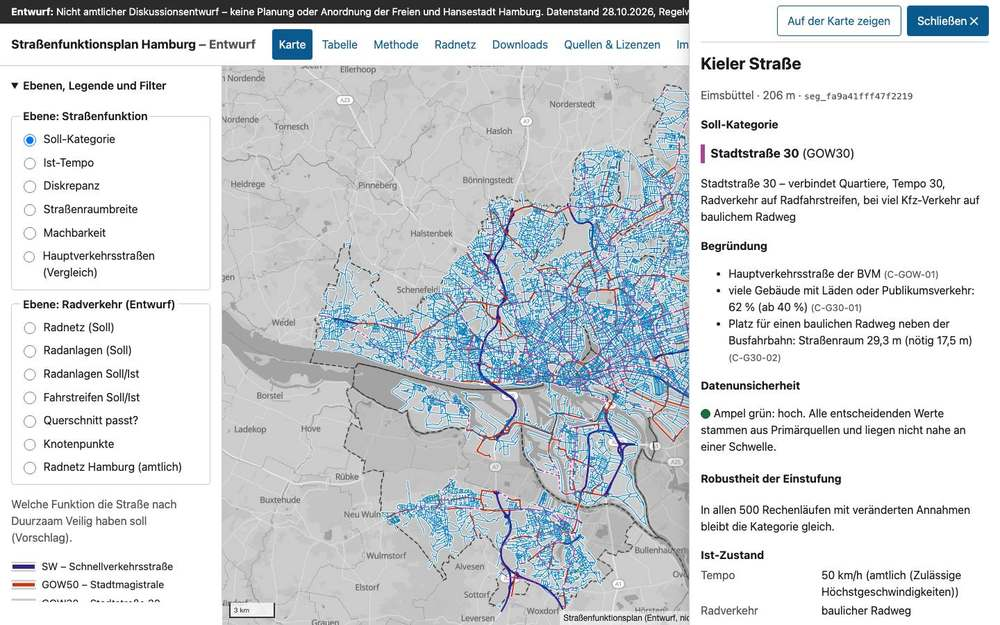 | 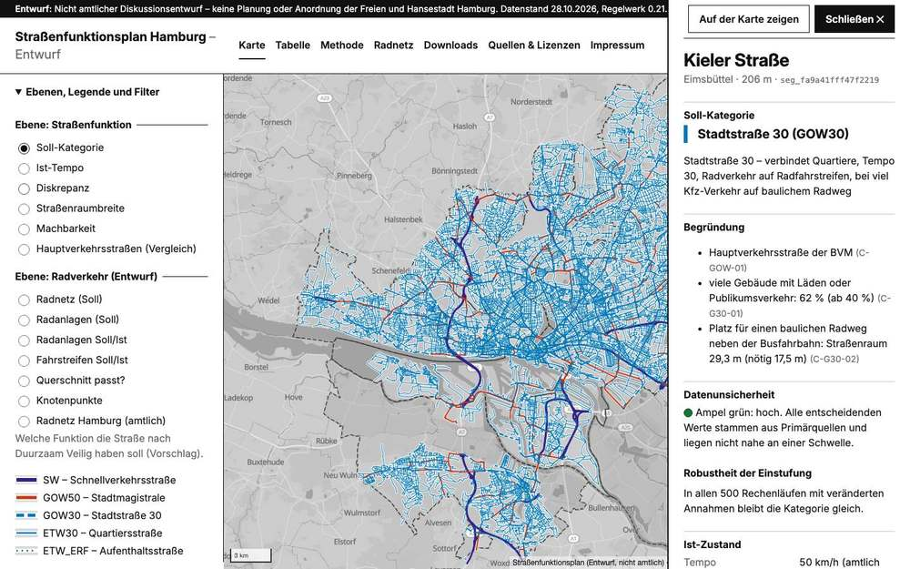 |
| Methode | 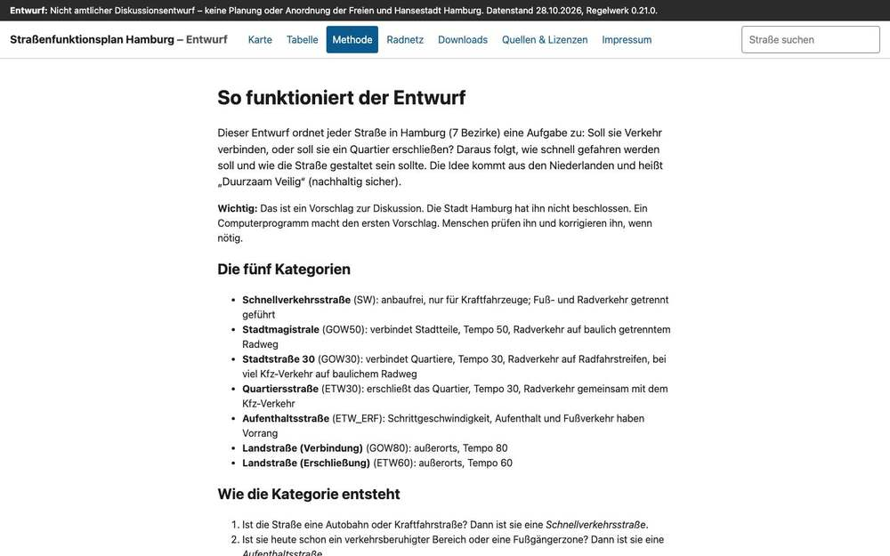 | 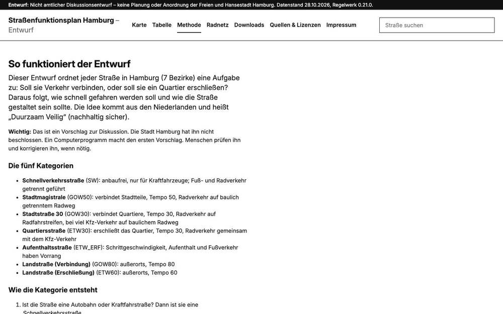 |
| Smartphone: Karte | 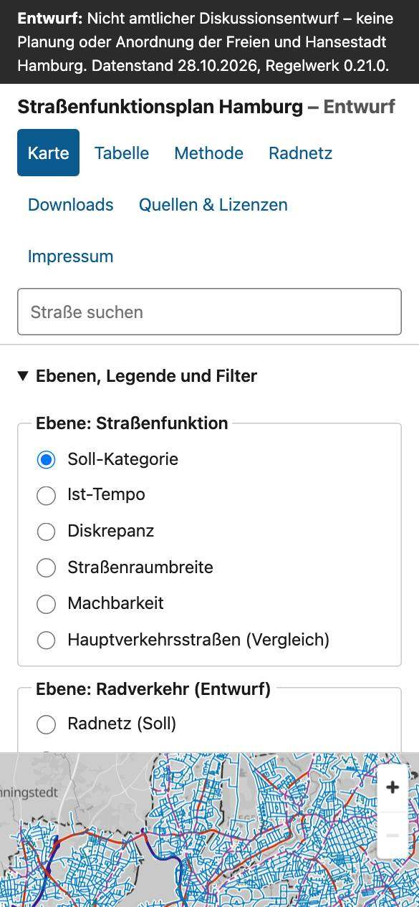 | 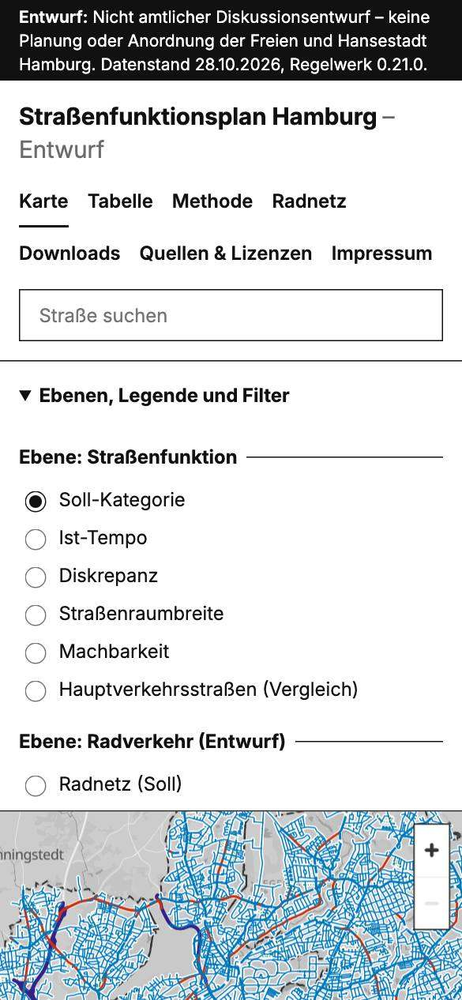 |
| Smartphone: Steckbrief | 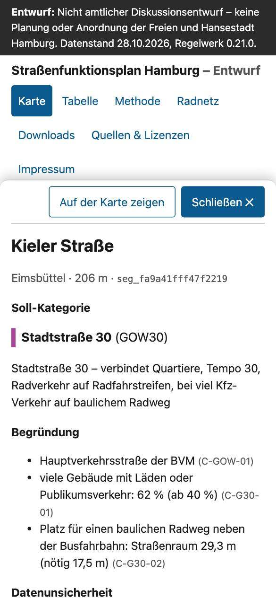 | 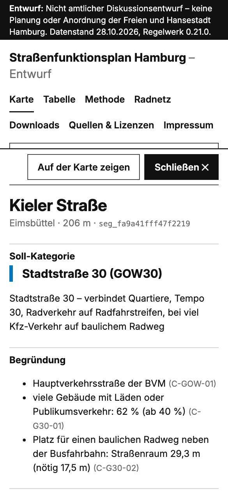 |

Alle Seiten, Ebenen und Steckbriefe nachher: `docs/redesign/img/p1-*.jpg` (erzeugt mit
`IMG_PREFIX=p1- node analysis/redesign/ui/capture.mjs`), ohne JavaScript-Fehler auf beiden Geräten.

## Prüfungen

| Prüfung | Ergebnis |
|---|---|
| Neue Tests zuerst (`web/test/design.test.js`, 12 Tests) | vor der Änderung 11 rot, danach grün. Geprüft werden: eine Bedeutung je Farbe, Kategorie = Farbe des Ziel-Tempos, bewertende Ebenen nur Orange/Grau, Radebenen nur Petrol/Grau, Knoten Schwarz bzw. Orange, zweites Merkmal (Breite/Strich) je Legende, Inter lokal ohne externe URL, Schrift unter 150 KB mit Lizenz, keine Schatten und Rundungen, Tabellenziffern |
| `make test` | Python 1 543 bestanden, 2 xfailed; Web 52 bestanden (40 bisherige + 12 neue) |
| Kontrast | alle Kartenfarben ≥ 3:1 gegen die weiße Umrandung (bestehende Tests), Text ≥ 4,5:1 (`tokens_check.py`) |
| Determinismus | zwei Builds hintereinander: alle Code-Dateien in `dist/assets` und `index.html` byte-gleich (SHA-256) |
| Vorschau, e2e | `npx playwright test` gegen `vite preview`: 40 bestanden (Desktop und Pixel 7) |
| axe-core (WCAG 2.2 AA) | 11 Seiten × 2 Geräte: **0 Verstöße** |
| Externe Anfragen | keine (Schrift aus `dist/assets`) |
| Lesbarkeit geänderter Texte | zwei kurze Texte: Legendenhinweis Knoten (11 Wörter, Fachbegriff „Soll“, der in Paket 2 zu „Ziel“ wird) und Lizenzsatz Inter (13 Wörter). Für die Formeln zu kurz (unter 30 Wörter) |

## Offene Punkte für dein OK

- **Merge und Deployment:** Nach deinem OK merge ich `redesign/2026-11-p1-design`. Deployment über GitHub Pages
  (Workflow `pages.yml`) erst mit deinem ausdrücklichen OK.
- `docs/licenses.md` erscheint auf der Seite erst nach dem nächsten `make export`. Bis dahin steht der Lizenzhinweis
  zu Inter nur im Impressum.
- Nächstes Paket: 2 Inhalte und Texte (Themen, drei Ebenen, Navigation mit 4 Punkten, Glossar, X2, X3).
