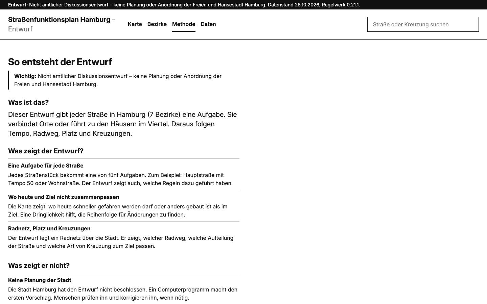
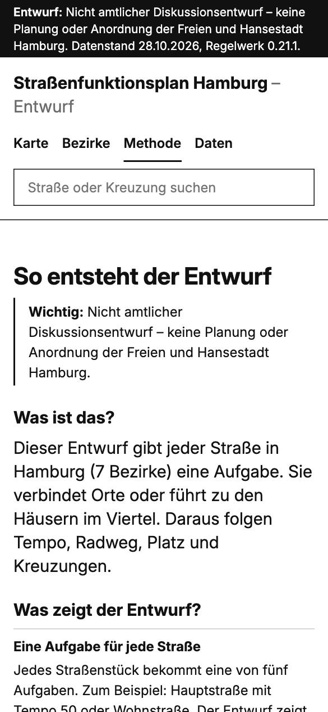
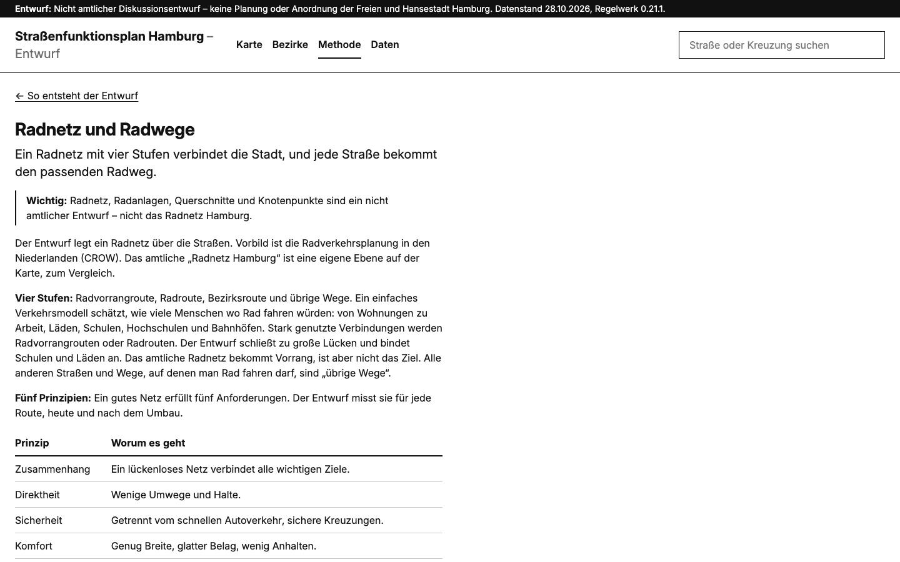
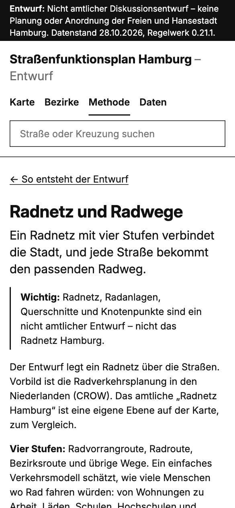
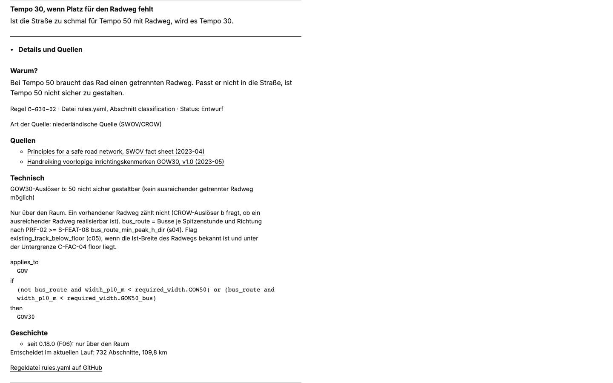
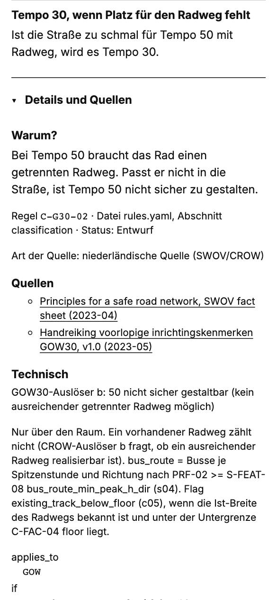
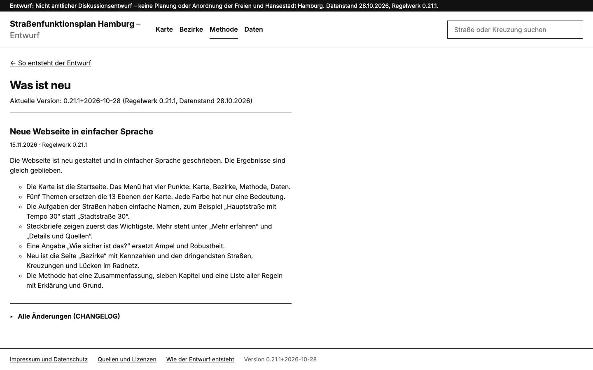
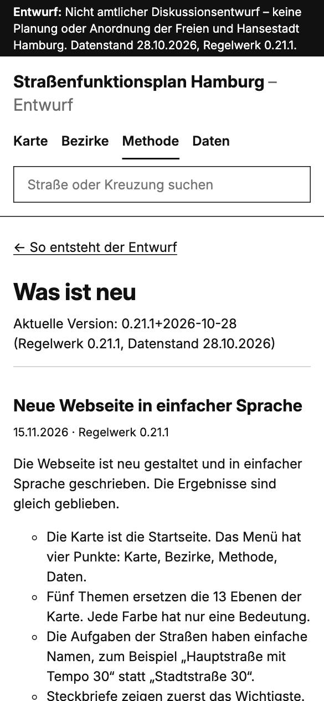

# Redesign 2026-11 · Teil B, Paket 3: Methode

Branch `redesign/2026-11-p3-methodology` (von `redesign/2026-11` nach Paket 4). Umgesetzt sind die Zeilen E2 b (Methode
als Zusammenfassung, Kapitel und Regelreferenz) und E5 c (Regelreferenz aus den Regeldateien) aus `decisions.md`.
Keine Regel, keine Schwelle und kein Ergebnis wurde geändert.

## Was neu ist

| Teil | Ebene 1 | Ebene 2 | Ebene 3 | URL |
|---|---|---|---|---|
| Zusammenfassung | „Was ist das?“ (2 Sätze), je 3 Punkte „Was zeigt der Entwurf?“ / „Was zeigt er nicht?“ | je Punkt ein Absatz, Anteil der Annahmen | Links in die Kapitel | `#methode` |
| 7 Kapitel | ein Satz | Erklärung (80–290 Wörter) | jede Regel des Kapitels mit `label_plain` und `explain_plain`, aufklappbar „Details und Quellen“ | `#methode/<kapitel>` |
| Alle Regeln | `label_plain` | `explain_plain`, Kennzeichen „Annahme“ | `why`, Regel-ID, Datei, Status, Art der Quelle, Quellen mit Link, Werte mit Einheit, technische Felder, Geschichte, wie oft die Regel im Lauf entschieden hat, Link auf die Regeldatei | `#methode/regeln`, `#methode/regeln?regel=C-G30-02` |
| ~~Was ist neu~~ | entfallen mit prompts/25 (`#methode/neu` führt auf `#methode`) | | | |

- Die Seite „Radnetz“ ist jetzt Kapitel 4 der Methode. Der alte Link `#radnetz` führt auf `#methode/radnetz`.
- Im Steckbrief verlinkt jede Regel-ID (Begründung, Entscheidungsweg, Kreuzung) auf ihre Stelle in der Regelreferenz.
- Die Regelreferenz hat eine Suche (Nummer, Name, Text) und den Filter „nur Annahmen“.

## Woher die Inhalte kommen (jeder Text an einer Stelle)

- **Regelreferenz:** `pipeline/lib/export_rules.py` liest die drei Regeldateien und schreibt `data/out/rules.json`
  (196 Regeln, 223 KB, wird erst beim Öffnen eines Kapitels geladen). `source` und `source_type` werden wie im Schema
  vom übergeordneten Abschnitt geerbt. Quellen werden in der eigenen Datei aufgelöst, denn sechs Schlüssel (zum
  Beispiel `SWOV_FS_2023`) stehen in zwei Dateien mit verschiedenen Einträgen. Werte je Radnetzstufe ohne eigenen
  `label_plain` (10 Werte, zum Beispiel `P-DIR-01 RSV`) bekommen den Namen aus dem Glossar („Radvorrangroute“).
- **Kapitelzuordnung:** über den Abschnitt der Regeldatei (`plain_language.yaml` `method.chapters[].sections`). Ein Test
  stellt sicher, dass jede Regel genau einem Kapitel gehört; ein neuer Abschnitt ohne Kapitel bricht den Export ab.
  Regeln je Kapitel: Radnetz 79, Kreuzungen 32, Daten 28, Platz 20, Aufgabe 16, Wie sicher 16, Abweichung 5.
- **„Entscheidet im aktuellen Lauf“:** 38 Regeln. Gezählt wird wie in `analysis/redesign/rule_inventory.py`: letzte
  Stufe der Kaskade im `rule_path` und `H-STR-01`, Knotentyp (`decision_rule`), Hinweis für Radfahrende
  (`cyclist_treatment`), letzte Stufe mit dem Endergebnis bei Radweg und Radnetzstufe. Andere Regeln zeigen keine Zahl.
- **Texte:** `config/plain_language.yaml` Abschnitt `method` (Version 0.11.0). Zahlen aus dem Lauf stehen als
  Platzhalter im Text (`{mc_runs}`, `{n_junctions}` …); der Export liefert die Werte in `meta.method.vars`, ein Test
  lässt nur bekannte Platzhalter zu. Die bisherigen Seiten (`methodHtml`, `radnetzHtml` in `web/src/pages.js`) sind
  gelöscht; ihr Inhalt steht in den Kapiteln.
- **Web:** `web/src/method.js` (reine Funktionen, getestet), Routen in `web/src/state.js` (`sub`, `rule`).

Ein Agent (Sonnet) schrieb die Kapiteltexte nach `guide.md`, `guide_radnetz.md`, Glossar und den alten Seiten. Ich habe
sie gegen die Regeldateien geprüft und sechs Stellen korrigiert: „sicher“ hieß dort „Aufgabe bleibt in allen Läufen
gleich“ (richtig: wechselt selten, unter der Grenze von V-UNC-01), „Datenlage niedrig“, Name der Seite „Daten“, der
Ausdruck „graue Straße“ (kein Begriff der Karte), ein Zirkelsatz zu den „übrigen Wegen“, ein Prinzipname
(„Direktheit“ wie im Steckbrief). Ein zweiter Agent (Sonnet) baute die Webseite nach einer festen Schnittstelle.

## Lesbarkeit

`analysis/redesign/p3_readability.py`: vorher = alte Seiten „Methode“ und „Radnetz“, nachher = Abschnitt `method`.

| Teil | Stand | Wörter | WSTF | Flesch-Amstad | Wörter je Satz | Sätze > 15 Wörter |
|---|---|---:|---:|---:|---:|---:|
| Seite Methode (alt) | vorher | 531 | 7,7 | 57,7 | 8,5 | 3 % |
| Seite Radnetz (alt) | vorher | 824 | 8,7 | 56,0 | 9,1 | 6 % |
| Zusammenfassung | nachher | 219 | 4,8 | 72,5 | 9,2 | 14 % |
| Kapitel Aufgabe einer Straße | nachher | 245 | 6,2 | 67,8 | 8,3 | 3 % |
| Kapitel Tempo und Abweichung | nachher | 182 | 4,7 | 74,7 | 10,1 | 17 % |
| Kapitel Platz in der Straße | nachher | 151 | 5,8 | 72,0 | 9,8 | 8 % |
| Kapitel Radnetz und Radwege | nachher | 290 | 7,4 | 61,0 | 9,4 | 3 % |
| Kapitel Kreuzungen | nachher | 209 | 6,4 | 68,3 | 9,6 | 10 % |
| Kapitel Wie sicher ist das? | nachher | 226 | 5,4 | 73,7 | 10,8 | 5 % |
| Kapitel Daten und Grenzen | nachher | 180 | 7,0 | 64,9 | 8,7 | 0 % |
| Regelreferenz (Einleitung) | nachher | 36 | 6,5 | 67,0 | 9,0 | 0 % |
| Was ist neu | nachher | 117 | 8,2 | 63,7 | 9,0 | 15 % |
| **gesamt vorher** | vorher | 1355 | 8,3 | 56,7 | 8,9 | 5 % |
| **gesamt nachher** | nachher | 1855 | 6,2 | 68,5 | 9,4 | 7 % |

Fachbegriffe ohne Erklärung: vorher 37 verschiedene (Diskrepanz, Soll-Querschnitt, Stadtmagistrale, Kfz …), nachher
13, davon Namen aus dem Glossar (Radvorrangroute, Bezirksroute, Fahrradstraße), Quellen (CROW, OpenStreetMap,
Duurzaam Veilig) und in „Was ist neu“ absichtlich die alten Namen zum Vergleich. Über dem Ziel (WSTF ≤ 7 für Ebene 2)
liegen das Kapitel Radnetz (7,4) und „Was ist neu“ (8,2, wegen der alten Namen).

## Prüfungen

- `make test`: grün (1766 Python-Tests, 2 erwartet fehlschlagend; 121 Web-Tests in 8 Dateien). Neu:
  `tests/test_export_rules.py` (16 Tests, zuerst geschrieben), `web/test/method.test.js`, Fälle in `state.test.js` und
  `profile.test.js`.
- Playwright (Desktop 1440 px und Smartphone 390 px): 54 von 54 bestanden, darunter axe ohne Verstoß auf allen
  Methodenseiten und neue Abläufe (Zusammenfassung → Kapitel → Details; `?regel=` öffnet die Regel; alter Link
  `#radnetz`).
- Determinismus: zwei Läufe ergeben dieselbe `rules.json` und dasselbe `meta.method` (Hash gleich).
- Keine Konsolenfehler, keine externen Anfragen (`analysis/redesign/ui/p3_method.mjs`).

**Nachgetragen aus Paket 2:** Der Playwright-Test „Bezirkstabelle auf Ebene 3“ schlug schon seit dem Merge von Paket 2
fehl; das ist mir damals entgangen. Ursachen: Der Test öffnete den zugeklappten Kasten nicht. Und am Smartphone lag
die Vergleichstabelle der Bezirke über dem Knopf „Alle Straßenstücke als Tabelle“, der Knopf war nicht antippbar.
Behoben: Tabelle im scrollbaren Rahmen (`.table-wrap`), Test öffnet den Kasten.

## Bilder

| | Desktop | Smartphone |
|---|---|---|
| Zusammenfassung |  |  |
| Kapitel Radnetz |  |  |
| Regel C-G30-02 offen |  |  |
| Was ist neu |  |  |

## Offen

- Nicht übernommen aus der alten Seite Radnetz: der Hinweis auf `reports/validation_cycling.md` (liegt nicht auf der
  Webseite). Die Regeldateien sind über „Daten“ und den Link auf GitHub erreichbar.
- Die Zahl der Tests je Regel (Ebene 3 im Plan von A2) zeigt die Referenz nicht: Sie ist eine Angabe für Entwickler und
  steht in `01_rules_inventory.csv`.
- „Was ist neu“ sagt „Die Ergebnisse sind gleich geblieben“. Wird Paket 5 (Regeln zusammenlegen, Kreuzungsfilter)
  vor der Veröffentlichung gemergt, muss der Eintrag ergänzt werden.
