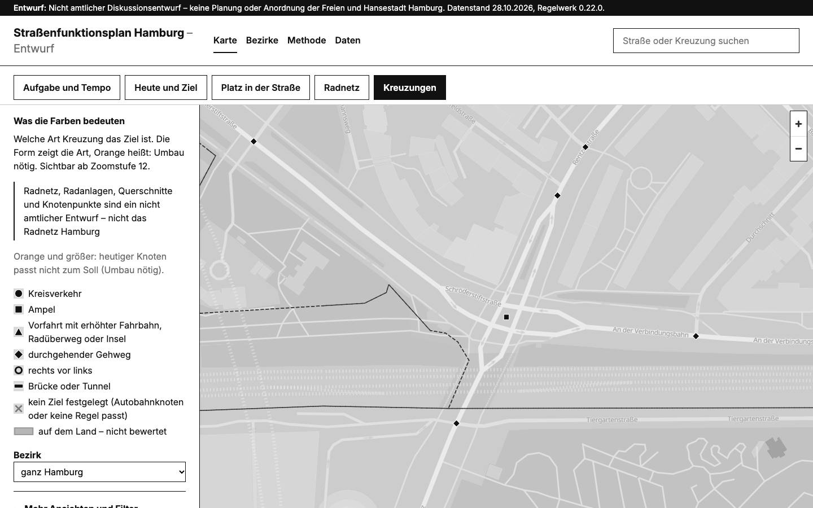

# Redesign 2026-11 · Teil B, Paket 5: Regeln zusammenlegen und Armfilter für Kreuzungen

Branch `redesign/2026-11-p5-consolidation` (von `redesign/2026-11` nach Paket 3). Umgesetzt sind die freigegebenen
Zeilen K1–K9 aus `decisions.md` (K10 und K11 abgelehnt, nicht umgesetzt), der Armfilter für Scheinkreuzungen (dein
Hinweis vom 14.11.2026, Option „Armfilter“), X1 (offene Frage) und X4 (`docs/source_policy.md`).
Versionen: rules.yaml 0.22.0, cycling_rules.yaml 0.12.0, design_rules.yaml 0.10.0, plain_language.yaml 0.11.1.

## Ergebnis

- **196 → 188 Regeln.** Kategorie, Radnetzstufe, Art des Radwegs, Fahrstreifen, Querschnitt und Kreuzungsart sind an
  jedem Abschnitt und an jeder bleibenden Kreuzung gleich (volle Neurechnung, Vergleich unten).
- **16 244 → 14 312 Kreuzungen.** 894 Teilungspunkte gehören jetzt zur Kreuzung davor, 1 038 Scheinkreuzungen entfallen.
- Alte IDs bleiben lesbar: Die übernehmende Regel trägt sie in `aliases`, ihre Trace-Einträge auch. Links wie
  `#methode/regeln?regel=J-02` öffnen J-01. Kein Override nennt eine alte ID (Test).

## Die Zusammenlegungen

| Zeile | Was | Messung im Lauf |
|---|---|---|
| K1 | N7 (Glättungsvorschlag) ist `proposal` von N2 | `coherence_trace` an 74 Abschnitten: N7 → N2 mit Alias; Flags und Vorschläge gleich (Flag-Text `N7_smooth:` bleibt) |
| K2 | JC-05 (freies Rechtsabbiegen) ist Baustein von JC-02, eigene Quelle `assumption` | `cyclist_treatment` an 605 Kreuzungen ohne JC-05, sonst gleich |
| K3 | J-02 in J-01 (`legs: GOW50+GOW50\|GOW30`) | `decision_rule` J-02 → J-01 an 449 Kreuzungen (522 vor dem Armfilter), Kreuzungsart gleich |
| K4 | C-IMP-06 in C-IMP-05 (neue Bedingung `low_speed_main_road`) | `imp_rule` an 259 Kanten C-IMP-06 → C-IMP-05; Widerstand, Kanten-IDs, Routen und Radnachfrage gleich |
| K5 | C-FAC-03 in S-04 | nur Trace (`aliases` an S-04, 17 999 Abschnitte); Art des Radwegs gleich |
| K6 | N6 gestrichen, `category_rank` bei J-M-04 | keine Änderung; Berichtsteil heißt „Übergänge (N5)“ |
| K7 | PRF-07 gestrichen, Hinweis in PL-05 `note` | keine Änderung |
| K8 | J-11 (Straßenbahn) gestrichen | keine Änderung (`tram_present` überall falsch) |
| K9 | P-COM-03, P-ATT-02 `inactive` | keine Änderung an Punkten und Datenlage |

Drei Agenten (Sonnet) setzten K1/K6, K2/K3/K7/K8 und K4/K5/K9 in getrennten Worktrees um, jeweils erst die Tests. Ich
habe die Zweige zusammengeführt (Konflikte nur in den Regelzahlen der Tests) und die volle Neurechnung geprüft. Ein
Punkt zu K4: Bisher trennte die Regel-ID zwei Kantengruppen. Damit Kanten-IDs stabil bleiben, trennt jetzt ein eigener
Schlüssel (mit oder ohne Radstreifen) wie vorher; der Vergleich bestätigt gleiche Kanten.

## Armfilter (design_rules J-M-01)

Neue Werte, beide Annahme: `min_arms` 3 und `pseudo_join_m` 60 m. Ein Knotenpunkt braucht mindestens drei Arme, nachdem
die Richtungsfahrbahnen zu einem Arm zusammengefasst sind (J-M-02), oder einen eigenständigen Radweg. Sonst ist er eine
Scheinkreuzung, meist der Punkt, an dem sich eine Straße in zwei Fahrbahnen teilt:

- bis 60 m vor einem Knoten einer echten Kreuzung, an die dieselbe Straße (gleicher Name) anschließt: Er gehört zu ihr.
  Er zählt zu ihren Knoten und seine Unfälle zu ihren Unfällen. node_id, Arme, Zufluss, Platz, heutige Ampel und Lage
  bleiben die der Kreuzung selbst.
- sonst entfällt er.

**Korrektur im Lauf:** Zuerst habe ich Arme und Platz der Kreuzung samt angeschlossener Teilungspunkte neu gemessen.
Dann wechselte an 98 bleibenden Kreuzungen die Art, zum Beispiel 32-mal „durchgehender Gehweg“ → „Ampel“. Grund: An den
Teilungspunkten gemessen, wurden die beiden Fahrbahnen nicht immer zu einem Arm zusammengefasst, und der Verkehr zählte
doppelt (Mundsburger Damm / Schwanenwik: 3 → 5 Arme). Ziel des Filters sind weniger Zeichen, nicht andere
Kreuzungsarten. Darum bleiben jetzt alle Werte der Kreuzung selbst; danach wechselt die Art an keiner Kreuzung.

<!-- Zahlen: uv run python -m analysis.redesign.armfilter_effects p5 data/interim -->
| Bezirk | vorher | nachher | angeschlossen | entfallen |
|---|---:|---:|---:|---:|
| Altona | 2 298 | 2 032 | 126 | 140 |
| Bergedorf | 872 | 776 | 36 | 60 |
| Eimsbüttel | 1 878 | 1 620 | 125 | 133 |
| Hamburg-Mitte | 2 961 | 2 604 | 174 | 183 |
| Hamburg-Nord | 2 353 | 2 121 | 151 | 81 |
| Harburg | 1 630 | 1 436 | 72 | 122 |
| Wandsbek | 3 853 | 3 382 | 185 | 286 |
| **Summe mit Bezirk** | 15 845 | 13 971 | 869 | 1 005 |
| **Hamburg gesamt** (mit Knoten ohne Bezirk) | 16 244 | 14 312 | 894 | 1 038 |

- **An bleibenden Kreuzungen** ändern sich nur: Knotenliste (791), Radunfälle (137, Unfälle an angeschlossenen
  Teilungspunkten), damit die Rangfolge beim Umbau, und an 3 Kreuzungen die heutige Ampel. Diese Ampeln lagen vorher
  einem entfallenen Teilungspunkt am nächsten (Bodestraße / Lohbrügger Landstraße, Fürstenmoordamm, Moorburger Bogen).
  Kreuzungsart, Entscheidungszeile (außer K3), Arme und Platz: 0 Änderungen.
- **Entfallene Punkte:** 535 mit einem Arm, 503 mit zwei Armen; keiner ist ein Treffpunkt zweier Straßen. 149 hatten im
  Ziel einen Umbaubedarf (104 „Ampel“, 29 „Kreisverkehr“). Ihre 136 Radunfälle bleiben in den Daten der Straßenabschnitte.
  Die Fälle mit den meisten Unfällen zum Prüfen:

| Knoten | Straße | Bezirk | Ziel vorher | Arme | Radunfälle |
|---|---|---|---|---:|---:|
| [`7064270281`](https://www.openstreetmap.org/?mlat=53.587706&mlon=9.874636#map=18/53.587706/9.874636) | Rugenbarg | Altona | Ampel | 2 | 5 |
| [`2410454082`](https://www.openstreetmap.org/?mlat=53.576220&mlon=9.824256#map=18/53.576220/9.824256) | Osdorfer Landstraße | Altona | Ampel | 2 | 3 |
| [`11476608577`](https://www.openstreetmap.org/?mlat=53.613184&mlon=9.905924#map=18/53.613184/9.905924) | Holsteiner Chaussee | Eimsbüttel | Ampel | 2 | 3 |
| [`7064310591`](https://www.openstreetmap.org/?mlat=53.587932&mlon=9.875041#map=18/53.587932/9.875041) | Rugenbarg | Altona | Ampel | 2 | 3 |
| [`3935416549`](https://www.openstreetmap.org/?mlat=53.590968&mlon=10.057028#map=18/53.590968/10.057028) | Habichtstraße | Hamburg-Nord | Ampel | 2 | 2 |
| [`266199070`](https://www.openstreetmap.org/?mlat=53.557988&mlon=9.990095#map=18/53.557988/9.990095) | Esplanade | Hamburg-Mitte | Kreisverkehr | 2 | 1 |

  Das sind vermutlich Fußgängerampeln oder Mittelinseln auf einer Straße. Eine Querungsstelle ist keine Kreuzung im
  Sinn der Tabelle; ob der Entwurf sie eigens bewerten soll, ist eine fachliche Frage für die nächste Regelrunde.
- **Dein Beispiel** An der Verbindungsbahn / Rentzelstraße / Schröderstiftstraße (`16334337`): Die drei Teilungspunkte
  in 37–50 m (Rentzelstraße, Schröderstiftstraße, An der Verbindungsbahn) gehören jetzt zur Kreuzung, auf der Karte steht
  ein Zeichen. Messeplatz / Rentzelstraße / Tiergartenstraße (74 m) ist eine echte Kreuzung und bleibt.

- **Alte Links:** `data/out/junction_redirects.json` ordnet jeden Knoten seiner Kreuzung zu. Ein geteilter Link auf einen
  angeschlossenen Teilungspunkt öffnet die Kreuzung; bei einem entfallenen Punkt erklärt der Steckbrief, warum es ihn
  nicht mehr gibt.
- **Overrides:** `overrides/junction_overrides.csv` ist leer, also keine verwaisten Einträge.

## Vergleich der vollen Neurechnung

`make rerun FROM=network` im Hauptverzeichnis, Vergleich mit dem Basislauf (`data/scenarios/redesign/base/interim`,
`analysis/review_2026_11/compare_runs.py` → `data/scenarios/redesign/p5/compare_vs_base.csv`). Unterschiede gibt es nur
in diesen Spalten:

- **Traces und IDs:** `coherence_trace` (74), `imp_rule` und `impedance_trace` (259/311 Kanten),
  `rule_trace_facility`, `rule_trace_junction`, `decision_rule` (449), `cyclist_treatment`/`treatment_text` (605).
- **Kreuzungen (Armfilter):** Knotenliste, Unfälle, Rangfolge, heutige Ampel an 3 Kreuzungen; in
  `validation_cycling` fehlen die Zeilen der entfallenen Kreuzungen. Die Robustheit der 14 312 bleibenden Kreuzungen ist
  gleich (0 Unterschiede in Läufen, Typwechseln und Auslösern).
- **Versionsnummern** in den Spalten der Validierung.

Keine Spalte zu Kategorie, Radnetzstufe, Radweg, Fahrstreifen oder Querschnitt ändert sich.

## Prüfungen

- `make test`: grün, 1775 Python-Tests (2 erwartet fehlschlagend), 123 Web-Tests. Neu: `tests/test_junction_filter.py`
  (8, zuerst geschrieben), `tests/test_rule_aliases.py` (3), Tests der Agenten je K-Zeile, Weiterleitung im Export.
- Playwright Desktop und Smartphone: 56 von 56, darunter die Weiterleitung alter Kreuzungslinks und axe.
- Determinismus: Knotenstufe zweimal gerechnet, `junctions.parquet` hashgleich.
- Doku: guide.md und guide_radnetz.md nennen N6/N7 nicht mehr als Regeln und beschreiben den Armfilter.
- „Was ist neu“ nennt jetzt weniger Kreuzungen und das kürzere Regelwerk; „Die Aufgaben der Straßen sind gleich
  geblieben“ statt „Die Ergebnisse sind gleich geblieben“.

## X1 und X4

- **X1:** `docs/open_questions.md`, neuer Abschnitt „Redesign 2026-11, Nebenbefund X1 Kreuzungen“ (743 Ampelkreuzungen
  mit Ziel „durchgehender Gehweg“; eine Zeile für querende Hauptstraßen mit Tempo 30 fehlt; keine Schwelle gesetzt).
- **X4:** `docs/source_policy.md`, nur aus CLAUDE.md, guide.md, sources.yaml und licenses.md zusammengestellt, jede
  Aussage mit Fundstelle. Offen: eigener Freigabeweg für Annahmen; Umgang mit Quellen ohne geklärte Lizenz.
