# 03 – Oberfläche und Datenpräsentation

Review 2026-11, Phase 3 (Prompt 21b). Stand 2026-11-07. **Nichts davon ist umgesetzt**; `web/` ist unverändert.

Geprüft wurde die gebaute Seite, Version 0.16.0+2026-10-28. Sie lief lokal über `vite preview` und entspricht dem Stand, der auf hamburgmobility.de veröffentlicht ist; der Ladetest lief zusätzlich gegen die Live-Seite.
Geräte (emuliert mit Playwright 1.64 / Chromium):
- Desktop 1440 × 900
- Pixel 7 (412 × 839)

Rohdaten liegen unter `data/scenarios/review_ui/` (nicht in Git), Skripte unter `analysis/review_2026_11/ui/`, Prototypen unter `prototypes/`. Abschnitte sind über ihre `segment_id` verlinkt: `https://hamburgmobility.de/#karte?seg=<id>`.

## Kurzfazit

1. **Die Seite beantwortet die Fragen, aber nicht in der Reihenfolge, in der Menschen fragen.**
   - Der Steckbrief ist im Median 538 Wörter lang: 5 Bildschirmhöhen am Desktop, 8 auf dem Smartphone.
   - „Was soll sich ändern?“ steht erst nach rund 1.490 px.
   - Ein Laie braucht für „Was ändert sich hier, und passt das?“ geschätzt 83 s und 4–5 Scroll-Gesten.
2. **Drei Bedienfehler mit klarer Ursache:**
   - Die Suche öffnet keinen Steckbrief.
   - Auf dem Smartphone bleiben nach der Suche nur 22 % des Bildschirms Karte.
   - Auf dem Smartphone ist ein Steckbrief aus der Tabelle nicht schließbar: Die Seite wird 1.021 px breit. Die Ursache ist gefunden, die Korrektur ist eine CSS-Zeile (Abschnitt 3.7).
3. **Der Steckbrief widerspricht sich selbst:**
   - Auf 188 km (1.449 Abschnitte) sagt die Straßen-Machbarkeit „passt“ oder „knapp“, der Radverkehrs-Querschnitt aber „passt nicht“.
   - Auf 129 km (808 Abschnitte) meldet die Diskrepanz „keine Radanlage“, der Radteil desselben Steckbriefs dagegen eine vorhandene Radanlage.
4. **Farben:**
   - Rot `#CC3311` hat 10 Bedeutungen in 12 Ebenen, darunter die neutrale Funktion GOW50 und das Hauptradnetz neben „passt nicht“ und „fehlt“.
   - Unter Deuteranopie sind Rot und Orange `#B35900` praktisch gleich (ΔE 0,3). Das betrifft vier Ebenen.
5. **Ebenen statt Fragen:** 13 Ebenen, 4 Overlays und 11 Filterelemente stehen in einem Bedienfeld; die Legende liegt unterhalb des sichtbaren Bereichs. Handlungsbedarf (Straße, Radanlage, Knoten) ist auf drei Ebenen verteilt. Netzlücken des Radnetzes werden berechnet (443 Maschen), aber nicht gezeigt.
6. **Technisch solide:** axe-core findet 0 Verstöße. Die Live-Seite ist über Slow 4G nach 4,1 s bedienbar und nach 10,2 s vollständig; `search.json` macht mit 586 KB 41 % der Startdaten auf dem Smartphone aus.
7. **Drei Prototypen** auf echten Daten von Eimsbüttel zeigen Alternativen:
   - Themen statt Ebenen
   - Ist/Soll-Vergleich mit Schieberegler und Szenario
   - geführter Einstieg mit Bezirksübersicht

   Alle drei nutzen einen neuen Steckbrief: Die Kurzantwort steht in der ersten Bildschirmhöhe, die Länge sinkt auf 134–196 Wörter.

---

## 1 Vorgehen

| Schritt | Skript | Ergebnis |
|---|---|---|
| Beispielorte und Stichprobe (30 Abschnitte, Seed 21) | `fixtures.py` | `fixtures.json` |
| Fünf Aufgaben als Klickpfade | `tasks.mjs` | `tasks.json`, `img/t*-*.jpg` |
| Heuristiken (Farben, Steckbrief, Laden, axe, Umfließen bei 320 px, Entwurfskennzeichnung) | `heuristics.mjs [--live]` | `heuristics.json`, `img/h-*.jpg` |
| Kennzahlen, Szenario, Netzlücken, Widersprüche | `district_kpi.py` | `prototypes/shared/*.json`, `presentation_stats.json` |
| Prototypen prüfen und fotografieren | `prototypes.mjs` | `prototypes.json`, `img/p-*.jpg` |

**Annahmen**, alle mit `source_type: assumption`:
- Zeitschätzung nach dem Keystroke-Level-Model (Card, Moran, Newell 1983): K 0,28 s (Touch 0,5 s), P 1,1 s, B 0,2 s, H 0,4 s, M 1,35 s. Ergänzt um 1 s je Scroll-Geste und eine Lesegeschwindigkeit von 200 Wörtern pro Minute.
- Die Zeiten sind Untergrenzen für geübte Nutzer; Suchen und Verstehen sind nur über M abgebildet.

**Grenzen:**
- Es wurde nicht mit Menschen getestet und kein echtes Smartphone verwendet.
- Bildschirmleser wurden nicht geprüft.
- Die Farbsehschwächen sind simuliert (Chromium `setEmulatedVisionDeficiency` und Machado/Oliveira/Fernandes 2009).

## 2 Aufgaben

| Aufgabe (Beispiel) | Gerät | Schritte | Klicks | Tasten | Scrolls | Wörter lesen | Zeit (KLM) |
|---|---|---:|---:|---:|---:|---:|---:|
| T1 „Welche Kategorie hat meine Straße und warum?“ (Hallerstraße) | Desktop | 5 | 3 | 9 | 0 | 50 | 29 s |
| | Mobil | 5 | 3 | 9 | 1 | 50 | 31 s |
| T2 „Was soll sich hier ändern und passt das in den Straßenraum?“ (im offenen Steckbrief) | Desktop | 3 | 0 | 0 | 4 | 246 | 83 s |
| | Mobil | 3 | 0 | 0 | 5 | 246 | 84 s |
| T3 „Wo ist in meinem Bezirk der größte Handlungsbedarf?“ (Eimsbüttel) | Desktop | 5 | 4 | 0 | 0 | 64 | 31 s |
| | Mobil | 5 | 4 | 0 | 1 | 64 | 32 s* |
| T4 „Wie sieht das Radnetz aus und wo sind Lücken?“ | Desktop | 4 | 4 | 0 | 0 | 50 | 26 s* |
| | Mobil | 4 | 4 | 0 | 1 | 50 | 27 s* |
| T5 „Was wird aus dieser Kreuzung?“ (Altonaer Str. / Max-Brauer-Allee / Schulterblatt) | Desktop | 7 | 6 | 10 | 0 | 53 | 38 s |
| | Mobil | 7 | 6 | 10 | 1 | 53 | 41 s |

\* Die Aufgabe ist auf diesem Weg nicht vollständig lösbar (siehe Stolpersteine).

### T1 – Kategorie und Begründung

Klickpfad: Suchfeld → „Hallerstr“ tippen → Vorschlag wählen → Karte zoomt → Linie treffen → Steckbrief.

Stolpersteine:
- **Die Suche zoomt nur**, sie öffnet keinen Steckbrief. Man muss eine 2–5 px breite Linie treffen; bei Straßen mit mehreren Abschnitten (Hallerstraße: 11) entscheidet die Tippstelle, welcher Steckbrief kommt.
- **Smartphone:** Nach der Suche beginnt die Karte bei 651 px von 839 px. Sichtbar sind 22 % Karte, darüber liegt das aufgeklappte Bedienfeld. Die gefundene Straße ist oft nicht im Bild.

  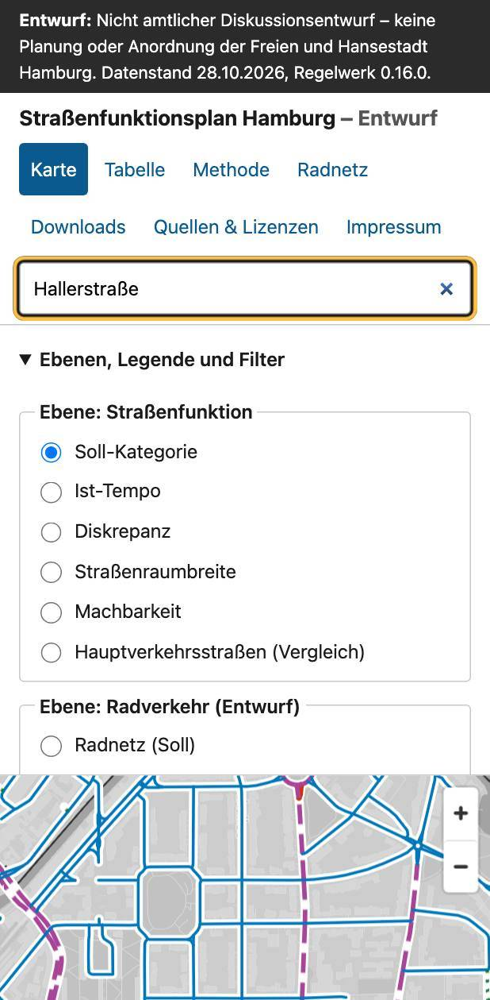

- Die Begründung ist kurz und gut lesbar. Sie nutzt aber Fachbegriffe wie „Verbindungswert 0,82 (ab 0,60)“ und zeigt Regel-IDs (C-GOW-01). Ob ein Schwellenwert belegt oder angenommen ist, sieht man nicht (Abschnitt 5.2).

### T2 – Was ändert sich, passt es?

Die Antwort ist über vier Abschnitte verteilt: Diskrepanz bei ~1.490 px, Querschnitt bei ~1.230 px, Radverkehr und Soll-Querschnitt bei ~1.920 px, dazu „Hinweise“. Der Steckbrief ist insgesamt 4.324 px lang.

- **Zwei Machbarkeitsaussagen:** „Querschnitt → Machbarkeit: passt“ und „Soll-Querschnitt: passt in den Straßenraum“. Hier stimmen sie überein, auf 188 km nicht (Abschnitt 3.5).
- Am Beispiel `seg_5a4361a0331e0791` widerspricht sich das Ist: Die Diskrepanz sagt „Radverkehr auf der Fahrbahn ohne Radfahrstreifen“, der Radteil sagt „Radanlage heute: Radfahrstreifen – Ist passt zum Soll“.

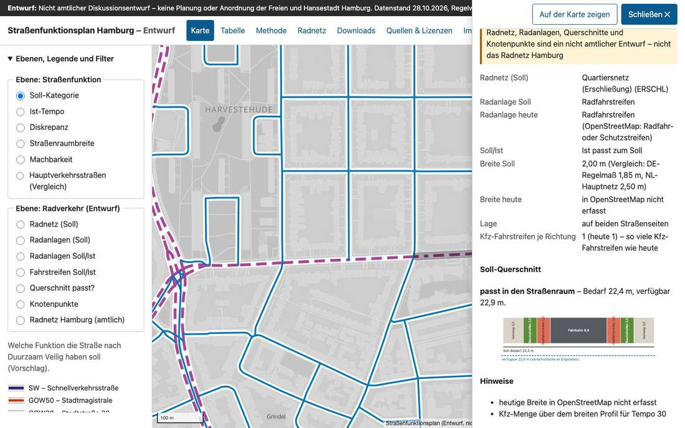

### T3 – Handlungsbedarf im Bezirk

Klickpfad: Tabelle → Bezirk wählen → nach Priorität sortiert → „öffnen“ → „Auf der Karte zeigen“.

- Die Tabelle zeigt Kürzel (GOW30, D1, D3) und mehrere Einträge derselben Straße untereinander; die Hallerstraße belegt sechs der ersten sieben Zeilen.
- Radanlagen, die fehlen, und Knoten mit Umbaubedarf (`priority_rank` liegt vor) kommen in keiner Liste vor.
- **Smartphone:** Der Steckbrief aus der Tabelle ist nicht bedienbar. „Schließen“ und „Auf der Karte zeigen“ liegen bei x = 700–879 px, sichtbar sind 412 px (Abschnitt 3.7).

  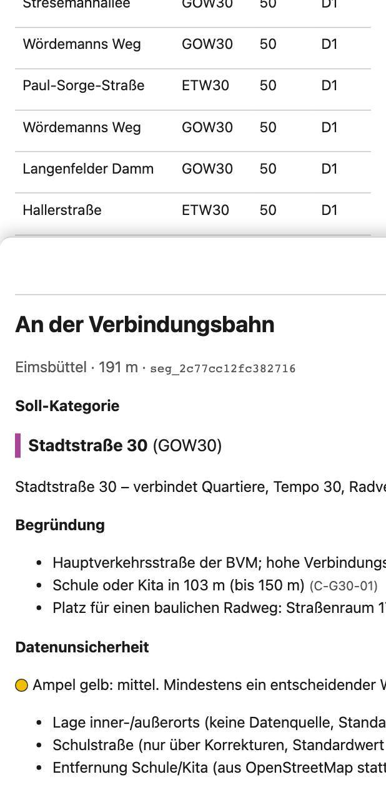

### T4 – Radnetz und Lücken

Klickpfad: Ebene „Radnetz (Soll)“ → Ebene „Radanlagen Soll/Ist“.

- **Netzlücken im Sinne fehlender Verbindungen zeigt keine Ebene.** Die Pipeline berechnet sie (`data/interim/cycle_mesh_gaps.parquet`: 443 Maschen über der Zielmaschenweite, 409 im Basisnetz und 34 im Hauptnetz; Eimsbüttel 64), exportiert sie aber nicht.
- Netz und Radanlagen-Lücke lassen sich nicht übereinanderlegen.
- Die Legende liegt unter dem Hinweistext außerhalb des sichtbaren Bereichs.
- Stadtweit ist die Ebene ein Rot-Grün-Teppich, unter Deuteranopie schwer lesbar (Abschnitt 3.3).

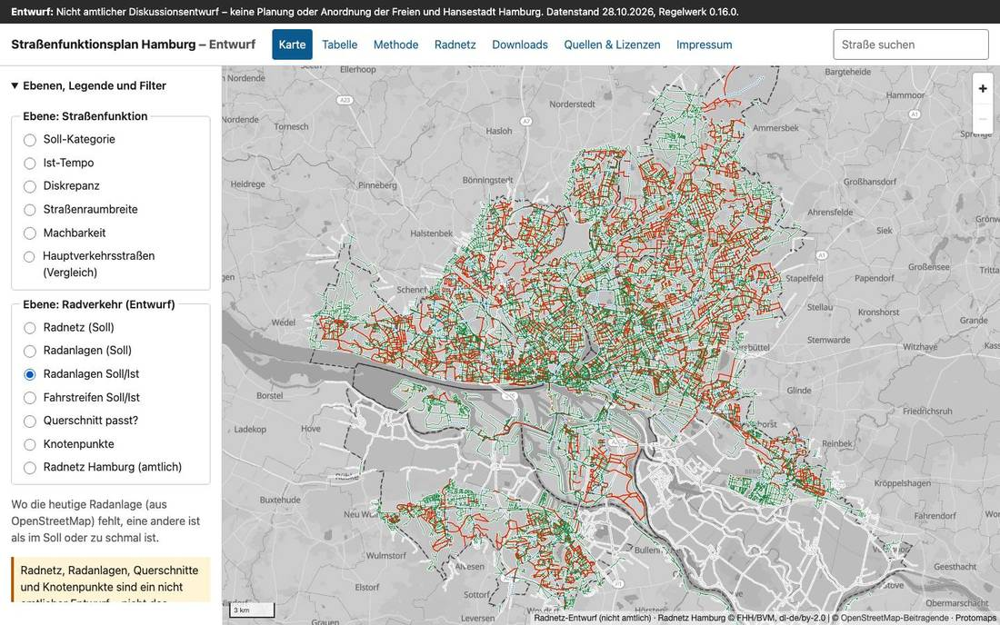

### T5 – Kreuzung

- Die Suche findet keine Knoten.
- In der Standard-Ebene öffnet ein Tipp auf die Kreuzung den Straßen-Steckbrief „Schulterblatt“ statt des Knotens.
- Knoten sind nur in der Rad-Ebene „Knotenpunkte“ anklickbar, und erst ab Zoomstufe 12 sichtbar. Unterhalb von Zoomstufe 12 zeigt die Ebene nichts, und die Oberfläche erklärt das nur mit „Sichtbar ab Zoomstufe 12“.
- Der Knoten-Steckbrief beginnt mit „Regel J-05 (Kategoriepaar GOW30+ETW30) ergibt hier: …“.

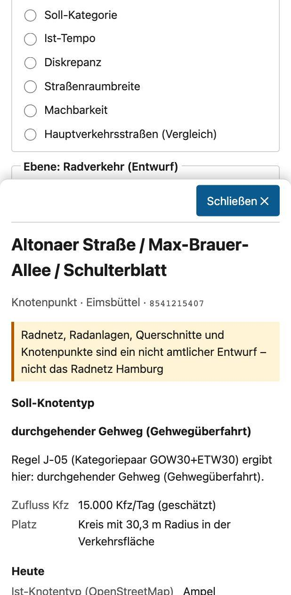

## 3 Heuristiken

### 3.1 Begriffe

- Die Ebenen-Legenden „Soll-Kategorie“ und „Diskrepanz“ zeigen Kürzel (SW, GOW50, D1–D3); die Tabelle zeigt nur Kürzel.
- Im Steckbrief stehen im Median 2 Regel-IDs und 3 Kategorie-Kürzel, im Knoten-Steckbrief Kategoriepaare („GOW30+ETW30“).
- Die Lesbarkeit des Steckbrieftexts liegt bei LIX 47 (Median, 30 Abschnitte) und damit im Bereich „schwer“ (Björnsson: 41–50 Sachtext).
- Mehrdeutig: „Querschnitt“ steht zweimal mit unterschiedlicher Bedeutung, „Machbarkeit“ und „passt“ ebenfalls zweimal.

### 3.2 Ebenen, Legenden, Filter

| | Desktop | Smartphone |
|---|---|---|
| Ebenen / Overlays / Filterelemente | 13 / 4 / 11 | 13 / 4 / 11 |
| Oberkante Legende (Fenster 900 bzw. 839 px) | 802 px | 932 px |
| Sichtbare Legendeneinträge beim Start | 2 von 6 | 0 von 6 |
| Kartenfläche beim Start | 89 % | 22 % (Karte ab 651 px) |

Weitere Punkte:
- Filter (Kategorie, Diskrepanz, Priorität) wirken auf Rad-Ebenen nicht; nur ein Hinweis im aufgeklappten Filterbereich sagt das.
- Overlays lassen sich mit jeder Ebene kombinieren, auch wo es keinen Sinn ergibt, etwa „Radnetz Hamburg“-Overlay über „Radnetz (amtlich)“.
- Die Rad-Ebenen tragen alle denselben gelben Hinweis, der die Legende nach unten schiebt.

### 3.3 Farben

**Bedeutung über Ebenen.** Dieselbe Farbe steht für Gegensätzliches:

| Farbe | Anzahl | Bedeutungen (Auszug) |
|---|---:|---|
| `#CC3311` rot | 10 | GOW50 · 50 km/h · D1 · Machbarkeit „passt nicht“ · Breite „schmal“ · **HAUPT-Radroute** · Radanlage „fehlt“ · „mehr Fahrstreifen“ · Querschnitt „passt nicht“ · Ampel |
| `#0077BB` blau | 10 | ETW30 · 30 km/h · D2 · Breite „breit“ · BASIS · Radfahrstreifen · „teilweise“ · „gleich viele Fahrstreifen“ · „In Arbeit“ · Kreisverkehr |
| `#117733` grün | 9 | ETW_ERF · ≤20 km/h · „passt“ · Radweg beidseitig · „Ist passt“ · „weniger Fahrstreifen“ · Bestand · durchgehender Gehweg |
| `#AA4499` lila | 8 | GOW30 · 40 km/h · D3 · Fahrradstraße · „zu schmal“ · geplant · Vorfahrt |

Rot bedeutet in neun Ebenen „schlecht“ oder „schnell“, in der Soll-Kategorie aber eine gewollte Funktion (Stadtmagistrale) und im Radnetz die wichtigste Route. Dadurch liest sich GOW50 als Mangel.

**Farbsehschwäche.** Gemessen ist der kleinste Farbabstand ΔE (CIE76) zwischen zwei Klassen derselben Ebene:

| Ebene | normal | Deuteranopie | Protanopie | Tritanopie | gleiche Strichart? |
|---|---:|---:|---:|---:|---|
| Machbarkeit (knapp / passt nicht) | 26 | **0,3** | 9 | 28 | nein |
| Radanlagen Soll/Ist (fehlt / andere) | 26 | **0,3** | 9 | 15 | nein |
| Querschnitt passt? (nach Abstrichen / nicht) | 26 | **0,3** | 9 | 28 | nein |
| Knotenpunkte (Ampel / Brücke) | 26 | **0,3** | 9 | 15 | Form unterschiedlich |
| Soll-Kategorie | 26 | 10 | 11 | 5 | nein |
| Radanlagen (Soll) | 33 | 9 | 11 | 5 | nein |

Ursache ist `#B35900`. Es ist nicht Teil der Paul-Tol-Palette, auf die sich `palette.js` beruft, und fällt unter Deuteranopie mit `#CC3311` zusammen. Strichart und Form trennen die Klassen noch, bei dünnen Linien und stadtweiter Zoomstufe reicht das nicht.

Für das Balkendiagramm der Bezirksübersicht wurde die Kategoriepalette zusätzlich mit dem Palettenvalidator geprüft. Ergebnis: SW `#332288` liegt außerhalb des Helligkeitsbands, Blau und Lila liegen unter Deuteranopie bei ΔE 7,7 (OKLab) und sind damit nur mit zweiter Kodierung zulässig.

| | normal | Deuteranopie |
|---|---|---|
| Radanlagen Soll/Ist | 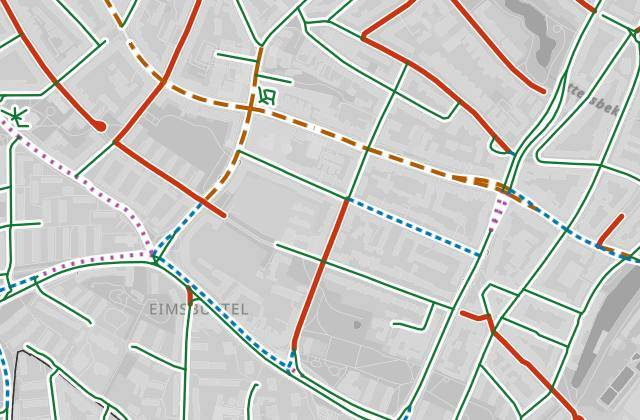 | 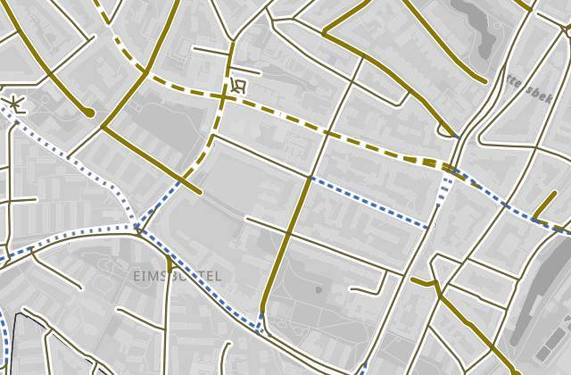 |
| Soll-Kategorie | 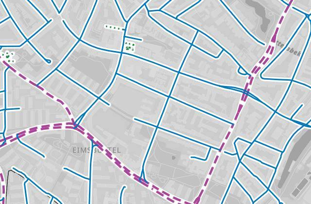 | 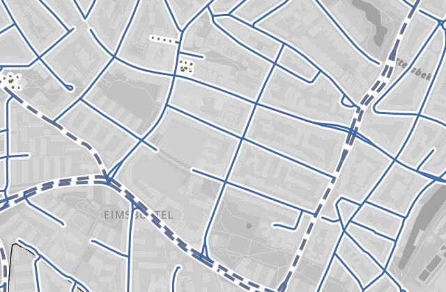 |

### 3.4 Zoomverhalten

- Die Fachkacheln reichen von Zoomstufe 10 bis 16, die Karte startet stadtweit bei etwa 10. In dieser Übersicht dominiert ETW30 (blau, 74 % der Länge), GOW30 (lila gestrichelt) ist kaum erkennbar.
- Knoten erscheinen erst ab Zoomstufe 12; darunter ist die Ebene leer.

| Soll-Kategorie, Zoomstufe 10 | Knotenpunkte, Zoomstufe 11,5 (leer) |
|---|---|
| 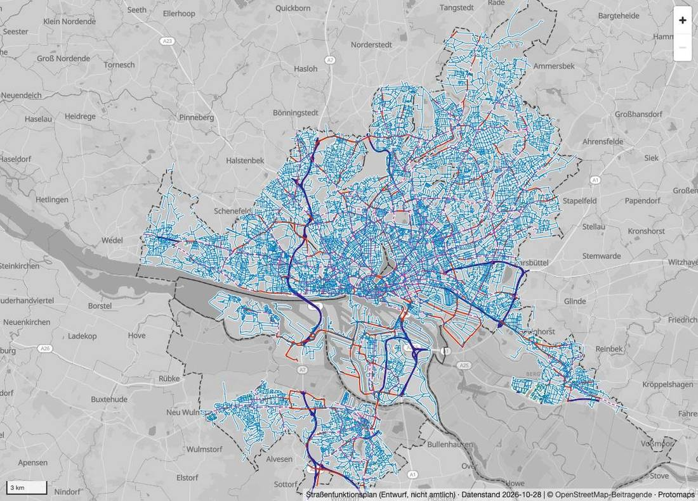 | 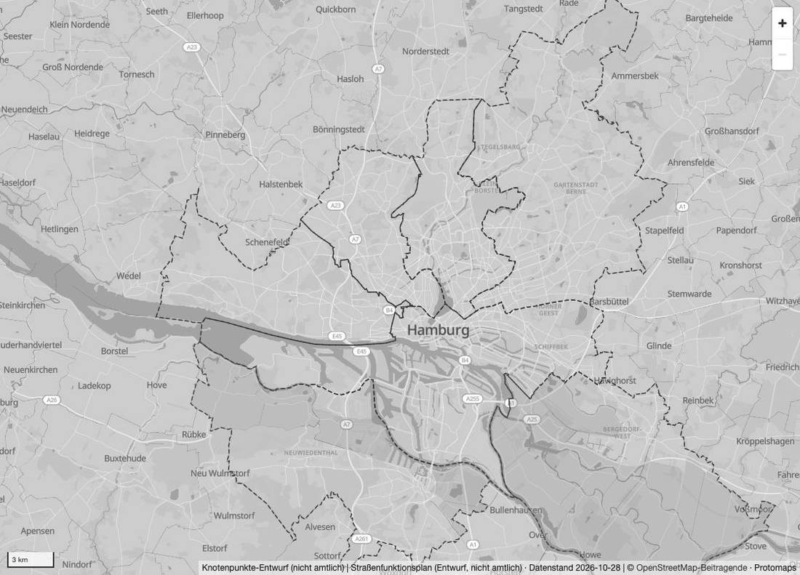 |

### 3.5 Steckbrief

Ausgewertet sind 30 Zufallsabschnitte; jeder hat einen Radteil.

| Kennzahl (Median) | Desktop | Smartphone |
|---|---:|---:|
| Wörter | 538 | 538 |
| Länge | 4.457 px = 5,0 Bildschirme | 4.767 px = 8,1 Bildschirme |
| „Begründung“ beginnt bei | 318 px | 318 px |
| „Diskrepanz“ beginnt bei | 1.486 px | 1.582 px |
| „Radverkehr“ beginnt bei | 1.844 px | 1.900 px |
| Hinweis „Entwurf / nicht amtlich“ | 2 × (nur im Radteil) | 2 × |

Reihenfolge heute: Soll-Kategorie · Begründung · Datenunsicherheit · Ist-Zustand · Querschnitt · Diskrepanz und Priorität · Radverkehr und Soll-Querschnitt · Datenquellen · Rückmeldung.
Die Datenunsicherheit steht damit vor der Antwort auf „was ändert sich“.

**Widersprüche innerhalb eines Steckbriefs** (stadtweit, `district_kpi.py`):

| Widerspruch | Abschnitte | km | Beispiele |
|---|---:|---:|---|
| Straße „passt“, Radverkehrs-Querschnitt „passt nicht“ | – | 100,1 | `seg_f82cb6d74aac2ddb`, `seg_0d09a705ebf2223a` |
| Straße „knapp“, Radverkehrs-Querschnitt „passt nicht“ | – | 88,0 | `seg_9bdbf52b7d347a15`, `seg_4da161304c34d2ee` |
| Summe Machbarkeit | 1.449 | 188,1 | |
| Diskrepanz „keine Radanlage“, Radteil nennt Radweg oder Radfahrstreifen | 808 | 129,1 | `seg_498b7e1e5d421cab`, `seg_f107760b70327da7` |

Ursachen:
- Die Straßen-Machbarkeit (`feasibility_*`) rechnet mit dem groben Kategorie-Profil.
- Der Radverkehrs-Querschnitt (`fit_class`) rechnet mit dem detaillierten Soll-Profil inklusive Bäumen, Parken und Radanlagenbreite.
- Das Ist der Radanlage stammt in der Diskrepanz aus den OSM-Tags des Fahrbahn-Abschnitts, im Radteil aus `cycle_facility_ist` einschließlich zugeordneter straßenbegleitender Radwege.

Beide Wege sind fachlich begründbar. Im Steckbrief stehen sie aber nebeneinander, ohne Erklärung.

**Unsicherheit:**
- Die Ampel unterscheidet kaum. 3.778 von 4.240 km (89 %) sind „mittel“, 276 km „niedrig“, 186 km „hoch“.
- Die Robustheit aus der Sensitivitätsanalyse ist aussagekräftiger: 218 km sind „unsicher“. Im Steckbrief steht sie aber erst unter der Ampel.

Steckbrief auf dem Smartphone, erster und dritter Bildschirm (insgesamt 7,9 Bildschirme):

| | |
|---|---|
| 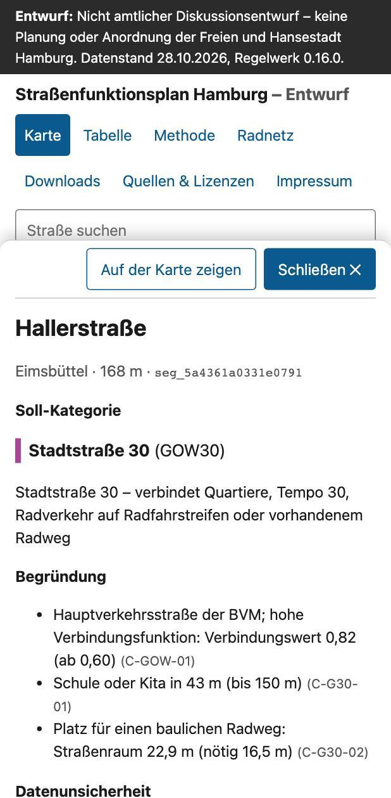 | 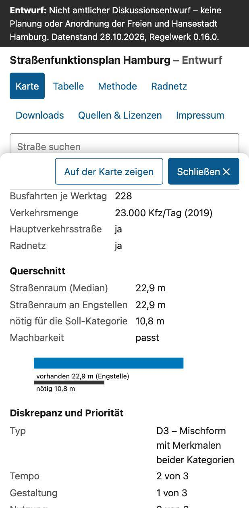 |

### 3.6 Ladezeit und Dateigrößen

| Messung | Daten geladen (Banner) | Karte sichtbar | Karte vollständig | Steckbrief öffnen | übertragen |
|---|---:|---:|---:|---:|---:|
| Live, Smartphone, Slow 4G (1,6 Mbit/s, 150 ms) | 4,1 s | 5,8 s | 10,2 s | 0,4 s | 1.417 KB |
| Live, Desktop, ungedrosselt | 0,7 s | 0,9 s | 2,3 s | 0,4 s | 2.939 KB |
| Lokal, Smartphone, Slow 4G | 3,8 s | 5,4 s | 6,1 s | 0,2 s | 996 KB |

Zusammensetzung beim Start (live, Smartphone):

| Bestandteil | Größe |
|---|---:|
| `search.json` (gzip) | 586 KB |
| JavaScript | 324 KB |
| Grundkarte | 301 KB |
| Schriften | 141 KB |
| Fachkacheln | 16 KB |

`search.json` wird vor der ersten Karte geladen, obwohl es erst beim Tippen ins Suchfeld gebraucht wird; das sind 41 % der Startdaten. Ein Steckbrief-JSON ist im Median 6,5 KB groß, höchstens 8,3 KB.

### 3.7 Barrierefreiheit

- **axe-core 4.13** (WCAG 2.0/2.1/2.2 A und AA) findet 0 Verstöße. Geprüft sind die 22 Zustände des bestehenden Berichts `reports/web_accessibility.md` und 4 zusätzliche Zustände:
  - Tabelle mit Steckbrief (mobil)
  - geöffneter Filter
  - offene Suchvorschläge
  - Radnetz mit Steckbrief (mobil)

  Offen zur Handprüfung bleiben Farbkontrast über der Karte und Links im Fließtext.
- **Umfließen bei 320 px (WCAG 1.4.10): Verstoß auf der Tabellenseite.** Die ganze Seite wird 1.021 px breit, nicht nur der Tabellenbereich.
  - *Ursache:* Die unsichtbaren Zusatztexte in den „öffnen“-Schaltflächen (`.visually-hidden`, `position: absolute`) haben keinen positionierten Vorfahren innerhalb von `.table-wrap`. Sie entkommen dem Scroll-Container und verbreitern das Dokument.
  - *Nachweis:* Mit `.table-wrap { position: relative; }` (nur im Testbrowser eingefügt) ist die Seite wieder 320 px breit.
  - *Folge:* Derselbe Fehler macht den Steckbrief auf dem Smartphone unbedienbar (T3).

  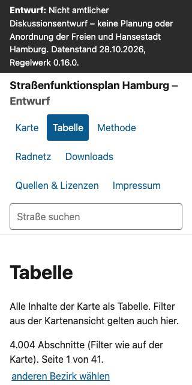
- Auf der Karte ist keine Linie per Tastatur auswählbar. Ausweg sind Tabelle und Suche, wie im bestehenden Bericht beschrieben.

### 3.8 Kennzeichnung als Entwurf

- Das Banner ist in allen 12 geprüften Ansichten beim Laden sichtbar, aber nicht fixiert. Nach einmal Scrollen ist es auf Tabelle, Methode, Radnetz und Downloads verschwunden.
- Am Desktop verdeckt der Steckbrief das Banner teilweise.
- Der Straßenteil des Steckbriefs hat keinen eigenen Entwurfshinweis. Ein Screenshot nur des oberen Steckbriefs, wie er weitergegeben wird, trägt keine Kennzeichnung; der Radteil hat sie.

---

## 4 Drei Konzepte (klickbare Prototypen)

**Start:** `cd web && npx vite --config ../prototypes/vite.config.mjs`, dann http://localhost:5180/.

**Gemeinsam:**
- Echte Daten des Bezirks Eimsbüttel: Kacheln und Steckbriefe aus `data/out`, Kennzahlen aus `prototypes/shared/kpi.json`.
- Farben und Legendengruppen der Webseite: `web/src/palette.js` und `layers.js` werden nur importiert, nicht geändert.
- Ein **neuer Steckbrief** (`prototypes/shared/steckbrief.js`, Abschnitt 5.1), der auf den vorhandenen Steckbrief-JSONs läuft und daher keine Änderung an der Pipeline braucht.

**Prüfung** (`prototypes.mjs`): 22 Zustände ohne Konsolenfehler und mit 0 axe-Verstößen. Ausnahme: abgebrochene Kachelanfragen beim programmatischen Springen der Karte im Modus „Radanlagen“; sie kommen aus dem Testaufbau, nicht aus der Bedienung.

| Steckbrief | heute | Prototyp |
|---|---:|---:|
| Wörter (Hallerstraße) | 538 (Median) | 134 (A) / 196 (B mit Querschnitt) |
| Bildschirme Desktop | 5,0 | 1,1 / 1,6 |
| Bildschirme Smartphone | 8,1 | 1,9 / 2,7 |
| „Was sich ändern soll“ endet bei (Desktop) | ~1.900 px (verteilt) | 588 px / 646 px |

### A – Themen statt Ebenen (`prototypes/themen/`)

Fünf Einstiege ersetzen die 13 Ebenen: Straßenfunktion, Radnetz, Handlungsbedarf, Kreuzungen, Datenqualität. Jedes Thema bietet:
- eine Frage als Überschrift
- zwei Sätze Erklärung
- höchstens drei Ansichten
- eine Legende in Klartext, z. B. „Stadtmagistrale (50 km/h)“
- zwei bis drei Bezirkszahlen
- bei Handlungsbedarf und Kreuzungen eine Rangliste, die zur Stelle springt und den Steckbrief öffnet

Neu sind die Ansichten „Tempo Soll“, „Handlungsbedarf“ (Priorität in drei Klassen), „Datenqualität“ (unsicher / lückenhaft) und Netzlücken als Flächen.

| Desktop: Straßenfunktion | Desktop: Handlungsbedarf mit Steckbrief |
|---|---|
| 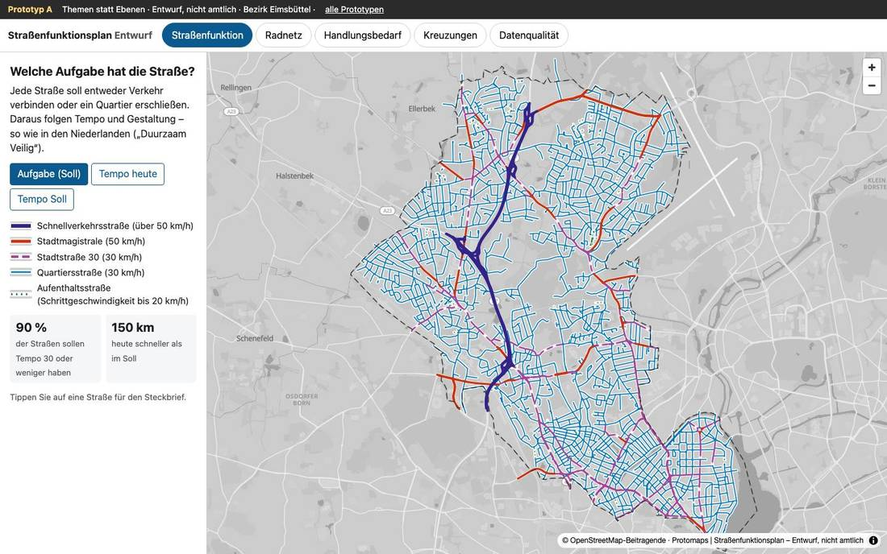 | 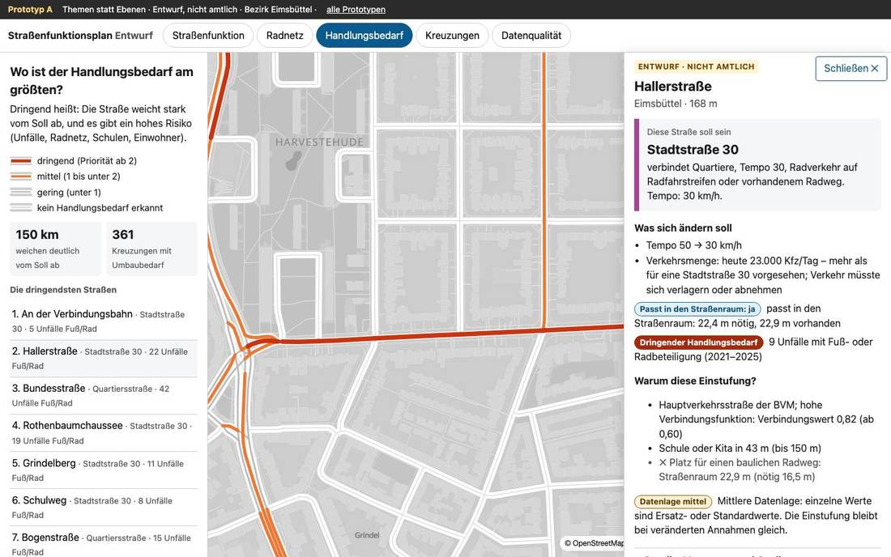 |
| **Desktop: Radnetz mit Netzlücken** | **Smartphone: Handlungsbedarf mit Steckbrief** |
| 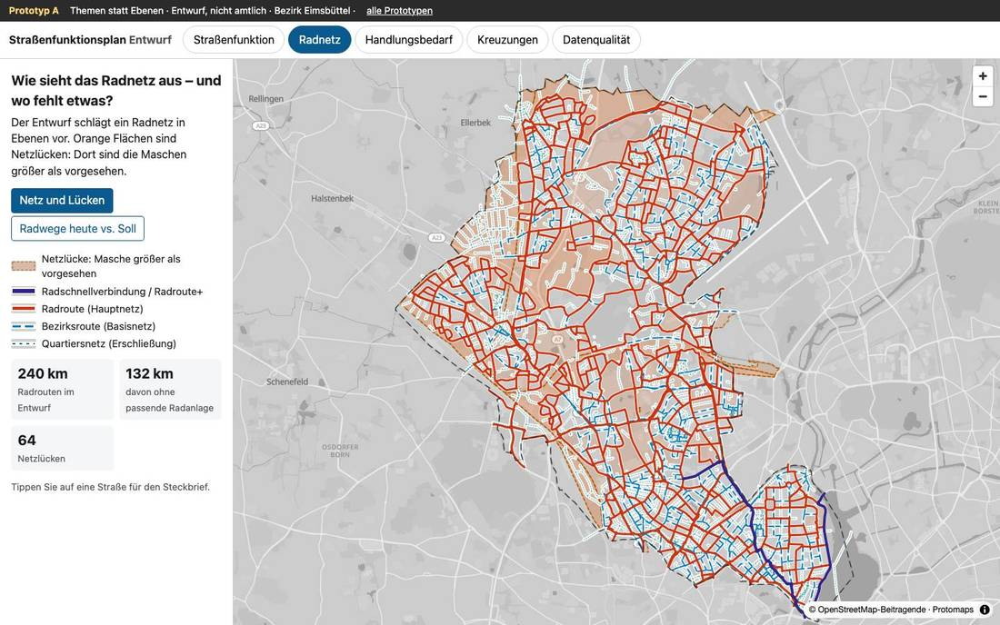 | 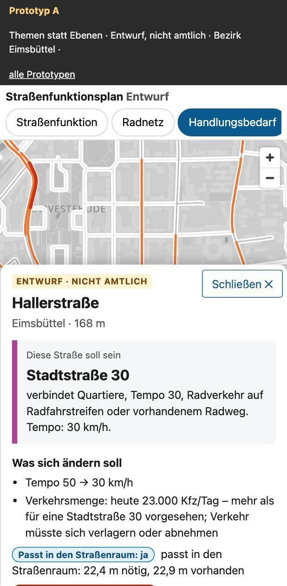 |

- **Vorteile:** Löst T3, T4 und T5 direkt mit 1–2 Klicks statt 4–7, gemessen im Prototyp. Auf dem Smartphone bleibt die Karte die Hauptfläche, Erklärung und Legende stehen darunter. Die Kürzel verschwinden aus der Oberfläche.
- **Nachteile:** Fachleute verlieren freie Kombinationen (z. B. Breite + Bus-Overlay), wenn man nicht eine Experten-Ansicht behält. Die Zuordnung der Ansichten zu Themen muss fachlich entschieden werden.
- **Aufwand** (Schätzung, Annahme): 4–6 Personentage in `web/`, plus 1 Tag Export der Netzlücken und Bezirkszahlen.

### B – Ist/Soll-Vergleich (`prototypes/vergleich/`)

Eine geteilte Karte mit Schieberegler: links das Heute, rechts das Soll, gleiche Farben mit gleicher Bedeutung. Drei Vergleiche:
1. Tempo heute ↔ Tempo Soll
2. Radanlage heute ↔ Soll (aus `fi`/`fs` der Radkacheln)
3. **Szenario:** veröffentlicht (0.16.0) ↔ „GOW50-Kompromiss“. Dafür wurde der gespeicherte Stand `data/variants/2026-11-07_gow50-kompromiss` (Regelwerk 0.14.0, Regel C-G50-02) verwendet. In Eimsbüttel ändern sich 48,2 km, davon 46,1 km von Stadtstraße 30 zu Stadtmagistrale.

Der Steckbrief zeigt im Vergleich den Querschnitt heute (schematisch) und im Soll sowie die Kategorie im Szenario.

| Desktop: Tempo heute / Soll | Desktop: Szenario mit Steckbrief und Querschnitt |
|---|---|
| 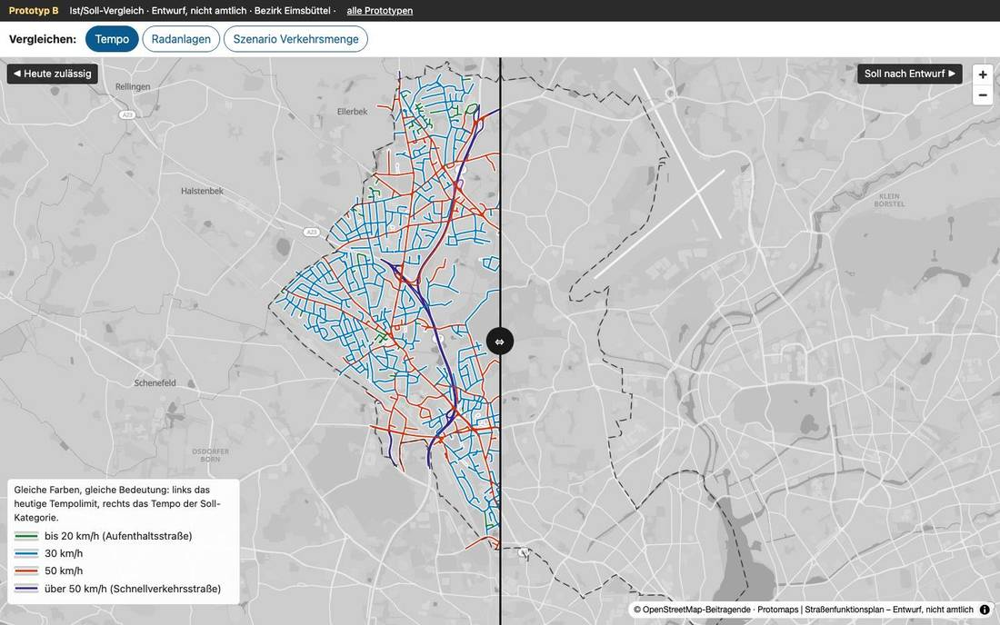 | 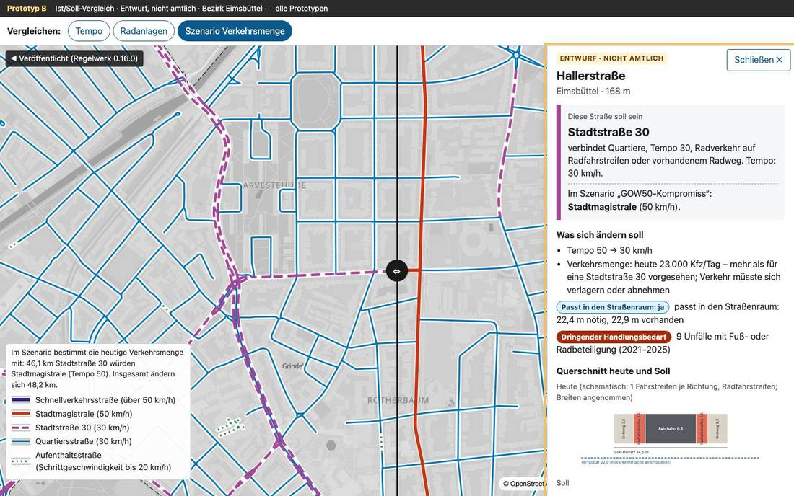 |
| **Desktop: Radanlagen heute / Soll** | **Smartphone: Tempo heute / Soll** |
| 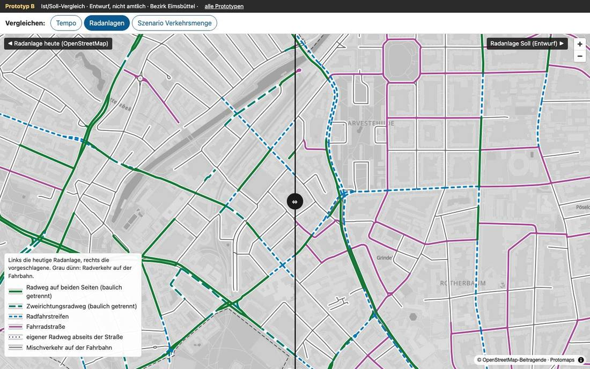 | 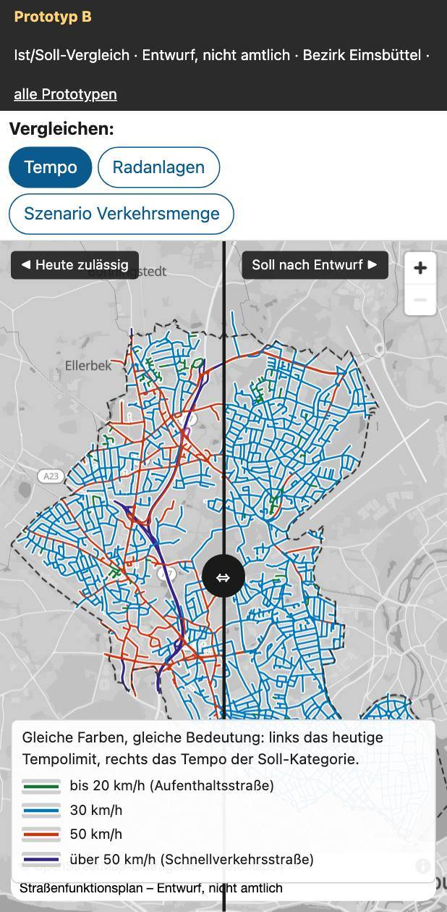 |

- **Vorteile:**
  - Macht die Diskrepanz ohne Erklärung sichtbar: links rote Hauptstraßen mit 50 km/h, rechts fast alles blau mit 30 km/h.
  - Derselbe Mechanismus trägt die Szenarien aus Phase 2a (A–D).
  - Der Querschnitt vorher/nachher beantwortet T2 in einem Bild.
- **Nachteile:**
  - Es laufen zwei Karten; auf dem Smartphone ist der Schieberegler eng.
  - Das Ist-Querschnittsbild ist geschätzt, mit angenommenen Breiten: Gehweg 2,5 m, Fahrstreifen 3,25 m, Radweg 1,6 m (`source_type: assumption`), weil es keine gemessenen Ist-Elementbreiten gibt. Für echte Breiten bräuchte es ein Ist-Profil in der Pipeline.
- **Aufwand** (Schätzung): 6–9 Personentage, plus 2–4 Tage für ein Ist-Profil aus OSM-Tags (Fahrstreifen, Parken, Radanlage), falls gewünscht.

### C – Geführter Einstieg (`prototypes/gefuehrt/`)

Drei Schritte führen zur Karte:
1. Die Idee: Aufgabe → Gestaltung → Heute
2. Die fünf Straßentypen mit Linienmuster
3. „Ihr Bezirk“ mit sechs Kennzahlen, der Verteilung der Straßentypen, den fünf dringendsten Straßen und Kreuzungen und einem Vergleich der sieben Bezirke

Erst danach kommt die Karte; „Direkt zur Karte“ ist auf jeder Seite möglich.

| Schritt 1 | Bezirksübersicht (ganze Seite) |
|---|---|
| 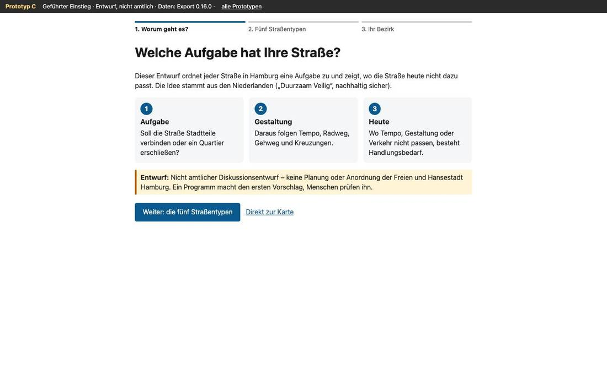 | 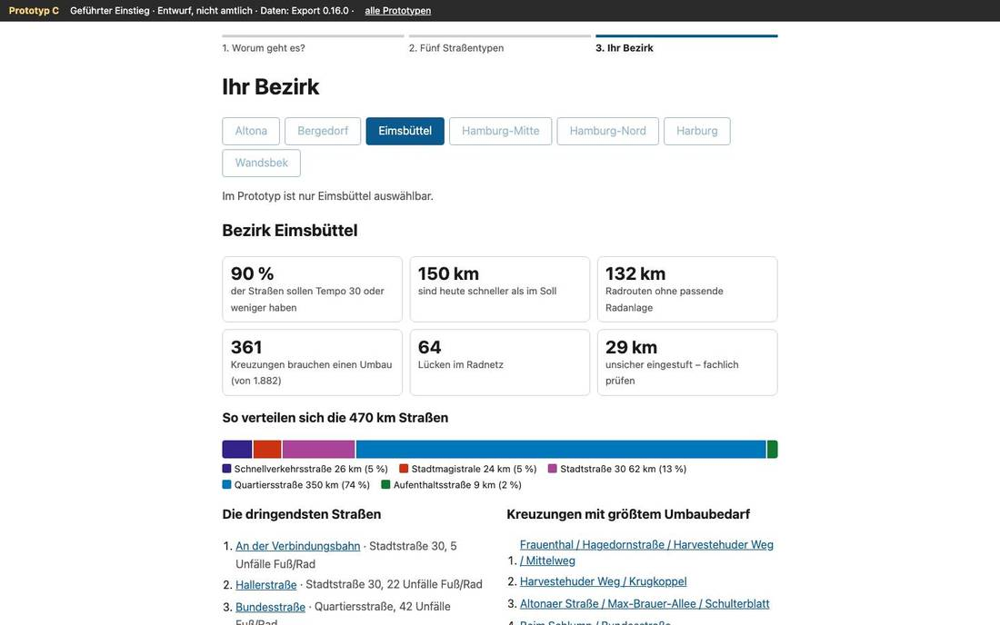 |
| **Karte nach Klick auf eine Kreuzung** | **Smartphone: Bezirksübersicht** |
| 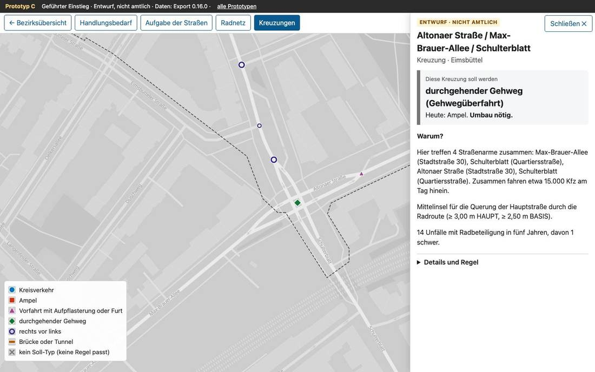 | 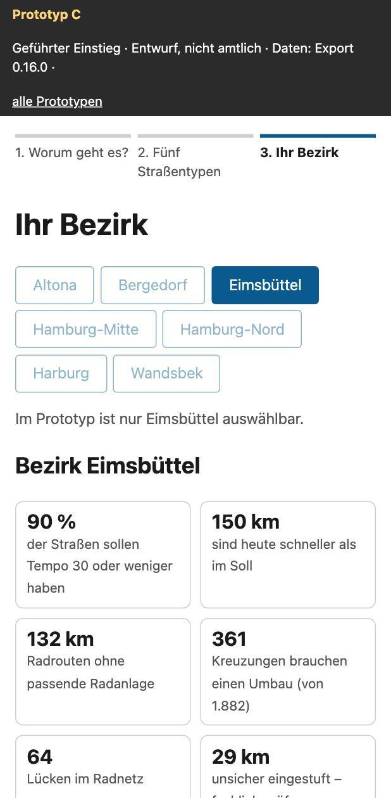 |

Kennzahlen Eimsbüttel aus `kpi.json`:

| Kennzahl | Wert |
|---|---|
| Straßen mit Soll Tempo 30 oder weniger | 90 % |
| Heute schneller als im Soll | 150 km |
| Radrouten ohne passende Radanlage | 132 km |
| Kreuzungen mit Umbaubedarf | 361 von 1.882 |
| Netzlücken | 64 |
| Unsicher eingestuft | 29 km |

- **Vorteile:** Beantwortet T3 („größter Handlungsbedarf“) ohne Karte. Die Kennzahlen eignen sich für Bezirksgremien und Presse. Die Einführung erklärt Duurzaam Veilig, bevor Farben erscheinen.
- **Nachteile:** Wiederkehrende Nutzer brauchen den Einstieg nicht; er braucht einen Merker im Browser und einen direkten Link. Die Kennzahlen müssen bei jedem Export neu entstehen (kleine Erweiterung der Exportstufe).
- **Aufwand** (Schätzung): 5–7 Personentage, plus 1 Tag für `kpi.json` im Export.

### Die Konzepte im Vergleich

| | heute | A Themen | B Vergleich | C Geführt |
|---|---|---|---|---|
| T1 Kategorie + warum | Suche, dann Linie treffen | gleich, kürzerer Steckbrief | gleich | gleich |
| T2 Was ändert sich, passt es? | 4–5 Scrolls, 246 Wörter | Kurzantwort, 0 Scrolls | Kurzantwort + Querschnitt | Kurzantwort |
| T3 Handlungsbedarf Bezirk | Tabelle, 5 Schritte, nur Straßen | Rangliste, 1 Klick | – | Übersicht ohne Karte |
| T4 Radnetz und Lücken | 2 Ebenen, keine Netzlücken | 1 Klick, mit Netzlücken | Radanlage heute/Soll | Karte „Radnetz“ |
| T5 Kreuzung | Rad-Ebene suchen | Thema „Kreuzungen“ + Rangliste | – | Rangliste |
| Szenarien (2a) | – | als Ansicht möglich | **eingebaut** | als Kennzahl möglich |

Die Konzepte schließen sich nicht aus: A als Gerüst, B als Modus innerhalb eines Themas, C als Startseite mit Bezirksübersicht.

---

## 5 Datenpräsentation

### 5.1 Steckbrief: Kurzantwort zuerst

Gliederung, wie im Prototyp umgesetzt (`prototypes/shared/steckbrief.js`):

1. **Kopf** mit Name, Bezirk, Länge und dem Hinweis „Entwurf · nicht amtlich“ in jedem Steckbrief.
2. **Kurzantwort** in einem Kasten in der Kategoriefarbe: „Diese Straße soll sein: Stadtstraße 30 – verbindet Quartiere … Tempo 30 km/h.“ Bei Szenarien folgt eine Zeile „Im Szenario …“.
3. **Was sich ändern soll** als höchstens vier Sätze aus vorhandenen Feldern:
   - Tempo `ist → soll`
   - Radanlage heute → Soll
   - weniger Fahrstreifen
   - Verkehrsmenge über Soll mit Klartext („Verkehr müsste sich verlagern oder abnehmen“)
4. **Passt es?** als *eine* Antwort. Das detaillierte Radverkehrs-Profil hat Vorrang vor der groben Straßen-Machbarkeit; damit entfällt der Widerspruch auf 188 km in der Darstellung. Die fachliche Frage, welche Machbarkeit gilt, gehört in Phase 4.
5. **Dringlichkeit** in drei Klassen aus `priority` (dringend ab 2, mittel ab 1, gering darunter; Annahme), dazu die Unfallsumme.
6. **Warum diese Einstufung?** als Begründungssätze ohne Regel-IDs; nicht erfüllte Bedingungen sind ausgegraut und mit ✗ markiert.
7. **Wie sicher?** als *ein* Hinweis: Zuerst die Robustheit („unsicher“, wenn die Sensitivität kippt), sonst die Datenlage in Worten.
8. **Details** aufklappbar: Messwerte, Regeln für Fachleute (IDs, erfüllt / nicht erfüllt, Version), Quellen, Link zum vollständigen Steckbrief.

Für die Übernahme sollte zusätzlich das Ist der Radanlage aus *einer* Quelle kommen (Widerspruch auf 129 km, Abschnitt 3.5).

### 5.2 Klartext statt Regel-IDs, Annahmen sichtbar machen

- Die Begründungen sind schon heute Sätze (`reasons[].text`); die IDs können in den Detailbereich wandern. Beispiele:

  | ID heute im Text | Klartext (vorhanden) | Vorschlag Zusatz |
  |---|---|---|
  | C-GOW-01 | „Hauptverkehrsstraße der BVM; hohe Verbindungsfunktion: Verbindungswert 0,82 (ab 0,60)“ | „Verbindungswert“ einmal erklären (Glossar-Tooltip) |
  | C-G30-01 | „Schule oder Kita in 43 m (bis 150 m)“ | „(bis 150 m, **Annahme**)“ – Schwelle in rules.yaml mit `source_type: assumption` |
  | C-G30-02 | „Platz für einen baulichen Radweg: Straßenraum 22,9 m (nötig 16,5 m)“ | – |
  | J-05 (Knoten) | „Regel J-05 (Kategoriepaar GOW30+ETW30) ergibt hier: …“ | „Hier trifft eine Stadtstraße 30 auf eine Quartiersstraße; dafür schlägt der Entwurf … vor.“ |

- **Annahmen kennzeichnen:** In `rules.yaml` sind 51 von 76 Schwellenwerten `assumption`, 21 `swov_crow` und 4 `de_regelwerk`. Der Steckbrief zeigt Schwellen wie „bis 150 m“, ohne die Herkunft zu nennen. Vorschlag: ein kleines Kennzeichen „Annahme“ bzw. „CROW“ hinter jedem Schwellenwert, aus `source_type` im Export erzeugt. Dazu muss der Export `source_type` je Begründung mitliefern (kleine Erweiterung der Exportstufe).
- Ein **Glossar** mit etwa zwölf Begriffen (Verbindungswert, Diskrepanz, DTV, Masche, Querschnitt …) ersetzt Fachwörter nicht, sondern erklärt sie beim Antippen.

### 5.3 Unsicherheit und Annahmen

- Die Ampel ist für 89 % der Länge „mittel“ und hilft damit kaum bei der Auswahl. Besser ist eine zweistufige Kennzeichnung:
  - „**unsicher** – fachlich prüfen“ aus der Sensitivität (stadtweit 218 km, Eimsbüttel 29 km)
  - „**Datenlücke**“ aus `confidence = niedrig` (276 km)
  - alles andere ohne Kennzeichnung, Details im Aufklappbereich
- Auf der Karte als eigene Ansicht „Datenqualität“ (Prototyp A) statt nur im Steckbrief.
- Szenario-Annahmen (z. B. Verkehrsverdampfung 0/10/20 %) gehören sichtbar an den Szenarioschalter, nicht in eine Fußnote.

### 5.4 Bezirkskennzahlen

- Eine `kpi.json` je Export mit den Kennzahlen aus `district_kpi.py` (Tabelle in Abschnitt 4C).
  - Normierung: Anteile nach Länge bzw. Anzahl, damit Bezirke unterschiedlicher Größe vergleichbar sind.
  - Ranglisten auf Straßen statt auf Abschnitte verdichtet; die Hallerstraße erscheint dann einmal statt sechsmal.
- Darstellung als Kennzahlkacheln und eine Vergleichstabelle mit Balken. Die Tabelle ist zugleich die Textalternative.

### 5.5 Downloads und Datenbeschreibung

`datenbeschreibung.md` ist vollständig, aber technisch. Vorschläge:
- Am Anfang drei Zeilen „Welche Datei wofür?“ (GeoPackage/GeoParquet für GIS, CSV für Tabellen, GeoJSON für Web).
- Eine Tabelle Kürzel → Klartext (Kategorien, D1–D3, Radnetzebenen, Knotentypen).
- Eine Spalte `source_type` bzw. eine Spalte „Herkunft“ je Feld (amtlich, OSM, berechnet, Annahme).
- Ein Download der Netzlücken (heute nur in `data/interim`).
- Szenarien als eigene Dateien (`scenario_<name>.csv`: `segment_id`, Kategorie, Abweichung zum Stand) mit Annahmen im Kopf.
- `search.json` erst beim ersten Fokus auf das Suchfeld laden (spart auf dem Smartphone 41 % der Startdaten).

### 5.6 Szenarien darstellen

Am Beispiel des echten GOW30→GOW50-Wechsels (Phase 1.3, `data/scenarios/review_static/gow_switch.json`; stadtweit 367 km GOW30 → GOW50) gezeigt in Prototyp B:

1. **Umschalter oder Schieberegler** zwischen „veröffentlicht“ und Szenario, gleiche Farben auf beiden Seiten.
2. **Kennzahl am Schalter:** „In Eimsbüttel ändern sich 48,2 km; 46,1 km Stadtstraße 30 würden Stadtmagistrale.“
3. **Steckbrief-Zeile** „Im Szenario: Stadtmagistrale (50 km/h)“ nur dort, wo sich etwas ändert.
4. Für A–D aus Phase 2a:
   - Auswahl aus bis zu vier Szenarien
   - eine Differenzansicht, die nur geänderte Abschnitte hervorhebt und den Rest grau zeigt
   - Annahmen (Verdampfung, Kapazität) direkt am Schalter
   - Mehrbelastung auf ETW30 (Schleichverkehr) als eigene Klasse

   Datenformat: je Szenario eine kleine JSON `segment_id → Kategorie` (Eimsbüttel: 18 KB) und die Kennzahlen; Kacheln müssen nicht neu entstehen.

Die Szenarien A–D aus Phase 2a wurden parallel zu dieser Phase fertig. Sie stehen in `02a_strassen.md` und `data/scenarios/B_gow30_cap`, `C_gow30_reduction` und `D_assignment`; Szenario A ist der veröffentlichte Stand 0.16.0.
Prototyp B nutzt noch den gespeicherten Variantenstand 0.14.0 (Verkehrsmenge als Grenze), nicht die Läufe aus Phase 2a. Für B, C und D braucht der Umschalter je Szenario nur die Zuordnung `segment_id → Kategorie` (bei C zusätzlich die nötige Reduktion in Kfz/Tag, bei D die Mehrbelastung). Das ist Datenaufbereitung, keine neue Oberflächenlogik.

---

## 6 Eingangspunkte für das Optionenpapier (Phase 4)

Hier wird nichts entschieden.

1. Korrektur `.table-wrap { position: relative; }`: behebt den Verstoß beim Umfließen und den unbedienbaren Steckbrief auf dem Smartphone. Aufwand < 1 Stunde.
2. Suche öffnet den Steckbrief, auf dem Smartphone klappt das Bedienfeld nach der Suche zu, Knoten werden suchbar.
3. Welche Machbarkeit gilt (Straßenprofil oder Radverkehrs-Profil), und aus welcher Quelle kommt das Ist der Radanlage? (188 km und 129 km Widerspruch)
4. Neuer Steckbrief mit Kurzantwort zuerst (Prototyp, 3–4 Personentage).
5. Farbpalette: `#B35900` ersetzen; Rot nicht für Soll-Funktionen und Hauptradnetz verwenden.
6. Oberflächenkonzept: A, B, C oder eine Kombination (Vergleichstabelle in Abschnitt 4).
7. Netzlücken und Bezirkskennzahlen exportieren.
8. Annahmen im Steckbrief kennzeichnen (`source_type` im Export).
9. Ampel durch „unsicher / Datenlücke“ ersetzen.
10. `search.json` erst bei Bedarf laden.
11. Entwurfshinweis im Steckbrief und als festes Banner.
12. Darstellung der Szenarien aus Phase 2a nach dem Muster von Prototyp B.

## 7 Reproduktion

```sh
uv run python analysis/review_2026_11/ui/fixtures.py
uv run python analysis/review_2026_11/ui/district_kpi.py
(cd web && npx vite preview --port 4173 --strictPort) &        # gebaute Seite
node analysis/review_2026_11/ui/tasks.mjs
node analysis/review_2026_11/ui/heuristics.mjs --live          # --only=controls,zoom,cvd,profiles,draft,axe,load
(cd web && npx vite --config ../prototypes/vite.config.mjs) &  # Prototypen
node analysis/review_2026_11/ui/prototypes.mjs
uv run python analysis/review_2026_11/ui/curate_images.py      # nur referenzierte Bilder in docs/, Rest nach data/
```
