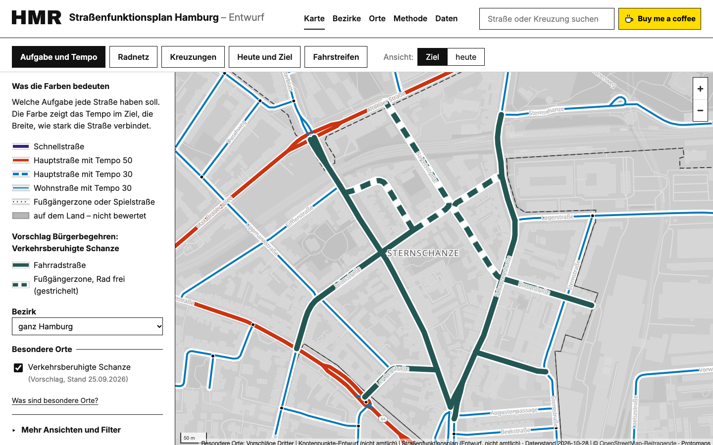
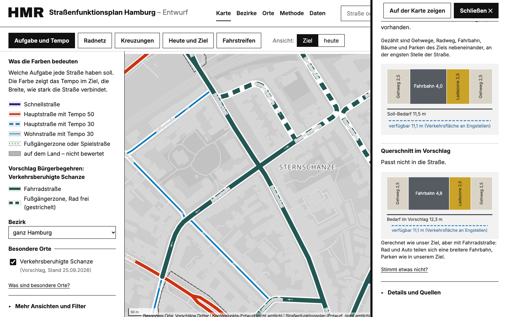

# Besondere Orte – Bericht Teil 1

Stand: 16.11.2026, zweite Runde · Branch `explore/special-places-schanze` · Auftrag:
`prompts/26_special_places_trees_parking.md`

Nichts ist gemergt oder veröffentlicht. Die Rückmeldung zur ersten Vorschau ist eingearbeitet: neuer Zuschnitt, nur
Grün, kein Leuchtschein, kein 3D, Querschnitt im Vorschlag, kein Verkehrsszenario.

## Kurz

- **Neue Funktion „Besondere Orte“:** Sie zeigt Vorschläge Dritter auf der Karte, im Steckbrief und auf der Seite `#orte`. Neue Orte kommen nur durch einen neuen Eintrag in `config/special_places.yaml` dazu.
- **Schanze:** 24 Abschnitte (2,07 km) als Fahrradstraße und 3 Abschnitte (0,77 km) als Fußgängerzone mit „Rad frei“.
- **Regelwerk unverändert:** Klassifikation, Soll-Kategorie, Regeltext und Soll-Querschnitt ändern sich nicht. Ein Test prüft das.
- **Neu im Steckbrief:** die Skizze „Querschnitt im Vorschlag“, gerechnet mit unserer eigenen Querschnittslogik.
- **Tests:**
  - `make test`: 1831 Python-Tests und 136 Web-Unit-Tests grün
  - `make a11y`: 66 von 66 grün, axe meldet 0 kritische und 0 ernste Verstöße
  - keine Konsolenfehler

## Stand der Initiative

- **Was wir zeigen:** „Stand 25.09.2026: Unterschriften werden gesammelt“. Das Bezirksamt Altona hat das Bürgerbegehren zugelassen; nötig sind 3 % der Wahlberechtigten in Altona innerhalb von sechs Monaten.
- **Quellen:** zukunftsentscheid-hamburg.de und Radio Reeperbahn, beide am 16.11.2026 erreichbar.
- **Neuerer Stand:** keiner gefunden.
- **Vor der Veröffentlichung erneut prüfen.** Das steht auch in `docs/open_questions.md`.

## Zuschnitt

Nach deiner Vorgabe:

| Maßnahme | Straße | Abschnitte | Länge | Grenze |
| --- | --- | ---: | ---: | --- |
| Fahrradstraße | Schanzenstraße | 8 | 648 m | bis zur Sternschanzenbrücke |
| | Schulterblatt | 7 | 626 m | bis zur Altonaer Straße |
| | Lerchenstraße | 2 | 158 m | bis zur Stresemannstraße |
| | Juliusstraße | 3 | 251 m | ganz |
| | Kampstraße | 2 | 175 m | ganz |
| | Ludwigstraße | 1 | 137 m | ganz |
| | Susannenstraße | 1 | 73 m | ganz |
| Fußgängerzone, Rad frei | Bartelsstraße (Doppelname mit Susannenstraße) | 2 | 583 m | ganz |
| | Rosenhofstraße | 1 | 185 m | ganz |

**Zu den Grenzen:**
- **Sternschanzenbrücke:** Die Brücke der Verbindungsbahn liegt im Abschnitt `seg_8792f14eff61d5ea`. Er ist 117 m lang, die Brücke liegt 40–64 m vor seinem Nordende. Ich habe ihn mitgenommen, weil der größere Teil südlich der Brücke liegt. Abschnitte zu teilen würde die `segment_id` ändern.
- **Altonaer Straße und Stresemannstraße:** Die Abschnitte enden jeweils an der Kreuzung. Die kurzen Stücke innerhalb der Kreuzungen gehören nicht dazu.

## Darstellung

- **Linien:**
  - Fahrradstraße: durchgehend Dunkelgrün (#235753, aus der Palette des Zukunftsentscheids) auf weißer Kontur
  - Fußgängerzone: dieselbe Farbe gestrichelt
- **Weggefallen:** kein Leuchtschein, kein Farbverlauf, kein 3D. Das Kippen der Karte ist wieder entfernt.
- **Bedeutung ohne Farbe:** Die Maßnahme ist am Muster erkennbar. Die Legende sagt zusätzlich „(gestrichelt)“, damit das auch ohne Bild ankommt.
- **Legende:** Sie wechselt mit dem Schalter („Vorschlag Bürgerbegehren: Verkehrsberuhigte Schanze“).
- **Schalter „Besondere Orte“:** bleibt unter der Bezirksauswahl.
- **Link:** `#karte?place=schanze_verkehrsberuhigt` öffnet den Ort direkt.

Screenshots in `screenshots/`:
- im Repository: `d_overview.png`, `m_overview.png`, `d_profile_cycle_street.png` (Kampstraße), `m_profile_cycle_street.png`, `d_page_orte.png`
- nur lokal in `screenshots/alle/` (nicht im Repository): Zoom-Ansichten, Steckbrief Rosenhofstraße, mobile Orte-Seite

## Querschnitt im Vorschlag (neu)

Im Steckbrief steht nach unserer Skizze „Hat das Ziel Platz?“ ein zweiter Block „Querschnitt im Vorschlag“. Er wird beim Export mit derselben Logik und denselben Werten gerechnet wie unser Soll-Querschnitt (`pipeline/lib/profile.py`, `config/design_rules.yaml`). Nur die Maßnahme ist eingesetzt (`config/special_places.yaml`, `measures.*.profile`):

- **Fahrradstraße:**
  - Radführung „Fahrradstraße“; die Fahrbahn bekommt deren Sollbreite (cycle_street_carriageway)
  - Kategorie, Gehwege, Ladezone und Parken bleiben wie in unserem Ziel
- **Fußgängerzone:**
  - Kategorie „Fußgängerzone oder Spielstraße“ (ETW_ERF): eine gemeinsame Mischfläche ohne Gehwege
  - kein Parken am Rand (PRF-03 für ETW_ERF); Ladezone wie im Ziel

**Ergebnis für die 27 Abschnitte:**

| Fall | Abschnitte | Anzeige im Steckbrief |
| --- | ---: | --- |
| Querschnitt gleich wie in unserem Ziel | 21 | „Die Aufteilung der Straße bleibt wie in unserem Ziel. Anders sind nur die Verkehrsregeln.“ |
| Fahrradstraße mit breiterer Fahrbahn (4,75 m statt 4,0 m) | 3 | zweite Skizze; Kampstraße `seg_5835…` und Lerchenstraße `seg_18b1…` passen nicht, Lerchenstraße `seg_20ce…` passt |
| Fußgängerzone als Mischfläche 4,75 m und Ladezone | 3 | zweite Skizze; passt überall, es bleibt viel Platz übrig |

**Hinweis:** Bei 21 Abschnitten ist die Aufteilung gleich, weil unser Ziel für eine Wohnstraße mit Tempo 30 dieselbe Fahrbahnbreite vorsieht wie für eine Fahrradstraße. Der Unterschied liegt dann in den Verkehrsregeln (Vorrang für das Rad, Autos nur als Anlieger), nicht im Platz.

**Offen:** Was der Vorschlag zum Parken vorsieht, steht nicht in den Quellen. Die Skizze sagt das ausdrücklich: „Was der Vorschlag zum Parken sagt, ist offen.“ Die Frage steht in `docs/open_questions.md`.

## Alle erzeugten Texte

Die Vergleichssätze hast du freigegeben. Einzige Änderung seit der ersten Vorschau: Den Satz „Rad und Auto teilen sich die Fahrbahn“ habe ich aus Variante 2 gestrichen, weil ihn die Bedingung nicht absichert (Hinweis aus dem Review).

**Fahrradstraße – Vergleich** (Anzahl der Abschnitte nach dem neuen Zuschnitt)
1. *(13)* „Unser Entwurf sieht hier auch eine Fahrradstraße vor. Vorschlag und Regelwerk passen zusammen.“
2. *(1)* „Unser Regelwerk sieht hier eine Wohnstraße mit Tempo 30 vor. Die Straße gehört zum Radnetz. Eine Fahrradstraße passt dazu, wenn wenig Autoverkehr bleibt.“
3. *(10)* „Unser Regelwerk sieht hier eine Wohnstraße mit Tempo 30 vor. Die Straße gehört in unserem Entwurf nicht zum Radnetz. Eine Fahrradstraße geht darüber hinaus. Sie passt zu einer Wohnstraße, wenn wenig Autoverkehr bleibt.“
4. bis 6. *(0)* Varianten für andere Kategorien und der Rückfall, unverändert wie in der ersten Vorschau

**Hinweise:**
- „Heute gilt hier Tempo 50. In einer Fahrradstraße gilt höchstens Tempo 30.“ (an Schanzenstraße, Schulterblatt und Lerchenstraße mit Tempo 50 heute)
- Der Bus-Hinweis kommt in der Schanze nicht vor.

**Fußgängerzone – Vergleich** *(3)*: „Hier geht der Vorschlag weiter als unser Regelwerk. Wir sehen eine Wohnstraße mit Tempo 30 vor. Eine Fußgängerzone sieht unser Regelwerk nur dort vor, wo heute schon eine ist. Neue Fußgängerzonen plant es nicht.“

**Neue Sätze zum Querschnitt:**
- „Die Aufteilung der Straße bleibt wie in unserem Ziel. Anders sind nur die Verkehrsregeln.“
- Fahrradstraße: „Gerechnet wie unser Ziel, aber mit Fahrradstraße: Rad und Auto teilen sich eine breitere Fahrbahn, Parken wie in unserem Ziel.“
- Fußgängerzone: „Gerechnet wie eine Fußgängerzone in unserem Regelwerk: eine gemeinsame Fläche ohne Bordstein und ohne Parken am Rand. Was der Vorschlag zum Parken sagt, ist offen.“

## Leistung

| Messung | Wert |
| --- | --- |
| `special_places.geojson` (nur bei eingeschaltetem Ort geladen) | 10,6 KB (vorher 48 KB mit den 3D-Flächen) |
| Zusätzlicher Code im Startbundle | ca. +4 KB gzip (weniger als in der ersten Runde: Kippen, 3D und Verlauf sind entfernt) |
| Bildrate Handy, gedrosselt (Messung der ersten Runde, mit 3D) | Median 59,9 fps; ohne 3D höchstens gleich gut |

## Szenario

Auf deinen Wunsch wird kein Verkehr durchgerechnet. Der Querschnitt im Vorschlag ist eine reine Platzrechnung je Abschnitt, ohne Verlagerung auf Nachbarstraßen.

## Wer was gemacht hat

| Agent | Modell | Aufgabe |
| --- | --- | --- |
| `street-matcher` | haiku | erste Zuordnung Straßen → `segment_id`, Doppelnamen und Lücken |
| `screenshot-runner` | haiku | Screenshots der ersten Runde (A/B, flach und gekippt) |
| `a11y-perf-check` | haiku | axe, Dateigrößen, Bildrate und Konsole (erste Runde); fand den zu kleinen Link |
| `review` | sonnet | unabhängige Prüfung des Diffs der ersten Runde; Hinweise eingearbeitet |
| Hauptsitzung | – | Zuschnitt an Brücke und Kreuzungen (OSM-Bahnbrücke gegen Abschnitte geprüft), neue Darstellung, Querschnitt im Vorschlag, Tests, Screenshots und Prüfungen der zweiten Runde, Bericht |

## Geänderte Dateien (Stand zweite Runde)

- **Konfiguration:**
  - `config/special_places.yaml` (0.2.0): Zuschnitt, `theme` nur Grün, `measures.*.profile`
  - `config/schema/special_places_model.py`: `ProfileChange`, ohne 3D-Felder
  - `config/plain_language.yaml`: Texte zum Querschnitt im Vorschlag
- **Pipeline:**
  - `pipeline/lib/special_places.py`: `proposal_input`, `proposal_profiles`, ohne 3D-Flächen
  - `pipeline/s09_export.py`: `proposal_profiles` aus den Eingaben von c06
- **Web:**
  - `web/src/layers.js`: grüne Linie, gestrichelt für die Fußgängerzone
  - `web/src/map.js` und `web/src/main.js`: Kippen und 3D entfernt
  - `web/src/panel.js`: Skizzentitel als Parameter
  - `web/src/profile.js`: Block „Querschnitt im Vorschlag“
- **Tests:** `tests/test_special_places.py`, `web/test/profile.test.js`
- **Doku:** `docs/open_questions.md`, `CHANGELOG.md`
- **Prüfdatei:** `reports/special_places_schanze_match.geojson` zeigt noch die erste, ungekürzte Zuordnung des Agenten. Maßgeblich ist `config/special_places.yaml`.

## Offene Punkte

1. **Parken im Vorschlag:** Bei der Initiative nachfragen? Bis dahin bleibt der Hinweis in der Skizze.
2. **Mehrere Orte:** Ab dem zweiten Ort würde ich den Schalter auf Auswahlknöpfe umstellen.
3. **Freigabe Teil 1:** Wenn du zustimmst, committe ich Teil 1 auf diesem Branch. Danach beginne ich Teil 2 (Bäume und Parkplätze) auf `feature/trees-parking-stats`. Gemergt und deployed wird erst nach deinem OK zu Teil 2.
