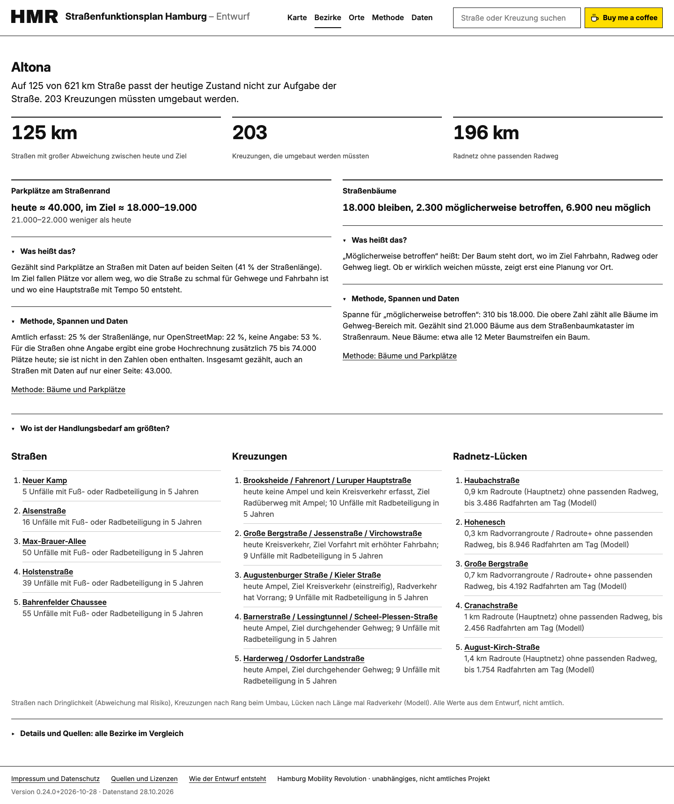

# Bäume und Parkplätze – Bericht Teil 2

Stand: 17.11.2026 · Branch `feature/trees-parking-stats` (zweigt von `explore/special-places-schanze` ab) · Auftrag:
`prompts/26_special_places_trees_parking.md`, Teil 2 · Methode: `methode_vorschlag.md` (Freigabe 16.11.2026)

Nicht committet, nicht gemergt, nicht deployed. Dies ist der Halt nach 2.3.

## Kurz

| Hamburg (Arbeitsgebiet, 4 240 km) | Wert |
| --- | --- |
| Parkplätze heute, Straßen mit Daten auf beiden Seiten (37 % der Länge) | ≈ 248 000 |
| … im Ziel | ≈ 133 000–137 000 (≈ 112 000–115 000 weniger) |
| Straßenbäume im Straßenraum (Kataster) | 190 567 |
| … möglicherweise betroffen | ≈ 21 000 (Spanne 3 600–62 000; Gehweg-Bäume bleiben) |
| … neu möglich (Baumstreifen im Ziel) | ≈ 62 000 |
| Verkehrsberuhigte Schanze | ≈ 270 Parkplätze weniger im Vorschlag (559 → 293 auf 25 von 27 Abschnitten) |

**Woher der Rückgang beim Parken kommt** (Straßen mit vollständigen Daten):
- **Wohnstraßen, Abbaustufe D1 (ca. 58 000 Plätze):** Das Ziel mit Gehwegen von 2,5–3 m und 4,75 m Fahrbahn passt nicht in die Straße, deshalb fällt das Parken zuerst weg.
- **Hauptstraßen mit Tempo 50 (ca. 27 000):** Dort gibt es nach PRF-03 kein Parken am Rand.
- **Schräg- und Querparken wird Längsparken (ca. 25 000):** Wo das Ziel nur Längsparken kennt, passen weniger Plätze an denselben Bordstein.

Das sind Folgen unseres Regelwerks, keine neue Setzung. Sie lassen sich aber diskutieren, etwa ob D1 vor schmaleren Gehwegen kommen sollte.

## Daten

| Quelle | Lizenz | Stand | Nutzung |
| --- | --- | --- | --- |
| Straßenbaumkataster (BUKEA, WFS `de.hh.up:strassenbaumkataster`) | dl-de/by-2.0 | Abruf 16.11.2026 | 229 876 Bäume; 190 567 im Straßenraum eines Abschnitts |
| Öffentlicher Parkraum (LBV, WFS `de.hh.up:parkraum`) – **neu gefunden** | dl-de/by-2.0 | Abruf 16.11.2026 | 203 029 Flächen, fast alle ein Stellplatz; 194 535 zugeordnet |
| OSM-Parktags je Seite (`parking:left/right/both`, alt `parking:lane:*`) | ODbL | Auszug 28.10.2026 | 10 343 Abschnitte mit mindestens einer Seite |

`sources.yaml` 0.1.13 (beide WFS geprüft, `check_status: verified`), Manifest und Quellenvermerke in `docs/licenses.md`
sind nachgetragen.

**Abdeckung Parken (Länge):**

| Bezirk | amtlich | nur OSM | keine Daten |
| --- | ---: | ---: | ---: |
| Hamburg-Nord | 68 % | 11 % | 21 % |
| Hamburg-Mitte | 27 % | 24 % | 49 % |
| Eimsbüttel | 24 % | 28 % | 48 % |
| Altona | 25 % | 22 % | 53 % |
| Wandsbek | 11 % | 3 % | 87 % |
| Harburg | 6 % | 7 % | 87 % |
| Bergedorf | 5 % | 11 % | 85 % |
| Hamburg | 25 % | 15 % | 61 % |

## Methode (wie freigegeben, mit drei Änderungen)

Die Methode steht in `methode_vorschlag.md`, die Regeln TP-P-01 bis TP-T-03 in `design_rules.yaml` 0.11.0. Die Rechnung macht die Stufe `pipeline/c09_trees_parking.py` (`make trees-parking`, in der Kette vor `export-cycling`).

**Änderungen gegenüber dem Vorschlag:**
1. **Ziel nach PRF-03 statt nur nach dem Profil-Element (TP-P-03).** Das Soll-Profil setzt Parkreihen nur, wo OSM Parken angibt. Mit dem Profil-Element allein wären amtlich erfasste Plätze als „entfallend“ gezählt worden: erster Lauf rund 42 000 statt rund 135 000 im Ziel. Jetzt entscheidet die Aufgabe der Straße:
   - Wohnstraße: Plätze bleiben, höchstens so viele wie längs Platz haben, außer bei D1.
   - Hauptstraße mit Tempo 50 und Fußgängerzone: 0.
   - Hauptstraße mit Tempo 30: nur Parkstreifen.
2. **Mittlere Schätzung bei Bäumen:** zusätzlich zur Spanne. Seit 17.11.2026 zählen Bäume im Gehweg als „bleibt“ (deine Entscheidung). Vorher reichte die obere Zahl bis 84 % aller Bäume, jetzt bis 62 000. Die Karten zeigen die mittlere Schätzung, die Spanne steht auf Stufe 3.
3. **Korrekturen nach der QA** (siehe unten):
   - lange amtliche Flächen nach Fläche statt nach Länge zählen
   - „Absolutes Haltverbot“ und „Ladezone“ ausschließen
   - auf Abschnitten unter 30 m gilt eine leere Gegenseite als unbekannt statt 0

**Eichung OSM (TP-P-01):** Auf 4 094 Seiten mit beiden Angaben zählt das amtliche Kataster im Median 0,74 der rechnerischen Plätze (Bordlänge ÷ Platzlänge), 25.–75. Perzentil 0,57–0,89. Mit diesem Faktor werden die reinen OSM-Seiten gerechnet.

## C-PRI-10 auf das Kataster umgestellt

`cycling_rules.yaml` 0.13.0: Einzelbäume kommen jetzt aus dem Kataster (Kronenradius aus dem Kronendurchmesser), Baumreihen weiter aus OSM.
- Grünanteil an den Radnetzkanten im Mittel: 19,4 % → 22,3 %
- Punkte „Grün“ (P-ATT-01): 0,48 → 0,54
- Gesamtwertung der fünf Prinzipien: +0,003

`make cycle-principles` und der Export sind neu gerechnet.

## QA (Agent `stats-qa`, ausführlich in `qa_stats.md`)

Ohne Luftbilder: `orthophotos` hat in `sources.yaml` keinen Endpunkt, und ein Dienst wurde nicht erfunden. Geprüft wurde deshalb durch unabhängige Nachrechnung aus den Rohdaten.

- **Doppelzählung:** keine. Die unabhängige Zuordnung weicht bei Bäumen um −1,1 % ab, bei Flächen um −0,13 %; das liegt an einer etwas strengeren Regel der Nachrechnung.
- **Fehlend ≠ 0:** bestätigt. 19 361 Abschnitte ohne Daten sind leer, Bezirkssummen = Summe der Abschnitte.
- **Bäume:** Die Nachrechnung trifft 3 553 / 21 233 / 159 138 (Code: 3 557 / 21 286 / 159 600). Fünf Straßen wurden von Hand gegen TP-T-02 geprüft und folgen der Regel.
- **Fehlerquote in 30 Stichproben:**
  - Parken: 2 von 8 prüfbaren Straßen > 20 % daneben. Beide Fälle betrafen lange Quer- oder Schrägflächen und sind korrigiert. 22 Stichproben sind nur über OSM oder gar nicht prüfbar.
  - Bäume: 30 von 30 stimmen gegen eine eindeutige Zuordnung. Gegen den Straßennamen im Kataster weichen 8 ab; das liegt an überlappenden Puffern in der Nachprüfung und einmal an einem abweichenden Straßennamen.
- **Umgesetzt:** Flächen-Gewichtung (vorher etwa +1,1 % zu viel), Haltverbot und Ladezone ausgeschlossen (etwa +0,8 %), kurze Abschnitte. Neue Werte für Hamburg: 258 400 → 254 800 gezählt, 252 500 → 248 400 auf vollständigen Straßen.
- **Für deine Sichtprüfung** (Links in `reports/trees_parking.md`):
  1. Jungfrauenthal: lange Querflächen
  2. Beselerstraße: Schrägflächen
  3. Ernst-August-Stieg: Profil auf 8,5 von 17 m gekürzt
  4. Heimfelder Straße: 63 Plätze aus OSM auf einer Seite
  5. Hohe Straße: Radweg-Band über Bäumen

## Darstellung

- **Bezirke:** zwei Karten je Bezirk und eine Fassung für ganz Hamburg unter der Bezirksliste:
  - „Parkplätze am Straßenrand: heute ≈ X, im Ziel ≈ Y“ und „Z weniger als heute“
  - „Straßenbäume: X bleiben, Y möglicherweise betroffen, Z neu möglich“

  Stufe 2 „Was heißt das?“, Stufe 3 „Methode, Spannen und Daten“ mit Link zum Methodenkapitel.
- **Steckbrief:** Absatz „Bäume und Parkplätze“ auf Stufe 2 mit Quelle (amtlich, OSM oder keine Daten); ohne Daten steht dort „keine Daten“.
- **Methode:** neues Kapitel `#methode/baeume_parken` mit den Regeln TP-… in der Regelreferenz.
- **Download:** neue Spalten `park_today`, `park_today_known`, `park_target_min/max`, `trees_n`, `trees_affected_min/mid/max`, `trees_new`, mit Beschreibung in `datenbeschreibung.md`.
- **Ort Schanze:** „Im Vorschlag entfallen etwa 270 Parkplätze, an den Straßen mit Daten …“ (Screenshot `tp_orte.png`).
- **Wortwahl:** immer „möglicherweise betroffen“, nie „wird gefällt“. Alle Zahlen sind gerundet und mit „≈“ markiert.

## Prüfungen

- **`make test`:** 1855 Python-Tests und 139 Web-Tests grün. Neu sind `tests/test_trees_parking.py` (synthetische Fälle) und `tests/test_trees_parking_data.py` (fehlend ≠ 0, Spannen, Summen, Eindeutigkeit). Die Regelzahl in den Tests ist von 190 auf 197 gesetzt.
- **`make a11y`:** 67 von 68 grün, mit der neuen Seite „Methode Bäume und Parkplätze“. Der eine Fehlschlag war eine bestehende Kreuzungs-Weiterleitung (mobil), ein Timeout unter Last während der QA; einzeln wiederholt grün.
- **Konsole:** keine Fehler auf Bezirke, Bezirk Altona, Steckbrief, Orte und Methode.

## Neue Annahmen (alle in `design_rules.yaml`, `source_type` je Wert)

| Wert | Wert | source_type |
| --- | --- | --- |
| Stellplatz längs / quer (Bordlänge) | 5,2 m / 2,5 m | hamburg (LBV-Median) |
| Fläche eines Platzes längs / quer / schräg | 10,9 / 12,75 / 15,0 m² | hamburg (LBV-Median) |
| Bordlänge je Platz schräg | 3,9 m | assumption |
| Abstand an Kreuzungen | 5 m, 8 m vor Kreuzungen mit baulichem Radweg | de_regelwerk (StVO § 12) |
| Abzug Einfahrten (osm_factor) | geeicht, 0,74 | hamburg (abgeleitet) |
| Reihe statt Einzelplatz ab | 1,5 × 5,2 m | assumption |
| Gegenseite ohne Flächen = 0 ab Abschnittslänge | 30 m | assumption |
| Hochrechnung | 25.–75. Perzentil je Kategorie | assumption |
| Zuordnung Baum/Fläche | halbe Straßenraumbreite + 2 m (ohne Breite 10 m) | assumption |
| Lageunsicherheit | ± 1,5 m | assumption |
| Baumabstand „neu möglich“ | 12 m | assumption |
| Kronendurchmesser gültig (C-PRI-10) | 1–30 m | assumption |

## Wer was gemacht hat

| Agent | Modell | Aufgabe |
| --- | --- | --- |
| `data-extractor` | haiku | Abdeckung OSM/LBV je Bezirk, Maße der LBV-Flächen, Abstände der Bäume |
| `stats-qa` | sonnet | unabhängige Nachrechnung, Doppelzählung, 30 Stichproben, Fehlerquellen |
| Hauptsitzung | – | Quellen geprüft und abgerufen, Methode, Regeln, Stufe c09, C-PRI-10, Export, Webseite, Tests, Bericht |

## Entscheidungen vom 17.11.2026

1. **Hochrechnung ohne Daten:** weggelassen (TP-P-04 `status: inactive`). Die Webseite zeigt nur „gezählt auf X % der Straßenlänge“ und sagt ausdrücklich, dass fehlende Daten nicht „keine Parkplätze“ heißen.
2. **Bäume im Gehweg:** zählen als „bleibt“. Hamburg: möglicherweise betroffen ≈ 21 000, Spanne 3 600–62 000.
3. **Luftbilder:** Kandidaten notiert in `docs/open_questions.md`, Abschnitt Bäume und Parkplätze; noch nicht abgerufen.
4. **Freigabe:** Commit, Pull Request, Merge und Deploy.
