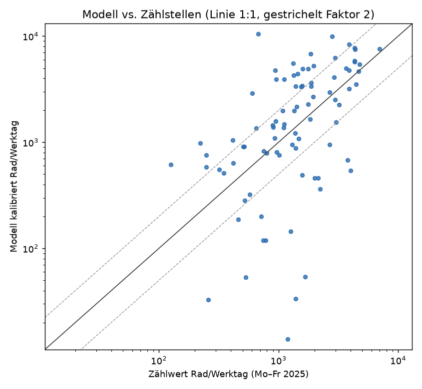
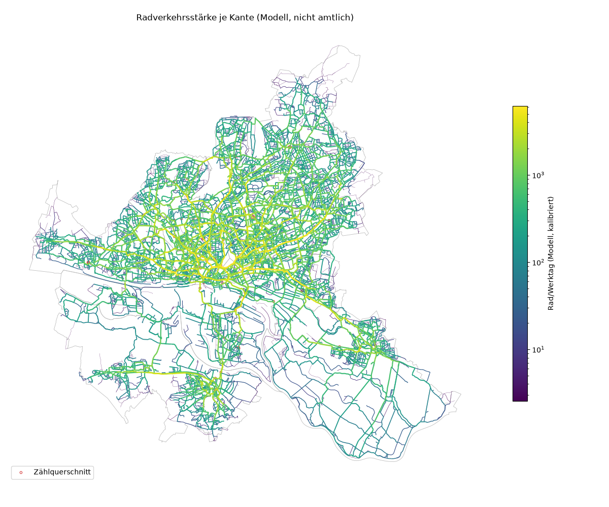

# Radverkehrsnachfrage (Stufe c02)

Erzeugt 2026-11-07T13:57:28+00:00 mit pipeline/c02_cycle_demand.py · cycling_rules.yaml 0.7.0 · nicht amtlicher Entwurf. Alle Modellparameter sind Annahmen (source_type assumption, status draft) und vor fachlicher Nutzung zu prüfen.

## Kurzfassung

- Kalibrierfaktor k = 0.234 (ein Faktor für Hamburg, C-DEM-06) aus 86 Zählquerschnitten.
- Güte: Spearman 0.56, Pearson (log) 0.49, Pearson 0.56, mittlere relative Abweichung 113%, 52% der Querschnitte innerhalb Faktor 2.
- 552 km mit Konfidenz hoch, 1 751 km mittel, 4 127 km niedrig.
- Werte sind modelliert, nicht gezählt. Sie dienen als Grundlage für Hierarchie (Prompt 16) und Breiten (Prompt 18).

## Modell

- Zonen: 2 620 Quadrate zu 500 m im Zensus-Gitter (EPSG:3035), davon 2 223 mit Einwohnern (1 808 530 Einwohner in Hamburg) und 2 509 mit Zielen (C-DEM-01). Zonenpunkt an den nächsten Graphknoten angebunden (Median 74 m, Maximum 1376 m).
- Ziele (C-DEM-02/03), Gewicht × Anteil der Zone an der Hamburger Summe:

| Zieltyp | Gewicht | Objekte | Summe | Quelle |
| --- | ---: | ---: | ---: | --- |
| jobs_floor_area | 0.40 | 56 530 | 74 117 933 | ALKIS Gebäude (Geschossfläche Nichtwohnen, m²) |
| shops | 0.20 | 10 447 | 10 447 | OSM shop=* |
| schools | 0.15 | 557 | 557 | OSM amenity=school (Fallback) |
| universities | 0.10 | 110 | 110 | OSM amenity=university|college (Fallback) |
| rapid_transit_stops | 0.15 | 375 | 375 | HVV-GTFS, route_type [1, 2, 109, 402] |

- Verteilung (C-DEM-04): produktionsgebundenes Gravitationsmodell, f(d) = exp(−0.25 · d), d = wahrgenommener Widerstand in km, nur Relationen 0.5–15.0 km.
- Umlegung (C-DEM-05): stochastic, 3 Lauf/Läufe, Störung σ = 0.1, Seed 42; Graph 44 627 Knoten, 111 357 gerichtete Bögen (größte stark zusammenhängende Komponente).

| Lauf | Laufzeit s | Fahrten (Modell) | mittlere Weglänge km (Widerstand) | Quellzonen ohne Ziel im Band |
| ---: | ---: | ---: | ---: | ---: |
| 1 | 24 | 1 808 530 | 6.34 | 0 |
| 2 | 24 | 1 808 530 | 6.34 | 0 |
| 3 | 24 | 1 808 530 | 6.34 | 0 |

Modellfahrten haben keine absolute Einheit (1 Fahrt je Einwohner); erst der Kalibrierfaktor macht daraus Rad/Werktag.

## Kalibrierung an Zählstellen

- Zählstellen: 312, davon 104 ohne Richtung. Nur diese gehen ein; sie sind die Summe der zwei richtungsbezogenen Zählstellen am selben Querschnitt (Median-Verhältnis 1,00; geprüft 2026-11-05), so wird nichts doppelt gezählt.
- Zählwert: Mittel Mo–Fr 2025 über Tage mit count > 0, mindestens 150 gültige Werktage: 97 Querschnitte. Modellwert: Summe beider Richtungen aller Kanten, die ein Querschnitt von ±25 m schneidet (≥ 45°).
- Mit Modellwert > 0: 86; ohne Kante im Umkreis von 30 m oder ohne Modellfluss: 11.
- k = geometrisches Mittel von Zählwert/Modellwert = **0.234**.

| Kennzahl | Wert |
| --- | ---: |
| Querschnitte | 86 |
| Pearson r (linear) | 0.56 |
| Pearson r (log) | 0.49 |
| Spearman ρ | 0.56 |
| mittlere relative Abweichung | 113% |
| Median Zählwert/Modell | 0.75 |
| Anteil innerhalb Faktor 2 | 52% |

Verhältnis Zählwert/Modell je Bezirk (nur Diagnose; kalibriert wird mit einem Faktor für Hamburg):

| Bezirk | Querschnitte | geom. Mittel Zählwert/Modell |
| --- | ---: | ---: |
| Altona | 12 | 1.55 |
| Bergedorf | 4 | 0.63 |
| Eimsbüttel | 17 | 1.21 |
| Hamburg-Mitte | 20 | 1.14 |
| Hamburg-Nord | 17 | 0.97 |
| Harburg | 7 | 0.36 |
| Wandsbek | 9 | 0.85 |

Größte Abweichungen (je 5 über- und unterschätzt):

| Zählstelle | Bezirk | Zählwert | Modell | Zählwert/Modell | Kanten | Prüfen |
| --- | --- | ---: | ---: | ---: | ---: | --- |
| Verkehrszählstelle 6779940 | Hamburg-Nord | 677 | 10 502 | 0.06 | 1 | [Luftbild](https://geoportal-hamburg.de/?MAP/PROJECTION=EPSG:25832&MAP/CENTER=[567549,5935741]&MAP/ZOOMLEVEL=10&MAP/LAYERIDS=19968) · [Panoramax](https://api.panoramax.xyz/#focus=map&map=18/53.566185/10.019947) · [OSM](https://www.openstreetmap.org/?mlat=53.566185&mlon=10.019947#map=18/53.566185/10.019947) |
| Verkehrszählstelle 0117930 | Hamburg-Mitte | 937 | 4 754 | 0.20 | 2 | [Luftbild](https://geoportal-hamburg.de/?MAP/PROJECTION=EPSG:25832&MAP/CENTER=[568093,5932088]&MAP/ZOOMLEVEL=10&MAP/LAYERIDS=19968) · [Panoramax](https://api.panoramax.xyz/#focus=map&map=18/53.533288/10.027366) · [OSM](https://www.openstreetmap.org/?mlat=53.533288&mlon=10.027366#map=18/53.533288/10.027366) |
| Verkehrszählstelle 0333960 | Hamburg-Mitte | 126 | 618 | 0.20 | 1 | [Luftbild](https://geoportal-hamburg.de/?MAP/PROJECTION=EPSG:25832&MAP/CENTER=[567750,5932059]&MAP/ZOOMLEVEL=10&MAP/LAYERIDS=19968) · [Panoramax](https://api.panoramax.xyz/#focus=map&map=18/53.533071/10.022181) · [OSM](https://www.openstreetmap.org/?mlat=53.533071&mlon=10.022181#map=18/53.533071/10.022181) |
| Verkehrszählstelle 6848980 | Harburg | 605 | 2 895 | 0.21 | 2 | [Luftbild](https://geoportal-hamburg.de/?MAP/PROJECTION=EPSG:25832&MAP/CENTER=[565459,5924593]&MAP/ZOOMLEVEL=10&MAP/LAYERIDS=19968) · [Panoramax](https://api.panoramax.xyz/#focus=map&map=18/53.466262/9.986063) · [OSM](https://www.openstreetmap.org/?mlat=53.466262&mlon=9.986063#map=18/53.466262/9.986063) |
| Verkehrszählstelle 7462910 | Wandsbek | 222 | 985 | 0.23 | 1 | [Luftbild](https://geoportal-hamburg.de/?MAP/PROJECTION=EPSG:25832&MAP/CENTER=[575891,5939103]&MAP/ZOOMLEVEL=10&MAP/LAYERIDS=19968) · [Panoramax](https://api.panoramax.xyz/#focus=map&map=18/53.595264/10.146695) · [OSM](https://www.openstreetmap.org/?mlat=53.595264&mlon=10.146695#map=18/53.595264/10.146695) |
| Verkehrszählstelle 6111920 | Hamburg-Nord | 1 197 | 14 | 86.01 | 1 | [Luftbild](https://geoportal-hamburg.de/?MAP/PROJECTION=EPSG:25832&MAP/CENTER=[568903,5939488]&MAP/ZOOMLEVEL=10&MAP/LAYERIDS=19968) · [Panoramax](https://api.panoramax.xyz/#focus=map&map=18/53.599690/10.041213) · [OSM](https://www.openstreetmap.org/?mlat=53.599690&mlon=10.041213#map=18/53.599690/10.041213) |
| Verkehrszählstelle 7786960 | Hamburg-Mitte | 1 393 | 33 | 41.58 | 1 | [Luftbild](https://geoportal-hamburg.de/?MAP/PROJECTION=EPSG:25832&MAP/CENTER=[566082,5933388]&MAP/ZOOMLEVEL=10&MAP/LAYERIDS=19968) · [Panoramax](https://api.panoramax.xyz/#focus=map&map=18/53.545228/9.997300) · [OSM](https://www.openstreetmap.org/?mlat=53.545228&mlon=9.997300#map=18/53.545228/9.997300) |
| Verkehrszählstelle 6381910 | Eimsbüttel | 1 676 | 54 | 30.97 | 1 | [Luftbild](https://geoportal-hamburg.de/?MAP/PROJECTION=EPSG:25832&MAP/CENTER=[561715,5939105]&MAP/ZOOMLEVEL=10&MAP/LAYERIDS=19968) · [Panoramax](https://api.panoramax.xyz/#focus=map&map=18/53.597140/9.932533) · [OSM](https://www.openstreetmap.org/?mlat=53.597140&mlon=9.932533#map=18/53.597140/9.932533) |
| Verkehrszählstelle 7462970 | Wandsbek | 530 | 53 | 9.93 | 1 | [Luftbild](https://geoportal-hamburg.de/?MAP/PROJECTION=EPSG:25832&MAP/CENTER=[575887,5939062]&MAP/ZOOMLEVEL=10&MAP/LAYERIDS=19968) · [Panoramax](https://api.panoramax.xyz/#focus=map&map=18/53.594891/10.146629) · [OSM](https://www.openstreetmap.org/?mlat=53.594891&mlon=10.146629#map=18/53.594891/10.146629) |
| Verkehrszählstelle 0010920 | Eimsbüttel | 1 267 | 144 | 8.77 | 1 | [Luftbild](https://geoportal-hamburg.de/?MAP/PROJECTION=EPSG:25832&MAP/CENTER=[563446,5936190]&MAP/ZOOMLEVEL=10&MAP/LAYERIDS=19968) · [Panoramax](https://api.panoramax.xyz/#focus=map&map=18/53.570735/9.958093) · [OSM](https://www.openstreetmap.org/?mlat=53.570735&mlon=9.958093#map=18/53.570735/9.958093) |

## Vergleich mit DB Rad+ (nur Plausibilität)

- 150 778 Linien 2025 (App-Stichprobe, nicht repräsentativ; drei Datensätze vom Server nicht lieferbar, siehe data/manifest.json skipped_records). Linienmitte an die nächste Kante ≤ 15 m: 121 438 Linien auf 34 215 Kanten (Maximum je Kante).
- Spearman ρ (Modell kalibriert vs. DB-Rad+-Fahrten): 0.36; Pearson (log): 0.33.
- DB Rad+ geht nicht in die Kalibrierung ein.

## Karte

## demand_confidence (C-DEM-07)

- hoch: ≤ 500 m von einem Querschnitt mit Zählwert/Modell in [0.5, 2.0]
- niedrig: ≤ 2 km von der Landesgrenze (Wege über die Grenze fehlen), in ländlichen Stadtteilen, unter 50 Rad/Tag oder ohne Modellwert (außerhalb der Hauptkomponente)
- sonst mittel

| Konfidenz | Kanten | km |
| --- | ---: | ---: |
| hoch | 7 412 | 552.2 |
| mittel | 20 604 | 1 750.7 |
| niedrig | 37 957 | 4 127.4 |

## Die 30 stärksten Kanten (Prüfung durch Ortskundige)

| # | edge_id | Bezirk | Name | Art | Rad/Werktag | Spitzenstunde | Konfidenz | Prüfen |
| ---: | --- | --- | --- | --- | ---: | ---: | --- | --- |
| 1 | `ce_8038f2e3cf316d79` | Hamburg-Mitte | – | path | 15 362 | 2 304 | mittel | [Luftbild](https://geoportal-hamburg.de/?MAP/PROJECTION=EPSG:25832&MAP/CENTER=[566533,5934788]&MAP/ZOOMLEVEL=10&MAP/LAYERIDS=19968) · [Panoramax](https://api.panoramax.xyz/#focus=map&map=18/53.557755/10.004409) · [OSM](https://www.openstreetmap.org/?mlat=53.557755&mlon=10.004409#map=18/53.557755/10.004409) |
| 2 | `ce_a52c09c1bd3724c8` | Hamburg-Mitte | neben An der Alster | path | 15 362 | 2 304 | mittel | [Luftbild](https://geoportal-hamburg.de/?MAP/PROJECTION=EPSG:25832&MAP/CENTER=[566615,5934832]&MAP/ZOOMLEVEL=10&MAP/LAYERIDS=19968) · [Panoramax](https://api.panoramax.xyz/#focus=map&map=18/53.558141/10.005644) · [OSM](https://www.openstreetmap.org/?mlat=53.558141&mlon=10.005644#map=18/53.558141/10.005644) |
| 3 | `ce_cfcb338858308d70` | Hamburg-Mitte | – | path | 15 362 | 2 304 | mittel | [Luftbild](https://geoportal-hamburg.de/?MAP/PROJECTION=EPSG:25832&MAP/CENTER=[566694,5934888]&MAP/ZOOMLEVEL=10&MAP/LAYERIDS=19968) · [Panoramax](https://api.panoramax.xyz/#focus=map&map=18/53.558630/10.006858) · [OSM](https://www.openstreetmap.org/?mlat=53.558630&mlon=10.006858#map=18/53.558630/10.006858) |
| 4 | `ce_2dd614b279c81a05` | Hamburg-Mitte | neben An der Alster | path | 15 241 | 2 286 | mittel | [Luftbild](https://geoportal-hamburg.de/?MAP/PROJECTION=EPSG:25832&MAP/CENTER=[566768,5934932]&MAP/ZOOMLEVEL=10&MAP/LAYERIDS=19968) · [Panoramax](https://api.panoramax.xyz/#focus=map&map=18/53.559019/10.007979) · [OSM](https://www.openstreetmap.org/?mlat=53.559019&mlon=10.007979#map=18/53.559019/10.007979) |
| 5 | `ce_c5e4650005b0a6c9` | Hamburg-Mitte | neben An der Alster | path | 15 241 | 2 286 | mittel | [Luftbild](https://geoportal-hamburg.de/?MAP/PROJECTION=EPSG:25832&MAP/CENTER=[566799,5934953]&MAP/ZOOMLEVEL=10&MAP/LAYERIDS=19968) · [Panoramax](https://api.panoramax.xyz/#focus=map&map=18/53.559199/10.008457) · [OSM](https://www.openstreetmap.org/?mlat=53.559199&mlon=10.008457#map=18/53.559199/10.008457) |
| 6 | `ce_f823aac7a9b0a893` | Hamburg-Mitte | – | path | 15 241 | 2 286 | mittel | [Luftbild](https://geoportal-hamburg.de/?MAP/PROJECTION=EPSG:25832&MAP/CENTER=[566862,5935008]&MAP/ZOOMLEVEL=10&MAP/LAYERIDS=19968) · [Panoramax](https://api.panoramax.xyz/#focus=map&map=18/53.559690/10.009418) · [OSM](https://www.openstreetmap.org/?mlat=53.559690&mlon=10.009418#map=18/53.559690/10.009418) |
| 7 | `ce_7394c93f5562b841` | Hamburg-Mitte | – | path | 15 159 | 2 274 | mittel | [Luftbild](https://geoportal-hamburg.de/?MAP/PROJECTION=EPSG:25832&MAP/CENTER=[566948,5935076]&MAP/ZOOMLEVEL=10&MAP/LAYERIDS=19968) · [Panoramax](https://api.panoramax.xyz/#focus=map&map=18/53.560290/10.010725) · [OSM](https://www.openstreetmap.org/?mlat=53.560290&mlon=10.010725#map=18/53.560290/10.010725) |
| 8 | `ce_76d874ca9bcbd707` | Hamburg-Mitte | neben An der Alster | path | 15 159 | 2 274 | hoch | [Luftbild](https://geoportal-hamburg.de/?MAP/PROJECTION=EPSG:25832&MAP/CENTER=[567106,5935167]&MAP/ZOOMLEVEL=10&MAP/LAYERIDS=19968) · [Panoramax](https://api.panoramax.xyz/#focus=map&map=18/53.561088/10.013134) · [OSM](https://www.openstreetmap.org/?mlat=53.561088&mlon=10.013134#map=18/53.561088/10.013134) |
| 9 | `ce_8bb203f92cc25299` | Hamburg-Mitte | – | path | 15 159 | 2 274 | mittel | [Luftbild](https://geoportal-hamburg.de/?MAP/PROJECTION=EPSG:25832&MAP/CENTER=[567068,5935131]&MAP/ZOOMLEVEL=10&MAP/LAYERIDS=19968) · [Panoramax](https://api.panoramax.xyz/#focus=map&map=18/53.560768/10.012555) · [OSM](https://www.openstreetmap.org/?mlat=53.560768&mlon=10.012555#map=18/53.560768/10.012555) |
| 10 | `ce_e55f2d101f35deb2` | Hamburg-Mitte | – | path | 15 159 | 2 274 | mittel | [Luftbild](https://geoportal-hamburg.de/?MAP/PROJECTION=EPSG:25832&MAP/CENTER=[567020,5935092]&MAP/ZOOMLEVEL=10&MAP/LAYERIDS=19968) · [Panoramax](https://api.panoramax.xyz/#focus=map&map=18/53.560425/10.011818) · [OSM](https://www.openstreetmap.org/?mlat=53.560425&mlon=10.011818#map=18/53.560425/10.011818) |
| 11 | `ce_8ae9294e64f381c1` | Hamburg-Mitte | neben Kennedybrücke | path | 14 815 | 2 222 | hoch | [Luftbild](https://geoportal-hamburg.de/?MAP/PROJECTION=EPSG:25832&MAP/CENTER=[566205,5934753]&MAP/ZOOMLEVEL=10&MAP/LAYERIDS=19968) · [Panoramax](https://api.panoramax.xyz/#focus=map&map=18/53.557484/9.999448) · [OSM](https://www.openstreetmap.org/?mlat=53.557484&mlon=9.999448#map=18/53.557484/9.999448) |
| 12 | `ce_22f6f1144a4740e1` | Hamburg-Mitte | – | path | 14 016 | 2 102 | hoch | [Luftbild](https://geoportal-hamburg.de/?MAP/PROJECTION=EPSG:25832&MAP/CENTER=[566442,5934753]&MAP/ZOOMLEVEL=10&MAP/LAYERIDS=19968) · [Panoramax](https://api.panoramax.xyz/#focus=map&map=18/53.557453/10.003016) · [OSM](https://www.openstreetmap.org/?mlat=53.557453&mlon=10.003016#map=18/53.557453/10.003016) |
| 13 | `ce_4366aea3d6d6e0a1` | Hamburg-Mitte | neben An der Alster | path | 13 665 | 2 050 | hoch | [Luftbild](https://geoportal-hamburg.de/?MAP/PROJECTION=EPSG:25832&MAP/CENTER=[567178,5935259]&MAP/ZOOMLEVEL=10&MAP/LAYERIDS=19968) · [Panoramax](https://api.panoramax.xyz/#focus=map&map=18/53.561899/10.014239) · [OSM](https://www.openstreetmap.org/?mlat=53.561899&mlon=10.014239#map=18/53.561899/10.014239) |
| 14 | `ce_98138626bf96eee0` | Hamburg-Nord | – | path | 13 665 | 2 050 | hoch | [Luftbild](https://geoportal-hamburg.de/?MAP/PROJECTION=EPSG:25832&MAP/CENTER=[567243,5935375]&MAP/ZOOMLEVEL=10&MAP/LAYERIDS=19968) · [Panoramax](https://api.panoramax.xyz/#focus=map&map=18/53.562942/10.015240) · [OSM](https://www.openstreetmap.org/?mlat=53.562942&mlon=10.015240#map=18/53.562942/10.015240) |
| 15 | `ce_b47e8ab5607ff44b` | Hamburg-Nord | neben Schwanenwik | path | 13 665 | 2 050 | hoch | [Luftbild](https://geoportal-hamburg.de/?MAP/PROJECTION=EPSG:25832&MAP/CENTER=[567310,5935454]&MAP/ZOOMLEVEL=10&MAP/LAYERIDS=19968) · [Panoramax](https://api.panoramax.xyz/#focus=map&map=18/53.563637/10.016274) · [OSM](https://www.openstreetmap.org/?mlat=53.563637&mlon=10.016274#map=18/53.563637/10.016274) |
| 16 | `ce_4895db27155a88a8` | Hamburg-Nord | neben Schwanenwik | path | 12 667 | 1 900 | hoch | [Luftbild](https://geoportal-hamburg.de/?MAP/PROJECTION=EPSG:25832&MAP/CENTER=[567335,5935665]&MAP/ZOOMLEVEL=10&MAP/LAYERIDS=19968) · [Panoramax](https://api.panoramax.xyz/#focus=map&map=18/53.565535/10.016705) · [OSM](https://www.openstreetmap.org/?mlat=53.565535&mlon=10.016705#map=18/53.565535/10.016705) |
| 17 | `ce_bb63d64ad95f65c9` | Hamburg-Nord | neben Schwanenwik | path | 12 660 | 1 899 | hoch | [Luftbild](https://geoportal-hamburg.de/?MAP/PROJECTION=EPSG:25832&MAP/CENTER=[567338,5935620]&MAP/ZOOMLEVEL=10&MAP/LAYERIDS=19968) · [Panoramax](https://api.panoramax.xyz/#focus=map&map=18/53.565128/10.016731) · [OSM](https://www.openstreetmap.org/?mlat=53.565128&mlon=10.016731#map=18/53.565128/10.016731) |
| 18 | `ce_bbf126f6b13d1a42` | Hamburg-Nord | neben Schwanenwik | path | 12 660 | 1 899 | hoch | [Luftbild](https://geoportal-hamburg.de/?MAP/PROJECTION=EPSG:25832&MAP/CENTER=[567341,5935559]&MAP/ZOOMLEVEL=10&MAP/LAYERIDS=19968) · [Panoramax](https://api.panoramax.xyz/#focus=map&map=18/53.564576/10.016757) · [OSM](https://www.openstreetmap.org/?mlat=53.564576&mlon=10.016757#map=18/53.564576/10.016757) |
| 19 | `ce_8d4a94e4b404216f` | Hamburg-Mitte | – | path | 10 980 | 1 647 | mittel | [Luftbild](https://geoportal-hamburg.de/?MAP/PROJECTION=EPSG:25832&MAP/CENTER=[568065,5934627]&MAP/ZOOMLEVEL=10&MAP/LAYERIDS=19968) · [Panoramax](https://api.panoramax.xyz/#focus=map&map=18/53.556112/10.027499) · [OSM](https://www.openstreetmap.org/?mlat=53.556112&mlon=10.027499#map=18/53.556112/10.027499) |
| 20 | `ce_a0936140a3a5d423` | Hamburg-Mitte | neben Bürgerweide | path | 10 818 | 1 623 | mittel | [Luftbild](https://geoportal-hamburg.de/?MAP/PROJECTION=EPSG:25832&MAP/CENTER=[568187,5934679]&MAP/ZOOMLEVEL=10&MAP/LAYERIDS=19968) · [Panoramax](https://api.panoramax.xyz/#focus=map&map=18/53.556560/10.029340) · [OSM](https://www.openstreetmap.org/?mlat=53.556560&mlon=10.029340#map=18/53.556560/10.029340) |
| 21 | `ce_f706abd236d129e5` | Hamburg-Mitte | – | path | 10 818 | 1 623 | mittel | [Luftbild](https://geoportal-hamburg.de/?MAP/PROJECTION=EPSG:25832&MAP/CENTER=[568071,5934620]&MAP/ZOOMLEVEL=10&MAP/LAYERIDS=19968) · [Panoramax](https://api.panoramax.xyz/#focus=map&map=18/53.556049/10.027573) · [OSM](https://www.openstreetmap.org/?mlat=53.556049&mlon=10.027573#map=18/53.556049/10.027573) |
| 22 | `ce_86a293b77c647958` | Hamburg-Nord | Hartwicusstraße | road | 10 598 | 1 590 | hoch | [Luftbild](https://geoportal-hamburg.de/?MAP/PROJECTION=EPSG:25832&MAP/CENTER=[567431,5935716]&MAP/ZOOMLEVEL=10&MAP/LAYERIDS=19968) · [Panoramax](https://api.panoramax.xyz/#focus=map&map=18/53.565979/10.018160) · [OSM](https://www.openstreetmap.org/?mlat=53.565979&mlon=10.018160#map=18/53.565979/10.018160) |
| 23 | `ce_a62ddf0f152a059b` | Hamburg-Nord | – | path | 10 564 | 1 585 | hoch | [Luftbild](https://geoportal-hamburg.de/?MAP/PROJECTION=EPSG:25832&MAP/CENTER=[567332,5935708]&MAP/ZOOMLEVEL=10&MAP/LAYERIDS=19968) · [Panoramax](https://api.panoramax.xyz/#focus=map&map=18/53.565916/10.016668) · [OSM](https://www.openstreetmap.org/?mlat=53.565916&mlon=10.016668#map=18/53.565916/10.016668) |
| 24 | `ce_21014ab02fa6ba54` | Hamburg-Nord | Hartwicusstraße | road | 10 547 | 1 582 | hoch | [Luftbild](https://geoportal-hamburg.de/?MAP/PROJECTION=EPSG:25832&MAP/CENTER=[567523,5935736]&MAP/ZOOMLEVEL=10&MAP/LAYERIDS=19968) · [Panoramax](https://api.panoramax.xyz/#focus=map&map=18/53.566150/10.019557) · [OSM](https://www.openstreetmap.org/?mlat=53.566150&mlon=10.019557#map=18/53.566150/10.019557) |
| 25 | `ce_4196f2e8e1ab988d` | Eimsbüttel | neben Alsterglacis | path | 10 509 | 1 576 | hoch | [Luftbild](https://geoportal-hamburg.de/?MAP/PROJECTION=EPSG:25832&MAP/CENTER=[565804,5934857]&MAP/ZOOMLEVEL=10&MAP/LAYERIDS=19968) · [Panoramax](https://api.panoramax.xyz/#focus=map&map=18/53.558463/9.993411) · [OSM](https://www.openstreetmap.org/?mlat=53.558463&mlon=9.993411#map=18/53.558463/9.993411) |
| 26 | `ce_5b5c21132f28f398` | Hamburg-Nord | Hartwicusstraße | road | 10 502 | 1 575 | hoch | [Luftbild](https://geoportal-hamburg.de/?MAP/PROJECTION=EPSG:25832&MAP/CENTER=[567562,5935742]&MAP/ZOOMLEVEL=10&MAP/LAYERIDS=19968) · [Panoramax](https://api.panoramax.xyz/#focus=map&map=18/53.566191/10.020141) · [OSM](https://www.openstreetmap.org/?mlat=53.566191&mlon=10.020141#map=18/53.566191/10.020141) |
| 27 | `ce_ea537a5afcc62f4e` | Eimsbüttel | neben Kennedybrücke | path | 10 404 | 1 561 | hoch | [Luftbild](https://geoportal-hamburg.de/?MAP/PROJECTION=EPSG:25832&MAP/CENTER=[565878,5934892]&MAP/ZOOMLEVEL=10&MAP/LAYERIDS=19968) · [Panoramax](https://api.panoramax.xyz/#focus=map&map=18/53.558766/9.994545) · [OSM](https://www.openstreetmap.org/?mlat=53.558766&mlon=9.994545#map=18/53.558766/9.994545) |
| 28 | `ce_1f36317abc34ec77` | Eimsbüttel | – | path | 10 369 | 1 555 | hoch | [Luftbild](https://geoportal-hamburg.de/?MAP/PROJECTION=EPSG:25832&MAP/CENTER=[565848,5934901]&MAP/ZOOMLEVEL=10&MAP/LAYERIDS=19968) · [Panoramax](https://api.panoramax.xyz/#focus=map&map=18/53.558852/9.994084) · [OSM](https://www.openstreetmap.org/?mlat=53.558852&mlon=9.994084#map=18/53.558852/9.994084) |
| 29 | `ce_89e7f1ab678e29bb` | Eimsbüttel | neben Kennedybrücke | path | 10 369 | 1 555 | hoch | [Luftbild](https://geoportal-hamburg.de/?MAP/PROJECTION=EPSG:25832&MAP/CENTER=[565872,5934894]&MAP/ZOOMLEVEL=10&MAP/LAYERIDS=19968) · [Panoramax](https://api.panoramax.xyz/#focus=map&map=18/53.558788/9.994445) · [OSM](https://www.openstreetmap.org/?mlat=53.558788&mlon=9.994445#map=18/53.558788/9.994445) |
| 30 | `ce_f2e7166a1fa05760` | Eimsbüttel | neben Kennedybrücke | path | 10 369 | 1 555 | hoch | [Luftbild](https://geoportal-hamburg.de/?MAP/PROJECTION=EPSG:25832&MAP/CENTER=[565860,5934896]&MAP/ZOOMLEVEL=10&MAP/LAYERIDS=19968) · [Panoramax](https://api.panoramax.xyz/#focus=map&map=18/53.558810/9.994267) · [OSM](https://www.openstreetmap.org/?mlat=53.558810&mlon=9.994267#map=18/53.558810/9.994267) |

## 30 Zufallsstichproben (Seed 42)

| edge_id | Bezirk | Name | Art | Rad/Werktag | hin/zurück | Konfidenz | Prüfen |
| --- | --- | --- | --- | ---: | --- | --- | --- |
| `ce_0e5e566d2eefc99b` | Altona | Bei der Rolandsmühle | road | 86 | 35/51 | mittel | [Luftbild](https://geoportal-hamburg.de/?MAP/PROJECTION=EPSG:25832&MAP/CENTER=[560654,5933759]&MAP/ZOOMLEVEL=10&MAP/LAYERIDS=19968) · [Panoramax](https://api.panoramax.xyz/#focus=map&map=18/53.549216/9.915458) · [OSM](https://www.openstreetmap.org/?mlat=53.549216&mlon=9.915458#map=18/53.549216/9.915458) |
| `ce_3aef5a2940e76ac7` | Altona | Pieperweg | road | 89 | 19/70 | niedrig | [Luftbild](https://geoportal-hamburg.de/?MAP/PROJECTION=EPSG:25832&MAP/CENTER=[554305,5937212]&MAP/ZOOMLEVEL=10&MAP/LAYERIDS=19968) · [Panoramax](https://api.panoramax.xyz/#focus=map&map=18/53.580950/9.820257) · [OSM](https://www.openstreetmap.org/?mlat=53.580950&mlon=9.820257#map=18/53.580950/9.820257) |
| `ce_7e73d7e10ec38b1d` | Altona | Flerrentwiete | road | 16 | 16/0 | niedrig | [Luftbild](https://geoportal-hamburg.de/?MAP/PROJECTION=EPSG:25832&MAP/CENTER=[549776,5937405]&MAP/ZOOMLEVEL=10&MAP/LAYERIDS=19968) · [Panoramax](https://api.panoramax.xyz/#focus=map&map=18/53.583135/9.751882) · [OSM](https://www.openstreetmap.org/?mlat=53.583135&mlon=9.751882#map=18/53.583135/9.751882) |
| `ce_8d15e20340fef49d` | Altona | – | path | 238 | 238/0 | niedrig | [Luftbild](https://geoportal-hamburg.de/?MAP/PROJECTION=EPSG:25832&MAP/CENTER=[554510,5936727]&MAP/ZOOMLEVEL=10&MAP/LAYERIDS=19968) · [Panoramax](https://api.panoramax.xyz/#focus=map&map=18/53.576566/9.823264) · [OSM](https://www.openstreetmap.org/?mlat=53.576566&mlon=9.823264#map=18/53.576566/9.823264) |
| `ce_2cc60ecda14db6a9` | Bergedorf | – | road | 0 | 0/0 | niedrig | [Luftbild](https://geoportal-hamburg.de/?MAP/PROJECTION=EPSG:25832&MAP/CENTER=[580674,5927047]&MAP/ZOOMLEVEL=10&MAP/LAYERIDS=19968) · [Panoramax](https://api.panoramax.xyz/#focus=map&map=18/53.486205/10.215837) · [OSM](https://www.openstreetmap.org/?mlat=53.486205&mlon=10.215837#map=18/53.486205/10.215837) |
| `ce_3c98c6fc8894efb6` | Bergedorf | Wentorfer Straße | road | 294 | 264/30 | niedrig | [Luftbild](https://geoportal-hamburg.de/?MAP/PROJECTION=EPSG:25832&MAP/CENTER=[581487,5927268]&MAP/ZOOMLEVEL=10&MAP/LAYERIDS=19968) · [Panoramax](https://api.panoramax.xyz/#focus=map&map=18/53.488067/10.228152) · [OSM](https://www.openstreetmap.org/?mlat=53.488067&mlon=10.228152#map=18/53.488067/10.228152) |
| `ce_5cce82fb4356b329` | Bergedorf | neben Ebner-Eschenbach-Weg | path | 12 | 7/5 | niedrig | [Luftbild](https://geoportal-hamburg.de/?MAP/PROJECTION=EPSG:25832&MAP/CENTER=[577876,5926626]&MAP/ZOOMLEVEL=10&MAP/LAYERIDS=19968) · [Panoramax](https://api.panoramax.xyz/#focus=map&map=18/53.482846/10.173581) · [OSM](https://www.openstreetmap.org/?mlat=53.482846&mlon=10.173581#map=18/53.482846/10.173581) |
| `ce_8d5147dd24a922c4` | Eimsbüttel | – | path | 47 | 47/0 | niedrig | [Luftbild](https://geoportal-hamburg.de/?MAP/PROJECTION=EPSG:25832&MAP/CENTER=[563695,5935540]&MAP/ZOOMLEVEL=10&MAP/LAYERIDS=19968) · [Panoramax](https://api.panoramax.xyz/#focus=map&map=18/53.564867/9.961727) · [OSM](https://www.openstreetmap.org/?mlat=53.564867&mlon=9.961727#map=18/53.564867/9.961727) |
| `ce_ae9110d2a6ca511b` | Eimsbüttel | Graf-Otto-Weg | road | 91 | 77/14 | niedrig | [Luftbild](https://geoportal-hamburg.de/?MAP/PROJECTION=EPSG:25832&MAP/CENTER=[560136,5944402]&MAP/ZOOMLEVEL=10&MAP/LAYERIDS=19968) · [Panoramax](https://api.panoramax.xyz/#focus=map&map=18/53.644927/9.909706) · [OSM](https://www.openstreetmap.org/?mlat=53.644927&mlon=9.909706#map=18/53.644927/9.909706) |
| `ce_c114f44771e0e957` | Eimsbüttel | Jaarsmoor | road | 745 | 626/119 | niedrig | [Luftbild](https://geoportal-hamburg.de/?MAP/PROJECTION=EPSG:25832&MAP/CENTER=[559081,5940384]&MAP/ZOOMLEVEL=10&MAP/LAYERIDS=19968) · [Panoramax](https://api.panoramax.xyz/#focus=map&map=18/53.608935/9.892975) · [OSM](https://www.openstreetmap.org/?mlat=53.608935&mlon=9.892975#map=18/53.608935/9.892975) |
| `ce_ea44be57b420b190` | Eimsbüttel | – | path | 0 | 0/0 | niedrig | [Luftbild](https://geoportal-hamburg.de/?MAP/PROJECTION=EPSG:25832&MAP/CENTER=[559519,5940971]&MAP/ZOOMLEVEL=10&MAP/LAYERIDS=19968) · [Panoramax](https://api.panoramax.xyz/#focus=map&map=18/53.614168/9.899714) · [OSM](https://www.openstreetmap.org/?mlat=53.614168&mlon=9.899714#map=18/53.614168/9.899714) |
| `ce_0a460b6afff1a8aa` | Hamburg-Mitte | Hein-Hoyer-Straße | road | 81 | 81/0 | mittel | [Luftbild](https://geoportal-hamburg.de/?MAP/PROJECTION=EPSG:25832&MAP/CENTER=[563776,5934123]&MAP/ZOOMLEVEL=10&MAP/LAYERIDS=19968) · [Panoramax](https://api.panoramax.xyz/#focus=map&map=18/53.552117/9.962660) · [OSM](https://www.openstreetmap.org/?mlat=53.552117&mlon=9.962660#map=18/53.552117/9.962660) |
| `ce_0af7274411d3047f` | Hamburg-Mitte | Mannesallee | road | 5 | 5/0 | niedrig | [Luftbild](https://geoportal-hamburg.de/?MAP/PROJECTION=EPSG:25832&MAP/CENTER=[565572,5929933]&MAP/ZOOMLEVEL=10&MAP/LAYERIDS=19968) · [Panoramax](https://api.panoramax.xyz/#focus=map&map=18/53.514242/9.988875) · [OSM](https://www.openstreetmap.org/?mlat=53.514242&mlon=9.988875#map=18/53.514242/9.988875) |
| `ce_1d10470f7aea4b22` | Hamburg-Mitte | Bethesdastraße | road | 1 565 | 1 168/397 | mittel | [Luftbild](https://geoportal-hamburg.de/?MAP/PROJECTION=EPSG:25832&MAP/CENTER=[568613,5934742]&MAP/ZOOMLEVEL=10&MAP/LAYERIDS=19968) · [Panoramax](https://api.panoramax.xyz/#focus=map&map=18/53.557068/10.035791) · [OSM](https://www.openstreetmap.org/?mlat=53.557068&mlon=10.035791#map=18/53.557068/10.035791) |
| `ce_921ccd51799780ce` | Hamburg-Mitte | Süderstraße | road | 509 | 509/0 | mittel | [Luftbild](https://geoportal-hamburg.de/?MAP/PROJECTION=EPSG:25832&MAP/CENTER=[568319,5933452]&MAP/ZOOMLEVEL=10&MAP/LAYERIDS=19968) · [Panoramax](https://api.panoramax.xyz/#focus=map&map=18/53.545517/10.031070) · [OSM](https://www.openstreetmap.org/?mlat=53.545517&mlon=10.031070#map=18/53.545517/10.031070) |
| `ce_cc364527de2587d1` | Hamburg-Mitte | Kandinskyallee | road | 0 | 0/0 | niedrig | [Luftbild](https://geoportal-hamburg.de/?MAP/PROJECTION=EPSG:25832&MAP/CENTER=[576193,5931235]&MAP/ZOOMLEVEL=10&MAP/LAYERIDS=19968) · [Panoramax](https://api.panoramax.xyz/#focus=map&map=18/53.524506/10.149345) · [OSM](https://www.openstreetmap.org/?mlat=53.524506&mlon=10.149345#map=18/53.524506/10.149345) |
| `ce_25415a5cca91710d` | Hamburg-Nord | Falkenried | road | 0 | 0/0 | hoch | [Luftbild](https://geoportal-hamburg.de/?MAP/PROJECTION=EPSG:25832&MAP/CENTER=[564248,5937935]&MAP/ZOOMLEVEL=10&MAP/LAYERIDS=19968) · [Panoramax](https://api.panoramax.xyz/#focus=map&map=18/53.586316/9.970568) · [OSM](https://www.openstreetmap.org/?mlat=53.586316&mlon=9.970568#map=18/53.586316/9.970568) |
| `ce_592ef5ab74bf950b` | Hamburg-Nord | Heerwisch | road | 284 | 124/159 | niedrig | [Luftbild](https://geoportal-hamburg.de/?MAP/PROJECTION=EPSG:25832&MAP/CENTER=[566084,5945661]&MAP/ZOOMLEVEL=10&MAP/LAYERIDS=19968) · [Panoramax](https://api.panoramax.xyz/#focus=map&map=18/53.655526/9.999936) · [OSM](https://www.openstreetmap.org/?mlat=53.655526&mlon=9.999936#map=18/53.655526/9.999936) |
| `ce_5f0fc89729abe2b1` | Hamburg-Nord | Herzmoor | road | 0 | 0/0 | niedrig | [Luftbild](https://geoportal-hamburg.de/?MAP/PROJECTION=EPSG:25832&MAP/CENTER=[568348,5946433]&MAP/ZOOMLEVEL=10&MAP/LAYERIDS=19968) · [Panoramax](https://api.panoramax.xyz/#focus=map&map=18/53.662176/10.034358) · [OSM](https://www.openstreetmap.org/?mlat=53.662176&mlon=10.034358#map=18/53.662176/10.034358) |
| `ce_cdf3b4911c7ed331` | Hamburg-Nord | – | path | 5 | 5/0 | niedrig | [Luftbild](https://geoportal-hamburg.de/?MAP/PROJECTION=EPSG:25832&MAP/CENTER=[566883,5939137]&MAP/ZOOMLEVEL=10&MAP/LAYERIDS=19968) · [Panoramax](https://api.panoramax.xyz/#focus=map&map=18/53.596792/10.010613) · [OSM](https://www.openstreetmap.org/?mlat=53.596792&mlon=10.010613#map=18/53.596792/10.010613) |
| `ce_0b972cbad9999e38` | Harburg | Friedhofstraße | road | 262 | 63/199 | mittel | [Luftbild](https://geoportal-hamburg.de/?MAP/PROJECTION=EPSG:25832&MAP/CENTER=[563553,5922833]&MAP/ZOOMLEVEL=10&MAP/LAYERIDS=19968) · [Panoramax](https://api.panoramax.xyz/#focus=map&map=18/53.450673/9.957001) · [OSM](https://www.openstreetmap.org/?mlat=53.450673&mlon=9.957001#map=18/53.450673/9.957001) |
| `ce_d9bd88c7fb1410f3` | Harburg | Cuxhavener Straße | road | 1 179 | 338/841 | niedrig | [Luftbild](https://geoportal-hamburg.de/?MAP/PROJECTION=EPSG:25832&MAP/CENTER=[558906,5925145]&MAP/ZOOMLEVEL=10&MAP/LAYERIDS=19968) · [Panoramax](https://api.panoramax.xyz/#focus=map&map=18/53.472002/9.887460) · [OSM](https://www.openstreetmap.org/?mlat=53.472002&mlon=9.887460#map=18/53.472002/9.887460) |
| `ce_e8eeb80056cdd35e` | Harburg | Hasselwerder Straße | road | 212 | 45/167 | niedrig | [Luftbild](https://geoportal-hamburg.de/?MAP/PROJECTION=EPSG:25832&MAP/CENTER=[553795,5930571]&MAP/ZOOMLEVEL=10&MAP/LAYERIDS=19968) · [Panoramax](https://api.panoramax.xyz/#focus=map&map=18/53.521314/9.811399) · [OSM](https://www.openstreetmap.org/?mlat=53.521314&mlon=9.811399#map=18/53.521314/9.811399) |
| `ce_3b49b2ddb01ff9b3` | Wandsbek | Wellingsbüttler Weg | road | 41 | 41/0 | niedrig | [Luftbild](https://geoportal-hamburg.de/?MAP/PROJECTION=EPSG:25832&MAP/CENTER=[570085,5943685]&MAP/ZOOMLEVEL=10&MAP/LAYERIDS=19968) · [Panoramax](https://api.panoramax.xyz/#focus=map&map=18/53.637244/10.060013) · [OSM](https://www.openstreetmap.org/?mlat=53.637244&mlon=10.060013#map=18/53.637244/10.060013) |
| `ce_7de91f5fefcd1b86` | Wandsbek | Ohlstedter Stieg | road | 162 | 6/156 | niedrig | [Luftbild](https://geoportal-hamburg.de/?MAP/PROJECTION=EPSG:25832&MAP/CENTER=[575512,5949373]&MAP/ZOOMLEVEL=10&MAP/LAYERIDS=19968) · [Panoramax](https://api.panoramax.xyz/#focus=map&map=18/53.687605/10.143461) · [OSM](https://www.openstreetmap.org/?mlat=53.687605&mlon=10.143461#map=18/53.687605/10.143461) |
| `ce_a2c0f99a848e7ac3` | Wandsbek | – | path | 740 | 175/565 | mittel | [Luftbild](https://geoportal-hamburg.de/?MAP/PROJECTION=EPSG:25832&MAP/CENTER=[573659,5941430]&MAP/ZOOMLEVEL=10&MAP/LAYERIDS=19968) · [Panoramax](https://api.panoramax.xyz/#focus=map&map=18/53.616492/10.113526) · [OSM](https://www.openstreetmap.org/?mlat=53.616492&mlon=10.113526#map=18/53.616492/10.113526) |
| `ce_c266c3b5fad1e338` | Wandsbek | – | path | 0 | 0/0 | niedrig | [Luftbild](https://geoportal-hamburg.de/?MAP/PROJECTION=EPSG:25832&MAP/CENTER=[570894,5937510]&MAP/ZOOMLEVEL=10&MAP/LAYERIDS=19968) · [Panoramax](https://api.panoramax.xyz/#focus=map&map=18/53.581647/10.070843) · [OSM](https://www.openstreetmap.org/?mlat=53.581647&mlon=10.070843#map=18/53.581647/10.070843) |
| `ce_d0c6947e06722549` | Wandsbek | Pillauer Straße | road | 9 | 5/4 | niedrig | [Luftbild](https://geoportal-hamburg.de/?MAP/PROJECTION=EPSG:25832&MAP/CENTER=[572027,5938971]&MAP/ZOOMLEVEL=10&MAP/LAYERIDS=19968) · [Panoramax](https://api.panoramax.xyz/#focus=map&map=18/53.594616/10.088293) · [OSM](https://www.openstreetmap.org/?mlat=53.594616&mlon=10.088293#map=18/53.594616/10.088293) |
| `ce_d589dc4f7c5191d2` | Wandsbek | Wiesenhof | road | 0 | 0/0 | niedrig | [Luftbild](https://geoportal-hamburg.de/?MAP/PROJECTION=EPSG:25832&MAP/CENTER=[577638,5940917]&MAP/ZOOMLEVEL=10&MAP/LAYERIDS=19968) · [Panoramax](https://api.panoramax.xyz/#focus=map&map=18/53.611311/10.173536) · [OSM](https://www.openstreetmap.org/?mlat=53.611311&mlon=10.173536#map=18/53.611311/10.173536) |
| `ce_5241f0f7183abf0e` | nan | Fliegenberg | road | 0 | 0/0 | niedrig | [Luftbild](https://geoportal-hamburg.de/?MAP/PROJECTION=EPSG:25832&MAP/CENTER=[575949,5919007]&MAP/ZOOMLEVEL=10&MAP/LAYERIDS=19968) · [Panoramax](https://api.panoramax.xyz/#focus=map&map=18/53.414656/10.142706) · [OSM](https://www.openstreetmap.org/?mlat=53.414656&mlon=10.142706#map=18/53.414656/10.142706) |

## Grenzen

- Einfaches Modell: ein Zweck, keine Tageszeiten, keine Verkehrsmittelwahl; Quellen nur Einwohner, Ziele über Proxys. Parameter (β, Gewichte, Widerstandsfaktoren) sind Setzungen und nicht geschätzt.
- Wege über die Landesgrenze und Freizeitverkehr fehlen; deshalb Konfidenz niedrig am Rand.
- Routenwahl nur über den wahrgenommenen Widerstand im Ist-Zustand; Abbiegewiderstände fehlen, Wartezeiten sind pauschal.
- Getrennt erfasste Radwege tragen den Fluss neben der Fahrbahnkante; je Straßenabschnitt sind Fahrbahn und Seitenwege (sidepath_of) zusammen zu lesen.
- Zählstellen messen nur an 100 Querschnitten, vor allem an Hauptstraßen; Werte in Nebenstraßen sind kaum geprüft.
- DB Rad+ ist eine App-Stichprobe und nicht repräsentativ.

## Quellen und Lizenzen

- © OpenStreetMap-Beitragende (ODbL): Radgraph, Geschäfte, Schulen, Hochschulen; abgeleitete Daten unter ODbL.
- Zensus 2022 Gitter 100 m © Statistische Ämter des Bundes und der Länder (dl-de/by-2.0).
- ALKIS © Freie und Hansestadt Hamburg, LGV (dl-de/by-2.0); HVV-GTFS © Hamburger Verkehrsverbund GmbH (dl-de/by-2.0).
- Rad-Zählstellen © Freie und Hansestadt Hamburg (dl-de/by-2.0); DB Rad+ (ODbL).
