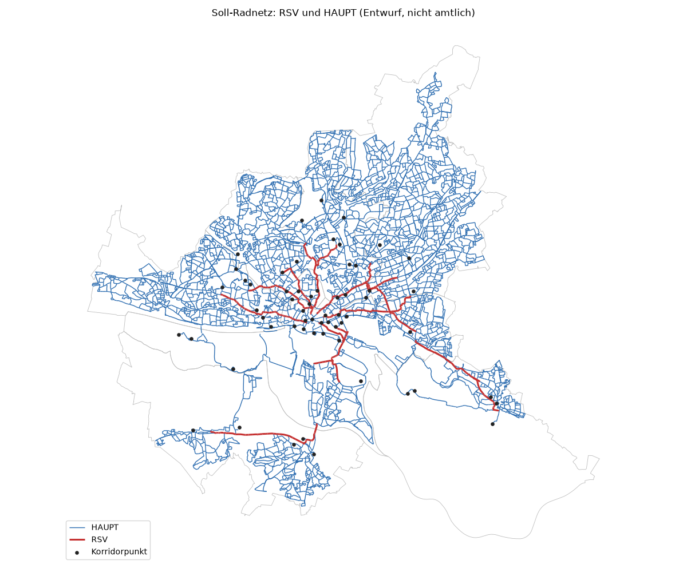
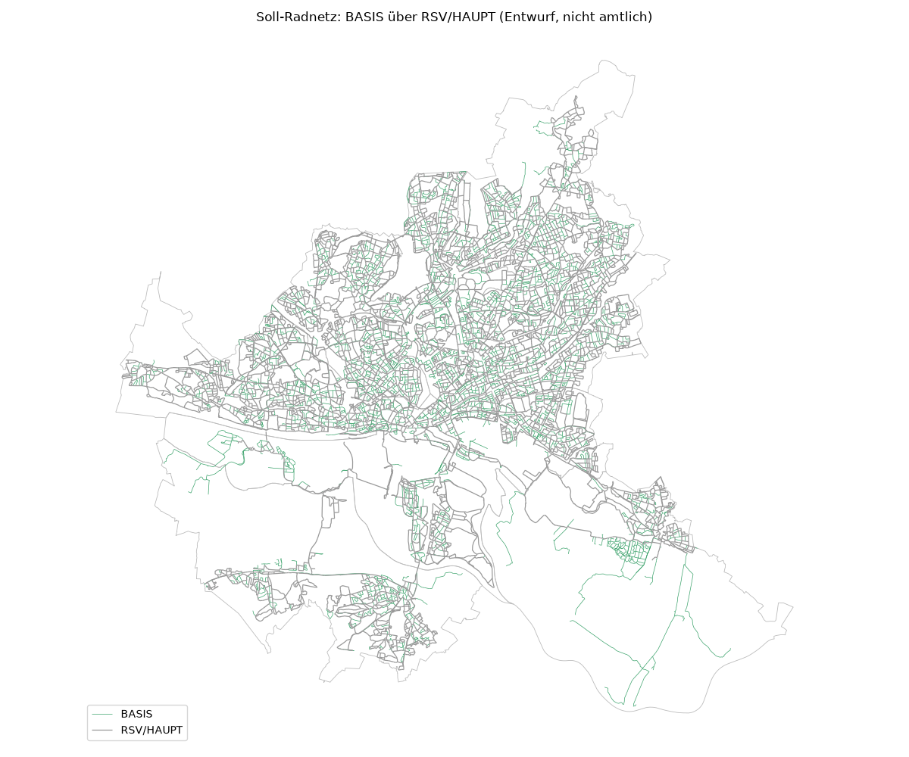
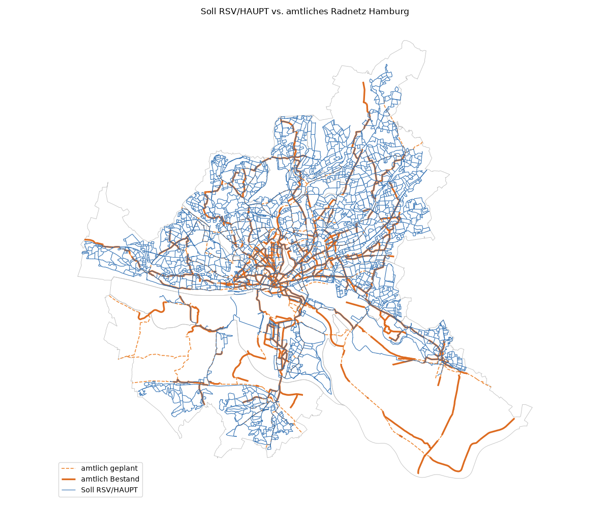

# Soll-Radnetz: Hierarchie und Lückenschluss (Stufe c03)

Erzeugt 2026-11-06T11:21:18+00:00 mit pipeline/c03_cycle_network.py · cycling_rules.yaml 0.3.0 · nicht amtlicher Entwurf. Alle Entwurfsparameter (C-NET-01…13) sind Annahmen (source_type assumption, status draft) und vor fachlicher Nutzung zu prüfen.

## Kurzfassung

- RSV: 84 km (1 011 Kanten)
- HAUPT: 2 027 km (19 739 Kanten)
- BASIS: 1 052 km (10 256 Kanten)
- ERSCHL: 3 268 km (34 967 Kanten)
- Amtliches Radnetz (Bestand, 371 km): 59% liegt am Soll-Netz RSV/HAUPT, 76% am Soll-Netz bis BASIS (Puffer 20 m).
- Soll RSV/HAUPT außerhalb des amtlichen Bestands: 1 856 km, davon 184 km im geplanten amtlichen Netz.
- Maschen über der Höchstweite nach Verdichtung: HAUPT 108, BASIS 728 (Lückenliste unten; Maschen in ländlichen Stadtteilen nicht geprüft).
- Parallelregel P-ATT-03: 6 von 466 geprüften Läufen an Straßen mit DTV > 15 000 auf eine Parallelroute verlegt.
- Overrides angewendet: 0.

**Grenzen vorab:** Bezirks- und Stadtteilzentren fehlen als Korridorpunkte (kein Endpunkt für das Zentrenkonzept, Entscheidung 2026-11-06). Die Nachfrage aus Prompt 15 ist nur mäßig kalibriert (Spearman 0,53, mittlere relative Abweichung 154 %; Nebenstraßen parallel zu Hauptstraßen ohne erfassten Radweg werden überschätzt). Beides wirkt auf Korridore und RSV-Abschnitte; bitte die RSV-Liste und die Karten mit Ortskenntnis lesen.

## Verfahren

1. **Soll-Widerstand (C-NET-03):** Länge × Faktor der regelkonformen Führung je cat_final (path separated_track_or_cycle_street, SW gow50_separated_track, GOW80 gow50_separated_track, GOW50 gow50_separated_track, GOW30 gow30_cycle_lane, ETW30 etw30_mixed, ETW_ERF etw30_mixed, ETW60 etw30_mixed) plus Wartezeiten des Ist-Zustands; ungerichtet.
2. **Boni:** Nachfrage (C-NET-04) bis −30% ab 2 000 Rad/Werktag; amtliches Radnetz (C-NET-05, alle Status) × 0.8 bei ≥ 50% Überdeckung im Puffer 15 m.
3. **Korridore (C-NET-01/02):** Punkte zusammengefasst ab 500 m; jeder Punkt mit seinen 4 nächsten (bis 15 km) und mit der Innenstadt verbunden, günstigster Weg nach Soll-Widerstand mit Boni.
4. **RSV (C-NET-06):** Korridorläufe mit ≥ 2 000 Rad/Werktag (Lücken bis 500 m überbrückt) und ≥ 5 km Länge; übrige Korridorkanten HAUPT.
5. **HAUPT-Verdichtung (C-NET-07/08):** Maschen des RSV+HAUPT-Netzes mit Barrieren (Bahn, Flüsse/Kanäle) und Landesgrenze; Seite des flächengleichen Quadrats ohne Wasser, Wald, Parks, Friedhöfe, Flughafen (≥ 5 ha); Maschen > 600 m werden geteilt, ab der Kante mit der höchsten Nachfrage im Kernbereich (Abstand zum Maschenrand ≥ 0.5 × größter Abstand).
6. **Parallelregel (C-NET-10, P-ATT-03):** Läufe ≥ 300 m an Straßen mit DTV > 15 000; Alternative über Kanten im Puffer 200 m, höchstens 60 m an der Hauptstraße (Anschluss/Querung), Umwegfaktor ≤ P-DIR-01 (RSV 1.1, HAUPT 1.2); die Hauptstraße bleibt BASIS. Danach zweite HAUPT-Verdichtung ohne diese Hauptstraßen.
7. **BASIS (C-NET-09/08):** Schulen und Nahversorgung (supermarket, convenience, bakery, butcher, greengrocer, chemist) weiter als 150 m vom Netz angebunden; dann Maschen > 300 m geteilt.
8. **Kontinuität (C-NET-11):** niedrigere Läufe bis 200 m zwischen zwei gleichen höheren Läufen angehoben.
9. **ERSCHL (C-NET-12):** alle übrigen Kanten. **Overrides:** overrides/cycle_network_overrides.csv, nur approved.

## Korridorpunkte (C-NET-01)

| Art | Punkte | nach Zusammenfassung | Quelle |
| --- | ---: | ---: | --- |
| Innenstadt | 1 | 1 | Annahme (Rathausmarkt, 53.5503/9.9925) |
| Schnellbahn-Umsteigeknoten | 127 | 16 | HVV-GTFS, ≥ 2 Verkehrsmittel im Umkreis 250 m |
| Hochschule | 41 | 20 | OSM amenity=university (Fallback) |
| Arbeitsplatzschwerpunkt | 51 | 23 | ALKIS-Geschossfläche Nichtwohnen, Zonen ≥ Quantil 0.98 (224 Tsd. m²) |
| Bezirks-/Stadtteilzentren | – | – | fehlt: sources.yaml `centres` ohne Endpunkt (TODO) |

Korridorpaare: 209, davon mit Weg: 209. Anbindung an den Radgraphen: Median 61 m, Maximum 362 m.

## Kennzahlen je Kategorie

| Kategorie | km | Kanten | davon Bestand amtlich km | Komponenten | größte Komponente (Längenanteil) |
| --- | ---: | ---: | ---: | ---: | ---: |
| RSV | 83.7 | 1 011 | 34.7 | 6 | 30% |
| HAUPT | 2 027.1 | 19 739 | 194.8 | 1 | 100% |
| BASIS | 1 051.5 | 10 256 | 83.7 | 1 | 100% |
| ERSCHL | 3 268.1 | 34 967 | 232.1 | – | – |

Komponenten (P-COH-02): je Ebene einschließlich der höheren Ebenen.

Anteile je Bezirk (Kantenlänge):

| Bezirk | Abschnitte | km | RSV | HAUPT | BASIS | ERSCHL |
| --- | ---: | ---: | ---: | ---: | ---: | ---: |
| Altona | 8 424 | 787.5 | 1 % | 40 % | 16 % | 43 % |
| Bergedorf | 5 014 | 631.5 | 1 % | 15 % | 17 % | 67 % |
| Eimsbüttel | 8 086 | 629.2 | 2 % | 40 % | 17 % | 41 % |
| Hamburg-Mitte | 12 403 | 1 102.3 | 3 % | 29 % | 17 % | 51 % |
| Hamburg-Nord | 10 442 | 805.6 | 1 % | 34 % | 19 % | 45 % |
| Harburg | 5 650 | 701.3 | 1 % | 26 % | 13 % | 60 % |
| Wandsbek | 14 241 | 1 476.3 | 0 % | 40 % | 19 % | 41 % |
| ohne Bezirk | 1 713 | 296.7 | 0 % | 0 % | 0 % | 100 % |
| **gesamt** | 65 973 | 6 430.4 | 1 % | 32 % | 16 % | 51 % |

### Maschenweite (P-COH-01)

| Ebene | Höchstweite m | Maschen geprüft | Median Seite m | 90-%-Quantil m | größte m | über Höchstweite | in ländl. Stadtteilen nicht geprüft |
| --- | ---: | ---: | ---: | ---: | ---: | ---: | ---: |
| HAUPT + höher | 600 | 3 994 | 154 | 529 | 4 103 | 108 | 9 |
| BASIS + höher | 300 | 7 124 | 154 | 302 | 4 073 | 728 | 19 |

Verdichtungsrunden:

| Ebene | Runde | Maschen zu groß | neue Routen |
| --- | ---: | ---: | ---: |
| HAUPT 1 | 1 | 103 | 83 |
| HAUPT 1 | 2 | 110 | 89 |
| HAUPT 1 | 3 | 112 | 90 |
| HAUPT 1 | 4 | 118 | 95 |
| HAUPT 1 | 5 | 116 | 92 |
| HAUPT 1 | 6 | 110 | 83 |
| HAUPT 1 | 7 | 110 | 79 |
| HAUPT 1 | 8 | 107 | 69 |
| HAUPT 1 | 9 | 103 | 63 |
| HAUPT 1 | 10 | 105 | 63 |
| HAUPT 1 | 11 | 108 | 65 |
| HAUPT 1 | 12 | 107 | 62 |
| HAUPT 1 | 13 | 112 | 67 |
| HAUPT 1 | 14 | 109 | 62 |
| HAUPT 1 | 15 | 106 | 57 |
| HAUPT 1 | 16 | 108 | 59 |
| HAUPT 1 | 17 | 101 | 50 |
| HAUPT 1 | 18 | 100 | 46 |
| HAUPT 1 | 19 | 98 | 41 |
| HAUPT 1 | 20 | 97 | 37 |
| HAUPT 1 | 21 | 99 | 38 |
| HAUPT 1 | 22 | 96 | 32 |
| HAUPT 1 | 23 | 100 | 34 |
| HAUPT 1 | 24 | 98 | 30 |
| HAUPT 1 | 25 | 102 | 34 |
| HAUPT 1 | 26 | 99 | 30 |
| HAUPT 1 | 27 | 96 | 27 |
| HAUPT 1 | 28 | 96 | 24 |
| HAUPT 1 | 29 | 97 | 23 |
| HAUPT 1 | 30 | 93 | 18 |
| HAUPT 1 | 31 | 93 | 17 |
| HAUPT 1 | 32 | 98 | 22 |
| HAUPT 1 | 33 | 100 | 24 |
| HAUPT 1 | 34 | 100 | 22 |
| HAUPT 1 | 35 | 101 | 21 |
| HAUPT 1 | 36 | 100 | 20 |
| HAUPT 1 | 37 | 101 | 20 |
| HAUPT 1 | 38 | 102 | 20 |
| HAUPT 1 | 39 | 101 | 19 |
| HAUPT 1 | 40 | 101 | 19 |
| HAUPT 2 | 1 | 103 | 21 |
| HAUPT 2 | 2 | 102 | 19 |
| HAUPT 2 | 3 | 102 | 17 |
| HAUPT 2 | 4 | 102 | 14 |
| HAUPT 2 | 5 | 102 | 14 |
| HAUPT 2 | 6 | 102 | 14 |
| HAUPT 2 | 7 | 102 | 14 |
| HAUPT 2 | 8 | 101 | 13 |
| HAUPT 2 | 9 | 102 | 13 |
| HAUPT 2 | 10 | 102 | 13 |
| HAUPT 2 | 11 | 103 | 13 |
| HAUPT 2 | 12 | 103 | 13 |
| HAUPT 2 | 13 | 104 | 13 |
| HAUPT 2 | 14 | 104 | 12 |
| HAUPT 2 | 15 | 104 | 12 |
| HAUPT 2 | 16 | 104 | 11 |
| HAUPT 2 | 17 | 104 | 11 |
| HAUPT 2 | 18 | 104 | 10 |
| HAUPT 2 | 19 | 103 | 9 |
| HAUPT 2 | 20 | 103 | 9 |
| HAUPT 2 | 21 | 104 | 8 |
| HAUPT 2 | 22 | 105 | 9 |
| HAUPT 2 | 23 | 105 | 8 |
| HAUPT 2 | 24 | 105 | 8 |
| HAUPT 2 | 25 | 106 | 9 |
| HAUPT 2 | 26 | 106 | 9 |
| HAUPT 2 | 27 | 106 | 9 |
| HAUPT 2 | 28 | 106 | 9 |
| HAUPT 2 | 29 | 107 | 10 |
| HAUPT 2 | 30 | 107 | 8 |
| HAUPT 2 | 31 | 107 | 8 |
| HAUPT 2 | 32 | 108 | 9 |
| HAUPT 2 | 33 | 108 | 8 |
| HAUPT 2 | 34 | 108 | 8 |
| HAUPT 2 | 35 | 108 | 8 |
| HAUPT 2 | 36 | 108 | 7 |
| HAUPT 2 | 37 | 108 | 7 |
| HAUPT 2 | 38 | 108 | 7 |
| HAUPT 2 | 39 | 108 | 7 |
| HAUPT 2 | 40 | 108 | 6 |
| BASIS | 1 | 1113 | 890 |
| BASIS | 2 | 1054 | 726 |
| BASIS | 3 | 943 | 493 |
| BASIS | 4 | 865 | 316 |
| BASIS | 5 | 798 | 196 |
| BASIS | 6 | 758 | 112 |
| BASIS | 7 | 744 | 75 |
| BASIS | 8 | 734 | 43 |
| BASIS | 9 | 731 | 30 |
| BASIS | 10 | 730 | 22 |
| BASIS | 11 | 729 | 17 |
| BASIS | 12 | 729 | 13 |
| BASIS | 13 | 728 | 11 |
| BASIS | 14 | 729 | 11 |
| BASIS | 15 | 728 | 7 |
| BASIS | 16 | 729 | 6 |
| BASIS | 17 | 728 | 5 |
| BASIS | 18 | 728 | 4 |
| BASIS | 19 | 728 | 3 |
| BASIS | 20 | 728 | 2 |
| BASIS | 21 | 728 | 2 |
| BASIS | 22 | 728 | 2 |
| BASIS | 23 | 728 | 2 |
| BASIS | 24 | 728 | 2 |
| BASIS | 25 | 728 | 2 |
| BASIS | 26 | 728 | 2 |
| BASIS | 27 | 728 | 2 |
| BASIS | 28 | 728 | 1 |
| BASIS | 29 | 728 | 1 |
| BASIS | 30 | 728 | 1 |
| BASIS | 31 | 728 | 1 |
| BASIS | 32 | 728 | 1 |
| BASIS | 33 | 728 | 0 |

### Abdeckung wichtiger Ziele (P-COH-03, ≤ 300 m vom RSV/HAUPT-Netz)

| Ziel | Anzahl | abgedeckt |
| --- | ---: | ---: |
| Schulen (OSM) | 557 | 96% |
| Schnellbahnhalte | 375 | 99% |
| Hochschulen (OSM university) | 41 | 100% |
| Zentren | – | nicht prüfbar (Datensatz fehlt) |

## Karten

## Vergleich mit dem amtlichen Radnetz

Amtlich = WFS Radnetz Hamburg, Status Bestand; geplant = In Arbeit, Priorisierte Netzergänzungen/Netzverbesserungen, Netzbedeutende Abschnitte mit Verbesserungspotential (Entscheidung 2026-11-06). Überdeckung im Puffer 20 m.

| Kennzahl | km |
| --- | ---: |
| amtlich (Bestand) | 371.4 |
| davon am Soll RSV/HAUPT | 220.2 |
| davon am Soll bis BASIS | 282.0 |
| fehlt im Soll RSV/HAUPT | 151.1 |
| geplant (amtlich) | 292.4 |
| davon am Soll RSV/HAUPT | 165.0 |
| Soll RSV/HAUPT gesamt | 2 110.8 |
| Soll RSV/HAUPT zusätzlich (nicht am amtlichen Bestand) | 1 855.8 |
| davon im geplanten amtlichen Netz | 184.1 |

Längste amtliche Bestandsabschnitte ohne Soll RSV/HAUPT (Top 15):

| Länge m | Soll dort (größte Kategorie) | Prüfen |
| ---: | --- | --- |
| 5 103 | BASIS | [Luftbild](https://geoportal-hamburg.de/?MAP/PROJECTION=EPSG:25832&MAP/CENTER=[577209,5920892]&MAP/ZOOMLEVEL=10&MAP/LAYERIDS=19968) · [Panoramax](https://api.panoramax.xyz/#focus=map&map=18/53.431411/10.162119) · [OSM](https://www.openstreetmap.org/?mlat=53.431411&mlon=10.162119#map=18/53.431411/10.162119) |
| 4 454 | HAUPT | [Luftbild](https://geoportal-hamburg.de/?MAP/PROJECTION=EPSG:25832&MAP/CENTER=[570437,5929974]&MAP/ZOOMLEVEL=10&MAP/LAYERIDS=19968) · [Panoramax](https://api.panoramax.xyz/#focus=map&map=18/53.513978/10.062247) · [OSM](https://www.openstreetmap.org/?mlat=53.513978&mlon=10.062247#map=18/53.513978/10.062247) |
| 4 209 | BASIS | [Luftbild](https://geoportal-hamburg.de/?MAP/PROJECTION=EPSG:25832&MAP/CENTER=[580907,5917845]&MAP/ZOOMLEVEL=10&MAP/LAYERIDS=19968) · [Panoramax](https://api.panoramax.xyz/#focus=map&map=18/53.403472/10.216980) · [OSM](https://www.openstreetmap.org/?mlat=53.403472&mlon=10.216980#map=18/53.403472/10.216980) |
| 3 614 | BASIS | [Luftbild](https://geoportal-hamburg.de/?MAP/PROJECTION=EPSG:25832&MAP/CENTER=[585025,5921139]&MAP/ZOOMLEVEL=10&MAP/LAYERIDS=19968) · [Panoramax](https://api.panoramax.xyz/#focus=map&map=18/53.432426/10.279804) · [OSM](https://www.openstreetmap.org/?mlat=53.432426&mlon=10.279804#map=18/53.432426/10.279804) |
| 3 466 | BASIS | [Luftbild](https://geoportal-hamburg.de/?MAP/PROJECTION=EPSG:25832&MAP/CENTER=[578652,5918928]&MAP/ZOOMLEVEL=10&MAP/LAYERIDS=19968) · [Panoramax](https://api.panoramax.xyz/#focus=map&map=18/53.413549/10.183340) · [OSM](https://www.openstreetmap.org/?mlat=53.413549&mlon=10.183340#map=18/53.413549/10.183340) |
| 3 440 | BASIS | [Luftbild](https://geoportal-hamburg.de/?MAP/PROJECTION=EPSG:25832&MAP/CENTER=[581378,5924306]&MAP/ZOOMLEVEL=10&MAP/LAYERIDS=19968) · [Panoramax](https://api.panoramax.xyz/#focus=map&map=18/53.461462/10.225732) · [OSM](https://www.openstreetmap.org/?mlat=53.461462&mlon=10.225732#map=18/53.461462/10.225732) |
| 3 131 | HAUPT | [Luftbild](https://geoportal-hamburg.de/?MAP/PROJECTION=EPSG:25832&MAP/CENTER=[575498,5929969]&MAP/ZOOMLEVEL=10&MAP/LAYERIDS=19968) · [Panoramax](https://api.panoramax.xyz/#focus=map&map=18/53.513233/10.138550) · [OSM](https://www.openstreetmap.org/?mlat=53.513233&mlon=10.138550#map=18/53.513233/10.138550) |
| 2 431 | BASIS | [Luftbild](https://geoportal-hamburg.de/?MAP/PROJECTION=EPSG:25832&MAP/CENTER=[555512,5931491]&MAP/ZOOMLEVEL=10&MAP/LAYERIDS=19968) · [Panoramax](https://api.panoramax.xyz/#focus=map&map=18/53.529402/9.837457) · [OSM](https://www.openstreetmap.org/?mlat=53.529402&mlon=9.837457#map=18/53.529402/9.837457) |
| 2 199 | BASIS | [Luftbild](https://geoportal-hamburg.de/?MAP/PROJECTION=EPSG:25832&MAP/CENTER=[582589,5919714]&MAP/ZOOMLEVEL=10&MAP/LAYERIDS=19968) · [Panoramax](https://api.panoramax.xyz/#focus=map&map=18/53.420006/10.242761) · [OSM](https://www.openstreetmap.org/?mlat=53.420006&mlon=10.242761#map=18/53.420006/10.242761) |
| 2 132 | BASIS | [Luftbild](https://geoportal-hamburg.de/?MAP/PROJECTION=EPSG:25832&MAP/CENTER=[580584,5921676]&MAP/ZOOMLEVEL=10&MAP/LAYERIDS=19968) · [Panoramax](https://api.panoramax.xyz/#focus=map&map=18/53.437953/10.213108) · [OSM](https://www.openstreetmap.org/?mlat=53.437953&mlon=10.213108#map=18/53.437953/10.213108) |
| 2 085 | HAUPT | [Luftbild](https://geoportal-hamburg.de/?MAP/PROJECTION=EPSG:25832&MAP/CENTER=[566969,5924238]&MAP/ZOOMLEVEL=10&MAP/LAYERIDS=19968) · [Panoramax](https://api.panoramax.xyz/#focus=map&map=18/53.462885/10.008733) · [OSM](https://www.openstreetmap.org/?mlat=53.462885&mlon=10.008733#map=18/53.462885/10.008733) |
| 2 080 | BASIS | [Luftbild](https://geoportal-hamburg.de/?MAP/PROJECTION=EPSG:25832&MAP/CENTER=[573363,5950518]&MAP/ZOOMLEVEL=10&MAP/LAYERIDS=19968) · [Panoramax](https://api.panoramax.xyz/#focus=map&map=18/53.698207/10.111192) · [OSM](https://www.openstreetmap.org/?mlat=53.698207&mlon=10.111192#map=18/53.698207/10.111192) |
| 2 049 | ERSCHL | [Luftbild](https://geoportal-hamburg.de/?MAP/PROJECTION=EPSG:25832&MAP/CENTER=[566013,5930578]&MAP/ZOOMLEVEL=10&MAP/LAYERIDS=19968) · [Panoramax](https://api.panoramax.xyz/#focus=map&map=18/53.519984/9.995661) · [OSM](https://www.openstreetmap.org/?mlat=53.519984&mlon=9.995661#map=18/53.519984/9.995661) |
| 2 010 | BASIS | [Luftbild](https://geoportal-hamburg.de/?MAP/PROJECTION=EPSG:25832&MAP/CENTER=[558879,5931435]&MAP/ZOOMLEVEL=10&MAP/LAYERIDS=19968) · [Panoramax](https://api.panoramax.xyz/#focus=map&map=18/53.528535/9.888246) · [OSM](https://www.openstreetmap.org/?mlat=53.528535&mlon=9.888246#map=18/53.528535/9.888246) |
| 1 774 | ERSCHL | [Luftbild](https://geoportal-hamburg.de/?MAP/PROJECTION=EPSG:25832&MAP/CENTER=[571606,5926108]&MAP/ZOOMLEVEL=10&MAP/LAYERIDS=19968) · [Panoramax](https://api.panoramax.xyz/#focus=map&map=18/53.479078/10.078995) · [OSM](https://www.openstreetmap.org/?mlat=53.479078&mlon=10.078995#map=18/53.479078/10.078995) |

Zusätzliche Soll-RSV/HAUPT-Straßen ohne amtlichen Bestand (Top 15 nach Länge):

| Straße / Weg | km | Kategorie | im geplanten Netz km | Prüfen |
| --- | ---: | --- | ---: | --- |
| neben Bremer Straße | 6.03 | HAUPT | 4.83 | [Luftbild](https://geoportal-hamburg.de/?MAP/PROJECTION=EPSG:25832&MAP/CENTER=[562594,5921609]&MAP/ZOOMLEVEL=10&MAP/LAYERIDS=19968) · [Panoramax](https://api.panoramax.xyz/#focus=map&map=18/53.439795/9.942323) · [OSM](https://www.openstreetmap.org/?mlat=53.439795&mlon=9.942323#map=18/53.439795/9.942323) |
| Moorwerder Hauptdeich | 5.48 | HAUPT | 0.00 | [Luftbild](https://geoportal-hamburg.de/?MAP/PROJECTION=EPSG:25832&MAP/CENTER=[570431,5924607]&MAP/ZOOMLEVEL=10&MAP/LAYERIDS=19968) · [Panoramax](https://api.panoramax.xyz/#focus=map&map=18/53.465745/10.060950) · [OSM](https://www.openstreetmap.org/?mlat=53.465745&mlon=10.060950#map=18/53.465745/10.060950) |
| Billwerder Billdeich | 5.24 | HAUPT | 0.00 | [Luftbild](https://geoportal-hamburg.de/?MAP/PROJECTION=EPSG:25832&MAP/CENTER=[574203,5930849]&MAP/ZOOMLEVEL=10&MAP/LAYERIDS=19968) · [Panoramax](https://api.panoramax.xyz/#focus=map&map=18/53.521330/10.119241) · [OSM](https://www.openstreetmap.org/?mlat=53.521330&mlon=10.119241#map=18/53.521330/10.119241) |
| neben Waltershofer Straße | 4.43 | HAUPT | 4.43 | [Luftbild](https://geoportal-hamburg.de/?MAP/PROJECTION=EPSG:25832&MAP/CENTER=[559810,5925319]&MAP/ZOOMLEVEL=10&MAP/LAYERIDS=19968) · [Panoramax](https://api.panoramax.xyz/#focus=map&map=18/53.473455/9.901124) · [OSM](https://www.openstreetmap.org/?mlat=53.473455&mlon=9.901124#map=18/53.473455/9.901124) |
| Poppenbütteler Weg | 4.03 | HAUPT | 0.00 | [Luftbild](https://geoportal-hamburg.de/?MAP/PROJECTION=EPSG:25832&MAP/CENTER=[568649,5944894]&MAP/ZOOMLEVEL=10&MAP/LAYERIDS=19968) · [Panoramax](https://api.panoramax.xyz/#focus=map&map=18/53.648305/10.038571) · [OSM](https://www.openstreetmap.org/?mlat=53.648305&mlon=10.038571#map=18/53.648305/10.038571) |
| Elbchaussee | 4.00 | HAUPT | 3.26 | [Luftbild](https://geoportal-hamburg.de/?MAP/PROJECTION=EPSG:25832&MAP/CENTER=[555715,5933996]&MAP/ZOOMLEVEL=10&MAP/LAYERIDS=19968) · [Panoramax](https://api.panoramax.xyz/#focus=map&map=18/53.551897/9.840976) · [OSM](https://www.openstreetmap.org/?mlat=53.551897&mlon=9.840976#map=18/53.551897/9.840976) |
| Cuxhavener Straße | 4.00 | RSV | 0.08 | [Luftbild](https://geoportal-hamburg.de/?MAP/PROJECTION=EPSG:25832&MAP/CENTER=[556181,5925202]&MAP/ZOOMLEVEL=10&MAP/LAYERIDS=19968) · [Panoramax](https://api.panoramax.xyz/#focus=map&map=18/53.472806/9.846433) · [OSM](https://www.openstreetmap.org/?mlat=53.472806&mlon=9.846433#map=18/53.472806/9.846433) |
| neben Schnackenburgallee | 3.95 | HAUPT | 0.37 | [Luftbild](https://geoportal-hamburg.de/?MAP/PROJECTION=EPSG:25832&MAP/CENTER=[559866,5938488]&MAP/ZOOMLEVEL=10&MAP/LAYERIDS=19968) · [Panoramax](https://api.panoramax.xyz/#focus=map&map=18/53.591805/9.904478) · [OSM](https://www.openstreetmap.org/?mlat=53.591805&mlon=9.904478#map=18/53.591805/9.904478) |
| Alsterwanderweg | 3.91 | HAUPT | 0.00 | [Luftbild](https://geoportal-hamburg.de/?MAP/PROJECTION=EPSG:25832&MAP/CENTER=[568539,5943129]&MAP/ZOOMLEVEL=10&MAP/LAYERIDS=19968) · [Panoramax](https://api.panoramax.xyz/#focus=map&map=18/53.632454/10.036517) · [OSM](https://www.openstreetmap.org/?mlat=53.632454&mlon=10.036517#map=18/53.632454/10.036517) |
| neben Cuxhavener Straße | 3.74 | RSV | 0.28 | [Luftbild](https://geoportal-hamburg.de/?MAP/PROJECTION=EPSG:25832&MAP/CENTER=[554334,5924856]&MAP/ZOOMLEVEL=10&MAP/LAYERIDS=19968) · [Panoramax](https://api.panoramax.xyz/#focus=map&map=18/53.469888/9.818538) · [OSM](https://www.openstreetmap.org/?mlat=53.469888&mlon=9.818538#map=18/53.469888/9.818538) |
| neben Berner Heerweg | 3.71 | HAUPT | 0.91 | [Luftbild](https://geoportal-hamburg.de/?MAP/PROJECTION=EPSG:25832&MAP/CENTER=[573678,5938954]&MAP/ZOOMLEVEL=10&MAP/LAYERIDS=19968) · [Panoramax](https://api.panoramax.xyz/#focus=map&map=18/53.594240/10.113226) · [OSM](https://www.openstreetmap.org/?mlat=53.594240&mlon=10.113226#map=18/53.594240/10.113226) |
| neben Meiendorfer Straße | 3.66 | HAUPT | 0.01 | [Luftbild](https://geoportal-hamburg.de/?MAP/PROJECTION=EPSG:25832&MAP/CENTER=[577014,5942017]&MAP/ZOOMLEVEL=10&MAP/LAYERIDS=19968) · [Panoramax](https://api.panoramax.xyz/#focus=map&map=18/53.621283/10.164381) · [OSM](https://www.openstreetmap.org/?mlat=53.621283&mlon=10.164381#map=18/53.621283/10.164381) |
| neben Holsteiner Chaussee | 3.58 | HAUPT | 0.00 | [Luftbild](https://geoportal-hamburg.de/?MAP/PROJECTION=EPSG:25832&MAP/CENTER=[560058,5944348]&MAP/ZOOMLEVEL=10&MAP/LAYERIDS=19968) · [Panoramax](https://api.panoramax.xyz/#focus=map&map=18/53.644454/9.908511) · [OSM](https://www.openstreetmap.org/?mlat=53.644454&mlon=9.908511#map=18/53.644454/9.908511) |
| neben Alte Landstraße | 3.54 | HAUPT | 0.00 | [Luftbild](https://geoportal-hamburg.de/?MAP/PROJECTION=EPSG:25832&MAP/CENTER=[570922,5944649]&MAP/ZOOMLEVEL=10&MAP/LAYERIDS=19968) · [Panoramax](https://api.panoramax.xyz/#focus=map&map=18/53.645801/10.072893) · [OSM](https://www.openstreetmap.org/?mlat=53.645801&mlon=10.072893#map=18/53.645801/10.072893) |
| neben Luruper Hauptstraße | 3.53 | HAUPT | 0.00 | [Luftbild](https://geoportal-hamburg.de/?MAP/PROJECTION=EPSG:25832&MAP/CENTER=[558144,5937842]&MAP/ZOOMLEVEL=10&MAP/LAYERIDS=19968) · [Panoramax](https://api.panoramax.xyz/#focus=map&map=18/53.586201/9.878351) · [OSM](https://www.openstreetmap.org/?mlat=53.586201&mlon=9.878351#map=18/53.586201/9.878351) |

## RSV-Abschnitte (C-NET-06)

23 Korridore mit RSV-Läufen. Längste Korridore mit RSV-Anteil:

| route_id | Korridor | km | RSV km | Median Rad/Werktag | Prüfen |
| --- | --- | ---: | ---: | ---: | --- |
| `rt_9dab92d8a75510aa` | Innenstadt (Rathausmarkt) – Hochschule HAW Hamburg Energie Campus | 20.9 | 18.1 | 3 830 | [Luftbild](https://geoportal-hamburg.de/?MAP/PROJECTION=EPSG:25832&MAP/CENTER=[573763,5932232]&MAP/ZOOMLEVEL=10&MAP/LAYERIDS=19968) · [Panoramax](https://api.panoramax.xyz/#focus=map&map=18/53.533816/10.112927) · [OSM](https://www.openstreetmap.org/?mlat=53.533816&mlon=10.112927#map=18/53.533816/10.112927) |
| `rt_d98d16d4f6df6b74` | Innenstadt (Rathausmarkt) – Hochschule HAW - Life Sciences - Campus Bergedorf | 18.2 | 16.5 | 5 104 | [Luftbild](https://geoportal-hamburg.de/?MAP/PROJECTION=EPSG:25832&MAP/CENTER=[573373,5933222]&MAP/ZOOMLEVEL=10&MAP/LAYERIDS=19968) · [Panoramax](https://api.panoramax.xyz/#focus=map&map=18/53.542764/10.107268) · [OSM](https://www.openstreetmap.org/?mlat=53.542764&mlon=10.107268#map=18/53.542764/10.107268) |
| `rt_ef74f810d825e8b0` | Innenstadt (Rathausmarkt) – Umsteigeknoten Neugraben | 23.8 | 16.3 | 2 642 | [Luftbild](https://geoportal-hamburg.de/?MAP/PROJECTION=EPSG:25832&MAP/CENTER=[563960,5924903]&MAP/ZOOMLEVEL=10&MAP/LAYERIDS=19968) · [Panoramax](https://api.panoramax.xyz/#focus=map&map=18/53.469229/9.963550) · [OSM](https://www.openstreetmap.org/?mlat=53.469229&mlon=9.963550#map=18/53.469229/9.963550) |
| `rt_905b5b331dc096e5` | Innenstadt (Rathausmarkt) – Umsteigeknoten Bergedorf | 18.9 | 15.0 | 4 609 | [Luftbild](https://geoportal-hamburg.de/?MAP/PROJECTION=EPSG:25832&MAP/CENTER=[573679,5933060]&MAP/ZOOMLEVEL=10&MAP/LAYERIDS=19968) · [Panoramax](https://api.panoramax.xyz/#focus=map&map=18/53.541266/10.111849) · [OSM](https://www.openstreetmap.org/?mlat=53.541266&mlon=10.111849#map=18/53.541266/10.111849) |
| `rt_ad15aafddcc3fd36` | Innenstadt (Rathausmarkt) – Arbeitsplatzschwerpunkt Harburg (300 Tsd. m²) | 20.3 | 14.2 | 2 454 | [Luftbild](https://geoportal-hamburg.de/?MAP/PROJECTION=EPSG:25832&MAP/CENTER=[565304,5924573]&MAP/ZOOMLEVEL=10&MAP/LAYERIDS=19968) · [Panoramax](https://api.panoramax.xyz/#focus=map&map=18/53.466099/9.983721) · [OSM](https://www.openstreetmap.org/?mlat=53.466099&mlon=9.983721#map=18/53.466099/9.983721) |
| `rt_3f2aee1c9915af36` | Innenstadt (Rathausmarkt) – Hochschule Helmut-Schmidt-Universität – Universität der Bundeswehr Hamburg | 10.2 | 8.7 | 3 926 | [Luftbild](https://geoportal-hamburg.de/?MAP/PROJECTION=EPSG:25832&MAP/CENTER=[570151,5934562]&MAP/ZOOMLEVEL=10&MAP/LAYERIDS=19968) · [Panoramax](https://api.panoramax.xyz/#focus=map&map=18/53.555251/10.058967) · [OSM](https://www.openstreetmap.org/?mlat=53.555251&mlon=10.058967#map=18/53.555251/10.058967) |
| `rt_685738ee599e52bb` | Innenstadt (Rathausmarkt) – Arbeitsplatzschwerpunkt Hamburg-Mitte (278 Tsd. m²) | 9.6 | 8.4 | 6 298 | [Luftbild](https://geoportal-hamburg.de/?MAP/PROJECTION=EPSG:25832&MAP/CENTER=[569829,5934631]&MAP/ZOOMLEVEL=10&MAP/LAYERIDS=19968) · [Panoramax](https://api.panoramax.xyz/#focus=map&map=18/53.555912/10.054118) · [OSM](https://www.openstreetmap.org/?mlat=53.555912&mlon=10.054118#map=18/53.555912/10.054118) |
| `rt_04292b8a44ebb0ba` | Innenstadt (Rathausmarkt) – Hochschule Helmut-Schmidt-Universität - Campus Nord | 10.9 | 8.0 | 3 189 | [Luftbild](https://geoportal-hamburg.de/?MAP/PROJECTION=EPSG:25832&MAP/CENTER=[569615,5936643]&MAP/ZOOMLEVEL=10&MAP/LAYERIDS=19968) · [Panoramax](https://api.panoramax.xyz/#focus=map&map=18/53.574028/10.051333) · [OSM](https://www.openstreetmap.org/?mlat=53.574028&mlon=10.051333#map=18/53.574028/10.051333) |
| `rt_9e6601ea7803cda7` | Innenstadt (Rathausmarkt) – Hochschule I. Institut für Theoretische Physik | 8.9 | 7.7 | 4 235 | [Luftbild](https://geoportal-hamburg.de/?MAP/PROJECTION=EPSG:25832&MAP/CENTER=[561890,5934407]&MAP/ZOOMLEVEL=10&MAP/LAYERIDS=19968) · [Panoramax](https://api.panoramax.xyz/#focus=map&map=18/53.554896/9.934253) · [OSM](https://www.openstreetmap.org/?mlat=53.554896&mlon=9.934253#map=18/53.554896/9.934253) |
| `rt_b16a05ec880f4542` | Innenstadt (Rathausmarkt) – Arbeitsplatzschwerpunkt Hamburg-Nord (327 Tsd. m²) | 8.5 | 7.3 | 2 770 | [Luftbild](https://geoportal-hamburg.de/?MAP/PROJECTION=EPSG:25832&MAP/CENTER=[565982,5937481]&MAP/ZOOMLEVEL=10&MAP/LAYERIDS=19968) · [Panoramax](https://api.panoramax.xyz/#focus=map&map=18/53.582027/9.996651) · [OSM](https://www.openstreetmap.org/?mlat=53.582027&mlon=9.996651#map=18/53.582027/9.996651) |
| `rt_6b2977f56199391b` | Innenstadt (Rathausmarkt) – Arbeitsplatzschwerpunkt Wandsbek (290 Tsd. m²) | 9.8 | 6.9 | 2 150 | [Luftbild](https://geoportal-hamburg.de/?MAP/PROJECTION=EPSG:25832&MAP/CENTER=[569136,5936461]&MAP/ZOOMLEVEL=10&MAP/LAYERIDS=19968) · [Panoramax](https://api.panoramax.xyz/#focus=map&map=18/53.572456/10.044066) · [OSM](https://www.openstreetmap.org/?mlat=53.572456&mlon=10.044066#map=18/53.572456/10.044066) |
| `rt_6de4898bcc7637c9` | Innenstadt (Rathausmarkt) – Arbeitsplatzschwerpunkt Hamburg-Mitte (263 Tsd. m²) | 9.6 | 6.9 | 3 700 | [Luftbild](https://geoportal-hamburg.de/?MAP/PROJECTION=EPSG:25832&MAP/CENTER=[567772,5931192]&MAP/ZOOMLEVEL=10&MAP/LAYERIDS=19968) · [Panoramax](https://api.panoramax.xyz/#focus=map&map=18/53.525278/10.022327) · [OSM](https://www.openstreetmap.org/?mlat=53.525278&mlon=10.022327#map=18/53.525278/10.022327) |
| `rt_6a25b050273570ae` | Innenstadt (Rathausmarkt) – Arbeitsplatzschwerpunkt Hamburg-Nord (247 Tsd. m²) | 9.1 | 6.7 | 3 514 | [Luftbild](https://geoportal-hamburg.de/?MAP/PROJECTION=EPSG:25832&MAP/CENTER=[565938,5937766]&MAP/ZOOMLEVEL=10&MAP/LAYERIDS=19968) · [Panoramax](https://api.panoramax.xyz/#focus=map&map=18/53.584595/9.996046) · [OSM](https://www.openstreetmap.org/?mlat=53.584595&mlon=9.996046#map=18/53.584595/9.996046) |
| `rt_aa601155bd8984d5` | Innenstadt (Rathausmarkt) – Arbeitsplatzschwerpunkt Altona (228 Tsd. m²) | 7.6 | 6.6 | 2 525 | [Luftbild](https://geoportal-hamburg.de/?MAP/PROJECTION=EPSG:25832&MAP/CENTER=[563865,5936067]&MAP/ZOOMLEVEL=10&MAP/LAYERIDS=19968) · [Panoramax](https://api.panoramax.xyz/#focus=map&map=18/53.569583/9.964387) · [OSM](https://www.openstreetmap.org/?mlat=53.569583&mlon=9.964387#map=18/53.569583/9.964387) |
| `rt_b3e5311382ffdee5` | Innenstadt (Rathausmarkt) – Hochschule Gebäude D | 15.3 | 6.3 | 1 886 | [Luftbild](https://geoportal-hamburg.de/?MAP/PROJECTION=EPSG:25832&MAP/CENTER=[565862,5926294]&MAP/ZOOMLEVEL=10&MAP/LAYERIDS=19968) · [Panoramax](https://api.panoramax.xyz/#focus=map&map=18/53.481498/9.992496) · [OSM](https://www.openstreetmap.org/?mlat=53.481498&mlon=9.992496#map=18/53.481498/9.992496) |

## Parallelregel P-ATT-03 (C-NET-10)

348 verschiedene Läufe an Straßen mit DTV > 15 000 (auf 466 Routen geprüft): nur über die Hauptstraße 256, Umweg zu groß 86, verlegt 6.

| Routen | Straße (DTV > Schwelle) | Kategorie | Lauf m | Alternative | Alternative m | davon Hauptstraße m | Umwegfaktor | Schwelle | Ergebnis | Prüfen |
| ---: | --- | --- | ---: | --- | ---: | ---: | ---: | ---: | --- | --- |
| 1 | neben Georg-Heyken-Straße | HAUPT | 915 | – | 71 | 0 | 0.08 | 1.2 | verlegt | [Luftbild](https://geoportal-hamburg.de/?MAP/PROJECTION=EPSG:25832&MAP/CENTER=[560481,5926246]&MAP/ZOOMLEVEL=10&MAP/LAYERIDS=19968) · [Panoramax](https://api.panoramax.xyz/#focus=map&map=18/53.481714/9.911404) · [OSM](https://www.openstreetmap.org/?mlat=53.481714&mlon=9.911404#map=18/53.481714/9.911404) |
| 1 | Schiffbeker Weg, Schiffbeker Höhe | HAUPT | 712 | Maukestieg, Sandkoppelweg, Gothaer Weg | 724 | 0 | 1.02 | 1.2 | verlegt | [Luftbild](https://geoportal-hamburg.de/?MAP/PROJECTION=EPSG:25832&MAP/CENTER=[573328,5933701]&MAP/ZOOMLEVEL=10&MAP/LAYERIDS=19968) · [Panoramax](https://api.panoramax.xyz/#focus=map&map=18/53.547076/10.106713) · [OSM](https://www.openstreetmap.org/?mlat=53.547076&mlon=10.106713#map=18/53.547076/10.106713) |
| 1 | neben Schnackenburgallee, Schnackenburgallee | HAUPT | 511 | – | 5 | 0 | 0.01 | 1.2 | verlegt | [Luftbild](https://geoportal-hamburg.de/?MAP/PROJECTION=EPSG:25832&MAP/CENTER=[560514,5937522]&MAP/ZOOMLEVEL=10&MAP/LAYERIDS=19968) · [Panoramax](https://api.panoramax.xyz/#focus=map&map=18/53.583051/9.914083) · [OSM](https://www.openstreetmap.org/?mlat=53.583051&mlon=9.914083#map=18/53.583051/9.914083) |
| 1 | neben Friedrich-Ebert-Damm | HAUPT | 495 | neben Friedrich-Ebert-Damm, neben Eckerkoppel | 586 | 19 | 1.18 | 1.2 | verlegt | [Luftbild](https://geoportal-hamburg.de/?MAP/PROJECTION=EPSG:25832&MAP/CENTER=[573563,5939329]&MAP/ZOOMLEVEL=10&MAP/LAYERIDS=19968) · [Panoramax](https://api.panoramax.xyz/#focus=map&map=18/53.597623/10.111580) · [OSM](https://www.openstreetmap.org/?mlat=53.597623&mlon=10.111580#map=18/53.597623/10.111580) |
| 1 | neben Dehnhaide, Dehnhaide | HAUPT | 420 | Langenrehm, Dehnhaide | 35 | 19 | 0.08 | 1.2 | verlegt | [Luftbild](https://geoportal-hamburg.de/?MAP/PROJECTION=EPSG:25832&MAP/CENTER=[569144,5937215]&MAP/ZOOMLEVEL=10&MAP/LAYERIDS=19968) · [Panoramax](https://api.panoramax.xyz/#focus=map&map=18/53.579225/10.044351) · [OSM](https://www.openstreetmap.org/?mlat=53.579225&mlon=10.044351#map=18/53.579225/10.044351) |
| 1 | Eiffestraße | HAUPT | 382 | Grevenweg, Eiffestraße | 31 | 17 | 0.08 | 1.2 | verlegt | [Luftbild](https://geoportal-hamburg.de/?MAP/PROJECTION=EPSG:25832&MAP/CENTER=[568750,5934228]&MAP/ZOOMLEVEL=10&MAP/LAYERIDS=19968) · [Panoramax](https://api.panoramax.xyz/#focus=map&map=18/53.552437/10.037737) · [OSM](https://www.openstreetmap.org/?mlat=53.552437&mlon=10.037737#map=18/53.552437/10.037737) |
| 1 | Dockenhudener Straße, Elbchaussee | HAUPT | 3 805 | Ole Hoop, Godeffroystraße, Elbchaussee | 4 620 | 2 096 | 1.21 | 1.2 | nur über die Hauptstraße | [Luftbild](https://geoportal-hamburg.de/?MAP/PROJECTION=EPSG:25832&MAP/CENTER=[555602,5934133]&MAP/ZOOMLEVEL=10&MAP/LAYERIDS=19968) · [Panoramax](https://api.panoramax.xyz/#focus=map&map=18/53.553135/9.839296) · [OSM](https://www.openstreetmap.org/?mlat=53.553135&mlon=9.839296#map=18/53.553135/9.839296) |
| 1 | neben Stader Straße, neben Cuxhavener Straße, Cuxhavener Straße | RSV | 2 169 | neben Stader Straße, neben Cuxhavener Straße, Hausbrucher Bahnhofstraße | 2 871 | 1 912 | 1.32 | 1.1 | nur über die Hauptstraße | [Luftbild](https://geoportal-hamburg.de/?MAP/PROJECTION=EPSG:25832&MAP/CENTER=[560355,5925010]&MAP/ZOOMLEVEL=10&MAP/LAYERIDS=19968) · [Panoramax](https://api.panoramax.xyz/#focus=map&map=18/53.470616/9.909273) · [OSM](https://www.openstreetmap.org/?mlat=53.470616&mlon=9.909273#map=18/53.470616/9.909273) |
| 1 | neben Wandsbeker Marktstraße, Wandsbeker Allee, Wandsbeker Marktstraße | RSV | 1 992 | neben Wandsbeker Marktstraße, neben Robert-Schuman-Brücke, Wandsbeker Marktstraße | 2 945 | 428 | 1.48 | 1.1 | nur über die Hauptstraße | [Luftbild](https://geoportal-hamburg.de/?MAP/PROJECTION=EPSG:25832&MAP/CENTER=[571426,5936891]&MAP/ZOOMLEVEL=10&MAP/LAYERIDS=19968) · [Panoramax](https://api.panoramax.xyz/#focus=map&map=18/53.576014/10.078732) · [OSM](https://www.openstreetmap.org/?mlat=53.576014&mlon=10.078732#map=18/53.576014/10.078732) |
| 1 | neben Wandsbeker Marktstraße, Wandsbeker Allee, Wandsbeker Marktstraße | HAUPT | 1 992 | neben Wandsbeker Marktstraße, neben Robert-Schuman-Brücke, Wandsbeker Marktstraße | 2 945 | 428 | 1.48 | 1.2 | nur über die Hauptstraße | [Luftbild](https://geoportal-hamburg.de/?MAP/PROJECTION=EPSG:25832&MAP/CENTER=[571426,5936891]&MAP/ZOOMLEVEL=10&MAP/LAYERIDS=19968) · [Panoramax](https://api.panoramax.xyz/#focus=map&map=18/53.576014/10.078732) · [OSM](https://www.openstreetmap.org/?mlat=53.576014&mlon=10.078732#map=18/53.576014/10.078732) |
| 1 | neben Stein-Hardenberg-Straße | HAUPT | 1 784 | Ostende, Sonnenredder, Sonnenweg | 2 287 | 0 | 1.28 | 1.2 | Umweg zu groß | [Luftbild](https://geoportal-hamburg.de/?MAP/PROJECTION=EPSG:25832&MAP/CENTER=[574498,5938372]&MAP/ZOOMLEVEL=10&MAP/LAYERIDS=19968) · [Panoramax](https://api.panoramax.xyz/#focus=map&map=18/53.588891/10.125476) · [OSM](https://www.openstreetmap.org/?mlat=53.588891&mlon=10.125476#map=18/53.588891/10.125476) |
| 1 | Saseler Chaussee, neben Rolfinckstraße, neben Saseler Chaussee | HAUPT | 1 774 | Saseler Chaussee, Farmsener Weg, Volksdorfer Weg | 2 486 | 1 153 | 1.40 | 1.2 | nur über die Hauptstraße | [Luftbild](https://geoportal-hamburg.de/?MAP/PROJECTION=EPSG:25832&MAP/CENTER=[572794,5944714]&MAP/ZOOMLEVEL=10&MAP/LAYERIDS=19968) · [Panoramax](https://api.panoramax.xyz/#focus=map&map=18/53.646126/10.101214) · [OSM](https://www.openstreetmap.org/?mlat=53.646126&mlon=10.101214#map=18/53.646126/10.101214) |
| 1 | Krohnstieg, neben Krohnstieg | HAUPT | 1 692 | Garstedter Weg, Krohnstieg, Niendorfer Straße | 1 695 | 1 124 | 1.00 | 1.2 | nur über die Hauptstraße | [Luftbild](https://geoportal-hamburg.de/?MAP/PROJECTION=EPSG:25832&MAP/CENTER=[564685,5944647]&MAP/ZOOMLEVEL=10&MAP/LAYERIDS=19968) · [Panoramax](https://api.panoramax.xyz/#focus=map&map=18/53.646589/9.978552) · [OSM](https://www.openstreetmap.org/?mlat=53.646589&mlon=9.978552#map=18/53.646589/9.978552) |
| 1 | Rodigallee, Schiffbeker Weg | HAUPT | 1 628 | Denksteinweg, Gehrdenweg, Schiffbeker Weg | 2 125 | 104 | 1.30 | 1.2 | nur über die Hauptstraße | [Luftbild](https://geoportal-hamburg.de/?MAP/PROJECTION=EPSG:25832&MAP/CENTER=[573962,5936374]&MAP/ZOOMLEVEL=10&MAP/LAYERIDS=19968) · [Panoramax](https://api.panoramax.xyz/#focus=map&map=18/53.571013/10.116908) · [OSM](https://www.openstreetmap.org/?mlat=53.571013&mlon=10.116908#map=18/53.571013/10.116908) |
| 1 | neben Saseler Chaussee, Farmsener Weg | HAUPT | 1 552 | neben Saseler Chaussee, neben Kunaustraße, Wegzoll | 1 776 | 1 054 | 1.14 | 1.2 | nur über die Hauptstraße | [Luftbild](https://geoportal-hamburg.de/?MAP/PROJECTION=EPSG:25832&MAP/CENTER=[572788,5944639]&MAP/ZOOMLEVEL=10&MAP/LAYERIDS=19968) · [Panoramax](https://api.panoramax.xyz/#focus=map&map=18/53.645450/10.101116) · [OSM](https://www.openstreetmap.org/?mlat=53.645450&mlon=10.101116#map=18/53.645450/10.101116) |
| 1 | Saseler Chaussee, Bergstedter Chaussee / Saseler Chaussee, Bergstedter Chaussee | HAUPT | 1 393 | Saseler Chaussee, Bergstedter Chaussee / Saseler Chaussee, Bergstedter Chaussee | 1 593 | 1 223 | 1.14 | 1.2 | nur über die Hauptstraße | [Luftbild](https://geoportal-hamburg.de/?MAP/PROJECTION=EPSG:25832&MAP/CENTER=[573793,5946422]&MAP/ZOOMLEVEL=10&MAP/LAYERIDS=19968) · [Panoramax](https://api.panoramax.xyz/#focus=map&map=18/53.661331/10.116732) · [OSM](https://www.openstreetmap.org/?mlat=53.661331&mlon=10.116732#map=18/53.661331/10.116732) |
| 1 | neben Bramfelder Chaussee, neben Bramfelder Chaussee / Saseler Chaussee, Saseler Chaussee | HAUPT | 1 342 | Bramfelder Drift, Eckerkamp, Saseler Chaussee | 1 422 | 595 | 1.06 | 1.2 | nur über die Hauptstraße | [Luftbild](https://geoportal-hamburg.de/?MAP/PROJECTION=EPSG:25832&MAP/CENTER=[572111,5943324]&MAP/ZOOMLEVEL=10&MAP/LAYERIDS=19968) · [Panoramax](https://api.panoramax.xyz/#focus=map&map=18/53.633725/10.090568) · [OSM](https://www.openstreetmap.org/?mlat=53.633725&mlon=10.090568#map=18/53.633725/10.090568) |
| 1 | neben Cuxhavener Straße, neben Stader Straße | RSV | 1 315 | neben Cuxhavener Straße, neben Stader Straße | 1 315 | 1 315 | 1.00 | 1.1 | nur über die Hauptstraße | [Luftbild](https://geoportal-hamburg.de/?MAP/PROJECTION=EPSG:25832&MAP/CENTER=[560487,5924992]&MAP/ZOOMLEVEL=10&MAP/LAYERIDS=19968) · [Panoramax](https://api.panoramax.xyz/#focus=map&map=18/53.470440/9.911258) · [OSM](https://www.openstreetmap.org/?mlat=53.470440&mlon=9.911258#map=18/53.470440/9.911258) |
| 2 | neben Stader Straße, neben Cuxhavener Straße | RSV | 1 315 | neben Stader Straße, neben Cuxhavener Straße | 1 315 | 1 315 | 1.00 | 1.1 | nur über die Hauptstraße | [Luftbild](https://geoportal-hamburg.de/?MAP/PROJECTION=EPSG:25832&MAP/CENTER=[559930,5925026]&MAP/ZOOMLEVEL=10&MAP/LAYERIDS=19968) · [Panoramax](https://api.panoramax.xyz/#focus=map&map=18/53.470813/9.902868) · [OSM](https://www.openstreetmap.org/?mlat=53.470813&mlon=9.902868#map=18/53.470813/9.902868) |
| 1 | neben Stader Straße, neben Cuxhavener Straße | HAUPT | 1 315 | neben Stader Straße, neben Cuxhavener Straße | 1 315 | 1 315 | 1.00 | 1.2 | nur über die Hauptstraße | [Luftbild](https://geoportal-hamburg.de/?MAP/PROJECTION=EPSG:25832&MAP/CENTER=[559930,5925026]&MAP/ZOOMLEVEL=10&MAP/LAYERIDS=19968) · [Panoramax](https://api.panoramax.xyz/#focus=map&map=18/53.470813/9.902868) · [OSM](https://www.openstreetmap.org/?mlat=53.470813&mlon=9.902868#map=18/53.470813/9.902868) |
| 1 | neben Sander Damm, neben Curslacker Neuer Deich | RSV | 1 306 | neben Sander Damm, neben Vierlandenstraße, neben Curslacker Neuer Deich | 1 430 | 1 254 | 1.10 | 1.1 | nur über die Hauptstraße | [Luftbild](https://geoportal-hamburg.de/?MAP/PROJECTION=EPSG:25832&MAP/CENTER=[580212,5926662]&MAP/ZOOMLEVEL=10&MAP/LAYERIDS=19968) · [Panoramax](https://api.panoramax.xyz/#focus=map&map=18/53.482816/10.208771) · [OSM](https://www.openstreetmap.org/?mlat=53.482816&mlon=10.208771#map=18/53.482816/10.208771) |
| 1 | neben Sander Damm, neben Curslacker Neuer Deich | HAUPT | 1 306 | neben Sander Damm, neben Vierlandenstraße, neben Curslacker Neuer Deich | 1 430 | 1 254 | 1.10 | 1.2 | nur über die Hauptstraße | [Luftbild](https://geoportal-hamburg.de/?MAP/PROJECTION=EPSG:25832&MAP/CENTER=[580212,5926662]&MAP/ZOOMLEVEL=10&MAP/LAYERIDS=19968) · [Panoramax](https://api.panoramax.xyz/#focus=map&map=18/53.482816/10.208771) · [OSM](https://www.openstreetmap.org/?mlat=53.482816&mlon=10.208771#map=18/53.482816/10.208771) |
| 2 | neben Curslacker Neuer Deich, neben Sander Damm | HAUPT | 1 306 | neben Curslacker Neuer Deich, neben Neuer Weg, neben Vierlandenstraße | 1 430 | 1 254 | 1.10 | 1.2 | nur über die Hauptstraße | [Luftbild](https://geoportal-hamburg.de/?MAP/PROJECTION=EPSG:25832&MAP/CENTER=[580214,5926832]&MAP/ZOOMLEVEL=10&MAP/LAYERIDS=19968) · [Panoramax](https://api.panoramax.xyz/#focus=map&map=18/53.484341/10.208852) · [OSM](https://www.openstreetmap.org/?mlat=53.484341&mlon=10.208852#map=18/53.484341/10.208852) |
| 3 | neben Buxtehuder Straße, neben Stader Straße | RSV | 1 275 | Grumbrechtstraße, Bissingstraße, Nobléestraße | 1 467 | 0 | 1.15 | 1.1 | Umweg zu groß | [Luftbild](https://geoportal-hamburg.de/?MAP/PROJECTION=EPSG:25832&MAP/CENTER=[563643,5924987]&MAP/ZOOMLEVEL=10&MAP/LAYERIDS=19968) · [Panoramax](https://api.panoramax.xyz/#focus=map&map=18/53.470025/9.958790) · [OSM](https://www.openstreetmap.org/?mlat=53.470025&mlon=9.958790#map=18/53.470025/9.958790) |
| 1 | neben Stader Straße, neben Buxtehuder Straße | RSV | 1 275 | neben Milchgrund, Milchgrund, Hermesweg | 1 467 | 0 | 1.15 | 1.1 | Umweg zu groß | [Luftbild](https://geoportal-hamburg.de/?MAP/PROJECTION=EPSG:25832&MAP/CENTER=[563488,5925014]&MAP/ZOOMLEVEL=10&MAP/LAYERIDS=19968) · [Panoramax](https://api.panoramax.xyz/#focus=map&map=18/53.470283/9.956465) · [OSM](https://www.openstreetmap.org/?mlat=53.470283&mlon=9.956465#map=18/53.470283/9.956465) |
| 1 | neben Borsteler Chaussee, neben Papenreye, neben Kollaustraße | HAUPT | 1 254 | neben Papenreye, neben Kollaustraße | 1 363 | 1 144 | 1.09 | 1.2 | nur über die Hauptstraße | [Luftbild](https://geoportal-hamburg.de/?MAP/PROJECTION=EPSG:25832&MAP/CENTER=[563848,5940887]&MAP/ZOOMLEVEL=10&MAP/LAYERIDS=19968) · [Panoramax](https://api.panoramax.xyz/#focus=map&map=18/53.612901/9.965125) · [OSM](https://www.openstreetmap.org/?mlat=53.612901&mlon=9.965125#map=18/53.612901/9.965125) |
| 1 | neben Cuxhavener Straße, Cuxhavener Straße | HAUPT | 1 207 | An de Geest, Op de Wisch, Sandbek | 1 907 | 377 | 1.58 | 1.2 | nur über die Hauptstraße | [Luftbild](https://geoportal-hamburg.de/?MAP/PROJECTION=EPSG:25832&MAP/CENTER=[554966,5925007]&MAP/ZOOMLEVEL=10&MAP/LAYERIDS=19968) · [Panoramax](https://api.panoramax.xyz/#focus=map&map=18/53.471182/9.828094) · [OSM](https://www.openstreetmap.org/?mlat=53.471182&mlon=9.828094#map=18/53.471182/9.828094) |
| 1 | neben Papenreye | HAUPT | 1 179 | neben Kollaustraße, neben Papenreye, neben Borsteler Chaussee | 1 370 | 1 178 | 1.16 | 1.2 | nur über die Hauptstraße | [Luftbild](https://geoportal-hamburg.de/?MAP/PROJECTION=EPSG:25832&MAP/CENTER=[563806,5940893]&MAP/ZOOMLEVEL=10&MAP/LAYERIDS=19968) · [Panoramax](https://api.panoramax.xyz/#focus=map&map=18/53.612958/9.964483) · [OSM](https://www.openstreetmap.org/?mlat=53.612958&mlon=9.964483#map=18/53.612958/9.964483) |
| 2 | Bergedorfer Straße | RSV | 1 173 | Bergedorfer Straße | 1 173 | 1 173 | 1.00 | 1.1 | nur über die Hauptstraße | [Luftbild](https://geoportal-hamburg.de/?MAP/PROJECTION=EPSG:25832&MAP/CENTER=[578717,5928583]&MAP/ZOOMLEVEL=10&MAP/LAYERIDS=19968) · [Panoramax](https://api.panoramax.xyz/#focus=map&map=18/53.500300/10.186729) · [OSM](https://www.openstreetmap.org/?mlat=53.500300&mlon=10.186729#map=18/53.500300/10.186729) |
| 1 | neben Bargteheider Straße, Berner Straße, Meiendorfer Straße | HAUPT | 1 172 | Kohövedstraße, Boytinstraße, neben Boytinstraße | 2 040 | 412 | 1.74 | 1.2 | nur über die Hauptstraße | [Luftbild](https://geoportal-hamburg.de/?MAP/PROJECTION=EPSG:25832&MAP/CENTER=[576294,5940914]&MAP/ZOOMLEVEL=10&MAP/LAYERIDS=19968) · [Panoramax](https://api.panoramax.xyz/#focus=map&map=18/53.611481/10.153223) · [OSM](https://www.openstreetmap.org/?mlat=53.611481&mlon=10.153223#map=18/53.611481/10.153223) |

(318 weitere Läufe nicht gelistet; je Route in data/interim/cycle_routes.parquet, Spalte patt_runs.)

## Kontinuität (C-NET-11, P-COH-04)

- 2 Kanten angehoben (kurze Lücken zwischen gleichen höheren Kategorien).
- Routen mit Kategoriewechseln entlang des Wegs: 140 von 5661; mit Bruch durch Override: 0.
- Kategoriewechsel RSV↔HAUPT an Korridoren sind gewollt (RSV nur auf Läufen mit hoher Nachfrage); sie sind in data/interim/cycle_routes.parquet je Route gezählt (n_category_changes).

| Routenart | Routen | km (Summe Routenlängen) |
| --- | ---: | ---: |
| Anbindung Schule/Nahversorgung | 178 | 223 |
| Korridor | 209 | 1 019 |
| Verdichtung BASIS | 3001 | 949 |
| Verdichtung HAUPT | 2273 | 1 797 |

## Lückenliste (Maschen über der Höchstweite)

836 Maschen, nach Größe; vollständig in data/interim/cycle_mesh_gaps.parquet.

| Ebene | Seite m | Höchstweite m | Grund | Bezirk | Prüfen |
| --- | ---: | ---: | --- | --- | --- |
| HAUPT | 4 103 | 600 | max_rounds erreicht | Wandsbek | [Luftbild](https://geoportal-hamburg.de/?MAP/PROJECTION=EPSG:25832&MAP/CENTER=[571889,5947892]&MAP/ZOOMLEVEL=10&MAP/LAYERIDS=19968) · [Panoramax](https://api.panoramax.xyz/#focus=map&map=18/53.674809/10.088274) · [OSM](https://www.openstreetmap.org/?mlat=53.674809&mlon=10.088274#map=18/53.674809/10.088274) |
| BASIS | 4 073 | 300 | keine Teilung möglich (weniger als zwei erreichbare Netzknoten am Außenrand) | Wandsbek | [Luftbild](https://geoportal-hamburg.de/?MAP/PROJECTION=EPSG:25832&MAP/CENTER=[571889,5947892]&MAP/ZOOMLEVEL=10&MAP/LAYERIDS=19968) · [Panoramax](https://api.panoramax.xyz/#focus=map&map=18/53.674809/10.088274) · [OSM](https://www.openstreetmap.org/?mlat=53.674809&mlon=10.088274#map=18/53.674809/10.088274) |
| HAUPT | 3 322 | 600 | max_rounds erreicht | Altona | [Luftbild](https://geoportal-hamburg.de/?MAP/PROJECTION=EPSG:25832&MAP/CENTER=[551151,5938732]&MAP/ZOOMLEVEL=10&MAP/LAYERIDS=19968) · [Panoramax](https://api.panoramax.xyz/#focus=map&map=18/53.594925/9.772867) · [OSM](https://www.openstreetmap.org/?mlat=53.594925&mlon=9.772867#map=18/53.594925/9.772867) |
| BASIS | 3 150 | 300 | keine Teilung möglich (weniger als zwei erreichbare Netzknoten am Außenrand) | Altona | [Luftbild](https://geoportal-hamburg.de/?MAP/PROJECTION=EPSG:25832&MAP/CENTER=[551153,5938727]&MAP/ZOOMLEVEL=10&MAP/LAYERIDS=19968) · [Panoramax](https://api.panoramax.xyz/#focus=map&map=18/53.594878/9.772900) · [OSM](https://www.openstreetmap.org/?mlat=53.594878&mlon=9.772900#map=18/53.594878/9.772900) |
| BASIS | 2 565 | 300 | keine Teilung möglich (weniger als zwei erreichbare Netzknoten am Außenrand) | Hamburg-Mitte | [Luftbild](https://geoportal-hamburg.de/?MAP/PROJECTION=EPSG:25832&MAP/CENTER=[559960,5932074]&MAP/ZOOMLEVEL=10&MAP/LAYERIDS=19968) · [Panoramax](https://api.panoramax.xyz/#focus=map&map=18/53.534148/9.904670) · [OSM](https://www.openstreetmap.org/?mlat=53.534148&mlon=9.904670#map=18/53.534148/9.904670) |
| HAUPT | 2 437 | 600 | max_rounds erreicht | Harburg | [Luftbild](https://geoportal-hamburg.de/?MAP/PROJECTION=EPSG:25832&MAP/CENTER=[556892,5922052]&MAP/ZOOMLEVEL=10&MAP/LAYERIDS=19968) · [Panoramax](https://api.panoramax.xyz/#focus=map&map=18/53.444423/9.856564) · [OSM](https://www.openstreetmap.org/?mlat=53.444423&mlon=9.856564#map=18/53.444423/9.856564) |
| BASIS | 2 416 | 300 | keine Teilung möglich (weniger als zwei erreichbare Netzknoten am Außenrand) | Harburg | [Luftbild](https://geoportal-hamburg.de/?MAP/PROJECTION=EPSG:25832&MAP/CENTER=[556893,5922073]&MAP/ZOOMLEVEL=10&MAP/LAYERIDS=19968) · [Panoramax](https://api.panoramax.xyz/#focus=map&map=18/53.444606/9.856586) · [OSM](https://www.openstreetmap.org/?mlat=53.444606&mlon=9.856586#map=18/53.444606/9.856586) |
| HAUPT | 2 413 | 600 | keine Teilung möglich (weniger als zwei erreichbare Netzknoten am Außenrand) | Harburg | [Luftbild](https://geoportal-hamburg.de/?MAP/PROJECTION=EPSG:25832&MAP/CENTER=[561798,5928570]&MAP/ZOOMLEVEL=10&MAP/LAYERIDS=19968) · [Panoramax](https://api.panoramax.xyz/#focus=map&map=18/53.502450/9.931703) · [OSM](https://www.openstreetmap.org/?mlat=53.502450&mlon=9.931703#map=18/53.502450/9.931703) |
| BASIS | 2 413 | 300 | keine Teilung möglich (weniger als zwei erreichbare Netzknoten am Außenrand) | Harburg | [Luftbild](https://geoportal-hamburg.de/?MAP/PROJECTION=EPSG:25832&MAP/CENTER=[561798,5928570]&MAP/ZOOMLEVEL=10&MAP/LAYERIDS=19968) · [Panoramax](https://api.panoramax.xyz/#focus=map&map=18/53.502450/9.931703) · [OSM](https://www.openstreetmap.org/?mlat=53.502450&mlon=9.931703#map=18/53.502450/9.931703) |
| HAUPT | 2 038 | 600 | keine Teilung möglich (weniger als zwei erreichbare Netzknoten am Außenrand) | Wandsbek | [Luftbild](https://geoportal-hamburg.de/?MAP/PROJECTION=EPSG:25832&MAP/CENTER=[572367,5947410]&MAP/ZOOMLEVEL=10&MAP/LAYERIDS=19968) · [Panoramax](https://api.panoramax.xyz/#focus=map&map=18/53.670417/10.095395) · [OSM](https://www.openstreetmap.org/?mlat=53.670417&mlon=10.095395#map=18/53.670417/10.095395) |
| HAUPT | 2 025 | 600 | keine Teilung möglich (weniger als zwei erreichbare Netzknoten am Außenrand) | Hamburg-Mitte | [Luftbild](https://geoportal-hamburg.de/?MAP/PROJECTION=EPSG:25832&MAP/CENTER=[576327,5935134]&MAP/ZOOMLEVEL=10&MAP/LAYERIDS=19968) · [Panoramax](https://api.panoramax.xyz/#focus=map&map=18/53.559533/10.152308) · [OSM](https://www.openstreetmap.org/?mlat=53.559533&mlon=10.152308#map=18/53.559533/10.152308) |
| BASIS | 2 025 | 300 | keine Teilung möglich (weniger als zwei erreichbare Netzknoten am Außenrand) | Hamburg-Mitte | [Luftbild](https://geoportal-hamburg.de/?MAP/PROJECTION=EPSG:25832&MAP/CENTER=[576327,5935134]&MAP/ZOOMLEVEL=10&MAP/LAYERIDS=19968) · [Panoramax](https://api.panoramax.xyz/#focus=map&map=18/53.559533/10.152308) · [OSM](https://www.openstreetmap.org/?mlat=53.559533&mlon=10.152308#map=18/53.559533/10.152308) |
| HAUPT | 1 876 | 600 | max_rounds erreicht | Altona | [Luftbild](https://geoportal-hamburg.de/?MAP/PROJECTION=EPSG:25832&MAP/CENTER=[549809,5935311]&MAP/ZOOMLEVEL=10&MAP/LAYERIDS=19968) · [Panoramax](https://api.panoramax.xyz/#focus=map&map=18/53.564309/9.752044) · [OSM](https://www.openstreetmap.org/?mlat=53.564309&mlon=9.752044#map=18/53.564309/9.752044) |
| HAUPT | 1 805 | 600 | keine Teilung möglich (weniger als zwei erreichbare Netzknoten am Außenrand) | Harburg | [Luftbild](https://geoportal-hamburg.de/?MAP/PROJECTION=EPSG:25832&MAP/CENTER=[567115,5920972]&MAP/ZOOMLEVEL=10&MAP/LAYERIDS=19968) · [Panoramax](https://api.panoramax.xyz/#focus=map&map=18/53.433508/10.010232) · [OSM](https://www.openstreetmap.org/?mlat=53.433508&mlon=10.010232#map=18/53.433508/10.010232) |
| BASIS | 1 805 | 300 | keine Teilung möglich (weniger als zwei erreichbare Netzknoten am Außenrand) | Harburg | [Luftbild](https://geoportal-hamburg.de/?MAP/PROJECTION=EPSG:25832&MAP/CENTER=[567115,5920972]&MAP/ZOOMLEVEL=10&MAP/LAYERIDS=19968) · [Panoramax](https://api.panoramax.xyz/#focus=map&map=18/53.433508/10.010232) · [OSM](https://www.openstreetmap.org/?mlat=53.433508&mlon=10.010232#map=18/53.433508/10.010232) |
| BASIS | 1 782 | 300 | keine Teilung möglich (weniger als zwei erreichbare Netzknoten am Außenrand) | Altona | [Luftbild](https://geoportal-hamburg.de/?MAP/PROJECTION=EPSG:25832&MAP/CENTER=[549804,5935313]&MAP/ZOOMLEVEL=10&MAP/LAYERIDS=19968) · [Panoramax](https://api.panoramax.xyz/#focus=map&map=18/53.564327/9.751972) · [OSM](https://www.openstreetmap.org/?mlat=53.564327&mlon=9.751972#map=18/53.564327/9.751972) |
| HAUPT | 1 688 | 600 | max_rounds erreicht | Wandsbek | [Luftbild](https://geoportal-hamburg.de/?MAP/PROJECTION=EPSG:25832&MAP/CENTER=[576973,5941360]&MAP/ZOOMLEVEL=10&MAP/LAYERIDS=19968) · [Panoramax](https://api.panoramax.xyz/#focus=map&map=18/53.615382/10.163598) · [OSM](https://www.openstreetmap.org/?mlat=53.615382&mlon=10.163598#map=18/53.615382/10.163598) |
| HAUPT | 1 664 | 600 | keine Teilung möglich (weniger als zwei erreichbare Netzknoten am Außenrand) | Wandsbek | [Luftbild](https://geoportal-hamburg.de/?MAP/PROJECTION=EPSG:25832&MAP/CENTER=[576575,5940138]&MAP/ZOOMLEVEL=10&MAP/LAYERIDS=19968) · [Panoramax](https://api.panoramax.xyz/#focus=map&map=18/53.604466/10.157287) · [OSM](https://www.openstreetmap.org/?mlat=53.604466&mlon=10.157287#map=18/53.604466/10.157287) |
| BASIS | 1 664 | 300 | keine Teilung möglich (weniger als zwei erreichbare Netzknoten am Außenrand) | Wandsbek | [Luftbild](https://geoportal-hamburg.de/?MAP/PROJECTION=EPSG:25832&MAP/CENTER=[576575,5940138]&MAP/ZOOMLEVEL=10&MAP/LAYERIDS=19968) · [Panoramax](https://api.panoramax.xyz/#focus=map&map=18/53.604466/10.157287) · [OSM](https://www.openstreetmap.org/?mlat=53.604466&mlon=10.157287#map=18/53.604466/10.157287) |
| BASIS | 1 614 | 300 | keine Teilung möglich (weniger als zwei erreichbare Netzknoten am Außenrand) | Hamburg-Mitte | [Luftbild](https://geoportal-hamburg.de/?MAP/PROJECTION=EPSG:25832&MAP/CENTER=[572097,5931974]&MAP/ZOOMLEVEL=10&MAP/LAYERIDS=19968) · [Panoramax](https://api.panoramax.xyz/#focus=map&map=18/53.531728/10.087729) · [OSM](https://www.openstreetmap.org/?mlat=53.531728&mlon=10.087729#map=18/53.531728/10.087729) |
| HAUPT | 1 614 | 600 | keine Teilung möglich (weniger als zwei erreichbare Netzknoten am Außenrand) | Hamburg-Mitte | [Luftbild](https://geoportal-hamburg.de/?MAP/PROJECTION=EPSG:25832&MAP/CENTER=[572097,5931974]&MAP/ZOOMLEVEL=10&MAP/LAYERIDS=19968) · [Panoramax](https://api.panoramax.xyz/#focus=map&map=18/53.531728/10.087729) · [OSM](https://www.openstreetmap.org/?mlat=53.531728&mlon=10.087729#map=18/53.531728/10.087729) |
| BASIS | 1 612 | 300 | keine Teilung möglich (weniger als zwei erreichbare Netzknoten am Außenrand) | Hamburg-Mitte | [Luftbild](https://geoportal-hamburg.de/?MAP/PROJECTION=EPSG:25832&MAP/CENTER=[568243,5929605]&MAP/ZOOMLEVEL=10&MAP/LAYERIDS=19968) · [Panoramax](https://api.panoramax.xyz/#focus=map&map=18/53.510949/10.029082) · [OSM](https://www.openstreetmap.org/?mlat=53.510949&mlon=10.029082#map=18/53.510949/10.029082) |
| HAUPT | 1 612 | 600 | keine Teilung möglich (weniger als zwei erreichbare Netzknoten am Außenrand) | Hamburg-Mitte | [Luftbild](https://geoportal-hamburg.de/?MAP/PROJECTION=EPSG:25832&MAP/CENTER=[568243,5929605]&MAP/ZOOMLEVEL=10&MAP/LAYERIDS=19968) · [Panoramax](https://api.panoramax.xyz/#focus=map&map=18/53.510949/10.029082) · [OSM](https://www.openstreetmap.org/?mlat=53.510949&mlon=10.029082#map=18/53.510949/10.029082) |
| BASIS | 1 590 | 300 | keine Teilung möglich (weniger als zwei erreichbare Netzknoten am Außenrand) | Wandsbek | [Luftbild](https://geoportal-hamburg.de/?MAP/PROJECTION=EPSG:25832&MAP/CENTER=[576973,5941360]&MAP/ZOOMLEVEL=10&MAP/LAYERIDS=19968) · [Panoramax](https://api.panoramax.xyz/#focus=map&map=18/53.615382/10.163598) · [OSM](https://www.openstreetmap.org/?mlat=53.615382&mlon=10.163598#map=18/53.615382/10.163598) |
| HAUPT | 1 560 | 600 | keine Teilung möglich (weniger als zwei erreichbare Netzknoten am Außenrand) | Hamburg-Mitte | [Luftbild](https://geoportal-hamburg.de/?MAP/PROJECTION=EPSG:25832&MAP/CENTER=[568559,5926895]&MAP/ZOOMLEVEL=10&MAP/LAYERIDS=19968) · [Panoramax](https://api.panoramax.xyz/#focus=map&map=18/53.486557/10.033256) · [OSM](https://www.openstreetmap.org/?mlat=53.486557&mlon=10.033256#map=18/53.486557/10.033256) |
| BASIS | 1 560 | 300 | keine Teilung möglich (weniger als zwei erreichbare Netzknoten am Außenrand) | Hamburg-Mitte | [Luftbild](https://geoportal-hamburg.de/?MAP/PROJECTION=EPSG:25832&MAP/CENTER=[568559,5926895]&MAP/ZOOMLEVEL=10&MAP/LAYERIDS=19968) · [Panoramax](https://api.panoramax.xyz/#focus=map&map=18/53.486557/10.033256) · [OSM](https://www.openstreetmap.org/?mlat=53.486557&mlon=10.033256#map=18/53.486557/10.033256) |
| BASIS | 1 489 | 300 | keine Teilung möglich (weniger als zwei erreichbare Netzknoten am Außenrand) | Hamburg-Mitte | [Luftbild](https://geoportal-hamburg.de/?MAP/PROJECTION=EPSG:25832&MAP/CENTER=[569588,5927452]&MAP/ZOOMLEVEL=10&MAP/LAYERIDS=19968) · [Panoramax](https://api.panoramax.xyz/#focus=map&map=18/53.491430/10.048890) · [OSM](https://www.openstreetmap.org/?mlat=53.491430&mlon=10.048890#map=18/53.491430/10.048890) |
| HAUPT | 1 489 | 600 | keine Teilung möglich (weniger als zwei erreichbare Netzknoten am Außenrand) | Hamburg-Mitte | [Luftbild](https://geoportal-hamburg.de/?MAP/PROJECTION=EPSG:25832&MAP/CENTER=[569588,5927452]&MAP/ZOOMLEVEL=10&MAP/LAYERIDS=19968) · [Panoramax](https://api.panoramax.xyz/#focus=map&map=18/53.491430/10.048890) · [OSM](https://www.openstreetmap.org/?mlat=53.491430&mlon=10.048890#map=18/53.491430/10.048890) |
| BASIS | 1 481 | 300 | keine Teilung möglich (weniger als zwei erreichbare Netzknoten am Außenrand) | Wandsbek | [Luftbild](https://geoportal-hamburg.de/?MAP/PROJECTION=EPSG:25832&MAP/CENTER=[576825,5952671]&MAP/ZOOMLEVEL=10&MAP/LAYERIDS=19968) · [Panoramax](https://api.panoramax.xyz/#focus=map&map=18/53.717058/10.164154) · [OSM](https://www.openstreetmap.org/?mlat=53.717058&mlon=10.164154#map=18/53.717058/10.164154) |
| HAUPT | 1 478 | 600 | keine Teilung möglich (weniger als zwei erreichbare Netzknoten am Außenrand) | Eimsbüttel | [Luftbild](https://geoportal-hamburg.de/?MAP/PROJECTION=EPSG:25832&MAP/CENTER=[559938,5943391]&MAP/ZOOMLEVEL=10&MAP/LAYERIDS=19968) · [Panoramax](https://api.panoramax.xyz/#focus=map&map=18/53.635862/9.906509) · [OSM](https://www.openstreetmap.org/?mlat=53.635862&mlon=9.906509#map=18/53.635862/9.906509) |

## 30 Zufallsstichproben (Seed 42)

| edge_id | Bezirk | Name | Art | Kategorie | Rad/Werktag | amtlich | Route | Prüfen |
| --- | --- | --- | --- | --- | ---: | --- | --- | --- |
| `ce_0e1d83d28915dc9e` | Altona | Bernstorffstraße | road | HAUPT | 4 167 | – | `rt_1b9c1ec15ceedf68` | [Luftbild](https://geoportal-hamburg.de/?MAP/PROJECTION=EPSG:25832&MAP/CENTER=[563529,5934847]&MAP/ZOOMLEVEL=10&MAP/LAYERIDS=19968) · [Panoramax](https://api.panoramax.xyz/#focus=map&map=18/53.558658/9.959080) · [OSM](https://www.openstreetmap.org/?mlat=53.558658&mlon=9.959080#map=18/53.558658/9.959080) |
| `ce_39bb6efb31c3109a` | Altona | neben Taşköprüstraße | path | ERSCHL | 0 | – | – | [Luftbild](https://geoportal-hamburg.de/?MAP/PROJECTION=EPSG:25832&MAP/CENTER=[561683,5935344]&MAP/ZOOMLEVEL=10&MAP/LAYERIDS=19968) · [Panoramax](https://api.panoramax.xyz/#focus=map&map=18/53.563338/9.931312) · [OSM](https://www.openstreetmap.org/?mlat=53.563338&mlon=9.931312#map=18/53.563338/9.931312) |
| `ce_7cf8178f45f27db2` | Altona | – | path | ERSCHL | 0 | – | – | [Luftbild](https://geoportal-hamburg.de/?MAP/PROJECTION=EPSG:25832&MAP/CENTER=[552041,5936299]&MAP/ZOOMLEVEL=10&MAP/LAYERIDS=19968) · [Panoramax](https://api.panoramax.xyz/#focus=map&map=18/53.572966/9.785906) · [OSM](https://www.openstreetmap.org/?mlat=53.572966&mlon=9.785906#map=18/53.572966/9.785906) |
| `ce_8ab7b65cb27936b9` | Altona | Altonaer Poststraße | road | ERSCHL | 0 | Bestand | – | [Luftbild](https://geoportal-hamburg.de/?MAP/PROJECTION=EPSG:25832&MAP/CENTER=[562334,5933885]&MAP/ZOOMLEVEL=10&MAP/LAYERIDS=19968) · [Panoramax](https://api.panoramax.xyz/#focus=map&map=18/53.550152/9.940844) · [OSM](https://www.openstreetmap.org/?mlat=53.550152&mlon=9.940844#map=18/53.550152/9.940844) |
| `ce_2bc960a2ce848093` | Bergedorf | Sichter | road | HAUPT | 32 | – | `rt_c619ac2c6030d9f6` | [Luftbild](https://geoportal-hamburg.de/?MAP/PROJECTION=EPSG:25832&MAP/CENTER=[580914,5927340]&MAP/ZOOMLEVEL=10&MAP/LAYERIDS=19968) · [Panoramax](https://api.panoramax.xyz/#focus=map&map=18/53.488798/10.219532) · [OSM](https://www.openstreetmap.org/?mlat=53.488798&mlon=10.219532#map=18/53.488798/10.219532) |
| `ce_3b2bb8473d28d4d6` | Bergedorf | Bockhorster Höhe | road | ERSCHL | 0 | – | – | [Luftbild](https://geoportal-hamburg.de/?MAP/PROJECTION=EPSG:25832&MAP/CENTER=[577876,5930261]&MAP/ZOOMLEVEL=10&MAP/LAYERIDS=19968) · [Panoramax](https://api.panoramax.xyz/#focus=map&map=18/53.515511/10.174475) · [OSM](https://www.openstreetmap.org/?mlat=53.515511&mlon=10.174475#map=18/53.515511/10.174475) |
| `ce_5b12a772e8bb4ac2` | Bergedorf | Wehrdeich | road | HAUPT | 2 754 | geplant | `rt_d21a6b75e7fe151a` | [Luftbild](https://geoportal-hamburg.de/?MAP/PROJECTION=EPSG:25832&MAP/CENTER=[578803,5927078]&MAP/ZOOMLEVEL=10&MAP/LAYERIDS=19968) · [Panoramax](https://api.panoramax.xyz/#focus=map&map=18/53.486770/10.187651) · [OSM](https://www.openstreetmap.org/?mlat=53.486770&mlon=10.187651#map=18/53.486770/10.187651) |
| `ce_8b678c66ddf3f761` | Eimsbüttel | – | road | ERSCHL | 0 | geplant | – | [Luftbild](https://geoportal-hamburg.de/?MAP/PROJECTION=EPSG:25832&MAP/CENTER=[564116,5937889]&MAP/ZOOMLEVEL=10&MAP/LAYERIDS=19968) · [Panoramax](https://api.panoramax.xyz/#focus=map&map=18/53.585924/9.968558) · [OSM](https://www.openstreetmap.org/?mlat=53.585924&mlon=9.968558#map=18/53.585924/9.968558) |
| `ce_abc6142660b07fb6` | Eimsbüttel | Volksparkstraße | road | ERSCHL | 0 | geplant | – | [Luftbild](https://geoportal-hamburg.de/?MAP/PROJECTION=EPSG:25832&MAP/CENTER=[561050,5938484]&MAP/ZOOMLEVEL=10&MAP/LAYERIDS=19968) · [Panoramax](https://api.panoramax.xyz/#focus=map&map=18/53.591636/9.922361) · [OSM](https://www.openstreetmap.org/?mlat=53.591636&mlon=9.922361#map=18/53.591636/9.922361) |
| `ce_bd1adc80048064ef` | Eimsbüttel | Julius-Vosseler-Straße | road | ERSCHL | 1 421 | – | – | [Luftbild](https://geoportal-hamburg.de/?MAP/PROJECTION=EPSG:25832&MAP/CENTER=[562651,5938731]&MAP/ZOOMLEVEL=10&MAP/LAYERIDS=19968) · [Panoramax](https://api.panoramax.xyz/#focus=map&map=18/53.593667/9.946592) · [OSM](https://www.openstreetmap.org/?mlat=53.593667&mlon=9.946592#map=18/53.593667/9.946592) |
| `ce_e671b4baed8076dd` | Eimsbüttel | – | path | ERSCHL | 23 | – | – | [Luftbild](https://geoportal-hamburg.de/?MAP/PROJECTION=EPSG:25832&MAP/CENTER=[564795,5936453]&MAP/ZOOMLEVEL=10&MAP/LAYERIDS=19968) · [Panoramax](https://api.panoramax.xyz/#focus=map&map=18/53.572935/9.978509) · [OSM](https://www.openstreetmap.org/?mlat=53.572935&mlon=9.978509#map=18/53.572935/9.978509) |
| `ce_0a22f1fc42a92259` | Hamburg-Mitte | – | path | BASIS | 904 | Bestand | `rt_15c9c8dd0a121003` | [Luftbild](https://geoportal-hamburg.de/?MAP/PROJECTION=EPSG:25832&MAP/CENTER=[565888,5930486]&MAP/ZOOMLEVEL=10&MAP/LAYERIDS=19968) · [Panoramax](https://api.panoramax.xyz/#focus=map&map=18/53.519168/9.993759) · [OSM](https://www.openstreetmap.org/?mlat=53.519168&mlon=9.993759#map=18/53.519168/9.993759) |
| `ce_0aae7f75e01d651d` | Hamburg-Mitte | Neßdeich | road | ERSCHL | 625 | – | – | [Luftbild](https://geoportal-hamburg.de/?MAP/PROJECTION=EPSG:25832&MAP/CENTER=[556540,5932205]&MAP/ZOOMLEVEL=10&MAP/LAYERIDS=19968) · [Panoramax](https://api.panoramax.xyz/#focus=map&map=18/53.535706/9.853106) · [OSM](https://www.openstreetmap.org/?mlat=53.535706&mlon=9.853106#map=18/53.535706/9.853106) |
| `ce_1c7271fedfadf05d` | Hamburg-Mitte | Horner Rampe | road | ERSCHL | 1 306 | Bestand | – | [Luftbild](https://geoportal-hamburg.de/?MAP/PROJECTION=EPSG:25832&MAP/CENTER=[571781,5933578]&MAP/ZOOMLEVEL=10&MAP/LAYERIDS=19968) · [Panoramax](https://api.panoramax.xyz/#focus=map&map=18/53.546187/10.083330) · [OSM](https://www.openstreetmap.org/?mlat=53.546187&mlon=10.083330#map=18/53.546187/10.083330) |
| `ce_8ede197ff5496440` | Hamburg-Mitte | Bürgerweide | road | ERSCHL | 1 565 | – | – | [Luftbild](https://geoportal-hamburg.de/?MAP/PROJECTION=EPSG:25832&MAP/CENTER=[568803,5935004]&MAP/ZOOMLEVEL=10&MAP/LAYERIDS=19968) · [Panoramax](https://api.panoramax.xyz/#focus=map&map=18/53.559400/10.038718) · [OSM](https://www.openstreetmap.org/?mlat=53.559400&mlon=10.038718#map=18/53.559400/10.038718) |
| `ce_c6daeec0afd7fa3b` | Hamburg-Mitte | neben Klosterwall | path | ERSCHL | 5 922 | geplant | – | [Luftbild](https://geoportal-hamburg.de/?MAP/PROJECTION=EPSG:25832&MAP/CENTER=[566643,5933942]&MAP/ZOOMLEVEL=10&MAP/LAYERIDS=19968) · [Panoramax](https://api.panoramax.xyz/#focus=map&map=18/53.550136/10.005889) · [OSM](https://www.openstreetmap.org/?mlat=53.550136&mlon=10.005889#map=18/53.550136/10.005889) |
| `ce_244f9315d1c931d6` | Hamburg-Nord | – | ferry | ERSCHL | 222 | – | – | [Luftbild](https://geoportal-hamburg.de/?MAP/PROJECTION=EPSG:25832&MAP/CENTER=[566555,5936542]&MAP/ZOOMLEVEL=10&MAP/LAYERIDS=19968) · [Panoramax](https://api.panoramax.xyz/#focus=map&map=18/53.573516/10.005108) · [OSM](https://www.openstreetmap.org/?mlat=53.573516&mlon=10.005108#map=18/53.573516/10.005108) |
| `ce_570528d05d29c065` | Hamburg-Nord | Timmerloh | road | HAUPT | 192 | – | `rt_d16791a6ca657f66` | [Luftbild](https://geoportal-hamburg.de/?MAP/PROJECTION=EPSG:25832&MAP/CENTER=[567487,5945934]&MAP/ZOOMLEVEL=10&MAP/LAYERIDS=19968) · [Panoramax](https://api.panoramax.xyz/#focus=map&map=18/53.657802/10.021217) · [OSM](https://www.openstreetmap.org/?mlat=53.657802&mlon=10.021217#map=18/53.657802/10.021217) |
| `ce_5d7e9d35e5ed864c` | Hamburg-Nord | – | road | BASIS | 0 | – | `rt_a47056974ed90874` | [Luftbild](https://geoportal-hamburg.de/?MAP/PROJECTION=EPSG:25832&MAP/CENTER=[567595,5940285]&MAP/ZOOMLEVEL=10&MAP/LAYERIDS=19968) · [Panoramax](https://api.panoramax.xyz/#focus=map&map=18/53.607016/10.021616) · [OSM](https://www.openstreetmap.org/?mlat=53.607016&mlon=10.021616#map=18/53.607016/10.021616) |
| `ce_cac951672170e268` | Hamburg-Nord | Bendixensweg | road | ERSCHL | 0 | – | – | [Luftbild](https://geoportal-hamburg.de/?MAP/PROJECTION=EPSG:25832&MAP/CENTER=[569031,5939317]&MAP/ZOOMLEVEL=10&MAP/LAYERIDS=19968) · [Panoramax](https://api.panoramax.xyz/#focus=map&map=18/53.598136/10.043116) · [OSM](https://www.openstreetmap.org/?mlat=53.598136&mlon=10.043116#map=18/53.598136/10.043116) |
| `ce_0b5c7abf5fc36f0b` | Harburg | – | path | ERSCHL | 51 | – | – | [Luftbild](https://geoportal-hamburg.de/?MAP/PROJECTION=EPSG:25832&MAP/CENTER=[555777,5925142]&MAP/ZOOMLEVEL=10&MAP/LAYERIDS=19968) · [Panoramax](https://api.panoramax.xyz/#focus=map&map=18/53.472314/9.840326) · [OSM](https://www.openstreetmap.org/?mlat=53.472314&mlon=9.840326#map=18/53.472314/9.840326) |
| `ce_d35fee753dfd8605` | Harburg | Cuxhavener Straße | road | ERSCHL | 149 | – | – | [Luftbild](https://geoportal-hamburg.de/?MAP/PROJECTION=EPSG:25832&MAP/CENTER=[558181,5925138]&MAP/ZOOMLEVEL=10&MAP/LAYERIDS=19968) · [Panoramax](https://api.panoramax.xyz/#focus=map&map=18/53.472012/9.876549) · [OSM](https://www.openstreetmap.org/?mlat=53.472012&mlon=9.876549#map=18/53.472012/9.876549) |
| `ce_e236be26b3192f6e` | Harburg | neben Hohe Straße | path | HAUPT | 1 730 | – | `rt_343d9b84e6468c83` | [Luftbild](https://geoportal-hamburg.de/?MAP/PROJECTION=EPSG:25832&MAP/CENTER=[564811,5922969]&MAP/ZOOMLEVEL=10&MAP/LAYERIDS=19968) · [Panoramax](https://api.panoramax.xyz/#focus=map&map=18/53.451747/9.975968) · [OSM](https://www.openstreetmap.org/?mlat=53.451747&mlon=9.975968#map=18/53.451747/9.975968) |
| `ce_3a77b3f377c7fff9` | Wandsbek | Sonnenweg | road | ERSCHL | 14 | – | – | [Luftbild](https://geoportal-hamburg.de/?MAP/PROJECTION=EPSG:25832&MAP/CENTER=[574383,5938419]&MAP/ZOOMLEVEL=10&MAP/LAYERIDS=19968) · [Panoramax](https://api.panoramax.xyz/#focus=map&map=18/53.589329/10.123753) · [OSM](https://www.openstreetmap.org/?mlat=53.589329&mlon=10.123753#map=18/53.589329/10.123753) |
| `ce_7be121ee4e62a624` | Wandsbek | Baggesenstieg | road | BASIS | 6 | – | `rt_f8d22bba0e5b4a1d` | [Luftbild](https://geoportal-hamburg.de/?MAP/PROJECTION=EPSG:25832&MAP/CENTER=[572617,5945496]&MAP/ZOOMLEVEL=10&MAP/LAYERIDS=19968) · [Panoramax](https://api.panoramax.xyz/#focus=map&map=18/53.653182/10.098731) · [OSM](https://www.openstreetmap.org/?mlat=53.653182&mlon=10.098731#map=18/53.653182/10.098731) |
| `ce_a06e8872ffc89448` | Wandsbek | Baben de Möhl | road | ERSCHL | 0 | – | – | [Luftbild](https://geoportal-hamburg.de/?MAP/PROJECTION=EPSG:25832&MAP/CENTER=[573273,5947692]&MAP/ZOOMLEVEL=10&MAP/LAYERIDS=19968) · [Panoramax](https://api.panoramax.xyz/#focus=map&map=18/53.672825/10.109172) · [OSM](https://www.openstreetmap.org/?mlat=53.672825&mlon=10.109172#map=18/53.672825/10.109172) |
| `ce_bf7607d1b83eab1b` | Wandsbek | – | path | ERSCHL | 0 | – | – | [Luftbild](https://geoportal-hamburg.de/?MAP/PROJECTION=EPSG:25832&MAP/CENTER=[570263,5936563]&MAP/ZOOMLEVEL=10&MAP/LAYERIDS=19968) · [Panoramax](https://api.panoramax.xyz/#focus=map&map=18/53.573220/10.061105) · [OSM](https://www.openstreetmap.org/?mlat=53.573220&mlon=10.061105#map=18/53.573220/10.061105) |
| `ce_cda57e4f3b8da40e` | Wandsbek | Tegelweg | road | ERSCHL | 0 | – | – | [Luftbild](https://geoportal-hamburg.de/?MAP/PROJECTION=EPSG:25832&MAP/CENTER=[573361,5940049]&MAP/ZOOMLEVEL=10&MAP/LAYERIDS=19968) · [Panoramax](https://api.panoramax.xyz/#focus=map&map=18/53.604124/10.108695) · [OSM](https://www.openstreetmap.org/?mlat=53.604124&mlon=10.108695#map=18/53.604124/10.108695) |
| `ce_d21c146febc9478e` | Wandsbek | Kaskadenpark | road | ERSCHL | 99 | – | – | [Luftbild](https://geoportal-hamburg.de/?MAP/PROJECTION=EPSG:25832&MAP/CENTER=[575125,5937448]&MAP/ZOOMLEVEL=10&MAP/LAYERIDS=19968) · [Panoramax](https://api.panoramax.xyz/#focus=map&map=18/53.580497/10.134718) · [OSM](https://www.openstreetmap.org/?mlat=53.580497&mlon=10.134718#map=18/53.580497/10.134718) |
| `ce_44f558c621a1ef09` | nan | – | road | ERSCHL | 0 | – | – | [Luftbild](https://geoportal-hamburg.de/?MAP/PROJECTION=EPSG:25832&MAP/CENTER=[583070,5926378]&MAP/ZOOMLEVEL=10&MAP/LAYERIDS=19968) · [Panoramax](https://api.panoramax.xyz/#focus=map&map=18/53.479818/10.251769) · [OSM](https://www.openstreetmap.org/?mlat=53.479818&mlon=10.251769#map=18/53.479818/10.251769) |

## Grenzen

- Ohne Bezirks- und Stadtteilzentren fehlen Korridore zwischen Zentren ohne Schnellbahn-Umsteigeknoten, Hochschule oder großen Arbeitsplatzschwerpunkt. Sobald ein Datensatz zum Zentrenkonzept vorliegt (sources.yaml `centres`), neu rechnen.
- Die Nachfrage ist ein einfaches Modell mit mäßiger Kalibrierung (reports/cycle_demand.md); RSV hängt direkt am Auslöser 2 000 Rad/Werktag. Gebündelte Nebenstraßen können zu RSV werden, wo in Wirklichkeit die Hauptstraße genutzt würde.
- Die Maschenregel erzeugt ein dichtes Netz: Bei 600 m bzw. 300 m Maschenweite entstehen rechnerisch rund 2 bzw. 4 km Netz je km². Die Werte stammen aus der Delfter Netzlogik (DCE) und sind für Hamburg zu prüfen.
- Verdichtung wählt die Kante mit der höchsten Modellnachfrage im Kernbereich der Masche als Start; bei fehlender Nachfrage entscheidet die Lage zur Maschenmitte. Das Ergebnis ist ein Vorschlag, keine Optimierung.
- Barrieren nur Bahn (ohne Tunnel) und Flüsse/Kanäle aus OSM; Autobahnen sind keine Barriere, weil der Radgraph sie nicht enthält und Querungen über die Kanten erfasst sind. Ausschlussflächen aus OSM-Landnutzung.
- Der Netzentwurf ist ungerichtet; Einbahnstraßen ohne Radfreigabe in Gegenrichtung zählen in einer Richtung.
- Fähren können Teil eines Korridors sein (z. B. Elbquerung); sie erhalten die Kategorie der Route.

## Quellen und Lizenzen

- © OpenStreetMap-Beitragende (ODbL): Radgraph, Barrieren, Ausschlussflächen, Hochschulen, Schulen, Geschäfte; abgeleitete Daten unter ODbL.
- Radnetz Hamburg (WFS) © Freie und Hansestadt Hamburg, BVM (dl-de/by-2.0).
- ALKIS © Freie und Hansestadt Hamburg, LGV (dl-de/by-2.0); HVV-GTFS © Hamburger Verkehrsverbund GmbH (dl-de/by-2.0).
