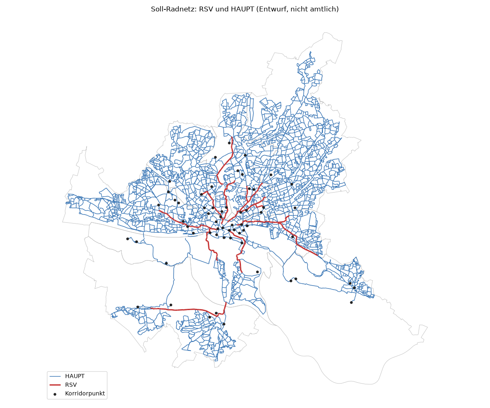
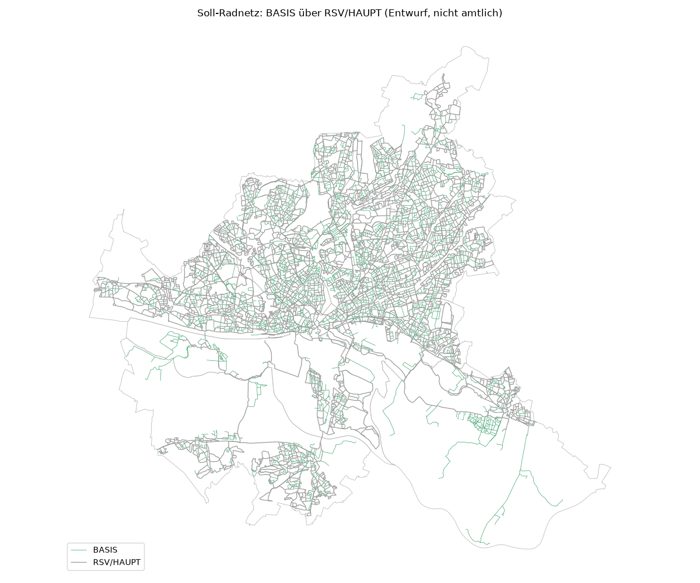
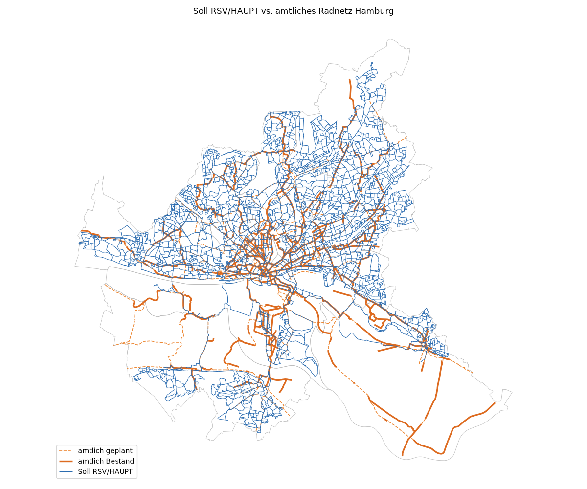

# Soll-Radnetz: Hierarchie und Lückenschluss (Stufe c03)

Erzeugt 2026-11-11T13:05:45+00:00 mit pipeline/c03_cycle_network.py · cycling_rules.yaml 0.10.0 · nicht amtlicher Entwurf. Alle Entwurfsparameter (C-NET-01…13) sind Annahmen (source_type assumption, status draft) und vor fachlicher Nutzung zu prüfen.

## Kurzfassung

- RSV: 73 km (899 Kanten)
- HAUPT: 1 810 km (18 057 Kanten)
- BASIS: 1 050 km (10 021 Kanten)
- ERSCHL: 3 497 km (36 996 Kanten)
- Amtliches Radnetz (Bestand, 371 km): 58% liegt am Soll-Netz RSV/HAUPT, 74% am Soll-Netz bis BASIS (Puffer 20 m).
- Soll RSV/HAUPT außerhalb des amtlichen Bestands: 1 641 km, davon 167 km im geplanten amtlichen Netz.
- Maschen über der Höchstweite nach Verdichtung: HAUPT 33, BASIS 408 (Lückenliste unten; Maschen in ländlichen Stadtteilen nicht geprüft).
- Parallelregel P-ATT-03: 3 von 422 geprüften Läufen an Straßen mit DTV > 15 000 auf eine Parallelroute verlegt.
- Overrides angewendet: 0.

**Grenzen vorab:** Bezirks- und Stadtteilzentren fehlen als Korridorpunkte (kein Endpunkt für das Zentrenkonzept, Entscheidung 2026-11-06). Die Nachfrage aus Prompt 15 ist nur mäßig kalibriert (Spearman 0,53, mittlere relative Abweichung 154 %; Nebenstraßen parallel zu Hauptstraßen ohne erfassten Radweg werden überschätzt). Beides wirkt auf Korridore und RSV-Abschnitte; bitte die RSV-Liste und die Karten mit Ortskenntnis lesen.

## Verfahren

1. **Soll-Widerstand (C-NET-03):** Länge × Faktor der bevorzugten Führung der Matrixzelle für die Ebene, die gerade entworfen wird (HAUPT-Zelle für Korridore, RSV und HAUPT, BASIS-Zelle für die BASIS-Anbindung und -Verdichtung; mit S-05, wenn das DTV bekannt ist), Faktoren je Führung (separated_oneway_both gow50_separated_track, separated_twoway gow50_separated_track, cycle_lane gow30_cycle_lane, cycle_street separated_track_or_cycle_street, mixed etw30_mixed, own_path separated_track_or_cycle_street); vorrangig je Kategorie (path separated_track_or_cycle_street, ETW_ERF walking_pace_area); plus Wartezeiten des Ist-Zustands; ungerichtet.
2. **Boni:** Nachfrage (C-NET-04) bis −30% ab 2 000 Rad/Werktag; amtliches Radnetz (C-NET-05, alle Status) × 0.8 bei ≥ 50% Überdeckung im Puffer 15 m.
3. **Korridore (C-NET-01/02):** Punkte zusammengefasst ab 500 m; jeder Punkt mit seinen 4 nächsten (bis 15 km) und mit der Innenstadt verbunden, günstigster Weg nach Soll-Widerstand mit Boni.
4. **RSV (C-NET-06):** Korridorläufe mit ≥ 2 000 Rad/Werktag (Lücken bis 500 m überbrückt) und ≥ 5 km Länge; übrige Korridorkanten HAUPT.
5. **HAUPT-Verdichtung (C-NET-07/08):** Maschen des RSV+HAUPT-Netzes mit Barrieren (Bahn, Flüsse/Kanäle) und Landesgrenze; Seite des flächengleichen Quadrats ohne Wasser, Wald, Parks, Friedhöfe, Flughafen (≥ 5 ha); Maschen > 600 m × √(4 400 Einwohner/km² / Einwohnerdichte der Masche), nie darunter; Maschen ohne Einwohner nicht (C-NET-07 density_scaling) werden geteilt, ab der Kante mit der höchsten Nachfrage im Kernbereich (Abstand zum Maschenrand ≥ 0.5 × größter Abstand).
6. **Parallelregel (C-NET-10, P-ATT-03):** Läufe ≥ 300 m an Straßen mit DTV > 15 000; Alternative über Kanten im Puffer 200 m, höchstens 60 m an der Hauptstraße (Anschluss/Querung), Umwegfaktor ≤ P-DIR-01 (RSV 1.1, HAUPT 1.2); die Hauptstraße bleibt BASIS. Danach zweite HAUPT-Verdichtung ohne diese Hauptstraßen.
7. **BASIS (C-NET-09/08):** Schulen und Nahversorgung (supermarket, convenience, bakery, butcher, greengrocer, chemist) weiter als 150 m vom Netz angebunden; dann Maschen > 300 m × √(4 400 Einwohner/km² / Einwohnerdichte der Masche), nie darunter; Maschen ohne Einwohner nicht (C-NET-07 density_scaling) geteilt.
8. **Kontinuität (C-NET-11):** niedrigere Läufe bis 200 m zwischen zwei gleichen höheren Läufen angehoben.
9. **ERSCHL (C-NET-12):** alle übrigen Kanten. **Overrides:** overrides/cycle_network_overrides.csv, nur approved.

## Korridorpunkte (C-NET-01)

| Art | Punkte | nach Zusammenfassung | Quelle |
| --- | ---: | ---: | --- |
| Innenstadt | 1 | 1 | Annahme (Rathausmarkt, 53.5503/9.9925) |
| Schnellbahn-Umsteigeknoten | 127 | 16 | HVV-GTFS, ≥ 2 Verkehrsmittel im Umkreis 250 m |
| Hochschule | 41 | 20 | OSM amenity=university (Fallback) |
| Arbeitsplatzschwerpunkt | 51 | 23 | ALKIS-Geschossfläche Nichtwohnen, Zonen ≥ Quantil 0.98 (224 Tsd. m²) |
| Bezirks-/Stadtteilzentren | – | – | fehlt: sources.yaml `centres` ohne Endpunkt (TODO) |

Korridorpaare: 209, davon mit Weg: 209. Anbindung an den Radgraphen: Median 61 m, Maximum 362 m.

## Kennzahlen je Kategorie

| Kategorie | km | Kanten | davon Bestand amtlich km | Komponenten | größte Komponente (Längenanteil) |
| --- | ---: | ---: | ---: | ---: | ---: |
| RSV | 72.8 | 899 | 30.0 | 7 | 18% |
| HAUPT | 1 810.2 | 18 057 | 188.5 | 1 | 100% |
| BASIS | 1 050.5 | 10 021 | 74.2 | 1 | 100% |
| ERSCHL | 3 496.9 | 36 996 | 252.6 | – | – |

Komponenten (P-COH-02): je Ebene einschließlich der höheren Ebenen.

Anteile je Bezirk (Kantenlänge):

| Bezirk | Abschnitte | km | RSV | HAUPT | BASIS | ERSCHL |
| --- | ---: | ---: | ---: | ---: | ---: | ---: |
| Altona | 8 424 | 787.5 | 1 % | 38 % | 15 % | 47 % |
| Bergedorf | 5 014 | 631.5 | 0 % | 14 % | 16 % | 69 % |
| Eimsbüttel | 8 086 | 629.2 | 1 % | 35 % | 20 % | 44 % |
| Hamburg-Mitte | 12 403 | 1 102.3 | 3 % | 25 % | 16 % | 57 % |
| Hamburg-Nord | 10 442 | 805.6 | 2 % | 28 % | 21 % | 49 % |
| Harburg | 5 650 | 701.3 | 1 % | 24 % | 13 % | 62 % |
| Wandsbek | 14 241 | 1 476.3 | 0 % | 37 % | 18 % | 45 % |
| ohne Bezirk | 1 713 | 296.7 | 0 % | 0 % | 0 % | 100 % |
| **gesamt** | 65 973 | 6 430.4 | 1 % | 28 % | 16 % | 54 % |

### Maschenweite (P-COH-01)

| Ebene | Höchstweite m | Maschen geprüft | Median Seite m | 90-%-Quantil m | größte m | über Höchstweite | über mesh_m.max | in ländl. Stadtteilen nicht geprüft |
| --- | ---: | ---: | ---: | ---: | ---: | ---: | ---: | ---: |
| HAUPT + höher | 600 | 3 490 | 161 | 538 | 5 158 | 33 | 167 | 7 |
| BASIS + höher | 300 | 6 349 | 164 | 331 | 4 085 | 408 | 848 | 13 |

Verdichtungsrunden:

| Ebene | Runde | Maschen zu groß | neue Routen |
| --- | ---: | ---: | ---: |
| HAUPT 1 | 1 | 74 | 71 |
| HAUPT 1 | 2 | 87 | 84 |
| HAUPT 1 | 3 | 82 | 79 |
| HAUPT 1 | 4 | 75 | 72 |
| HAUPT 1 | 5 | 77 | 74 |
| HAUPT 1 | 6 | 66 | 63 |
| HAUPT 1 | 7 | 60 | 57 |
| HAUPT 1 | 8 | 58 | 54 |
| HAUPT 1 | 9 | 59 | 55 |
| HAUPT 1 | 10 | 60 | 56 |
| HAUPT 1 | 11 | 56 | 52 |
| HAUPT 1 | 12 | 53 | 48 |
| HAUPT 1 | 13 | 49 | 44 |
| HAUPT 1 | 14 | 45 | 40 |
| HAUPT 1 | 15 | 39 | 33 |
| HAUPT 1 | 16 | 35 | 29 |
| HAUPT 1 | 17 | 37 | 31 |
| HAUPT 1 | 18 | 34 | 27 |
| HAUPT 1 | 19 | 38 | 31 |
| HAUPT 1 | 20 | 37 | 29 |
| HAUPT 1 | 21 | 36 | 28 |
| HAUPT 1 | 22 | 33 | 25 |
| HAUPT 1 | 23 | 31 | 23 |
| HAUPT 1 | 24 | 33 | 25 |
| HAUPT 1 | 25 | 33 | 24 |
| HAUPT 1 | 26 | 33 | 23 |
| HAUPT 1 | 27 | 32 | 21 |
| HAUPT 1 | 28 | 33 | 22 |
| HAUPT 1 | 29 | 35 | 24 |
| HAUPT 1 | 30 | 32 | 20 |
| HAUPT 1 | 31 | 30 | 18 |
| HAUPT 1 | 32 | 30 | 18 |
| HAUPT 1 | 33 | 29 | 16 |
| HAUPT 1 | 34 | 29 | 16 |
| HAUPT 1 | 35 | 29 | 16 |
| HAUPT 1 | 36 | 29 | 15 |
| HAUPT 1 | 37 | 29 | 15 |
| HAUPT 1 | 38 | 28 | 14 |
| HAUPT 1 | 39 | 29 | 15 |
| HAUPT 1 | 40 | 29 | 15 |
| HAUPT 2 | 1 | 30 | 15 |
| HAUPT 2 | 2 | 30 | 14 |
| HAUPT 2 | 3 | 30 | 14 |
| HAUPT 2 | 4 | 31 | 14 |
| HAUPT 2 | 5 | 30 | 11 |
| HAUPT 2 | 6 | 30 | 11 |
| HAUPT 2 | 7 | 30 | 11 |
| HAUPT 2 | 8 | 30 | 11 |
| HAUPT 2 | 9 | 31 | 12 |
| HAUPT 2 | 10 | 30 | 11 |
| HAUPT 2 | 11 | 30 | 10 |
| HAUPT 2 | 12 | 30 | 10 |
| HAUPT 2 | 13 | 30 | 10 |
| HAUPT 2 | 14 | 30 | 10 |
| HAUPT 2 | 15 | 31 | 10 |
| HAUPT 2 | 16 | 31 | 10 |
| HAUPT 2 | 17 | 32 | 11 |
| HAUPT 2 | 18 | 32 | 11 |
| HAUPT 2 | 19 | 33 | 12 |
| HAUPT 2 | 20 | 32 | 10 |
| HAUPT 2 | 21 | 32 | 10 |
| HAUPT 2 | 22 | 32 | 10 |
| HAUPT 2 | 23 | 32 | 10 |
| HAUPT 2 | 24 | 32 | 9 |
| HAUPT 2 | 25 | 32 | 9 |
| HAUPT 2 | 26 | 32 | 9 |
| HAUPT 2 | 27 | 32 | 9 |
| HAUPT 2 | 28 | 32 | 9 |
| HAUPT 2 | 29 | 32 | 8 |
| HAUPT 2 | 30 | 32 | 8 |
| HAUPT 2 | 31 | 32 | 6 |
| HAUPT 2 | 32 | 32 | 6 |
| HAUPT 2 | 33 | 33 | 7 |
| HAUPT 2 | 34 | 33 | 7 |
| HAUPT 2 | 35 | 33 | 7 |
| HAUPT 2 | 36 | 33 | 7 |
| HAUPT 2 | 37 | 33 | 7 |
| HAUPT 2 | 38 | 33 | 7 |
| HAUPT 2 | 39 | 33 | 7 |
| HAUPT 2 | 40 | 33 | 6 |
| BASIS | 1 | 872 | 801 |
| BASIS | 2 | 771 | 646 |
| BASIS | 3 | 637 | 441 |
| BASIS | 4 | 536 | 270 |
| BASIS | 5 | 476 | 172 |
| BASIS | 6 | 440 | 97 |
| BASIS | 7 | 419 | 58 |
| BASIS | 8 | 413 | 42 |
| BASIS | 9 | 409 | 27 |
| BASIS | 10 | 405 | 19 |
| BASIS | 11 | 405 | 16 |
| BASIS | 12 | 404 | 11 |
| BASIS | 13 | 404 | 9 |
| BASIS | 14 | 404 | 8 |
| BASIS | 15 | 405 | 8 |
| BASIS | 16 | 405 | 6 |
| BASIS | 17 | 405 | 6 |
| BASIS | 18 | 405 | 5 |
| BASIS | 19 | 405 | 5 |
| BASIS | 20 | 405 | 4 |
| BASIS | 21 | 405 | 4 |
| BASIS | 22 | 406 | 5 |
| BASIS | 23 | 407 | 6 |
| BASIS | 24 | 407 | 5 |
| BASIS | 25 | 408 | 5 |
| BASIS | 26 | 408 | 4 |
| BASIS | 27 | 408 | 4 |
| BASIS | 28 | 408 | 3 |
| BASIS | 29 | 408 | 3 |
| BASIS | 30 | 408 | 2 |
| BASIS | 31 | 408 | 2 |
| BASIS | 32 | 408 | 2 |
| BASIS | 33 | 408 | 2 |
| BASIS | 34 | 408 | 2 |
| BASIS | 35 | 408 | 2 |
| BASIS | 36 | 408 | 2 |
| BASIS | 37 | 408 | 2 |
| BASIS | 38 | 408 | 2 |
| BASIS | 39 | 408 | 2 |
| BASIS | 40 | 408 | 2 |

### Abdeckung wichtiger Ziele (P-COH-03, ≤ 300 m vom RSV/HAUPT-Netz)

| Ziel | Anzahl | abgedeckt |
| --- | ---: | ---: |
| Schulen (OSM) | 557 | 95% |
| Schnellbahnhalte | 375 | 99% |
| Hochschulen (OSM university) | 41 | 100% |
| Zentren | – | nicht prüfbar (Datensatz fehlt) |

## Karten

## Vergleich mit dem amtlichen Radnetz

Amtlich = WFS Radnetz Hamburg, Status Bestand; geplant = In Arbeit, Priorisierte Netzergänzungen/Netzverbesserungen, Netzbedeutende Abschnitte mit Verbesserungspotential (Entscheidung 2026-11-06). Überdeckung im Puffer 20 m.

| Kennzahl | km |
| --- | ---: |
| amtlich (Bestand) | 371.4 |
| davon am Soll RSV/HAUPT | 215.6 |
| davon am Soll bis BASIS | 273.4 |
| fehlt im Soll RSV/HAUPT | 155.7 |
| geplant (amtlich) | 292.4 |
| davon am Soll RSV/HAUPT | 158.1 |
| Soll RSV/HAUPT gesamt | 1 883.0 |
| Soll RSV/HAUPT zusätzlich (nicht am amtlichen Bestand) | 1 640.6 |
| davon im geplanten amtlichen Netz | 166.6 |

Längste amtliche Bestandsabschnitte ohne Soll RSV/HAUPT (Top 15):

| Länge m | Soll dort (größte Kategorie) | Prüfen |
| ---: | --- | --- |
| 5 103 | BASIS | [Luftbild](https://geoportal-hamburg.de/?MAP/PROJECTION=EPSG:25832&MAP/CENTER=[577209,5920892]&MAP/ZOOMLEVEL=10&MAP/LAYERIDS=19968) · [Panoramax](https://api.panoramax.xyz/#focus=map&map=18/53.431411/10.162119) · [OSM](https://www.openstreetmap.org/?mlat=53.431411&mlon=10.162119#map=18/53.431411/10.162119) |
| 4 454 | HAUPT | [Luftbild](https://geoportal-hamburg.de/?MAP/PROJECTION=EPSG:25832&MAP/CENTER=[570437,5929974]&MAP/ZOOMLEVEL=10&MAP/LAYERIDS=19968) · [Panoramax](https://api.panoramax.xyz/#focus=map&map=18/53.513978/10.062247) · [OSM](https://www.openstreetmap.org/?mlat=53.513978&mlon=10.062247#map=18/53.513978/10.062247) |
| 4 209 | ERSCHL | [Luftbild](https://geoportal-hamburg.de/?MAP/PROJECTION=EPSG:25832&MAP/CENTER=[580907,5917845]&MAP/ZOOMLEVEL=10&MAP/LAYERIDS=19968) · [Panoramax](https://api.panoramax.xyz/#focus=map&map=18/53.403472/10.216980) · [OSM](https://www.openstreetmap.org/?mlat=53.403472&mlon=10.216980#map=18/53.403472/10.216980) |
| 3 614 | BASIS | [Luftbild](https://geoportal-hamburg.de/?MAP/PROJECTION=EPSG:25832&MAP/CENTER=[585025,5921139]&MAP/ZOOMLEVEL=10&MAP/LAYERIDS=19968) · [Panoramax](https://api.panoramax.xyz/#focus=map&map=18/53.432426/10.279804) · [OSM](https://www.openstreetmap.org/?mlat=53.432426&mlon=10.279804#map=18/53.432426/10.279804) |
| 3 466 | BASIS | [Luftbild](https://geoportal-hamburg.de/?MAP/PROJECTION=EPSG:25832&MAP/CENTER=[578652,5918928]&MAP/ZOOMLEVEL=10&MAP/LAYERIDS=19968) · [Panoramax](https://api.panoramax.xyz/#focus=map&map=18/53.413549/10.183340) · [OSM](https://www.openstreetmap.org/?mlat=53.413549&mlon=10.183340#map=18/53.413549/10.183340) |
| 3 440 | BASIS | [Luftbild](https://geoportal-hamburg.de/?MAP/PROJECTION=EPSG:25832&MAP/CENTER=[581378,5924306]&MAP/ZOOMLEVEL=10&MAP/LAYERIDS=19968) · [Panoramax](https://api.panoramax.xyz/#focus=map&map=18/53.461462/10.225732) · [OSM](https://www.openstreetmap.org/?mlat=53.461462&mlon=10.225732#map=18/53.461462/10.225732) |
| 3 192 | HAUPT | [Luftbild](https://geoportal-hamburg.de/?MAP/PROJECTION=EPSG:25832&MAP/CENTER=[575498,5929969]&MAP/ZOOMLEVEL=10&MAP/LAYERIDS=19968) · [Panoramax](https://api.panoramax.xyz/#focus=map&map=18/53.513233/10.138550) · [OSM](https://www.openstreetmap.org/?mlat=53.513233&mlon=10.138550#map=18/53.513233/10.138550) |
| 2 431 | BASIS | [Luftbild](https://geoportal-hamburg.de/?MAP/PROJECTION=EPSG:25832&MAP/CENTER=[555512,5931491]&MAP/ZOOMLEVEL=10&MAP/LAYERIDS=19968) · [Panoramax](https://api.panoramax.xyz/#focus=map&map=18/53.529402/9.837457) · [OSM](https://www.openstreetmap.org/?mlat=53.529402&mlon=9.837457#map=18/53.529402/9.837457) |
| 2 199 | BASIS | [Luftbild](https://geoportal-hamburg.de/?MAP/PROJECTION=EPSG:25832&MAP/CENTER=[582589,5919714]&MAP/ZOOMLEVEL=10&MAP/LAYERIDS=19968) · [Panoramax](https://api.panoramax.xyz/#focus=map&map=18/53.420006/10.242761) · [OSM](https://www.openstreetmap.org/?mlat=53.420006&mlon=10.242761#map=18/53.420006/10.242761) |
| 2 175 | HAUPT | [Luftbild](https://geoportal-hamburg.de/?MAP/PROJECTION=EPSG:25832&MAP/CENTER=[566259,5927431]&MAP/ZOOMLEVEL=10&MAP/LAYERIDS=19968) · [Panoramax](https://api.panoramax.xyz/#focus=map&map=18/53.491666/9.998716) · [OSM](https://www.openstreetmap.org/?mlat=53.491666&mlon=9.998716#map=18/53.491666/9.998716) |
| 2 132 | BASIS | [Luftbild](https://geoportal-hamburg.de/?MAP/PROJECTION=EPSG:25832&MAP/CENTER=[580584,5921676]&MAP/ZOOMLEVEL=10&MAP/LAYERIDS=19968) · [Panoramax](https://api.panoramax.xyz/#focus=map&map=18/53.437953/10.213108) · [OSM](https://www.openstreetmap.org/?mlat=53.437953&mlon=10.213108#map=18/53.437953/10.213108) |
| 2 080 | BASIS | [Luftbild](https://geoportal-hamburg.de/?MAP/PROJECTION=EPSG:25832&MAP/CENTER=[573363,5950518]&MAP/ZOOMLEVEL=10&MAP/LAYERIDS=19968) · [Panoramax](https://api.panoramax.xyz/#focus=map&map=18/53.698207/10.111192) · [OSM](https://www.openstreetmap.org/?mlat=53.698207&mlon=10.111192#map=18/53.698207/10.111192) |
| 2 034 | RSV | [Luftbild](https://geoportal-hamburg.de/?MAP/PROJECTION=EPSG:25832&MAP/CENTER=[566013,5930578]&MAP/ZOOMLEVEL=10&MAP/LAYERIDS=19968) · [Panoramax](https://api.panoramax.xyz/#focus=map&map=18/53.519984/9.995661) · [OSM](https://www.openstreetmap.org/?mlat=53.519984&mlon=9.995661#map=18/53.519984/9.995661) |
| 2 010 | BASIS | [Luftbild](https://geoportal-hamburg.de/?MAP/PROJECTION=EPSG:25832&MAP/CENTER=[558879,5931435]&MAP/ZOOMLEVEL=10&MAP/LAYERIDS=19968) · [Panoramax](https://api.panoramax.xyz/#focus=map&map=18/53.528535/9.888246) · [OSM](https://www.openstreetmap.org/?mlat=53.528535&mlon=9.888246#map=18/53.528535/9.888246) |
| 1 936 | HAUPT | [Luftbild](https://geoportal-hamburg.de/?MAP/PROJECTION=EPSG:25832&MAP/CENTER=[566969,5924238]&MAP/ZOOMLEVEL=10&MAP/LAYERIDS=19968) · [Panoramax](https://api.panoramax.xyz/#focus=map&map=18/53.462885/10.008733) · [OSM](https://www.openstreetmap.org/?mlat=53.462885&mlon=10.008733#map=18/53.462885/10.008733) |

Zusätzliche Soll-RSV/HAUPT-Straßen ohne amtlichen Bestand (Top 15 nach Länge):

| Straße / Weg | km | Kategorie | im geplanten Netz km | Prüfen |
| --- | ---: | --- | ---: | --- |
| neben Bremer Straße | 5.32 | HAUPT | 4.10 | [Luftbild](https://geoportal-hamburg.de/?MAP/PROJECTION=EPSG:25832&MAP/CENTER=[562753,5921703]&MAP/ZOOMLEVEL=10&MAP/LAYERIDS=19968) · [Panoramax](https://api.panoramax.xyz/#focus=map&map=18/53.440618/9.944725) · [OSM](https://www.openstreetmap.org/?mlat=53.440618&mlon=9.944725#map=18/53.440618/9.944725) |
| Billwerder Billdeich | 4.49 | HAUPT | 0.00 | [Luftbild](https://geoportal-hamburg.de/?MAP/PROJECTION=EPSG:25832&MAP/CENTER=[573850,5930988]&MAP/ZOOMLEVEL=10&MAP/LAYERIDS=19968) · [Panoramax](https://api.panoramax.xyz/#focus=map&map=18/53.522622/10.113949) · [OSM](https://www.openstreetmap.org/?mlat=53.522622&mlon=10.113949#map=18/53.522622/10.113949) |
| Alsterwanderweg | 4.20 | HAUPT | 0.00 | [Luftbild](https://geoportal-hamburg.de/?MAP/PROJECTION=EPSG:25832&MAP/CENTER=[568678,5943090]&MAP/ZOOMLEVEL=10&MAP/LAYERIDS=19968) · [Panoramax](https://api.panoramax.xyz/#focus=map&map=18/53.632088/10.038614) · [OSM](https://www.openstreetmap.org/?mlat=53.632088&mlon=10.038614#map=18/53.632088/10.038614) |
| neben Waltershofer Straße | 4.15 | HAUPT | 4.15 | [Luftbild](https://geoportal-hamburg.de/?MAP/PROJECTION=EPSG:25832&MAP/CENTER=[559835,5925130]&MAP/ZOOMLEVEL=10&MAP/LAYERIDS=19968) · [Panoramax](https://api.panoramax.xyz/#focus=map&map=18/53.471757/9.901457) · [OSM](https://www.openstreetmap.org/?mlat=53.471757&mlon=9.901457#map=18/53.471757/9.901457) |
| Elbchaussee | 4.00 | HAUPT | 3.26 | [Luftbild](https://geoportal-hamburg.de/?MAP/PROJECTION=EPSG:25832&MAP/CENTER=[555715,5933996]&MAP/ZOOMLEVEL=10&MAP/LAYERIDS=19968) · [Panoramax](https://api.panoramax.xyz/#focus=map&map=18/53.551897/9.840976) · [OSM](https://www.openstreetmap.org/?mlat=53.551897&mlon=9.840976#map=18/53.551897/9.840976) |
| neben Cuxhavener Straße | 3.74 | RSV | 0.28 | [Luftbild](https://geoportal-hamburg.de/?MAP/PROJECTION=EPSG:25832&MAP/CENTER=[554334,5924856]&MAP/ZOOMLEVEL=10&MAP/LAYERIDS=19968) · [Panoramax](https://api.panoramax.xyz/#focus=map&map=18/53.469888/9.818538) · [OSM](https://www.openstreetmap.org/?mlat=53.469888&mlon=9.818538#map=18/53.469888/9.818538) |
| neben Berner Heerweg | 3.70 | HAUPT | 0.91 | [Luftbild](https://geoportal-hamburg.de/?MAP/PROJECTION=EPSG:25832&MAP/CENTER=[573676,5938952]&MAP/ZOOMLEVEL=10&MAP/LAYERIDS=19968) · [Panoramax](https://api.panoramax.xyz/#focus=map&map=18/53.594222/10.113194) · [OSM](https://www.openstreetmap.org/?mlat=53.594222&mlon=10.113194#map=18/53.594222/10.113194) |
| Cuxhavener Straße | 3.58 | RSV | 0.08 | [Luftbild](https://geoportal-hamburg.de/?MAP/PROJECTION=EPSG:25832&MAP/CENTER=[556066,5925192]&MAP/ZOOMLEVEL=10&MAP/LAYERIDS=19968) · [Panoramax](https://api.panoramax.xyz/#focus=map&map=18/53.472726/9.844697) · [OSM](https://www.openstreetmap.org/?mlat=53.472726&mlon=9.844697#map=18/53.472726/9.844697) |
| neben Schnackenburgallee | 3.48 | HAUPT | 0.37 | [Luftbild](https://geoportal-hamburg.de/?MAP/PROJECTION=EPSG:25832&MAP/CENTER=[559898,5938256]&MAP/ZOOMLEVEL=10&MAP/LAYERIDS=19968) · [Panoramax](https://api.panoramax.xyz/#focus=map&map=18/53.589718/9.904915) · [OSM](https://www.openstreetmap.org/?mlat=53.589718&mlon=9.904915#map=18/53.589718/9.904915) |
| Schiffbeker Weg | 3.45 | HAUPT | 0.11 | [Luftbild](https://geoportal-hamburg.de/?MAP/PROJECTION=EPSG:25832&MAP/CENTER=[573821,5934675]&MAP/ZOOMLEVEL=10&MAP/LAYERIDS=19968) · [Panoramax](https://api.panoramax.xyz/#focus=map&map=18/53.555767/10.114379) · [OSM](https://www.openstreetmap.org/?mlat=53.555767&mlon=10.114379#map=18/53.555767/10.114379) |
| Moorwerder Hauptdeich | 3.42 | HAUPT | 0.00 | [Luftbild](https://geoportal-hamburg.de/?MAP/PROJECTION=EPSG:25832&MAP/CENTER=[570360,5925569]&MAP/ZOOMLEVEL=10&MAP/LAYERIDS=19968) · [Panoramax](https://api.panoramax.xyz/#focus=map&map=18/53.474397/10.060089) · [OSM](https://www.openstreetmap.org/?mlat=53.474397&mlon=10.060089#map=18/53.474397/10.060089) |
| neben Winsener Straße | 3.31 | HAUPT | 2.79 | [Luftbild](https://geoportal-hamburg.de/?MAP/PROJECTION=EPSG:25832&MAP/CENTER=[565199,5919983]&MAP/ZOOMLEVEL=10&MAP/LAYERIDS=19968) · [Panoramax](https://api.panoramax.xyz/#focus=map&map=18/53.424861/9.981191) · [OSM](https://www.openstreetmap.org/?mlat=53.424861&mlon=9.981191#map=18/53.424861/9.981191) |
| neben Elbgaustraße | 3.29 | HAUPT | 2.80 | [Luftbild](https://geoportal-hamburg.de/?MAP/PROJECTION=EPSG:25832&MAP/CENTER=[558799,5939448]&MAP/ZOOMLEVEL=10&MAP/LAYERIDS=19968) · [Panoramax](https://api.panoramax.xyz/#focus=map&map=18/53.600557/9.888540) · [OSM](https://www.openstreetmap.org/?mlat=53.600557&mlon=9.888540#map=18/53.600557/9.888540) |
| neben Eiffestraße | 3.19 | HAUPT | 0.00 | [Luftbild](https://geoportal-hamburg.de/?MAP/PROJECTION=EPSG:25832&MAP/CENTER=[570514,5934033]&MAP/ZOOMLEVEL=10&MAP/LAYERIDS=19968) · [Panoramax](https://api.panoramax.xyz/#focus=map&map=18/53.550450/10.064325) · [OSM](https://www.openstreetmap.org/?mlat=53.550450&mlon=10.064325#map=18/53.550450/10.064325) |
| neben Meiendorfer Straße | 3.19 | HAUPT | 0.01 | [Luftbild](https://geoportal-hamburg.de/?MAP/PROJECTION=EPSG:25832&MAP/CENTER=[576788,5941738]&MAP/ZOOMLEVEL=10&MAP/LAYERIDS=19968) · [Panoramax](https://api.panoramax.xyz/#focus=map&map=18/53.618814/10.160893) · [OSM](https://www.openstreetmap.org/?mlat=53.618814&mlon=10.160893#map=18/53.618814/10.160893) |

## RSV-Läufe: FGSV-Kandidat und Unsicherheit (F12)

RSV heißt seit cycling_rules.yaml 0.10.0 „Radvorrangroute / Radroute+“: Der Code bleibt, die Kategorie ist aber keine Radschnellverbindung im Sinne der FGSV. FGSV-Kandidat = Lauf ≥ 10 km mit ≥ 2 000 Rad/Werktag auf mehr als 50% der Länge (Annahme A5, FGSV-Hinweise am Original prüfen). rsv_confidence low = längengewichteter Median des Laufs unter 2 000 × 2 = 4 000 Rad/Werktag (Kalibrierung: 52 % der Zählquerschnitte innerhalb Faktor 2).

- RSV-Läufe (verschieden, über alle Korridore): 17, davon FGSV-Kandidaten 1, rsv_confidence low 7.
- RSV-km: 72.8, davon low 28.5, FGSV-Kandidat 11.5, ohne Lauf (Kontinuität/Override) 0.1.

| Lauf km | Median Rad/Werktag | Anteil ≥ Auslöser | FGSV-Kandidat | rsv_confidence |
| ---: | ---: | ---: | --- | --- |
| 11.5 | 5 078 | 91% | ja | high |
| 9.9 | 3 225 | 97% | nein | low |
| 7.8 | 3 241 | 98% | nein | low |
| 7.5 | 6 789 | 98% | nein | high |
| 7.1 | 4 830 | 97% | nein | high |
| 6.9 | 2 775 | 96% | nein | low |
| 6.8 | 4 476 | 94% | nein | high |
| 6.3 | 4 670 | 91% | nein | high |
| 6.3 | 3 639 | 86% | nein | low |
| 6.1 | 4 641 | 89% | nein | high |
| 6.0 | 3 467 | 99% | nein | low |
| 5.5 | 4 323 | 95% | nein | high |
| 5.4 | 3 467 | 100% | nein | low |
| 5.4 | 2 997 | 86% | nein | low |
| 5.4 | 4 154 | 93% | nein | high |

## RSV-Abschnitte (C-NET-06)

22 Korridore mit RSV-Läufen. Längste Korridore mit RSV-Anteil:

| route_id | Korridor | km | RSV km | Median Rad/Werktag | Prüfen |
| --- | --- | ---: | ---: | ---: | --- |
| `rt_77f46b744d5361bd` | Innenstadt (Rathausmarkt) – Umsteigeknoten Neugraben | 23.2 | 15.3 | 2 027 | [Luftbild](https://geoportal-hamburg.de/?MAP/PROJECTION=EPSG:25832&MAP/CENTER=[566101,5925610]&MAP/ZOOMLEVEL=10&MAP/LAYERIDS=19968) · [Panoramax](https://api.panoramax.xyz/#focus=map&map=18/53.475323/9.995949) · [OSM](https://www.openstreetmap.org/?mlat=53.475323&mlon=9.995949#map=18/53.475323/9.995949) |
| `rt_672ec9569a52b029` | Innenstadt (Rathausmarkt) – Arbeitsplatzschwerpunkt Harburg (300 Tsd. m²) | 19.8 | 13.3 | 1 946 | [Luftbild](https://geoportal-hamburg.de/?MAP/PROJECTION=EPSG:25832&MAP/CENTER=[565693,5927157]&MAP/ZOOMLEVEL=10&MAP/LAYERIDS=19968) · [Panoramax](https://api.panoramax.xyz/#focus=map&map=18/53.489274/9.990120) · [OSM](https://www.openstreetmap.org/?mlat=53.489274&mlon=9.990120#map=18/53.489274/9.990120) |
| `rt_504449be00c9c013` | Innenstadt (Rathausmarkt) – Umsteigeknoten Bergedorf | 18.8 | 11.5 | 2 858 | [Luftbild](https://geoportal-hamburg.de/?MAP/PROJECTION=EPSG:25832&MAP/CENTER=[573739,5933030]&MAP/ZOOMLEVEL=10&MAP/LAYERIDS=19968) · [Panoramax](https://api.panoramax.xyz/#focus=map&map=18/53.540989/10.112750) · [OSM](https://www.openstreetmap.org/?mlat=53.540989&mlon=10.112750#map=18/53.540989/10.112750) |
| `rt_11e87fdac8f2436f` | Innenstadt (Rathausmarkt) – Hochschule HAW - Life Sciences - Campus Bergedorf | 18.1 | 11.5 | 3 116 | [Luftbild](https://geoportal-hamburg.de/?MAP/PROJECTION=EPSG:25832&MAP/CENTER=[573432,5933190]&MAP/ZOOMLEVEL=10&MAP/LAYERIDS=19968) · [Panoramax](https://api.panoramax.xyz/#focus=map&map=18/53.542469/10.108153) · [OSM](https://www.openstreetmap.org/?mlat=53.542469&mlon=10.108153#map=18/53.542469/10.108153) |
| `rt_ca080c31449b50a7` | Innenstadt (Rathausmarkt) – Hochschule HAW Hamburg Energie Campus | 20.8 | 11.5 | 2 617 | [Luftbild](https://geoportal-hamburg.de/?MAP/PROJECTION=EPSG:25832&MAP/CENTER=[573771,5932181]&MAP/ZOOMLEVEL=10&MAP/LAYERIDS=19968) · [Panoramax](https://api.panoramax.xyz/#focus=map&map=18/53.533358/10.113027) · [OSM](https://www.openstreetmap.org/?mlat=53.533358&mlon=10.113027#map=18/53.533358/10.113027) |
| `rt_8d9efee1608c141e` | Innenstadt (Rathausmarkt) – Arbeitsplatzschwerpunkt Hamburg-Mitte (278 Tsd. m²) | 9.4 | 7.5 | 4 559 | [Luftbild](https://geoportal-hamburg.de/?MAP/PROJECTION=EPSG:25832&MAP/CENTER=[569895,5934616]&MAP/ZOOMLEVEL=10&MAP/LAYERIDS=19968) · [Panoramax](https://api.panoramax.xyz/#focus=map&map=18/53.555772/10.055102) · [OSM](https://www.openstreetmap.org/?mlat=53.555772&mlon=10.055102#map=18/53.555772/10.055102) |
| `rt_c77ab66b6cad4425` | Innenstadt (Rathausmarkt) – Hochschule Helmut-Schmidt-Universität – Universität der Bundeswehr Hamburg | 10.1 | 7.1 | 2 393 | [Luftbild](https://geoportal-hamburg.de/?MAP/PROJECTION=EPSG:25832&MAP/CENTER=[570217,5934547]&MAP/ZOOMLEVEL=10&MAP/LAYERIDS=19968) · [Panoramax](https://api.panoramax.xyz/#focus=map&map=18/53.555106/10.059952) · [OSM](https://www.openstreetmap.org/?mlat=53.555106&mlon=10.059952#map=18/53.555106/10.059952) |
| `rt_29fd24af7cd81ff5` | Innenstadt (Rathausmarkt) – Arbeitsplatzschwerpunkt Hamburg-Mitte (263 Tsd. m²) | 9.7 | 6.9 | 2 775 | [Luftbild](https://geoportal-hamburg.de/?MAP/PROJECTION=EPSG:25832&MAP/CENTER=[567796,5931225]&MAP/ZOOMLEVEL=10&MAP/LAYERIDS=19968) · [Panoramax](https://api.panoramax.xyz/#focus=map&map=18/53.525566/10.022694) · [OSM](https://www.openstreetmap.org/?mlat=53.525566&mlon=10.022694#map=18/53.525566/10.022694) |
| `rt_ef467cada2376b84` | Innenstadt (Rathausmarkt) – Hochschule I. Institut für Theoretische Physik | 8.9 | 6.8 | 3 540 | [Luftbild](https://geoportal-hamburg.de/?MAP/PROJECTION=EPSG:25832&MAP/CENTER=[561915,5934079]&MAP/ZOOMLEVEL=10&MAP/LAYERIDS=19968) · [Panoramax](https://api.panoramax.xyz/#focus=map&map=18/53.551945/9.934552) · [OSM](https://www.openstreetmap.org/?mlat=53.551945&mlon=9.934552#map=18/53.551945/9.934552) |
| `rt_a86de573643b9d09` | Innenstadt (Rathausmarkt) – Arbeitsplatzschwerpunkt Hamburg-Nord (307 Tsd. m²) | 12.6 | 6.3 | 3 012 | [Luftbild](https://geoportal-hamburg.de/?MAP/PROJECTION=EPSG:25832&MAP/CENTER=[565343,5938998]&MAP/ZOOMLEVEL=10&MAP/LAYERIDS=19968) · [Panoramax](https://api.panoramax.xyz/#focus=map&map=18/53.595738/9.987327) · [OSM](https://www.openstreetmap.org/?mlat=53.595738&mlon=9.987327#map=18/53.595738/9.987327) |
| `rt_2d15c04da5f307dd` | Innenstadt (Rathausmarkt) – Arbeitsplatzschwerpunkt Hamburg-Nord (327 Tsd. m²) | 8.5 | 6.3 | 1 957 | [Luftbild](https://geoportal-hamburg.de/?MAP/PROJECTION=EPSG:25832&MAP/CENTER=[565981,5937482]&MAP/ZOOMLEVEL=10&MAP/LAYERIDS=19968) · [Panoramax](https://api.panoramax.xyz/#focus=map&map=18/53.582034/9.996637) · [OSM](https://www.openstreetmap.org/?mlat=53.582034&mlon=9.996637#map=18/53.582034/9.996637) |
| `rt_d79bacc62933f495` | Innenstadt (Rathausmarkt) – Arbeitsplatzschwerpunkt Wandsbek (290 Tsd. m²) | 8.5 | 6.1 | 3 008 | [Luftbild](https://geoportal-hamburg.de/?MAP/PROJECTION=EPSG:25832&MAP/CENTER=[568423,5936634]&MAP/ZOOMLEVEL=10&MAP/LAYERIDS=19968) · [Panoramax](https://api.panoramax.xyz/#focus=map&map=18/53.574098/10.033327) · [OSM](https://www.openstreetmap.org/?mlat=53.574098&mlon=10.033327#map=18/53.574098/10.033327) |
| `rt_a3f51202ca48fa1c` | Arbeitsplatzschwerpunkt Harburg (300 Tsd. m²) – Arbeitsplatzschwerpunkt Harburg (241 Tsd. m²) | 6.8 | 6.0 | 3 075 | [Luftbild](https://geoportal-hamburg.de/?MAP/PROJECTION=EPSG:25832&MAP/CENTER=[562608,5925087]&MAP/ZOOMLEVEL=10&MAP/LAYERIDS=19968) · [Panoramax](https://api.panoramax.xyz/#focus=map&map=18/53.471045/9.943226) · [OSM](https://www.openstreetmap.org/?mlat=53.471045&mlon=9.943226#map=18/53.471045/9.943226) |
| `rt_c7596252079e2bf4` | Innenstadt (Rathausmarkt) – Hochschule Helmut-Schmidt-Universität - Campus Nord | 10.0 | 5.5 | 1 240 | [Luftbild](https://geoportal-hamburg.de/?MAP/PROJECTION=EPSG:25832&MAP/CENTER=[569191,5936506]&MAP/ZOOMLEVEL=10&MAP/LAYERIDS=19968) · [Panoramax](https://api.panoramax.xyz/#focus=map&map=18/53.572845/10.044903) · [OSM](https://www.openstreetmap.org/?mlat=53.572845&mlon=10.044903#map=18/53.572845/10.044903) |
| `rt_463b00cfca1d45be` | Umsteigeknoten Hamburg-Harburg – Arbeitsplatzschwerpunkt Harburg (300 Tsd. m²) | 7.4 | 5.4 | 1 637 | [Luftbild](https://geoportal-hamburg.de/?MAP/PROJECTION=EPSG:25832&MAP/CENTER=[562896,5925065]&MAP/ZOOMLEVEL=10&MAP/LAYERIDS=19968) · [Panoramax](https://api.panoramax.xyz/#focus=map&map=18/53.470813/9.947549) · [OSM](https://www.openstreetmap.org/?mlat=53.470813&mlon=9.947549#map=18/53.470813/9.947549) |

## Parallelregel P-ATT-03 (C-NET-10)

320 verschiedene Läufe an Straßen mit DTV > 15 000 (auf 422 Routen geprüft): nur über die Hauptstraße 236, Umweg zu groß 81, verlegt 3.

| Routen | Straße (DTV > Schwelle) | Kategorie | Lauf m | Alternative | Alternative m | davon Hauptstraße m | Umwegfaktor | Schwelle | Ergebnis | Prüfen |
| ---: | --- | --- | ---: | --- | ---: | ---: | ---: | ---: | --- | --- |
| 1 | neben Friedrich-Ebert-Damm | HAUPT | 499 | neben Friedrich-Ebert-Damm, neben Eckerkoppel | 582 | 16 | 1.17 | 1.2 | verlegt | [Luftbild](https://geoportal-hamburg.de/?MAP/PROJECTION=EPSG:25832&MAP/CENTER=[573562,5939328]&MAP/ZOOMLEVEL=10&MAP/LAYERIDS=19968) · [Panoramax](https://api.panoramax.xyz/#focus=map&map=18/53.597611/10.111559) · [OSM](https://www.openstreetmap.org/?mlat=53.597611&mlon=10.111559#map=18/53.597611/10.111559) |
| 1 | neben Dehnhaide, Dehnhaide | HAUPT | 420 | Langenrehm, Dehnhaide | 35 | 19 | 0.08 | 1.2 | verlegt | [Luftbild](https://geoportal-hamburg.de/?MAP/PROJECTION=EPSG:25832&MAP/CENTER=[569144,5937215]&MAP/ZOOMLEVEL=10&MAP/LAYERIDS=19968) · [Panoramax](https://api.panoramax.xyz/#focus=map&map=18/53.579225/10.044351) · [OSM](https://www.openstreetmap.org/?mlat=53.579225&mlon=10.044351#map=18/53.579225/10.044351) |
| 1 | Eiffestraße | HAUPT | 382 | Grevenweg, Eiffestraße | 31 | 17 | 0.08 | 1.2 | verlegt | [Luftbild](https://geoportal-hamburg.de/?MAP/PROJECTION=EPSG:25832&MAP/CENTER=[568750,5934228]&MAP/ZOOMLEVEL=10&MAP/LAYERIDS=19968) · [Panoramax](https://api.panoramax.xyz/#focus=map&map=18/53.552437/10.037737) · [OSM](https://www.openstreetmap.org/?mlat=53.552437&mlon=10.037737#map=18/53.552437/10.037737) |
| 1 | Elbchaussee, Dockenhudener Straße | HAUPT | 3 805 | Elbuferweg, Elbschloßstraße, Elbchaussee | 4 620 | 2 096 | 1.21 | 1.2 | nur über die Hauptstraße | [Luftbild](https://geoportal-hamburg.de/?MAP/PROJECTION=EPSG:25832&MAP/CENTER=[555561,5934186]&MAP/ZOOMLEVEL=10&MAP/LAYERIDS=19968) · [Panoramax](https://api.panoramax.xyz/#focus=map&map=18/53.553616/9.838684) · [OSM](https://www.openstreetmap.org/?mlat=53.553616&mlon=9.838684#map=18/53.553616/9.838684) |
| 1 | neben Alsterkrugchaussee | RSV | 2 298 | neben Alsterkrugchaussee, Alsterkrugchaussee, Wilhelm-Metzger-Straße | 3 181 | 441 | 1.38 | 1.1 | nur über die Hauptstraße | [Luftbild](https://geoportal-hamburg.de/?MAP/PROJECTION=EPSG:25832&MAP/CENTER=[566402,5941259]&MAP/ZOOMLEVEL=10&MAP/LAYERIDS=19968) · [Panoramax](https://api.panoramax.xyz/#focus=map&map=18/53.615925/10.003803) · [OSM](https://www.openstreetmap.org/?mlat=53.615925&mlon=10.003803#map=18/53.615925/10.003803) |
| 1 | neben Stader Straße, neben Cuxhavener Straße, Cuxhavener Straße | RSV | 2 169 | neben Stader Straße, neben Cuxhavener Straße, Hausbrucher Bahnhofstraße | 2 871 | 1 912 | 1.32 | 1.1 | nur über die Hauptstraße | [Luftbild](https://geoportal-hamburg.de/?MAP/PROJECTION=EPSG:25832&MAP/CENTER=[560355,5925010]&MAP/ZOOMLEVEL=10&MAP/LAYERIDS=19968) · [Panoramax](https://api.panoramax.xyz/#focus=map&map=18/53.470616/9.909273) · [OSM](https://www.openstreetmap.org/?mlat=53.470616&mlon=9.909273#map=18/53.470616/9.909273) |
| 1 | neben Wandsbeker Marktstraße, Wandsbeker Allee, Wandsbeker Marktstraße | HAUPT | 1 992 | neben Wandsbeker Marktstraße, Wandsbeker Allee, Robert-Schuman-Brücke | 2 974 | 431 | 1.49 | 1.2 | nur über die Hauptstraße | [Luftbild](https://geoportal-hamburg.de/?MAP/PROJECTION=EPSG:25832&MAP/CENTER=[571426,5936891]&MAP/ZOOMLEVEL=10&MAP/LAYERIDS=19968) · [Panoramax](https://api.panoramax.xyz/#focus=map&map=18/53.576014/10.078732) · [OSM](https://www.openstreetmap.org/?mlat=53.576014&mlon=10.078732#map=18/53.576014/10.078732) |
| 1 | Saseler Chaussee, neben Rolfinckstraße, neben Saseler Chaussee | HAUPT | 1 774 | Saseler Chaussee, Farmsener Weg, Volksdorfer Weg | 2 486 | 1 153 | 1.40 | 1.2 | nur über die Hauptstraße | [Luftbild](https://geoportal-hamburg.de/?MAP/PROJECTION=EPSG:25832&MAP/CENTER=[572794,5944714]&MAP/ZOOMLEVEL=10&MAP/LAYERIDS=19968) · [Panoramax](https://api.panoramax.xyz/#focus=map&map=18/53.646126/10.101214) · [OSM](https://www.openstreetmap.org/?mlat=53.646126&mlon=10.101214#map=18/53.646126/10.101214) |
| 1 | Schiffbeker Weg | HAUPT | 1 669 | Schiffbeker Weg, Lemkusweg, Danckwerthweg | 2 429 | 519 | 1.46 | 1.2 | nur über die Hauptstraße | [Luftbild](https://geoportal-hamburg.de/?MAP/PROJECTION=EPSG:25832&MAP/CENTER=[573530,5934118]&MAP/ZOOMLEVEL=10&MAP/LAYERIDS=19968) · [Panoramax](https://api.panoramax.xyz/#focus=map&map=18/53.550798/10.109849) · [OSM](https://www.openstreetmap.org/?mlat=53.550798&mlon=10.109849#map=18/53.550798/10.109849) |
| 1 | neben Saseler Chaussee, Farmsener Weg | HAUPT | 1 552 | neben Saseler Chaussee, neben Kunaustraße, Wegzoll | 1 776 | 1 054 | 1.14 | 1.2 | nur über die Hauptstraße | [Luftbild](https://geoportal-hamburg.de/?MAP/PROJECTION=EPSG:25832&MAP/CENTER=[572788,5944639]&MAP/ZOOMLEVEL=10&MAP/LAYERIDS=19968) · [Panoramax](https://api.panoramax.xyz/#focus=map&map=18/53.645450/10.101116) · [OSM](https://www.openstreetmap.org/?mlat=53.645450&mlon=10.101116#map=18/53.645450/10.101116) |
| 1 | Saseler Chaussee, Bergstedter Chaussee / Saseler Chaussee, Bergstedter Chaussee | HAUPT | 1 393 | Saseler Chaussee, Bergstedter Chaussee / Saseler Chaussee, Bergstedter Chaussee | 1 593 | 1 223 | 1.14 | 1.2 | nur über die Hauptstraße | [Luftbild](https://geoportal-hamburg.de/?MAP/PROJECTION=EPSG:25832&MAP/CENTER=[573793,5946422]&MAP/ZOOMLEVEL=10&MAP/LAYERIDS=19968) · [Panoramax](https://api.panoramax.xyz/#focus=map&map=18/53.661331/10.116732) · [OSM](https://www.openstreetmap.org/?mlat=53.661331&mlon=10.116732#map=18/53.661331/10.116732) |
| 1 | neben Cuxhavener Straße, neben Stader Straße | RSV | 1 315 | neben Cuxhavener Straße, neben Stader Straße | 1 315 | 1 315 | 1.00 | 1.1 | nur über die Hauptstraße | [Luftbild](https://geoportal-hamburg.de/?MAP/PROJECTION=EPSG:25832&MAP/CENTER=[560487,5924992]&MAP/ZOOMLEVEL=10&MAP/LAYERIDS=19968) · [Panoramax](https://api.panoramax.xyz/#focus=map&map=18/53.470440/9.911258) · [OSM](https://www.openstreetmap.org/?mlat=53.470440&mlon=9.911258#map=18/53.470440/9.911258) |
| 2 | neben Stader Straße, neben Cuxhavener Straße | RSV | 1 315 | neben Stader Straße, neben Cuxhavener Straße | 1 315 | 1 315 | 1.00 | 1.1 | nur über die Hauptstraße | [Luftbild](https://geoportal-hamburg.de/?MAP/PROJECTION=EPSG:25832&MAP/CENTER=[559930,5925026]&MAP/ZOOMLEVEL=10&MAP/LAYERIDS=19968) · [Panoramax](https://api.panoramax.xyz/#focus=map&map=18/53.470813/9.902868) · [OSM](https://www.openstreetmap.org/?mlat=53.470813&mlon=9.902868#map=18/53.470813/9.902868) |
| 1 | neben Stader Straße, neben Cuxhavener Straße | HAUPT | 1 315 | neben Stader Straße, neben Cuxhavener Straße | 1 315 | 1 315 | 1.00 | 1.2 | nur über die Hauptstraße | [Luftbild](https://geoportal-hamburg.de/?MAP/PROJECTION=EPSG:25832&MAP/CENTER=[559930,5925026]&MAP/ZOOMLEVEL=10&MAP/LAYERIDS=19968) · [Panoramax](https://api.panoramax.xyz/#focus=map&map=18/53.470813/9.902868) · [OSM](https://www.openstreetmap.org/?mlat=53.470813&mlon=9.902868#map=18/53.470813/9.902868) |
| 2 | neben Sander Damm, neben Curslacker Neuer Deich | HAUPT | 1 306 | neben Sander Damm, neben Vierlandenstraße, neben Curslacker Neuer Deich | 1 430 | 1 254 | 1.10 | 1.2 | nur über die Hauptstraße | [Luftbild](https://geoportal-hamburg.de/?MAP/PROJECTION=EPSG:25832&MAP/CENTER=[580212,5926662]&MAP/ZOOMLEVEL=10&MAP/LAYERIDS=19968) · [Panoramax](https://api.panoramax.xyz/#focus=map&map=18/53.482816/10.208771) · [OSM](https://www.openstreetmap.org/?mlat=53.482816&mlon=10.208771#map=18/53.482816/10.208771) |
| 2 | neben Curslacker Neuer Deich, neben Sander Damm | HAUPT | 1 306 | neben Curslacker Neuer Deich, neben Neuer Weg, neben Vierlandenstraße | 1 430 | 1 254 | 1.10 | 1.2 | nur über die Hauptstraße | [Luftbild](https://geoportal-hamburg.de/?MAP/PROJECTION=EPSG:25832&MAP/CENTER=[580214,5926832]&MAP/ZOOMLEVEL=10&MAP/LAYERIDS=19968) · [Panoramax](https://api.panoramax.xyz/#focus=map&map=18/53.484341/10.208852) · [OSM](https://www.openstreetmap.org/?mlat=53.484341&mlon=10.208852#map=18/53.484341/10.208852) |
| 3 | neben Buxtehuder Straße, neben Stader Straße | RSV | 1 275 | Grumbrechtstraße, Bissingstraße, Nobléestraße | 1 467 | 0 | 1.15 | 1.1 | Umweg zu groß | [Luftbild](https://geoportal-hamburg.de/?MAP/PROJECTION=EPSG:25832&MAP/CENTER=[563643,5924987]&MAP/ZOOMLEVEL=10&MAP/LAYERIDS=19968) · [Panoramax](https://api.panoramax.xyz/#focus=map&map=18/53.470025/9.958790) · [OSM](https://www.openstreetmap.org/?mlat=53.470025&mlon=9.958790#map=18/53.470025/9.958790) |
| 1 | neben Stader Straße, neben Buxtehuder Straße | RSV | 1 275 | neben Milchgrund, Milchgrund, Hermesweg | 1 467 | 0 | 1.15 | 1.1 | Umweg zu groß | [Luftbild](https://geoportal-hamburg.de/?MAP/PROJECTION=EPSG:25832&MAP/CENTER=[563488,5925014]&MAP/ZOOMLEVEL=10&MAP/LAYERIDS=19968) · [Panoramax](https://api.panoramax.xyz/#focus=map&map=18/53.470283/9.956465) · [OSM](https://www.openstreetmap.org/?mlat=53.470283&mlon=9.956465#map=18/53.470283/9.956465) |
| 1 | neben Borsteler Chaussee, neben Papenreye, neben Kollaustraße | HAUPT | 1 254 | neben Papenreye, neben Kollaustraße | 1 363 | 1 144 | 1.09 | 1.2 | nur über die Hauptstraße | [Luftbild](https://geoportal-hamburg.de/?MAP/PROJECTION=EPSG:25832&MAP/CENTER=[563848,5940887]&MAP/ZOOMLEVEL=10&MAP/LAYERIDS=19968) · [Panoramax](https://api.panoramax.xyz/#focus=map&map=18/53.612901/9.965125) · [OSM](https://www.openstreetmap.org/?mlat=53.612901&mlon=9.965125#map=18/53.612901/9.965125) |
| 2 | Bergedorfer Straße | HAUPT | 1 173 | Bergedorfer Straße | 1 173 | 1 173 | 1.00 | 1.2 | nur über die Hauptstraße | [Luftbild](https://geoportal-hamburg.de/?MAP/PROJECTION=EPSG:25832&MAP/CENTER=[578717,5928583]&MAP/ZOOMLEVEL=10&MAP/LAYERIDS=19968) · [Panoramax](https://api.panoramax.xyz/#focus=map&map=18/53.500300/10.186729) · [OSM](https://www.openstreetmap.org/?mlat=53.500300&mlon=10.186729#map=18/53.500300/10.186729) |
| 1 | neben Bargteheider Straße, Berner Straße, Meiendorfer Straße | HAUPT | 1 172 | Kohövedstraße, Boytinstraße, neben Boytinstraße | 2 036 | 412 | 1.74 | 1.2 | nur über die Hauptstraße | [Luftbild](https://geoportal-hamburg.de/?MAP/PROJECTION=EPSG:25832&MAP/CENTER=[576294,5940914]&MAP/ZOOMLEVEL=10&MAP/LAYERIDS=19968) · [Panoramax](https://api.panoramax.xyz/#focus=map&map=18/53.611481/10.153223) · [OSM](https://www.openstreetmap.org/?mlat=53.611481&mlon=10.153223#map=18/53.611481/10.153223) |
| 1 | neben Oldesloer Straße | HAUPT | 1 151 | neben Oldesloer Straße, Zum Niendorfer Grenzhaus | 1 185 | 869 | 1.03 | 1.2 | nur über die Hauptstraße | [Luftbild](https://geoportal-hamburg.de/?MAP/PROJECTION=EPSG:25832&MAP/CENTER=[561995,5944735]&MAP/ZOOMLEVEL=10&MAP/LAYERIDS=19968) · [Panoramax](https://api.panoramax.xyz/#focus=map&map=18/53.647705/9.937885) · [OSM](https://www.openstreetmap.org/?mlat=53.647705&mlon=9.937885#map=18/53.647705/9.937885) |
| 1 | neben Meiendorfer Straße, Oldenfelder Stieg, Bargteheider Straße | HAUPT | 1 125 | Dassauweg, Saseler Straße, neben Meiendorfer Straße | 1 943 | 664 | 1.73 | 1.2 | nur über die Hauptstraße | [Luftbild](https://geoportal-hamburg.de/?MAP/PROJECTION=EPSG:25832&MAP/CENTER=[576767,5941689]&MAP/ZOOMLEVEL=10&MAP/LAYERIDS=19968) · [Panoramax](https://api.panoramax.xyz/#focus=map&map=18/53.618376/10.160571) · [OSM](https://www.openstreetmap.org/?mlat=53.618376&mlon=10.160571#map=18/53.618376/10.160571) |
| 2 | neben Finkenwerder Straße | HAUPT | 1 102 | Dradenaustraße, Finkenwerder Straße, neben Finkenwerder Straße | 1 208 | 263 | 1.10 | 1.2 | nur über die Hauptstraße | [Luftbild](https://geoportal-hamburg.de/?MAP/PROJECTION=EPSG:25832&MAP/CENTER=[559974,5929865]&MAP/ZOOMLEVEL=10&MAP/LAYERIDS=19968) · [Panoramax](https://api.panoramax.xyz/#focus=map&map=18/53.514300/9.904451) · [OSM](https://www.openstreetmap.org/?mlat=53.514300&mlon=9.904451#map=18/53.514300/9.904451) |
| 1 | neben Krohnstieg, neben Langenhorner Chaussee | HAUPT | 1 099 | Langenhorner Chaussee, neben Langenhorner Chaussee, Timmstieg | 1 829 | 878 | 1.66 | 1.2 | nur über die Hauptstraße | [Luftbild](https://geoportal-hamburg.de/?MAP/PROJECTION=EPSG:25832&MAP/CENTER=[566959,5944325]&MAP/ZOOMLEVEL=10&MAP/LAYERIDS=19968) · [Panoramax](https://api.panoramax.xyz/#focus=map&map=18/53.643411/10.012882) · [OSM](https://www.openstreetmap.org/?mlat=53.643411&mlon=10.012882#map=18/53.643411/10.012882) |
| 1 | neben Rennbahnstraße | HAUPT | 1 096 | neben Rennbahnstraße | 1 096 | 1 096 | 1.00 | 1.2 | nur über die Hauptstraße | [Luftbild](https://geoportal-hamburg.de/?MAP/PROJECTION=EPSG:25832&MAP/CENTER=[571513,5935304]&MAP/ZOOMLEVEL=10&MAP/LAYERIDS=19968) · [Panoramax](https://api.panoramax.xyz/#focus=map&map=18/53.561734/10.079693) · [OSM](https://www.openstreetmap.org/?mlat=53.561734&mlon=10.079693#map=18/53.561734/10.079693) |
| 4 | neben Finkenwerder Straße | HAUPT | 1 094 | neben Finkenwerder Straße, Dradenaustraße, Finkenwerder Straße | 1 214 | 268 | 1.11 | 1.2 | nur über die Hauptstraße | [Luftbild](https://geoportal-hamburg.de/?MAP/PROJECTION=EPSG:25832&MAP/CENTER=[559971,5929868]&MAP/ZOOMLEVEL=10&MAP/LAYERIDS=19968) · [Panoramax](https://api.panoramax.xyz/#focus=map&map=18/53.514326/9.904407) · [OSM](https://www.openstreetmap.org/?mlat=53.514326&mlon=9.904407#map=18/53.514326/9.904407) |
| 1 | neben Schnackenburgallee | HAUPT | 1 083 | neben Schnackenburgallee, Am Volkspark, Schnackenburgallee | 1 593 | 498 | 1.47 | 1.2 | nur über die Hauptstraße | [Luftbild](https://geoportal-hamburg.de/?MAP/PROJECTION=EPSG:25832&MAP/CENTER=[560071,5937768]&MAP/ZOOMLEVEL=10&MAP/LAYERIDS=19968) · [Panoramax](https://api.panoramax.xyz/#focus=map&map=18/53.585318/9.907433) · [OSM](https://www.openstreetmap.org/?mlat=53.585318&mlon=9.907433#map=18/53.585318/9.907433) |
| 1 | neben Bargteheider Straße | HAUPT | 1 083 | Oldenfelder Straße, Schulpfad, Bargteheider Straße | 1 987 | 224 | 1.83 | 1.2 | nur über die Hauptstraße | [Luftbild](https://geoportal-hamburg.de/?MAP/PROJECTION=EPSG:25832&MAP/CENTER=[576222,5940721]&MAP/ZOOMLEVEL=10&MAP/LAYERIDS=19968) · [Panoramax](https://api.panoramax.xyz/#focus=map&map=18/53.609752/10.152094) · [OSM](https://www.openstreetmap.org/?mlat=53.609752&mlon=10.152094#map=18/53.609752/10.152094) |
| 1 | Saarlandstraße, neben Saarlandstraße | HAUPT | 1 080 | Hellbrookstraße, Alter Güterbahnhof, Alte Wöhr | 1 837 | 29 | 1.70 | 1.2 | Umweg zu groß | [Luftbild](https://geoportal-hamburg.de/?MAP/PROJECTION=EPSG:25832&MAP/CENTER=[568287,5939026]&MAP/ZOOMLEVEL=10&MAP/LAYERIDS=19968) · [Panoramax](https://api.panoramax.xyz/#focus=map&map=18/53.595617/10.031809) · [OSM](https://www.openstreetmap.org/?mlat=53.595617&mlon=10.031809#map=18/53.595617/10.031809) |

(290 weitere Läufe nicht gelistet; je Route in data/interim/cycle_routes.parquet, Spalte patt_runs.)

## Kontinuität (C-NET-11, P-COH-04)

- 5 Kanten angehoben (kurze Lücken zwischen gleichen höheren Kategorien).
- Routen mit Kategoriewechseln entlang des Wegs: 133 von 4936; mit Bruch durch Override: 0.
- Kategoriewechsel RSV↔HAUPT an Korridoren sind gewollt (RSV nur auf Läufen mit hoher Nachfrage); sie sind in data/interim/cycle_routes.parquet je Route gezählt (n_category_changes).

| Routenart | Routen | km (Summe Routenlängen) |
| --- | ---: | ---: |
| Anbindung Schule/Nahversorgung | 207 | 227 |
| Korridor | 209 | 1 007 |
| Verdichtung BASIS | 2712 | 954 |
| Verdichtung HAUPT | 1808 | 1 561 |

## Lückenliste (Maschen über der Höchstweite)

441 Maschen, nach Größe; vollständig in data/interim/cycle_mesh_gaps.parquet.

| Ebene | Seite m | Höchstweite m | Grund | Bezirk | Prüfen |
| --- | ---: | ---: | --- | --- | --- |
| HAUPT | 5 158 | 1018 | max_rounds erreicht | Wandsbek | [Luftbild](https://geoportal-hamburg.de/?MAP/PROJECTION=EPSG:25832&MAP/CENTER=[569511,5946849]&MAP/ZOOMLEVEL=10&MAP/LAYERIDS=19968) · [Panoramax](https://api.panoramax.xyz/#focus=map&map=18/53.665755/10.052044) · [OSM](https://www.openstreetmap.org/?mlat=53.665755&mlon=10.052044#map=18/53.665755/10.052044) |
| BASIS | 4 085 | 591 | max_rounds erreicht | Wandsbek | [Luftbild](https://geoportal-hamburg.de/?MAP/PROJECTION=EPSG:25832&MAP/CENTER=[571889,5947892]&MAP/ZOOMLEVEL=10&MAP/LAYERIDS=19968) · [Panoramax](https://api.panoramax.xyz/#focus=map&map=18/53.674809/10.088274) · [OSM](https://www.openstreetmap.org/?mlat=53.674809&mlon=10.088274#map=18/53.674809/10.088274) |
| BASIS | 3 138 | 654 | keine Teilung möglich (weniger als zwei erreichbare Netzknoten am Außenrand) | Altona | [Luftbild](https://geoportal-hamburg.de/?MAP/PROJECTION=EPSG:25832&MAP/CENTER=[551153,5938727]&MAP/ZOOMLEVEL=10&MAP/LAYERIDS=19968) · [Panoramax](https://api.panoramax.xyz/#focus=map&map=18/53.594878/9.772900) · [OSM](https://www.openstreetmap.org/?mlat=53.594878&mlon=9.772900#map=18/53.594878/9.772900) |
| HAUPT | 3 138 | 1308 | keine Teilung möglich (weniger als zwei erreichbare Netzknoten am Außenrand) | Altona | [Luftbild](https://geoportal-hamburg.de/?MAP/PROJECTION=EPSG:25832&MAP/CENTER=[551153,5938727]&MAP/ZOOMLEVEL=10&MAP/LAYERIDS=19968) · [Panoramax](https://api.panoramax.xyz/#focus=map&map=18/53.594878/9.772900) · [OSM](https://www.openstreetmap.org/?mlat=53.594878&mlon=9.772900#map=18/53.594878/9.772900) |
| BASIS | 2 565 | 2473 | keine Teilung möglich (weniger als zwei erreichbare Netzknoten am Außenrand) | Hamburg-Mitte | [Luftbild](https://geoportal-hamburg.de/?MAP/PROJECTION=EPSG:25832&MAP/CENTER=[559960,5932074]&MAP/ZOOMLEVEL=10&MAP/LAYERIDS=19968) · [Panoramax](https://api.panoramax.xyz/#focus=map&map=18/53.534148/9.904670) · [OSM](https://www.openstreetmap.org/?mlat=53.534148&mlon=9.904670#map=18/53.534148/9.904670) |
| HAUPT | 2 439 | 996 | max_rounds erreicht | Harburg | [Luftbild](https://geoportal-hamburg.de/?MAP/PROJECTION=EPSG:25832&MAP/CENTER=[556892,5922052]&MAP/ZOOMLEVEL=10&MAP/LAYERIDS=19968) · [Panoramax](https://api.panoramax.xyz/#focus=map&map=18/53.444423/9.856564) · [OSM](https://www.openstreetmap.org/?mlat=53.444423&mlon=9.856564#map=18/53.444423/9.856564) |
| BASIS | 2 416 | 510 | keine Teilung möglich (weniger als zwei erreichbare Netzknoten am Außenrand) | Harburg | [Luftbild](https://geoportal-hamburg.de/?MAP/PROJECTION=EPSG:25832&MAP/CENTER=[556893,5922073]&MAP/ZOOMLEVEL=10&MAP/LAYERIDS=19968) · [Panoramax](https://api.panoramax.xyz/#focus=map&map=18/53.444606/9.856586) · [OSM](https://www.openstreetmap.org/?mlat=53.444606&mlon=9.856586#map=18/53.444606/9.856586) |
| BASIS | 2 413 | 2213 | keine Teilung möglich (weniger als zwei erreichbare Netzknoten am Außenrand) | Harburg | [Luftbild](https://geoportal-hamburg.de/?MAP/PROJECTION=EPSG:25832&MAP/CENTER=[561798,5928570]&MAP/ZOOMLEVEL=10&MAP/LAYERIDS=19968) · [Panoramax](https://api.panoramax.xyz/#focus=map&map=18/53.502450/9.931703) · [OSM](https://www.openstreetmap.org/?mlat=53.502450&mlon=9.931703#map=18/53.502450/9.931703) |
| BASIS | 2 157 | 642 | max_rounds erreicht | Hamburg-Nord | [Luftbild](https://geoportal-hamburg.de/?MAP/PROJECTION=EPSG:25832&MAP/CENTER=[565332,5944429]&MAP/ZOOMLEVEL=10&MAP/LAYERIDS=19968) · [Panoramax](https://api.panoramax.xyz/#focus=map&map=18/53.644547/9.988292) · [OSM](https://www.openstreetmap.org/?mlat=53.644547&mlon=9.988292#map=18/53.644547/9.988292) |
| HAUPT | 2 038 | 1438 | keine Teilung möglich (weniger als zwei erreichbare Netzknoten am Außenrand) | Wandsbek | [Luftbild](https://geoportal-hamburg.de/?MAP/PROJECTION=EPSG:25832&MAP/CENTER=[572367,5947410]&MAP/ZOOMLEVEL=10&MAP/LAYERIDS=19968) · [Panoramax](https://api.panoramax.xyz/#focus=map&map=18/53.670417/10.095395) · [OSM](https://www.openstreetmap.org/?mlat=53.670417&mlon=10.095395#map=18/53.670417/10.095395) |
| HAUPT | 2 025 | 874 | keine Teilung möglich (weniger als zwei erreichbare Netzknoten am Außenrand) | Hamburg-Mitte | [Luftbild](https://geoportal-hamburg.de/?MAP/PROJECTION=EPSG:25832&MAP/CENTER=[576327,5935134]&MAP/ZOOMLEVEL=10&MAP/LAYERIDS=19968) · [Panoramax](https://api.panoramax.xyz/#focus=map&map=18/53.559533/10.152308) · [OSM](https://www.openstreetmap.org/?mlat=53.559533&mlon=10.152308#map=18/53.559533/10.152308) |
| BASIS | 2 025 | 437 | keine Teilung möglich (weniger als zwei erreichbare Netzknoten am Außenrand) | Hamburg-Mitte | [Luftbild](https://geoportal-hamburg.de/?MAP/PROJECTION=EPSG:25832&MAP/CENTER=[576327,5935134]&MAP/ZOOMLEVEL=10&MAP/LAYERIDS=19968) · [Panoramax](https://api.panoramax.xyz/#focus=map&map=18/53.559533/10.152308) · [OSM](https://www.openstreetmap.org/?mlat=53.559533&mlon=10.152308#map=18/53.559533/10.152308) |
| HAUPT | 2 014 | 796 | max_rounds erreicht | Wandsbek | [Luftbild](https://geoportal-hamburg.de/?MAP/PROJECTION=EPSG:25832&MAP/CENTER=[576973,5941360]&MAP/ZOOMLEVEL=10&MAP/LAYERIDS=19968) · [Panoramax](https://api.panoramax.xyz/#focus=map&map=18/53.615382/10.163598) · [OSM](https://www.openstreetmap.org/?mlat=53.615382&mlon=10.163598#map=18/53.615382/10.163598) |
| HAUPT | 1 876 | 881 | max_rounds erreicht | Altona | [Luftbild](https://geoportal-hamburg.de/?MAP/PROJECTION=EPSG:25832&MAP/CENTER=[549809,5935311]&MAP/ZOOMLEVEL=10&MAP/LAYERIDS=19968) · [Panoramax](https://api.panoramax.xyz/#focus=map&map=18/53.564309/9.752044) · [OSM](https://www.openstreetmap.org/?mlat=53.564309&mlon=9.752044#map=18/53.564309/9.752044) |
| BASIS | 1 835 | 428 | keine Teilung möglich (weniger als zwei erreichbare Netzknoten am Außenrand) | Wandsbek | [Luftbild](https://geoportal-hamburg.de/?MAP/PROJECTION=EPSG:25832&MAP/CENTER=[576973,5941359]&MAP/ZOOMLEVEL=10&MAP/LAYERIDS=19968) · [Panoramax](https://api.panoramax.xyz/#focus=map&map=18/53.615377/10.163592) · [OSM](https://www.openstreetmap.org/?mlat=53.615377&mlon=10.163592#map=18/53.615377/10.163592) |
| BASIS | 1 805 | 440 | keine Teilung möglich (weniger als zwei erreichbare Netzknoten am Außenrand) | Harburg | [Luftbild](https://geoportal-hamburg.de/?MAP/PROJECTION=EPSG:25832&MAP/CENTER=[567115,5920972]&MAP/ZOOMLEVEL=10&MAP/LAYERIDS=19968) · [Panoramax](https://api.panoramax.xyz/#focus=map&map=18/53.433508/10.010232) · [OSM](https://www.openstreetmap.org/?mlat=53.433508&mlon=10.010232#map=18/53.433508/10.010232) |
| HAUPT | 1 805 | 879 | keine Teilung möglich (weniger als zwei erreichbare Netzknoten am Außenrand) | Harburg | [Luftbild](https://geoportal-hamburg.de/?MAP/PROJECTION=EPSG:25832&MAP/CENTER=[567115,5920972]&MAP/ZOOMLEVEL=10&MAP/LAYERIDS=19968) · [Panoramax](https://api.panoramax.xyz/#focus=map&map=18/53.433508/10.010232) · [OSM](https://www.openstreetmap.org/?mlat=53.433508&mlon=10.010232#map=18/53.433508/10.010232) |
| BASIS | 1 782 | 456 | keine Teilung möglich (weniger als zwei erreichbare Netzknoten am Außenrand) | Altona | [Luftbild](https://geoportal-hamburg.de/?MAP/PROJECTION=EPSG:25832&MAP/CENTER=[549804,5935313]&MAP/ZOOMLEVEL=10&MAP/LAYERIDS=19968) · [Panoramax](https://api.panoramax.xyz/#focus=map&map=18/53.564327/9.751972) · [OSM](https://www.openstreetmap.org/?mlat=53.564327&mlon=9.751972#map=18/53.564327/9.751972) |
| BASIS | 1 665 | 491 | keine Teilung möglich (weniger als zwei erreichbare Netzknoten am Außenrand) | Wandsbek | [Luftbild](https://geoportal-hamburg.de/?MAP/PROJECTION=EPSG:25832&MAP/CENTER=[576575,5940138]&MAP/ZOOMLEVEL=10&MAP/LAYERIDS=19968) · [Panoramax](https://api.panoramax.xyz/#focus=map&map=18/53.604466/10.157287) · [OSM](https://www.openstreetmap.org/?mlat=53.604466&mlon=10.157287#map=18/53.604466/10.157287) |
| HAUPT | 1 665 | 982 | keine Teilung möglich (weniger als zwei erreichbare Netzknoten am Außenrand) | Wandsbek | [Luftbild](https://geoportal-hamburg.de/?MAP/PROJECTION=EPSG:25832&MAP/CENTER=[576575,5940138]&MAP/ZOOMLEVEL=10&MAP/LAYERIDS=19968) · [Panoramax](https://api.panoramax.xyz/#focus=map&map=18/53.604466/10.157287) · [OSM](https://www.openstreetmap.org/?mlat=53.604466&mlon=10.157287#map=18/53.604466/10.157287) |
| BASIS | 1 614 | 1175 | keine Teilung möglich (weniger als zwei erreichbare Netzknoten am Außenrand) | Hamburg-Mitte | [Luftbild](https://geoportal-hamburg.de/?MAP/PROJECTION=EPSG:25832&MAP/CENTER=[572097,5931974]&MAP/ZOOMLEVEL=10&MAP/LAYERIDS=19968) · [Panoramax](https://api.panoramax.xyz/#focus=map&map=18/53.531728/10.087729) · [OSM](https://www.openstreetmap.org/?mlat=53.531728&mlon=10.087729#map=18/53.531728/10.087729) |
| BASIS | 1 612 | 1443 | keine Teilung möglich (weniger als zwei erreichbare Netzknoten am Außenrand) | Hamburg-Mitte | [Luftbild](https://geoportal-hamburg.de/?MAP/PROJECTION=EPSG:25832&MAP/CENTER=[568243,5929605]&MAP/ZOOMLEVEL=10&MAP/LAYERIDS=19968) · [Panoramax](https://api.panoramax.xyz/#focus=map&map=18/53.510949/10.029082) · [OSM](https://www.openstreetmap.org/?mlat=53.510949&mlon=10.029082#map=18/53.510949/10.029082) |
| BASIS | 1 560 | 1410 | keine Teilung möglich (weniger als zwei erreichbare Netzknoten am Außenrand) | Hamburg-Mitte | [Luftbild](https://geoportal-hamburg.de/?MAP/PROJECTION=EPSG:25832&MAP/CENTER=[568559,5926895]&MAP/ZOOMLEVEL=10&MAP/LAYERIDS=19968) · [Panoramax](https://api.panoramax.xyz/#focus=map&map=18/53.486557/10.033256) · [OSM](https://www.openstreetmap.org/?mlat=53.486557&mlon=10.033256#map=18/53.486557/10.033256) |
| BASIS | 1 481 | 1209 | keine Teilung möglich (weniger als zwei erreichbare Netzknoten am Außenrand) | Wandsbek | [Luftbild](https://geoportal-hamburg.de/?MAP/PROJECTION=EPSG:25832&MAP/CENTER=[576825,5952671]&MAP/ZOOMLEVEL=10&MAP/LAYERIDS=19968) · [Panoramax](https://api.panoramax.xyz/#focus=map&map=18/53.717058/10.164154) · [OSM](https://www.openstreetmap.org/?mlat=53.717058&mlon=10.164154#map=18/53.717058/10.164154) |
| HAUPT | 1 430 | 626 | keine Teilung möglich (weniger als zwei erreichbare Netzknoten am Außenrand) | Eimsbüttel | [Luftbild](https://geoportal-hamburg.de/?MAP/PROJECTION=EPSG:25832&MAP/CENTER=[559662,5943339]&MAP/ZOOMLEVEL=10&MAP/LAYERIDS=19968) · [Panoramax](https://api.panoramax.xyz/#focus=map&map=18/53.635429/9.902324) · [OSM](https://www.openstreetmap.org/?mlat=53.635429&mlon=9.902324#map=18/53.635429/9.902324) |
| BASIS | 1 430 | 313 | keine Teilung möglich (weniger als zwei erreichbare Netzknoten am Außenrand) | Eimsbüttel | [Luftbild](https://geoportal-hamburg.de/?MAP/PROJECTION=EPSG:25832&MAP/CENTER=[559662,5943339]&MAP/ZOOMLEVEL=10&MAP/LAYERIDS=19968) · [Panoramax](https://api.panoramax.xyz/#focus=map&map=18/53.635429/9.902324) · [OSM](https://www.openstreetmap.org/?mlat=53.635429&mlon=9.902324#map=18/53.635429/9.902324) |
| HAUPT | 1 342 | 807 | keine Teilung möglich (weniger als zwei erreichbare Netzknoten am Außenrand) | Wandsbek | [Luftbild](https://geoportal-hamburg.de/?MAP/PROJECTION=EPSG:25832&MAP/CENTER=[576956,5946835]&MAP/ZOOMLEVEL=10&MAP/LAYERIDS=19968) · [Panoramax](https://api.panoramax.xyz/#focus=map&map=18/53.664594/10.164689) · [OSM](https://www.openstreetmap.org/?mlat=53.664594&mlon=10.164689#map=18/53.664594/10.164689) |
| BASIS | 1 342 | 403 | keine Teilung möglich (weniger als zwei erreichbare Netzknoten am Außenrand) | Wandsbek | [Luftbild](https://geoportal-hamburg.de/?MAP/PROJECTION=EPSG:25832&MAP/CENTER=[576956,5946835]&MAP/ZOOMLEVEL=10&MAP/LAYERIDS=19968) · [Panoramax](https://api.panoramax.xyz/#focus=map&map=18/53.664594/10.164689) · [OSM](https://www.openstreetmap.org/?mlat=53.664594&mlon=10.164689#map=18/53.664594/10.164689) |
| BASIS | 1 282 | 527 | keine Teilung möglich (weniger als zwei erreichbare Netzknoten am Außenrand) | Hamburg-Mitte | [Luftbild](https://geoportal-hamburg.de/?MAP/PROJECTION=EPSG:25832&MAP/CENTER=[576721,5931654]&MAP/ZOOMLEVEL=10&MAP/LAYERIDS=19968) · [Panoramax](https://api.panoramax.xyz/#focus=map&map=18/53.528197/10.157410) · [OSM](https://www.openstreetmap.org/?mlat=53.528197&mlon=10.157410#map=18/53.528197/10.157410) |
| HAUPT | 1 282 | 1054 | keine Teilung möglich (weniger als zwei erreichbare Netzknoten am Außenrand) | Hamburg-Mitte | [Luftbild](https://geoportal-hamburg.de/?MAP/PROJECTION=EPSG:25832&MAP/CENTER=[576721,5931654]&MAP/ZOOMLEVEL=10&MAP/LAYERIDS=19968) · [Panoramax](https://api.panoramax.xyz/#focus=map&map=18/53.528197/10.157410) · [OSM](https://www.openstreetmap.org/?mlat=53.528197&mlon=10.157410#map=18/53.528197/10.157410) |

## 30 Zufallsstichproben (Seed 42)

| edge_id | Bezirk | Name | Art | Kategorie | Rad/Werktag | amtlich | Route | Prüfen |
| --- | --- | --- | --- | --- | ---: | --- | --- | --- |
| `ce_0e1d83d28915dc9e` | Altona | Bernstorffstraße | road | HAUPT | 3 142 | – | `rt_1b9c1ec15ceedf68` | [Luftbild](https://geoportal-hamburg.de/?MAP/PROJECTION=EPSG:25832&MAP/CENTER=[563529,5934847]&MAP/ZOOMLEVEL=10&MAP/LAYERIDS=19968) · [Panoramax](https://api.panoramax.xyz/#focus=map&map=18/53.558658/9.959080) · [OSM](https://www.openstreetmap.org/?mlat=53.558658&mlon=9.959080#map=18/53.558658/9.959080) |
| `ce_39bb6efb31c3109a` | Altona | neben Taşköprüstraße | path | ERSCHL | 0 | – | – | [Luftbild](https://geoportal-hamburg.de/?MAP/PROJECTION=EPSG:25832&MAP/CENTER=[561683,5935344]&MAP/ZOOMLEVEL=10&MAP/LAYERIDS=19968) · [Panoramax](https://api.panoramax.xyz/#focus=map&map=18/53.563338/9.931312) · [OSM](https://www.openstreetmap.org/?mlat=53.563338&mlon=9.931312#map=18/53.563338/9.931312) |
| `ce_7cf8178f45f27db2` | Altona | – | path | ERSCHL | 0 | – | – | [Luftbild](https://geoportal-hamburg.de/?MAP/PROJECTION=EPSG:25832&MAP/CENTER=[552041,5936299]&MAP/ZOOMLEVEL=10&MAP/LAYERIDS=19968) · [Panoramax](https://api.panoramax.xyz/#focus=map&map=18/53.572966/9.785906) · [OSM](https://www.openstreetmap.org/?mlat=53.572966&mlon=9.785906#map=18/53.572966/9.785906) |
| `ce_8ab7b65cb27936b9` | Altona | Altonaer Poststraße | road | ERSCHL | 0 | Bestand | – | [Luftbild](https://geoportal-hamburg.de/?MAP/PROJECTION=EPSG:25832&MAP/CENTER=[562334,5933885]&MAP/ZOOMLEVEL=10&MAP/LAYERIDS=19968) · [Panoramax](https://api.panoramax.xyz/#focus=map&map=18/53.550152/9.940844) · [OSM](https://www.openstreetmap.org/?mlat=53.550152&mlon=9.940844#map=18/53.550152/9.940844) |
| `ce_2bc960a2ce848093` | Bergedorf | Sichter | road | HAUPT | 26 | – | `rt_a8093ab0b250375c` | [Luftbild](https://geoportal-hamburg.de/?MAP/PROJECTION=EPSG:25832&MAP/CENTER=[580914,5927340]&MAP/ZOOMLEVEL=10&MAP/LAYERIDS=19968) · [Panoramax](https://api.panoramax.xyz/#focus=map&map=18/53.488798/10.219532) · [OSM](https://www.openstreetmap.org/?mlat=53.488798&mlon=10.219532#map=18/53.488798/10.219532) |
| `ce_3b2bb8473d28d4d6` | Bergedorf | Bockhorster Höhe | road | ERSCHL | 0 | – | – | [Luftbild](https://geoportal-hamburg.de/?MAP/PROJECTION=EPSG:25832&MAP/CENTER=[577876,5930261]&MAP/ZOOMLEVEL=10&MAP/LAYERIDS=19968) · [Panoramax](https://api.panoramax.xyz/#focus=map&map=18/53.515511/10.174475) · [OSM](https://www.openstreetmap.org/?mlat=53.515511&mlon=10.174475#map=18/53.515511/10.174475) |
| `ce_5b12a772e8bb4ac2` | Bergedorf | Wehrdeich | road | HAUPT | 2 035 | geplant | `rt_7023e4fd86f7ab52` | [Luftbild](https://geoportal-hamburg.de/?MAP/PROJECTION=EPSG:25832&MAP/CENTER=[578803,5927078]&MAP/ZOOMLEVEL=10&MAP/LAYERIDS=19968) · [Panoramax](https://api.panoramax.xyz/#focus=map&map=18/53.486770/10.187651) · [OSM](https://www.openstreetmap.org/?mlat=53.486770&mlon=10.187651#map=18/53.486770/10.187651) |
| `ce_8b678c66ddf3f761` | Eimsbüttel | – | road | ERSCHL | 0 | geplant | – | [Luftbild](https://geoportal-hamburg.de/?MAP/PROJECTION=EPSG:25832&MAP/CENTER=[564116,5937889]&MAP/ZOOMLEVEL=10&MAP/LAYERIDS=19968) · [Panoramax](https://api.panoramax.xyz/#focus=map&map=18/53.585924/9.968558) · [OSM](https://www.openstreetmap.org/?mlat=53.585924&mlon=9.968558#map=18/53.585924/9.968558) |
| `ce_abc6142660b07fb6` | Eimsbüttel | Volksparkstraße | road | ERSCHL | 0 | geplant | – | [Luftbild](https://geoportal-hamburg.de/?MAP/PROJECTION=EPSG:25832&MAP/CENTER=[561050,5938484]&MAP/ZOOMLEVEL=10&MAP/LAYERIDS=19968) · [Panoramax](https://api.panoramax.xyz/#focus=map&map=18/53.591636/9.922361) · [OSM](https://www.openstreetmap.org/?mlat=53.591636&mlon=9.922361#map=18/53.591636/9.922361) |
| `ce_bd1adc80048064ef` | Eimsbüttel | Julius-Vosseler-Straße | road | ERSCHL | 1 141 | – | – | [Luftbild](https://geoportal-hamburg.de/?MAP/PROJECTION=EPSG:25832&MAP/CENTER=[562651,5938731]&MAP/ZOOMLEVEL=10&MAP/LAYERIDS=19968) · [Panoramax](https://api.panoramax.xyz/#focus=map&map=18/53.593667/9.946592) · [OSM](https://www.openstreetmap.org/?mlat=53.593667&mlon=9.946592#map=18/53.593667/9.946592) |
| `ce_e671b4baed8076dd` | Eimsbüttel | – | path | BASIS | 202 | – | `rt_e01fdde6d39d84d3` | [Luftbild](https://geoportal-hamburg.de/?MAP/PROJECTION=EPSG:25832&MAP/CENTER=[564795,5936453]&MAP/ZOOMLEVEL=10&MAP/LAYERIDS=19968) · [Panoramax](https://api.panoramax.xyz/#focus=map&map=18/53.572935/9.978509) · [OSM](https://www.openstreetmap.org/?mlat=53.572935&mlon=9.978509#map=18/53.572935/9.978509) |
| `ce_0a22f1fc42a92259` | Hamburg-Mitte | – | path | ERSCHL | 687 | Bestand | – | [Luftbild](https://geoportal-hamburg.de/?MAP/PROJECTION=EPSG:25832&MAP/CENTER=[565888,5930486]&MAP/ZOOMLEVEL=10&MAP/LAYERIDS=19968) · [Panoramax](https://api.panoramax.xyz/#focus=map&map=18/53.519168/9.993759) · [OSM](https://www.openstreetmap.org/?mlat=53.519168&mlon=9.993759#map=18/53.519168/9.993759) |
| `ce_0aae7f75e01d651d` | Hamburg-Mitte | Neßdeich | road | ERSCHL | 451 | – | – | [Luftbild](https://geoportal-hamburg.de/?MAP/PROJECTION=EPSG:25832&MAP/CENTER=[556540,5932205]&MAP/ZOOMLEVEL=10&MAP/LAYERIDS=19968) · [Panoramax](https://api.panoramax.xyz/#focus=map&map=18/53.535706/9.853106) · [OSM](https://www.openstreetmap.org/?mlat=53.535706&mlon=9.853106#map=18/53.535706/9.853106) |
| `ce_1c7271fedfadf05d` | Hamburg-Mitte | Horner Rampe | road | ERSCHL | 883 | Bestand | – | [Luftbild](https://geoportal-hamburg.de/?MAP/PROJECTION=EPSG:25832&MAP/CENTER=[571781,5933578]&MAP/ZOOMLEVEL=10&MAP/LAYERIDS=19968) · [Panoramax](https://api.panoramax.xyz/#focus=map&map=18/53.546187/10.083330) · [OSM](https://www.openstreetmap.org/?mlat=53.546187&mlon=10.083330#map=18/53.546187/10.083330) |
| `ce_8ede197ff5496440` | Hamburg-Mitte | Bürgerweide | road | ERSCHL | 1 536 | – | – | [Luftbild](https://geoportal-hamburg.de/?MAP/PROJECTION=EPSG:25832&MAP/CENTER=[568803,5935004]&MAP/ZOOMLEVEL=10&MAP/LAYERIDS=19968) · [Panoramax](https://api.panoramax.xyz/#focus=map&map=18/53.559400/10.038718) · [OSM](https://www.openstreetmap.org/?mlat=53.559400&mlon=10.038718#map=18/53.559400/10.038718) |
| `ce_c6daeec0afd7fa3b` | Hamburg-Mitte | neben Klosterwall | path | ERSCHL | 3 186 | geplant | – | [Luftbild](https://geoportal-hamburg.de/?MAP/PROJECTION=EPSG:25832&MAP/CENTER=[566643,5933942]&MAP/ZOOMLEVEL=10&MAP/LAYERIDS=19968) · [Panoramax](https://api.panoramax.xyz/#focus=map&map=18/53.550136/10.005889) · [OSM](https://www.openstreetmap.org/?mlat=53.550136&mlon=10.005889#map=18/53.550136/10.005889) |
| `ce_244f9315d1c931d6` | Hamburg-Nord | – | ferry | ERSCHL | 145 | – | – | [Luftbild](https://geoportal-hamburg.de/?MAP/PROJECTION=EPSG:25832&MAP/CENTER=[566555,5936542]&MAP/ZOOMLEVEL=10&MAP/LAYERIDS=19968) · [Panoramax](https://api.panoramax.xyz/#focus=map&map=18/53.573516/10.005108) · [OSM](https://www.openstreetmap.org/?mlat=53.573516&mlon=10.005108#map=18/53.573516/10.005108) |
| `ce_570528d05d29c065` | Hamburg-Nord | Timmerloh | road | BASIS | 151 | – | `rt_032ed2fe60fbdf6a` | [Luftbild](https://geoportal-hamburg.de/?MAP/PROJECTION=EPSG:25832&MAP/CENTER=[567487,5945934]&MAP/ZOOMLEVEL=10&MAP/LAYERIDS=19968) · [Panoramax](https://api.panoramax.xyz/#focus=map&map=18/53.657802/10.021217) · [OSM](https://www.openstreetmap.org/?mlat=53.657802&mlon=10.021217#map=18/53.657802/10.021217) |
| `ce_5d7e9d35e5ed864c` | Hamburg-Nord | – | road | BASIS | 0 | – | `rt_a47056974ed90874` | [Luftbild](https://geoportal-hamburg.de/?MAP/PROJECTION=EPSG:25832&MAP/CENTER=[567595,5940285]&MAP/ZOOMLEVEL=10&MAP/LAYERIDS=19968) · [Panoramax](https://api.panoramax.xyz/#focus=map&map=18/53.607016/10.021616) · [OSM](https://www.openstreetmap.org/?mlat=53.607016&mlon=10.021616#map=18/53.607016/10.021616) |
| `ce_cac951672170e268` | Hamburg-Nord | Bendixensweg | road | BASIS | 26 | – | `rt_5556df93e9eb3c3f` | [Luftbild](https://geoportal-hamburg.de/?MAP/PROJECTION=EPSG:25832&MAP/CENTER=[569031,5939317]&MAP/ZOOMLEVEL=10&MAP/LAYERIDS=19968) · [Panoramax](https://api.panoramax.xyz/#focus=map&map=18/53.598136/10.043116) · [OSM](https://www.openstreetmap.org/?mlat=53.598136&mlon=10.043116#map=18/53.598136/10.043116) |
| `ce_0b5c7abf5fc36f0b` | Harburg | – | path | ERSCHL | 0 | – | – | [Luftbild](https://geoportal-hamburg.de/?MAP/PROJECTION=EPSG:25832&MAP/CENTER=[555777,5925142]&MAP/ZOOMLEVEL=10&MAP/LAYERIDS=19968) · [Panoramax](https://api.panoramax.xyz/#focus=map&map=18/53.472314/9.840326) · [OSM](https://www.openstreetmap.org/?mlat=53.472314&mlon=9.840326#map=18/53.472314/9.840326) |
| `ce_d35fee753dfd8605` | Harburg | Cuxhavener Straße | road | ERSCHL | 110 | – | – | [Luftbild](https://geoportal-hamburg.de/?MAP/PROJECTION=EPSG:25832&MAP/CENTER=[558181,5925138]&MAP/ZOOMLEVEL=10&MAP/LAYERIDS=19968) · [Panoramax](https://api.panoramax.xyz/#focus=map&map=18/53.472012/9.876549) · [OSM](https://www.openstreetmap.org/?mlat=53.472012&mlon=9.876549#map=18/53.472012/9.876549) |
| `ce_e236be26b3192f6e` | Harburg | neben Hohe Straße | path | HAUPT | 1 021 | – | `rt_343d9b84e6468c83` | [Luftbild](https://geoportal-hamburg.de/?MAP/PROJECTION=EPSG:25832&MAP/CENTER=[564811,5922969]&MAP/ZOOMLEVEL=10&MAP/LAYERIDS=19968) · [Panoramax](https://api.panoramax.xyz/#focus=map&map=18/53.451747/9.975968) · [OSM](https://www.openstreetmap.org/?mlat=53.451747&mlon=9.975968#map=18/53.451747/9.975968) |
| `ce_3a77b3f377c7fff9` | Wandsbek | Sonnenweg | road | ERSCHL | 37 | – | – | [Luftbild](https://geoportal-hamburg.de/?MAP/PROJECTION=EPSG:25832&MAP/CENTER=[574383,5938419]&MAP/ZOOMLEVEL=10&MAP/LAYERIDS=19968) · [Panoramax](https://api.panoramax.xyz/#focus=map&map=18/53.589329/10.123753) · [OSM](https://www.openstreetmap.org/?mlat=53.589329&mlon=10.123753#map=18/53.589329/10.123753) |
| `ce_7be121ee4e62a624` | Wandsbek | Baggesenstieg | road | BASIS | 18 | – | `rt_f8d22bba0e5b4a1d` | [Luftbild](https://geoportal-hamburg.de/?MAP/PROJECTION=EPSG:25832&MAP/CENTER=[572617,5945496]&MAP/ZOOMLEVEL=10&MAP/LAYERIDS=19968) · [Panoramax](https://api.panoramax.xyz/#focus=map&map=18/53.653182/10.098731) · [OSM](https://www.openstreetmap.org/?mlat=53.653182&mlon=10.098731#map=18/53.653182/10.098731) |
| `ce_a06e8872ffc89448` | Wandsbek | Baben de Möhl | road | ERSCHL | 0 | – | – | [Luftbild](https://geoportal-hamburg.de/?MAP/PROJECTION=EPSG:25832&MAP/CENTER=[573273,5947692]&MAP/ZOOMLEVEL=10&MAP/LAYERIDS=19968) · [Panoramax](https://api.panoramax.xyz/#focus=map&map=18/53.672825/10.109172) · [OSM](https://www.openstreetmap.org/?mlat=53.672825&mlon=10.109172#map=18/53.672825/10.109172) |
| `ce_bf7607d1b83eab1b` | Wandsbek | – | path | ERSCHL | 0 | – | – | [Luftbild](https://geoportal-hamburg.de/?MAP/PROJECTION=EPSG:25832&MAP/CENTER=[570263,5936563]&MAP/ZOOMLEVEL=10&MAP/LAYERIDS=19968) · [Panoramax](https://api.panoramax.xyz/#focus=map&map=18/53.573220/10.061105) · [OSM](https://www.openstreetmap.org/?mlat=53.573220&mlon=10.061105#map=18/53.573220/10.061105) |
| `ce_cda57e4f3b8da40e` | Wandsbek | Tegelweg | road | ERSCHL | 36 | – | – | [Luftbild](https://geoportal-hamburg.de/?MAP/PROJECTION=EPSG:25832&MAP/CENTER=[573361,5940049]&MAP/ZOOMLEVEL=10&MAP/LAYERIDS=19968) · [Panoramax](https://api.panoramax.xyz/#focus=map&map=18/53.604124/10.108695) · [OSM](https://www.openstreetmap.org/?mlat=53.604124&mlon=10.108695#map=18/53.604124/10.108695) |
| `ce_d21c146febc9478e` | Wandsbek | Kaskadenpark | road | BASIS | 107 | – | `rt_d02f35d5222ee6b9` | [Luftbild](https://geoportal-hamburg.de/?MAP/PROJECTION=EPSG:25832&MAP/CENTER=[575125,5937448]&MAP/ZOOMLEVEL=10&MAP/LAYERIDS=19968) · [Panoramax](https://api.panoramax.xyz/#focus=map&map=18/53.580497/10.134718) · [OSM](https://www.openstreetmap.org/?mlat=53.580497&mlon=10.134718#map=18/53.580497/10.134718) |
| `ce_44f558c621a1ef09` | nan | – | road | ERSCHL | 0 | – | – | [Luftbild](https://geoportal-hamburg.de/?MAP/PROJECTION=EPSG:25832&MAP/CENTER=[583070,5926378]&MAP/ZOOMLEVEL=10&MAP/LAYERIDS=19968) · [Panoramax](https://api.panoramax.xyz/#focus=map&map=18/53.479818/10.251769) · [OSM](https://www.openstreetmap.org/?mlat=53.479818&mlon=10.251769#map=18/53.479818/10.251769) |

## Grenzen

- Ohne Bezirks- und Stadtteilzentren fehlen Korridore zwischen Zentren ohne Schnellbahn-Umsteigeknoten, Hochschule oder großen Arbeitsplatzschwerpunkt. Sobald ein Datensatz zum Zentrenkonzept vorliegt (sources.yaml `centres`), neu rechnen.
- Die Nachfrage ist ein einfaches Modell mit mäßiger Kalibrierung (reports/cycle_demand.md); RSV hängt direkt am Auslöser 2 000 Rad/Werktag. Gebündelte Nebenstraßen können zu RSV werden, wo in Wirklichkeit die Hauptstraße genutzt würde.
- Die Maschenregel erzeugt ein dichtes Netz: Bei 600 m bzw. 300 m Maschenweite entstehen rechnerisch rund 2 bzw. 4 km Netz je km². Die Werte stammen aus der Delfter Netzlogik (DCE) und sind für Hamburg zu prüfen.
- Verdichtung wählt die Kante mit der höchsten Modellnachfrage im Kernbereich der Masche als Start; bei fehlender Nachfrage entscheidet die Lage zur Maschenmitte. Das Ergebnis ist ein Vorschlag, keine Optimierung.
- Barrieren nur Bahn (ohne Tunnel) und Flüsse/Kanäle aus OSM; Autobahnen sind keine Barriere, weil der Radgraph sie nicht enthält und Querungen über die Kanten erfasst sind. Ausschlussflächen aus OSM-Landnutzung.
- Der Netzentwurf ist ungerichtet; Einbahnstraßen ohne Radfreigabe in Gegenrichtung zählen in einer Richtung.
- Fähren können Teil eines Korridors sein (z. B. Elbquerung); sie erhalten die Kategorie der Route.

## Quellen und Lizenzen

- © OpenStreetMap-Beitragende (ODbL): Radgraph, Barrieren, Ausschlussflächen, Hochschulen, Schulen, Geschäfte; abgeleitete Daten unter ODbL.
- Radnetz Hamburg (WFS) © Freie und Hansestadt Hamburg, BVM (dl-de/by-2.0).
- ALKIS © Freie und Hansestadt Hamburg, LGV (dl-de/by-2.0); HVV-GTFS © Hamburger Verkehrsverbund GmbH (dl-de/by-2.0).
