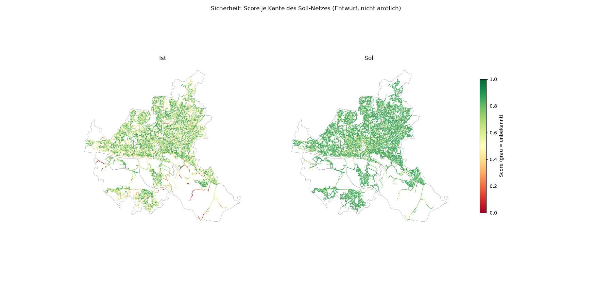
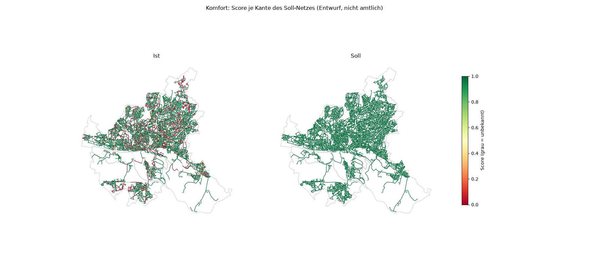
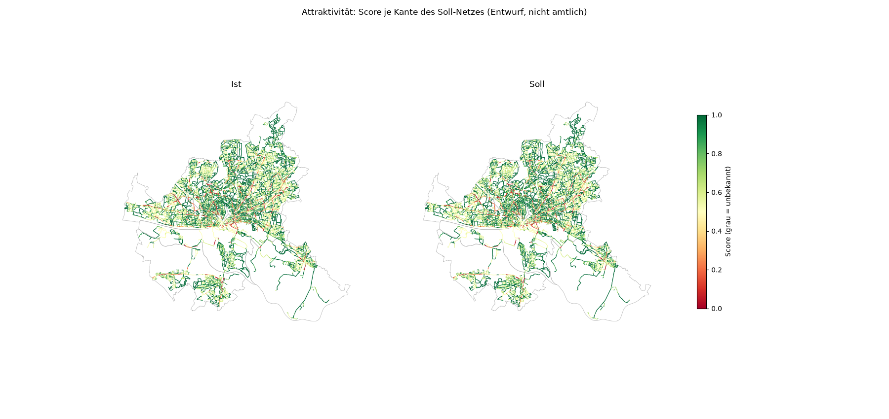
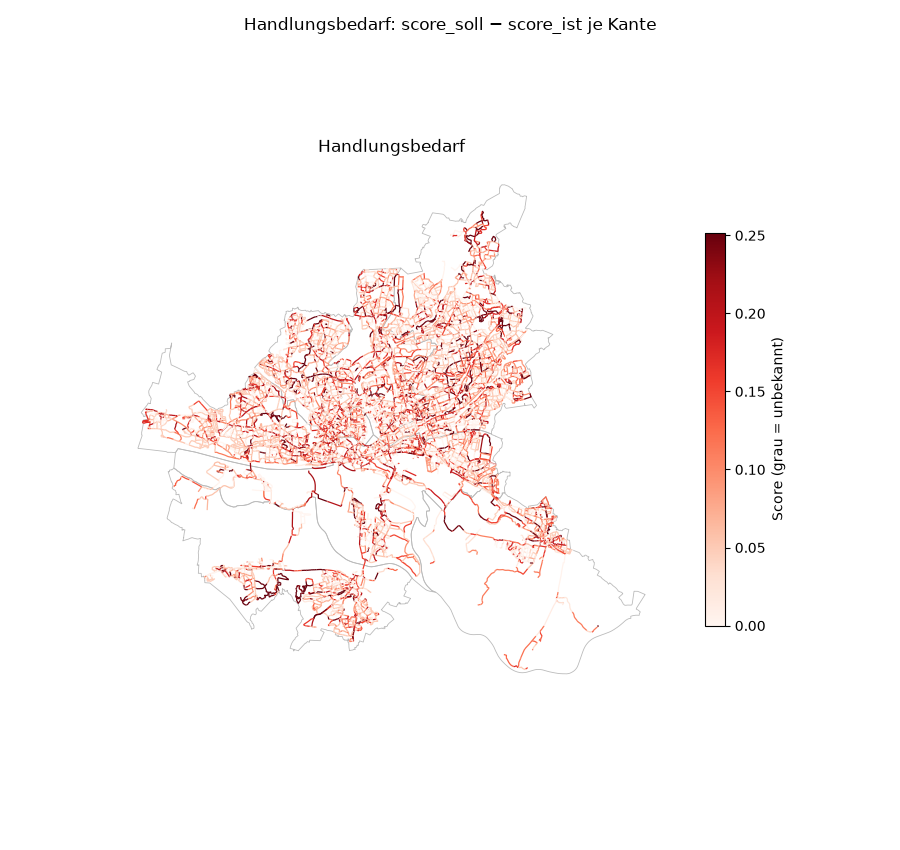

# Fünf Prinzipien: Bewertung des Soll-Radnetzes (Stufe c04)

Erzeugt 2026-11-11T12:44:25+00:00 mit pipeline/c04_principles.py · cycling_rules.yaml 0.9.0 · nicht amtlicher Entwurf. Alle Bewertungsregeln (C-PRI-01…16) und die Gewichte sind Annahmen (source_type assumption, status draft) und vor fachlicher Nutzung zu prüfen.

**score_ist** bewertet den heutigen Zustand der Soll-Route, **score_soll** den Zustand nach regelkonformem Ausbau (Führung nach Trennungsmatrix, Sollbreite, geschlossene Decke, Beleuchtung). Die Differenz ist der Handlungsbedarf. Fehlende Daten senken die confidence, nicht den Score.

## Kurzfassung

- RSV: 65 km, Score Ist 0.56 → Soll 0.68
- HAUPT: 1 861 km, Score Ist 0.67 → Soll 0.77
- BASIS: 1 038 km, Score Ist 0.78 → Soll 0.83
- Führung entspricht heute der Trennungsmatrix auf 48 % der Netzlänge mit bekannter Führung (RSV/HAUPT: 26 %).
- 5054 Routen bewertet; mittlerer Handlungsbedarf (score_soll − score_ist) 0.07, confidence: high 1909, medium 3145, low 0.
- Nicht bewertbar mangels Daten: P-SAF-02 (Knotentypen erst mit Prompt 20 (pipeline/c07_junctions.py)), P-COM-03 (kein Höhenmodell geladen (sources.yaml laserscan ohne Abruf)), P-ATT-02 (keine Lärmkarte (sources.yaml noise_maps ohne Endpunkt, Entscheidung 2026-11-06)).

## Datenlage je Prüfung

Anteil der Länge des Soll-Netzes (RSV, HAUPT, BASIS) mit Wert, unter den Kanten, für die die Prüfung anwendbar ist.

| Prüfung | Prinzip | Datengrundlage | anwendbar (km) | mit Wert |
| --- | --- | --- | ---: | ---: |
| P-COH-01 | Zusammenhang | c03 Maschen | 2 964 | 100 % |
| P-COH-02 | Zusammenhang | Soll-Netz | 2 962 | 100 % |
| P-COH-04 | Zusammenhang | Ist-Führung entlang der Route | 2 962 | 100 % |
| P-DIR-01 | Direktheit | Radgraph (Länge) | 2 962 | 99 % |
| P-DIR-02 | Direktheit | OSM-LSA, Vorfahrt C-GRAPH-05 | 2 962 | 100 % |
| P-DIR-03 | Direktheit | wie P-DIR-02 | 1 926 | 100 % |
| P-SAF-01 | Sicherheit | Ist-Führung (C-PRI-02), Trennungsmatrix | 2 907 | 100 % |
| P-SAF-02 | Sicherheit | – | 2 964 | 0 % |
| P-SAF-03 | Sicherheit | OSM lit | 2 964 | 85 % |
| P-SAF-04 | Sicherheit | Unfallatlas | 2 964 | 100 % |
| P-COM-01 | Komfort | OSM width/cycleway:width | 1 274 | 11 % |
| P-COM-02 | Komfort | OSM surface | 2 964 | 96 % |
| P-COM-03 | Komfort | – | 2 964 | 0 % |
| P-ATT-01 | Attraktivität | ALKIS, OSM-Bäume | 2 964 | 100 % |
| P-ATT-02 | Attraktivität | – | 2 964 | 0 % |
| P-ATT-03 | Attraktivität | DTV 2019 (HVS) | 2 964 | 100 % |

## Netzkennzahlen je Kategorie

Längengewichtete Mittel über die Kanten der Kategorie (Kantenwerte für Direktheit und Zusammenhang aus der Hauptroute der Kante).

| Kategorie | km | Zusammenhang Ist / Soll | Direktheit Ist / Soll | Sicherheit Ist / Soll | Komfort Ist / Soll | Attraktivität Ist / Soll | Gesamt Ist / Soll |
| --- | ---: | ---: | ---: | ---: | ---: | ---: | ---: |
| RSV | 65 | 0.33 / 0.35 | 0.65 / 0.65 | 0.66 / 0.79 | 0.49 / 1.00 | 0.63 / 0.63 | 0.56 / 0.68 |
| HAUPT | 1 861 | 0.68 / 0.71 | 0.66 / 0.66 | 0.64 / 0.82 | 0.69 / 1.00 | 0.70 / 0.70 | 0.67 / 0.77 |
| BASIS | 1 038 | 0.79 / 0.80 | 0.81 / 0.81 | 0.75 / 0.82 | 0.86 / 1.00 | 0.71 / 0.71 | 0.78 / 0.83 |

## Zusammenhang (P-COH)

**P-COH-01 Maschenweite** (aus c03, cycle_mesh_gaps.parquet):

| Ebene | Höchstweite | zu große Maschen | Seite Median | Seite max |
| --- | ---: | ---: | ---: | ---: |
| HAUPT | 600 m | 34 | 1 050 m | 4 076 m |
| BASIS | 300 m | 409 | 411 m | 4 064 m |

**P-COH-02 Komponenten** (je Ebene mit höheren Ebenen):

| Ebene | Komponenten | Anteil größte Komponente (Länge) |
| --- | ---: | ---: |
| RSV | 6 | 21 % |
| HAUPT | 1 | 100 % |
| BASIS | 1 | 100 % |

**P-COH-03 Abdeckung** (Ziele höchstens 300 m vom RSV/HAUPT-Netz; Zentren fehlen, kein Datensatz):

| Ziele | Anzahl | abgedeckt |
| --- | ---: | ---: |
| Schulen (OSM) | 557 | 96 % |
| Schnellbahnhalte | 375 | 99 % |
| Hochschulen (OSM university) | 41 | 100 % |

**P-COH-04 Kontinuität:** Wechsel der Ist-Führung je km (Median über Routen) 1.00, Soll (Führung und Kategorie) 0.00; Schwelle 1.0 je km (C-PRI-12).

## Direktheit (P-DIR)

**P-DIR-01 Umwegfaktor, Netzstichprobe** (C-PRI-04): je Kategorie 200 OD-Paare, Seed 42, Knoten der größten Komponente der Ebene (mit höheren Ebenen), Luftlinie im Band trip_length_km. Netzweg auf der Ebene gegen kürzesten Weg auf allen befahrbaren Kanten (Länge).

| Kategorie | Band (km) | Paare | ohne Weg | Median | 90-%-Wert | Schwelle | Anteil ≤ Schwelle |
| --- | --- | ---: | ---: | ---: | ---: | ---: | ---: |
| RSV | 5–15 | 200 | 0 | 1.15 | 1.21 | 1.1 | 44 % |
| HAUPT | 2–3 | 200 | 0 | 1.18 | 3.45 | 1.2 | 54 % |
| BASIS | 1–2 | 200 | 0 | 1.06 | 2.17 | 1.3 | 82 % |

**Je Route** (Median über Routen der Kategorie; Halte nach C-PRI-05, Soll = Ist bis Prompt 20):

| Kategorie | Routen | Umwegfaktor | Halte/km | Schwelle Halte | Zeitverlust s/km | Schwelle s/km |
| --- | ---: | ---: | ---: | ---: | ---: | ---: |
| RSV | 24 | 1.09 | 1.8 | 0.5 | 26 | 30 |
| HAUPT | 2085 | 1.10 | 1.1 | 1.0 | 11 | 30 |
| BASIS | 2945 | 1.00 | 0.0 | 2.0 | 0 | – |

## Sicherheit (P-SAF)

**P-SAF-01 Ist-Führung gegen Soll-Führung** (km, Kanten RSV/HAUPT/BASIS):

| Ist \ Soll | Radfahrstreifen | Fahrradstraße | Mischverkehr | eigener Weg | Radweg je Seite | unbekannt |
| --- | ---: | ---: | ---: | ---: | ---: | ---: |
| Radfahrstreifen | 5 | 29 | 15 | 0 | 36 | 0 |
| Fahrradstraße | 0 | 18 | 2 | 0 | 0 | 0 |
| Mischverkehr | 9 | 970 | 607 | 0 | 56 | 41 |
| eigener Weg | 0 | 0 | 0 | 417 | 0 | 0 |
| Radweg je Seite | 11 | 98 | 44 | 0 | 263 | 7 |
| Zweirichtungsradweg | 7 | 108 | 48 | 11 | 154 | 4 |
| unbekannt | 0 | 0 | 0 | 0 | 0 | 5 |

P-SAF-03 Beleuchtung: OSM lit auf 85 % der Netzlänge bekannt; davon beleuchtet 90 %. P-SAF-04 Unfälle mit Radbeteiligung 2021–2025: 7 667 Unfälle an Kanten des Soll-Netzes (je Kante höchstens 15 m entfernt; nur Summen gespeichert).

## Komfort und Attraktivität (P-COM, P-ATT)

- P-COM-01 Breite: anwendbar auf 1 274 km (ohne Mischverkehr), Breite in OSM auf 11 % davon; von diesen erreichen 18 % die Sollbreite.
- P-COM-02 Belag: bekannt auf 96 %; RSV/HAUPT mit geschlossener Decke 67 %.
- P-ATT-01 Grünanteil im 20-m-Puffer: Median 13 % (Ziel 30 %, ALKIS-Grünflächen und OSM-Bäume).
- P-ATT-03: 327 km des Soll-Netzes liegen an Straßen mit DTV > 15 000.

## Top 30 Routen mit dem größten Handlungsbedarf

Rangfolge nach Handlungsbedarf-km = (score_soll − score_ist) × Länge in km (C-PRI-14), damit lange Routen mit mittlerem Defizit vor sehr kurzen Verdichtungsstücken stehen. S/K: Sicherheit und Komfort Ist → Soll.

| # | Route | Kategorie | km | Ist | Soll | Δ | Δ × km | S | K | confidence | Prüfen |
| ---: | --- | --- | ---: | ---: | ---: | ---: | ---: | --- | --- | --- | --- |
| 1 | Innenstadt (Rathausmarkt) – Umsteigeknoten Neugraben (`rt_46a9a9c639d7d6c8`) | RSV | 23.2 | 0.57 | 0.71 | 0.14 | 3.30 | 0.59 → 0.76 | 0.44 → 1.00 | medium | [Luftbild](https://geoportal-hamburg.de/?MAP/PROJECTION=EPSG:25832&MAP/CENTER=[566101,5925609]&MAP/ZOOMLEVEL=10&MAP/LAYERIDS=19968) · [Panoramax](https://api.panoramax.xyz/#focus=map&map=18/53.475314/9.995944) · [OSM](https://www.openstreetmap.org/?mlat=53.475314&mlon=9.995944#map=18/53.475314/9.995944) |
| 2 | Innenstadt (Rathausmarkt) – Arbeitsplatzschwerpunkt Harburg (300 Tsd. m²) (`rt_3645a25b810b0a3f`) | RSV | 19.8 | 0.56 | 0.71 | 0.14 | 2.86 | 0.57 → 0.75 | 0.44 → 1.00 | high | [Luftbild](https://geoportal-hamburg.de/?MAP/PROJECTION=EPSG:25832&MAP/CENTER=[565693,5927156]&MAP/ZOOMLEVEL=10&MAP/LAYERIDS=19968) · [Panoramax](https://api.panoramax.xyz/#focus=map&map=18/53.489264/9.990118) · [OSM](https://www.openstreetmap.org/?mlat=53.489264&mlon=9.990118#map=18/53.489264/9.990118) |
| 3 | Umsteigeknoten Neugraben – Arbeitsplatzschwerpunkt Hamburg-Mitte (379 Tsd. m²) (`rt_a1437067c8713aec`) | HAUPT | 16.2 | 0.73 | 0.87 | 0.14 | 2.33 | 0.59 → 0.83 | 0.60 → 1.00 | medium | [Luftbild](https://geoportal-hamburg.de/?MAP/PROJECTION=EPSG:25832&MAP/CENTER=[560451,5929359]&MAP/ZOOMLEVEL=10&MAP/LAYERIDS=19968) · [Panoramax](https://api.panoramax.xyz/#focus=map&map=18/53.509694/9.911549) · [OSM](https://www.openstreetmap.org/?mlat=53.509694&mlon=9.911549#map=18/53.509694/9.911549) |
| 4 | Umsteigeknoten Neugraben – Hochschule Technologiezentrum Hamburg-Finkenwerder (`rt_fa57d47917cbb47c`) | HAUPT | 15.3 | 0.73 | 0.87 | 0.14 | 2.16 | 0.59 → 0.83 | 0.61 → 1.00 | medium | [Luftbild](https://geoportal-hamburg.de/?MAP/PROJECTION=EPSG:25832&MAP/CENTER=[560443,5928887]&MAP/ZOOMLEVEL=10&MAP/LAYERIDS=19968) · [Panoramax](https://api.panoramax.xyz/#focus=map&map=18/53.505453/9.911335) · [OSM](https://www.openstreetmap.org/?mlat=53.505453&mlon=9.911335#map=18/53.505453/9.911335) |
| 5 | Verdichtung HAUPT: Elbchaussee (`rt_0b6a6a1d99fe5f69`) | HAUPT | 21.8 | 0.63 | 0.72 | 0.09 | 2.05 | 0.53 → 0.73 | 0.87 → 1.00 | high | [Luftbild](https://geoportal-hamburg.de/?MAP/PROJECTION=EPSG:25832&MAP/CENTER=[551948,5934994]&MAP/ZOOMLEVEL=10&MAP/LAYERIDS=19968) · [Panoramax](https://api.panoramax.xyz/#focus=map&map=18/53.561248/9.784279) · [OSM](https://www.openstreetmap.org/?mlat=53.561248&mlon=9.784279#map=18/53.561248/9.784279) |
| 6 | Innenstadt (Rathausmarkt) – Hochschule Gebäude D (`rt_8eabe7a2f46ef973`) | RSV | 14.8 | 0.59 | 0.72 | 0.12 | 1.80 | 0.58 → 0.74 | 0.55 → 1.00 | medium | [Luftbild](https://geoportal-hamburg.de/?MAP/PROJECTION=EPSG:25832&MAP/CENTER=[565276,5929388]&MAP/ZOOMLEVEL=10&MAP/LAYERIDS=19968) · [Panoramax](https://api.panoramax.xyz/#focus=map&map=18/53.509382/9.984308) · [OSM](https://www.openstreetmap.org/?mlat=53.509382&mlon=9.984308#map=18/53.509382/9.984308) |
| 7 | Arbeitsplatzschwerpunkt Hamburg-Mitte (263 Tsd. m²) – Arbeitsplatzschwerpunkt Bergedorf (224 Tsd. m²) (`rt_a0ba9480bcf0aba0`) | HAUPT | 14.9 | 0.74 | 0.86 | 0.12 | 1.75 | 0.57 → 0.78 | 0.67 → 1.00 | medium | [Luftbild](https://geoportal-hamburg.de/?MAP/PROJECTION=EPSG:25832&MAP/CENTER=[569146,5931763]&MAP/ZOOMLEVEL=10&MAP/LAYERIDS=19968) · [Panoramax](https://api.panoramax.xyz/#focus=map&map=18/53.530230/10.043167) · [OSM](https://www.openstreetmap.org/?mlat=53.530230&mlon=10.043167#map=18/53.530230/10.043167) |
| 8 | Innenstadt (Rathausmarkt) – Arbeitsplatzschwerpunkt Hamburg-Mitte (231 Tsd. m²) (`rt_3a0535e6b916dd87`) | HAUPT | 12.9 | 0.70 | 0.83 | 0.13 | 1.72 | 0.56 → 0.76 | 0.57 → 1.00 | medium | [Luftbild](https://geoportal-hamburg.de/?MAP/PROJECTION=EPSG:25832&MAP/CENTER=[564309,5933531]&MAP/ZOOMLEVEL=10&MAP/LAYERIDS=19968) · [Panoramax](https://api.panoramax.xyz/#focus=map&map=18/53.546728/9.970578) · [OSM](https://www.openstreetmap.org/?mlat=53.546728&mlon=9.970578#map=18/53.546728/9.970578) |
| 9 | Innenstadt (Rathausmarkt) – Hochschule HAW Hamburg Energie Campus (`rt_839f9a75be497f58`) | RSV | 20.9 | 0.62 | 0.70 | 0.08 | 1.71 | 0.63 → 0.73 | 0.68 → 1.00 | medium | [Luftbild](https://geoportal-hamburg.de/?MAP/PROJECTION=EPSG:25832&MAP/CENTER=[573771,5932181]&MAP/ZOOMLEVEL=10&MAP/LAYERIDS=19968) · [Panoramax](https://api.panoramax.xyz/#focus=map&map=18/53.533357/10.113028) · [OSM](https://www.openstreetmap.org/?mlat=53.533357&mlon=10.113028#map=18/53.533357/10.113028) |
| 10 | Arbeitsplatzschwerpunkt Bergedorf (549 Tsd. m²) – Arbeitsplatzschwerpunkt Hamburg-Mitte (263 Tsd. m²) (`rt_d0346677dc8f077d`) | HAUPT | 14.3 | 0.74 | 0.85 | 0.12 | 1.68 | 0.57 → 0.78 | 0.68 → 1.00 | medium | [Luftbild](https://geoportal-hamburg.de/?MAP/PROJECTION=EPSG:25832&MAP/CENTER=[569013,5931962]&MAP/ZOOMLEVEL=10&MAP/LAYERIDS=19968) · [Panoramax](https://api.panoramax.xyz/#focus=map&map=18/53.532036/10.041212) · [OSM](https://www.openstreetmap.org/?mlat=53.532036&mlon=10.041212#map=18/53.532036/10.041212) |
| 11 | Innenstadt (Rathausmarkt) – Umsteigeknoten Hamburg-Harburg (`rt_01ce314479204899`) | RSV | 13.8 | 0.61 | 0.72 | 0.11 | 1.56 | 0.57 → 0.73 | 0.61 → 1.00 | medium | [Luftbild](https://geoportal-hamburg.de/?MAP/PROJECTION=EPSG:25832&MAP/CENTER=[565247,5929856]&MAP/ZOOMLEVEL=10&MAP/LAYERIDS=19968) · [Panoramax](https://api.panoramax.xyz/#focus=map&map=18/53.513591/9.983962) · [OSM](https://www.openstreetmap.org/?mlat=53.513591&mlon=9.983962#map=18/53.513591/9.983962) |
| 12 | Innenstadt (Rathausmarkt) – Arbeitsplatzschwerpunkt Harburg (241 Tsd. m²) (`rt_f16d9e5fc98b74d3`) | RSV | 13.4 | 0.61 | 0.72 | 0.11 | 1.50 | 0.58 → 0.74 | 0.62 → 1.00 | medium | [Luftbild](https://geoportal-hamburg.de/?MAP/PROJECTION=EPSG:25832&MAP/CENTER=[565220,5930046]&MAP/ZOOMLEVEL=10&MAP/LAYERIDS=19968) · [Panoramax](https://api.panoramax.xyz/#focus=map&map=18/53.515299/9.983596) · [OSM](https://www.openstreetmap.org/?mlat=53.515299&mlon=9.983596#map=18/53.515299/9.983596) |
| 13 | Umsteigeknoten Altona – Arbeitsplatzschwerpunkt Hamburg-Mitte (231 Tsd. m²) (`rt_2626b776f52397f5`) | HAUPT | 12.6 | 0.75 | 0.86 | 0.12 | 1.48 | 0.57 → 0.78 | 0.70 → 1.00 | medium | [Luftbild](https://geoportal-hamburg.de/?MAP/PROJECTION=EPSG:25832&MAP/CENTER=[557537,5934586]&MAP/ZOOMLEVEL=10&MAP/LAYERIDS=19968) · [Panoramax](https://api.panoramax.xyz/#focus=map&map=18/53.557004/9.868583) · [OSM](https://www.openstreetmap.org/?mlat=53.557004&mlon=9.868583#map=18/53.557004/9.868583) |
| 14 | Innenstadt (Rathausmarkt) – Arbeitsplatzschwerpunkt Bergedorf (224 Tsd. m²) (`rt_f148bb5f25fd2127`) | HAUPT | 12.5 | 0.70 | 0.81 | 0.11 | 1.42 | 0.56 → 0.76 | 0.65 → 1.00 | medium | [Luftbild](https://geoportal-hamburg.de/?MAP/PROJECTION=EPSG:25832&MAP/CENTER=[570219,5931700]&MAP/ZOOMLEVEL=10&MAP/LAYERIDS=19968) · [Panoramax](https://api.panoramax.xyz/#focus=map&map=18/53.529524/10.059349) · [OSM](https://www.openstreetmap.org/?mlat=53.529524&mlon=10.059349#map=18/53.529524/10.059349) |
| 15 | Innenstadt (Rathausmarkt) – Arbeitsplatzschwerpunkt Hamburg-Nord (307 Tsd. m²) (`rt_72c37ea42d007074`) | RSV | 12.9 | 0.57 | 0.68 | 0.11 | 1.38 | 0.62 → 0.72 | 0.51 → 1.00 | high | [Luftbild](https://geoportal-hamburg.de/?MAP/PROJECTION=EPSG:25832&MAP/CENTER=[568341,5938656]&MAP/ZOOMLEVEL=10&MAP/LAYERIDS=19968) · [Panoramax](https://api.panoramax.xyz/#focus=map&map=18/53.592280/10.032546) · [OSM](https://www.openstreetmap.org/?mlat=53.592280&mlon=10.032546#map=18/53.592280/10.032546) |
| 16 | Innenstadt (Rathausmarkt) – Umsteigeknoten Bergedorf (`rt_330eda61e65cb575`) | RSV | 18.9 | 0.64 | 0.71 | 0.07 | 1.37 | 0.63 → 0.73 | 0.74 → 1.00 | medium | [Luftbild](https://geoportal-hamburg.de/?MAP/PROJECTION=EPSG:25832&MAP/CENTER=[573715,5933042]&MAP/ZOOMLEVEL=10&MAP/LAYERIDS=19968) · [Panoramax](https://api.panoramax.xyz/#focus=map&map=18/53.541098/10.112394) · [OSM](https://www.openstreetmap.org/?mlat=53.541098&mlon=10.112394#map=18/53.541098/10.112394) |
| 17 | Arbeitsplatzschwerpunkt Hamburg-Mitte (278 Tsd. m²) – Arbeitsplatzschwerpunkt Bergedorf (224 Tsd. m²) (`rt_5be88c5238ed113e`) | HAUPT | 7.1 | 0.66 | 0.85 | 0.19 | 1.37 | 0.45 → 0.81 | 0.50 → 1.00 | medium | [Luftbild](https://geoportal-hamburg.de/?MAP/PROJECTION=EPSG:25832&MAP/CENTER=[572709,5930397]&MAP/ZOOMLEVEL=10&MAP/LAYERIDS=19968) · [Panoramax](https://api.panoramax.xyz/#focus=map&map=18/53.517468/10.096597) · [OSM](https://www.openstreetmap.org/?mlat=53.517468&mlon=10.096597#map=18/53.517468/10.096597) |
| 18 | Umsteigeknoten Neugraben – Arbeitsplatzschwerpunkt Hamburg-Mitte (231 Tsd. m²) (`rt_1f65359785a52cea`) | HAUPT | 10.2 | 0.73 | 0.86 | 0.13 | 1.36 | 0.62 → 0.82 | 0.58 → 1.00 | medium | [Luftbild](https://geoportal-hamburg.de/?MAP/PROJECTION=EPSG:25832&MAP/CENTER=[559820,5926567]&MAP/ZOOMLEVEL=10&MAP/LAYERIDS=19968) · [Panoramax](https://api.panoramax.xyz/#focus=map&map=18/53.484673/9.901500) · [OSM](https://www.openstreetmap.org/?mlat=53.484673&mlon=9.901500#map=18/53.484673/9.901500) |
| 19 | Innenstadt (Rathausmarkt) – Arbeitsplatzschwerpunkt Bergedorf (549 Tsd. m²) (`rt_312c55eaf10e71ed`) | HAUPT | 12.0 | 0.70 | 0.81 | 0.11 | 1.35 | 0.55 → 0.75 | 0.65 → 1.00 | medium | [Luftbild](https://geoportal-hamburg.de/?MAP/PROJECTION=EPSG:25832&MAP/CENTER=[569982,5931778]&MAP/ZOOMLEVEL=10&MAP/LAYERIDS=19968) · [Panoramax](https://api.panoramax.xyz/#focus=map&map=18/53.530255/10.055787) · [OSM](https://www.openstreetmap.org/?mlat=53.530255&mlon=10.055787#map=18/53.530255/10.055787) |
| 20 | Arbeitsplatzschwerpunkt Hamburg-Mitte (379 Tsd. m²) – Arbeitsplatzschwerpunkt Altona (226 Tsd. m²) (`rt_9fe1aad7bdd69990`) | HAUPT | 9.8 | 0.75 | 0.88 | 0.13 | 1.26 | 0.64 → 0.81 | 0.64 → 1.00 | medium | [Luftbild](https://geoportal-hamburg.de/?MAP/PROJECTION=EPSG:25832&MAP/CENTER=[560124,5935043]&MAP/ZOOMLEVEL=10&MAP/LAYERIDS=19968) · [Panoramax](https://api.panoramax.xyz/#focus=map&map=18/53.560821/9.907711) · [OSM](https://www.openstreetmap.org/?mlat=53.560821&mlon=9.907711#map=18/53.560821/9.907711) |
| 21 | Arbeitsplatzschwerpunkt Bergedorf (549 Tsd. m²) – Arbeitsplatzschwerpunkt Hamburg-Mitte (278 Tsd. m²) (`rt_e3d331b9b5cc9556`) | HAUPT | 6.6 | 0.65 | 0.84 | 0.19 | 1.25 | 0.45 → 0.81 | 0.52 → 1.00 | medium | [Luftbild](https://geoportal-hamburg.de/?MAP/PROJECTION=EPSG:25832&MAP/CENTER=[572886,5930550]&MAP/ZOOMLEVEL=10&MAP/LAYERIDS=19968) · [Panoramax](https://api.panoramax.xyz/#focus=map&map=18/53.518820/10.099305) · [OSM](https://www.openstreetmap.org/?mlat=53.518820&mlon=10.099305#map=18/53.518820/10.099305) |
| 22 | Innenstadt (Rathausmarkt) – Arbeitsplatzschwerpunkt Hamburg-Mitte (379 Tsd. m²) (`rt_11d6966950f5f77a`) | RSV | 15.0 | 0.58 | 0.67 | 0.08 | 1.24 | 0.57 → 0.72 | 0.80 → 1.00 | medium | [Luftbild](https://geoportal-hamburg.de/?MAP/PROJECTION=EPSG:25832&MAP/CENTER=[559566,5935498]&MAP/ZOOMLEVEL=10&MAP/LAYERIDS=19968) · [Panoramax](https://api.panoramax.xyz/#focus=map&map=18/53.564974/9.899373) · [OSM](https://www.openstreetmap.org/?mlat=53.564974&mlon=9.899373#map=18/53.564974/9.899373) |
| 23 | Verdichtung HAUPT: Niendorfer Gehege (`rt_c0464578be8fb33b`) | HAUPT | 7.2 | 0.62 | 0.79 | 0.17 | 1.21 | 0.57 → 0.81 | 0.52 → 1.00 | medium | [Luftbild](https://geoportal-hamburg.de/?MAP/PROJECTION=EPSG:25832&MAP/CENTER=[560322,5940791]&MAP/ZOOMLEVEL=10&MAP/LAYERIDS=19968) · [Panoramax](https://api.panoramax.xyz/#focus=map&map=18/53.612452/9.911817) · [OSM](https://www.openstreetmap.org/?mlat=53.612452&mlon=9.911817#map=18/53.612452/9.911817) |
| 24 | Umsteigeknoten Hamburg-Harburg – Arbeitsplatzschwerpunkt Harburg (300 Tsd. m²) (`rt_463b00cfca1d45be`) | RSV | 7.4 | 0.52 | 0.68 | 0.15 | 1.14 | 0.60 → 0.80 | 0.33 → 1.00 | high | [Luftbild](https://geoportal-hamburg.de/?MAP/PROJECTION=EPSG:25832&MAP/CENTER=[562896,5925065]&MAP/ZOOMLEVEL=10&MAP/LAYERIDS=19968) · [Panoramax](https://api.panoramax.xyz/#focus=map&map=18/53.470813/9.947549) · [OSM](https://www.openstreetmap.org/?mlat=53.470813&mlon=9.947549#map=18/53.470813/9.947549) |
| 25 | Verdichtung HAUPT: neben Osdorfer Landstraße (`rt_72d1850ab8acbd17`) | HAUPT | 9.2 | 0.57 | 0.70 | 0.12 | 1.14 | 0.60 → 0.76 | 0.51 → 1.00 | medium | [Luftbild](https://geoportal-hamburg.de/?MAP/PROJECTION=EPSG:25832&MAP/CENTER=[554538,5936526]&MAP/ZOOMLEVEL=10&MAP/LAYERIDS=19968) · [Panoramax](https://api.panoramax.xyz/#focus=map&map=18/53.574756/9.823643) · [OSM](https://www.openstreetmap.org/?mlat=53.574756&mlon=9.823643#map=18/53.574756/9.823643) |
| 26 | Arbeitsplatzschwerpunkt Harburg (300 Tsd. m²) – Arbeitsplatzschwerpunkt Harburg (241 Tsd. m²) (`rt_a3f51202ca48fa1c`) | RSV | 6.8 | 0.51 | 0.68 | 0.17 | 1.14 | 0.56 → 0.78 | 0.34 → 1.00 | high | [Luftbild](https://geoportal-hamburg.de/?MAP/PROJECTION=EPSG:25832&MAP/CENTER=[562608,5925087]&MAP/ZOOMLEVEL=10&MAP/LAYERIDS=19968) · [Panoramax](https://api.panoramax.xyz/#focus=map&map=18/53.471045/9.943226) · [OSM](https://www.openstreetmap.org/?mlat=53.471045&mlon=9.943226#map=18/53.471045/9.943226) |
| 27 | Hochschule HAW Hamburg Energie Campus – Arbeitsplatzschwerpunkt Bergedorf (549 Tsd. m²) (`rt_b367bfe31c89a2b5`) | HAUPT | 9.6 | 0.76 | 0.88 | 0.12 | 1.13 | 0.60 → 0.81 | 0.61 → 1.00 | medium | [Luftbild](https://geoportal-hamburg.de/?MAP/PROJECTION=EPSG:25832&MAP/CENTER=[577284,5927329]&MAP/ZOOMLEVEL=10&MAP/LAYERIDS=19968) · [Panoramax](https://api.panoramax.xyz/#focus=map&map=18/53.489245/10.164827) · [OSM](https://www.openstreetmap.org/?mlat=53.489245&mlon=10.164827#map=18/53.489245/10.164827) |
| 28 | Verdichtung HAUPT: Little Whistler (`rt_08c9b542408be57e`) | HAUPT | 4.3 | 0.53 | 0.79 | 0.26 | 1.12 | 0.42 → 0.83 | 0.07 → 1.00 | high | [Luftbild](https://geoportal-hamburg.de/?MAP/PROJECTION=EPSG:25832&MAP/CENTER=[560773,5923351]&MAP/ZOOMLEVEL=10&MAP/LAYERIDS=19968) · [Panoramax](https://api.panoramax.xyz/#focus=map&map=18/53.455657/9.915248) · [OSM](https://www.openstreetmap.org/?mlat=53.455657&mlon=9.915248#map=18/53.455657/9.915248) |
| 29 | Innenstadt (Rathausmarkt) – Hochschule HAW - Life Sciences - Campus Bergedorf (`rt_45e1e9f969e39995`) | RSV | 18.1 | 0.64 | 0.70 | 0.06 | 1.12 | 0.64 → 0.73 | 0.80 → 1.00 | medium | [Luftbild](https://geoportal-hamburg.de/?MAP/PROJECTION=EPSG:25832&MAP/CENTER=[573408,5933202]&MAP/ZOOMLEVEL=10&MAP/LAYERIDS=19968) · [Panoramax](https://api.panoramax.xyz/#focus=map&map=18/53.542585/10.107802) · [OSM](https://www.openstreetmap.org/?mlat=53.542585&mlon=10.107802#map=18/53.542585/10.107802) |
| 30 | Arbeitsplatzschwerpunkt Hamburg-Mitte (379 Tsd. m²) – Arbeitsplatzschwerpunkt Hamburg-Mitte (231 Tsd. m²) (`rt_9978d70cbf7eefbe`) | HAUPT | 6.9 | 0.73 | 0.89 | 0.16 | 1.11 | 0.55 → 0.83 | 0.67 → 1.00 | medium | [Luftbild](https://geoportal-hamburg.de/?MAP/PROJECTION=EPSG:25832&MAP/CENTER=[558090,5932012]&MAP/ZOOMLEVEL=10&MAP/LAYERIDS=19968) · [Panoramax](https://api.panoramax.xyz/#focus=map&map=18/53.533804/9.876452) · [OSM](https://www.openstreetmap.org/?mlat=53.533804&mlon=9.876452#map=18/53.533804/9.876452) |

Höchster Δ einer Route (ohne Längengewicht): 0.30; Routen mit Δ ≥ 0,2: 189.

## Karten je Prinzip

## Gewichts-Sensitivität (±20 %)

Jedes Gewicht einzeln um ±20% verändert, die übrigen anteilig umgelegt (C-PRI-14). Verglichen mit den Basisgewichten: Überschneidung der Top 30 nach Handlungsbedarf-km, Rangkorrelation (Spearman) aller Routen.

| Gewicht | Basis | Variante | Top-Überschneidung | Spearman |
| --- | ---: | ---: | ---: | ---: |
| Zusammenhang | 0.200 | 0.160 | 29/30 | 0.998 |
| Zusammenhang | 0.200 | 0.240 | 29/30 | 0.998 |
| Direktheit | 0.250 | 0.200 | 30/30 | 1.000 |
| Direktheit | 0.250 | 0.300 | 30/30 | 1.000 |
| Sicherheit | 0.300 | 0.240 | 29/30 | 0.995 |
| Sicherheit | 0.300 | 0.360 | 29/30 | 0.997 |
| Komfort | 0.150 | 0.120 | 29/30 | 0.999 |
| Komfort | 0.150 | 0.180 | 29/30 | 0.999 |
| Attraktivität | 0.100 | 0.080 | 30/30 | 1.000 |
| Attraktivität | 0.100 | 0.120 | 30/30 | 1.000 |

Kleinste Überschneidung: 29/30.

## Handlungsbedarf je Bezirk

| Bezirk | Netz-km | Score Ist | Score Soll | Δ |
| --- | ---: | ---: | ---: | ---: |
| Altona | 422 | 0.70 | 0.78 | 0.08 |
| Bergedorf | 194 | 0.73 | 0.82 | 0.09 |
| Eimsbüttel | 362 | 0.70 | 0.78 | 0.08 |
| Hamburg-Mitte | 481 | 0.71 | 0.80 | 0.09 |
| Hamburg-Nord | 418 | 0.70 | 0.78 | 0.08 |
| Harburg | 266 | 0.69 | 0.79 | 0.10 |
| Wandsbek | 820 | 0.71 | 0.80 | 0.08 |

## Stichprobe: 30 zufällige Kanten (Seed 42, nach Bezirk verteilt)

| Kante | Name | Kategorie | Führung Ist → Soll | Breite / Soll | Belag | lit | Score Ist / Soll | Prüfen |
| --- | --- | --- | --- | ---: | --- | --- | --- | --- |
| `ce_0e7da0c5a0df07cd` | Knospenweg | HAUPT | Mischverkehr → Fahrradstraße | – / – | asphalt | ja | 0.78 / 0.83 | [Luftbild](https://geoportal-hamburg.de/?MAP/PROJECTION=EPSG:25832&MAP/CENTER=[553463,5936487]&MAP/ZOOMLEVEL=10&MAP/LAYERIDS=19968) · [Panoramax](https://api.panoramax.xyz/#focus=map&map=18/53.574521/9.807408) · [OSM](https://www.openstreetmap.org/?mlat=53.574521&mlon=9.807408#map=18/53.574521/9.807408) |
| `ce_3a3483970ae84f56` | Seestraße | HAUPT | Radweg je Seite → Fahrradstraße | – / 2.50 | asphalt | ja | 0.71 / 0.76 | [Luftbild](https://geoportal-hamburg.de/?MAP/PROJECTION=EPSG:25832&MAP/CENTER=[557939,5936104]&MAP/ZOOMLEVEL=10&MAP/LAYERIDS=19968) · [Panoramax](https://api.panoramax.xyz/#focus=map&map=18/53.570600/9.874933) · [OSM](https://www.openstreetmap.org/?mlat=53.570600&mlon=9.874933#map=18/53.570600/9.874933) |
| `ce_7e1ef061d9bb9375` | Eimsbütteler Straße | BASIS | Mischverkehr → Mischverkehr | – / – | sett | ja | 0.61 / 0.76 | [Luftbild](https://geoportal-hamburg.de/?MAP/PROJECTION=EPSG:25832&MAP/CENTER=[563460,5935505]&MAP/ZOOMLEVEL=10&MAP/LAYERIDS=19968) · [Panoramax](https://api.panoramax.xyz/#focus=map&map=18/53.564578/9.958164) · [OSM](https://www.openstreetmap.org/?mlat=53.564578&mlon=9.958164#map=18/53.564578/9.958164) |
| `ce_8c9bb9df8f8cebca` | Eimsbütteler Straße | BASIS | Mischverkehr → Mischverkehr | – / – | asphalt | ja | 0.88 / 0.88 | [Luftbild](https://geoportal-hamburg.de/?MAP/PROJECTION=EPSG:25832&MAP/CENTER=[563113,5935692]&MAP/ZOOMLEVEL=10&MAP/LAYERIDS=19968) · [Panoramax](https://api.panoramax.xyz/#focus=map&map=18/53.566299/9.952970) · [OSM](https://www.openstreetmap.org/?mlat=53.566299&mlon=9.952970#map=18/53.566299/9.952970) |
| `ce_28e8c38277abe23c` | Ebner-Eschenbach-Weg | BASIS | Mischverkehr → Mischverkehr | – / – | paving_stones | ja | 0.72 / 0.74 | [Luftbild](https://geoportal-hamburg.de/?MAP/PROJECTION=EPSG:25832&MAP/CENTER=[577827,5926541]&MAP/ZOOMLEVEL=10&MAP/LAYERIDS=19968) · [Panoramax](https://api.panoramax.xyz/#focus=map&map=18/53.482083/10.172810) · [OSM](https://www.openstreetmap.org/?mlat=53.482083&mlon=10.172810#map=18/53.482083/10.172810) |
| `ce_410783551c7bfd75` | Oberer Landweg | BASIS | Mischverkehr → Mischverkehr | – / – | asphalt | ja | 0.69 / 0.69 | [Luftbild](https://geoportal-hamburg.de/?MAP/PROJECTION=EPSG:25832&MAP/CENTER=[578600,5926851]&MAP/ZOOMLEVEL=10&MAP/LAYERIDS=19968) · [Panoramax](https://api.panoramax.xyz/#focus=map&map=18/53.484754/10.184546) · [OSM](https://www.openstreetmap.org/?mlat=53.484754&mlon=10.184546#map=18/53.484754/10.184546) |
| `ce_1a37334ae737e10d` | Haseldorfer Weg | HAUPT | Zweirichtungsradweg → Fahrradstraße | – / 3.50 | asphalt | ja | 0.66 / 0.71 | [Luftbild](https://geoportal-hamburg.de/?MAP/PROJECTION=EPSG:25832&MAP/CENTER=[559198,5940258]&MAP/ZOOMLEVEL=10&MAP/LAYERIDS=19968) · [Panoramax](https://api.panoramax.xyz/#focus=map&map=18/53.607790/9.894721) · [OSM](https://www.openstreetmap.org/?mlat=53.607790&mlon=9.894721#map=18/53.607790/9.894721) |
| `ce_b09d02575ab78933` | Brahmsallee | HAUPT | Mischverkehr → Fahrradstraße | – / – | asphalt | ja | 0.72 / 0.80 | [Luftbild](https://geoportal-hamburg.de/?MAP/PROJECTION=EPSG:25832&MAP/CENTER=[565015,5936504]&MAP/ZOOMLEVEL=10&MAP/LAYERIDS=19968) · [Panoramax](https://api.panoramax.xyz/#focus=map&map=18/53.573369/9.981845) · [OSM](https://www.openstreetmap.org/?mlat=53.573369&mlon=9.981845#map=18/53.573369/9.981845) |
| `ce_c26bb28d7106edea` | Stresemannallee | HAUPT | Radfahrstreifen → Fahrradstraße | – / 2.50 | asphalt | ja | 0.64 / 0.76 | [Luftbild](https://geoportal-hamburg.de/?MAP/PROJECTION=EPSG:25832&MAP/CENTER=[563372,5938158]&MAP/ZOOMLEVEL=10&MAP/LAYERIDS=19968) · [Panoramax](https://api.panoramax.xyz/#focus=map&map=18/53.588429/9.957380) · [OSM](https://www.openstreetmap.org/?mlat=53.588429&mlon=9.957380#map=18/53.588429/9.957380) |
| `ce_c3c59ec9089c51bc` | neben Lappenbergsallee | BASIS | Radweg je Seite → Radfahrstreifen | 1.50 / 2.00 | paving_stones | ja | 0.89 / 0.91 | [Luftbild](https://geoportal-hamburg.de/?MAP/PROJECTION=EPSG:25832&MAP/CENTER=[562508,5936744]&MAP/ZOOMLEVEL=10&MAP/LAYERIDS=19968) · [Panoramax](https://api.panoramax.xyz/#focus=map&map=18/53.575829/9.944039) · [OSM](https://www.openstreetmap.org/?mlat=53.575829&mlon=9.944039#map=18/53.575829/9.944039) |
| `ce_0c890d23f1ee082d` | Helgoländer Allee | BASIS | Mischverkehr → Mischverkehr | – / – | asphalt | ja | 0.82 / 0.82 | [Luftbild](https://geoportal-hamburg.de/?MAP/PROJECTION=EPSG:25832&MAP/CENTER=[564231,5933470]&MAP/ZOOMLEVEL=10&MAP/LAYERIDS=19968) · [Panoramax](https://api.panoramax.xyz/#focus=map&map=18/53.546190/9.969390) · [OSM](https://www.openstreetmap.org/?mlat=53.546190&mlon=9.969390#map=18/53.546190/9.969390) |
| `ce_221e1679cf0a22b1` | – | HAUPT | eigener Weg → eigener Weg | – / 3.50 | paving_stones | ja | 0.60 / 0.76 | [Luftbild](https://geoportal-hamburg.de/?MAP/PROJECTION=EPSG:25832&MAP/CENTER=[568141,5933578]&MAP/ZOOMLEVEL=10&MAP/LAYERIDS=19968) · [Panoramax](https://api.panoramax.xyz/#focus=map&map=18/53.546674/10.028409) · [OSM](https://www.openstreetmap.org/?mlat=53.546674&mlon=10.028409#map=18/53.546674/10.028409) |
| `ce_b0951372acbf9df6` | – | BASIS | eigener Weg → eigener Weg | – / 3.00 | compacted | nein | 0.47 / 0.72 | [Luftbild](https://geoportal-hamburg.de/?MAP/PROJECTION=EPSG:25832&MAP/CENTER=[572762,5934668]&MAP/ZOOMLEVEL=10&MAP/LAYERIDS=19968) · [Panoramax](https://api.panoramax.xyz/#focus=map&map=18/53.555852/10.098399) · [OSM](https://www.openstreetmap.org/?mlat=53.555852&mlon=10.098399#map=18/53.555852/10.098399) |
| `ce_e4ac5fc9f8caff17` | Hermannstal | HAUPT | Radweg je Seite → Radweg je Seite | – / 2.50 | asphalt | ja | 0.67 / 0.69 | [Luftbild](https://geoportal-hamburg.de/?MAP/PROJECTION=EPSG:25832&MAP/CENTER=[572093,5934540]&MAP/ZOOMLEVEL=10&MAP/LAYERIDS=19968) · [Panoramax](https://api.panoramax.xyz/#focus=map&map=18/53.554790/10.088273) · [OSM](https://www.openstreetmap.org/?mlat=53.554790&mlon=10.088273#map=18/53.554790/10.088273) |
| `ce_f76f9cadffeee689` | neben Steintorplatz | HAUPT | Radweg je Seite → Radweg je Seite | 2.00 / 2.50 | asphalt | ja | 0.81 / 0.82 | [Luftbild](https://geoportal-hamburg.de/?MAP/PROJECTION=EPSG:25832&MAP/CENTER=[566834,5934179]&MAP/ZOOMLEVEL=10&MAP/LAYERIDS=19968) · [Panoramax](https://api.panoramax.xyz/#focus=map&map=18/53.552239/10.008813) · [OSM](https://www.openstreetmap.org/?mlat=53.552239&mlon=10.008813#map=18/53.552239/10.008813) |
| `ce_0b0f618339efabb9` | Alsterkrugchaussee | BASIS | Radfahrstreifen → Radweg je Seite | – / 2.25 | asphalt | ja | 0.65 / 0.75 | [Luftbild](https://geoportal-hamburg.de/?MAP/PROJECTION=EPSG:25832&MAP/CENTER=[566921,5942233]&MAP/ZOOMLEVEL=10&MAP/LAYERIDS=19968) · [Panoramax](https://api.panoramax.xyz/#focus=map&map=18/53.624610/10.011860) · [OSM](https://www.openstreetmap.org/?mlat=53.624610&mlon=10.011860#map=18/53.624610/10.011860) |
| `ce_263c0b512ddf9c11` | Heerwisch / Grellkamp | HAUPT | Mischverkehr → Fahrradstraße | – / – | paving_stones | ja | 0.60 / 0.82 | [Luftbild](https://geoportal-hamburg.de/?MAP/PROJECTION=EPSG:25832&MAP/CENTER=[565974,5945609]&MAP/ZOOMLEVEL=10&MAP/LAYERIDS=19968) · [Panoramax](https://api.panoramax.xyz/#focus=map&map=18/53.655075/9.998259) · [OSM](https://www.openstreetmap.org/?mlat=53.655075&mlon=9.998259#map=18/53.655075/9.998259) |
| `ce_5e442a20b769f4fa` | Sandfoort | BASIS | Mischverkehr → Mischverkehr | – / – | asphalt | ja | 0.81 / 0.81 | [Luftbild](https://geoportal-hamburg.de/?MAP/PROJECTION=EPSG:25832&MAP/CENTER=[566451,5945364]&MAP/ZOOMLEVEL=10&MAP/LAYERIDS=19968) · [Panoramax](https://api.panoramax.xyz/#focus=map&map=18/53.652812/10.005413) · [OSM](https://www.openstreetmap.org/?mlat=53.652812&mlon=10.005413#map=18/53.652812/10.005413) |
| `ce_649d3b34c18ac7ce` | Wittekopsweg | BASIS | Mischverkehr → Mischverkehr | – / – | asphalt | ja | 0.94 / 0.94 | [Luftbild](https://geoportal-hamburg.de/?MAP/PROJECTION=EPSG:25832&MAP/CENTER=[566746,5944318]&MAP/ZOOMLEVEL=10&MAP/LAYERIDS=19968) · [Panoramax](https://api.panoramax.xyz/#focus=map&map=18/53.643375/10.009664) · [OSM](https://www.openstreetmap.org/?mlat=53.643375&mlon=10.009664#map=18/53.643375/10.009664) |
| `ce_d5d8935bcd2979ec` | – | HAUPT | eigener Weg → eigener Weg | 5.00 / 3.50 | compacted | ja | 0.71 / 0.78 | [Luftbild](https://geoportal-hamburg.de/?MAP/PROJECTION=EPSG:25832&MAP/CENTER=[568016,5939125]&MAP/ZOOMLEVEL=10&MAP/LAYERIDS=19968) · [Panoramax](https://api.panoramax.xyz/#focus=map&map=18/53.596537/10.027738) · [OSM](https://www.openstreetmap.org/?mlat=53.596537&mlon=10.027738#map=18/53.596537/10.027738) |
| `ce_0ea8f04d1f51c171` | Goeschenstraße | BASIS | Mischverkehr → Mischverkehr | – / – | sett | ja | 0.67 / 0.82 | [Luftbild](https://geoportal-hamburg.de/?MAP/PROJECTION=EPSG:25832&MAP/CENTER=[564679,5923625]&MAP/ZOOMLEVEL=10&MAP/LAYERIDS=19968) · [Panoramax](https://api.panoramax.xyz/#focus=map&map=18/53.457663/9.974119) · [OSM](https://www.openstreetmap.org/?mlat=53.457663&mlon=9.974119#map=18/53.457663/9.974119) |
| `ce_5e1d7512b6844ad4` | Reeseberg | HAUPT | Mischverkehr → Fahrradstraße | – / – | asphalt | ja | 0.81 / 0.86 | [Luftbild](https://geoportal-hamburg.de/?MAP/PROJECTION=EPSG:25832&MAP/CENTER=[566161,5922251]&MAP/ZOOMLEVEL=10&MAP/LAYERIDS=19968) · [Panoramax](https://api.panoramax.xyz/#focus=map&map=18/53.445124/9.996141) · [OSM](https://www.openstreetmap.org/?mlat=53.445124&mlon=9.996141#map=18/53.445124/9.996141) |
| `ce_ffc8f8a5cfccb659` | neben Ehestorfer Weg | HAUPT | Radweg je Seite → Radweg je Seite | – / 2.50 | paving_stones | nein | 0.58 / 0.87 | [Luftbild](https://geoportal-hamburg.de/?MAP/PROJECTION=EPSG:25832&MAP/CENTER=[561976,5923219]&MAP/ZOOMLEVEL=10&MAP/LAYERIDS=19968) · [Panoramax](https://api.panoramax.xyz/#focus=map&map=18/53.454335/9.933340) · [OSM](https://www.openstreetmap.org/?mlat=53.454335&mlon=9.933340#map=18/53.454335/9.933340) |
| `ce_408483d0221bd446` | Poppenbütteler Weg | HAUPT | Mischverkehr → Fahrradstraße | – / – | asphalt | ja | 0.51 / 0.56 | [Luftbild](https://geoportal-hamburg.de/?MAP/PROJECTION=EPSG:25832&MAP/CENTER=[571715,5945879]&MAP/ZOOMLEVEL=10&MAP/LAYERIDS=19968) · [Panoramax](https://api.panoramax.xyz/#focus=map&map=18/53.656743/10.085171) · [OSM](https://www.openstreetmap.org/?mlat=53.656743&mlon=10.085171#map=18/53.656743/10.085171) |
| `ce_512cadf46cb3f493` | neben Holzmühlenstraße | HAUPT | Zweirichtungsradweg → Fahrradstraße | – / 3.50 | nan | ja | 0.60 / 0.71 | [Luftbild](https://geoportal-hamburg.de/?MAP/PROJECTION=EPSG:25832&MAP/CENTER=[571663,5936975]&MAP/ZOOMLEVEL=10&MAP/LAYERIDS=19968) · [Panoramax](https://api.panoramax.xyz/#focus=map&map=18/53.576730/10.082341) · [OSM](https://www.openstreetmap.org/?mlat=53.576730&mlon=10.082341#map=18/53.576730/10.082341) |
| `ce_78f9ea86c2e374bd` | Amtsstraße | HAUPT | Zweirichtungsradweg → Radweg je Seite | – / 3.50 | asphalt | ja | 0.52 / 0.58 | [Luftbild](https://geoportal-hamburg.de/?MAP/PROJECTION=EPSG:25832&MAP/CENTER=[576459,5939971]&MAP/ZOOMLEVEL=10&MAP/LAYERIDS=19968) · [Panoramax](https://api.panoramax.xyz/#focus=map&map=18/53.602975/10.155480) · [OSM](https://www.openstreetmap.org/?mlat=53.602975&mlon=10.155480#map=18/53.602975/10.155480) |
| `ce_8119b041e8f254b5` | neben Sieker Landstraße | HAUPT | Zweirichtungsradweg → Radweg je Seite | – / 3.50 | asphalt | – | 0.64 / 0.74 | [Luftbild](https://geoportal-hamburg.de/?MAP/PROJECTION=EPSG:25832&MAP/CENTER=[577315,5940366]&MAP/ZOOMLEVEL=10&MAP/LAYERIDS=19968) · [Panoramax](https://api.panoramax.xyz/#focus=map&map=18/53.606401/10.168518) · [OSM](https://www.openstreetmap.org/?mlat=53.606401&mlon=10.168518#map=18/53.606401/10.168518) |
| `ce_a953b4f6a5652a3c` | Saseler Straße | HAUPT | Radweg je Seite → Fahrradstraße | – / 2.50 | asphalt | ja | 0.79 / 0.84 | [Luftbild](https://geoportal-hamburg.de/?MAP/PROJECTION=EPSG:25832&MAP/CENTER=[576533,5942637]&MAP/ZOOMLEVEL=10&MAP/LAYERIDS=19968) · [Panoramax](https://api.panoramax.xyz/#focus=map&map=18/53.626930/10.157266) · [OSM](https://www.openstreetmap.org/?mlat=53.626930&mlon=10.157266#map=18/53.626930/10.157266) |
| `ce_e8bd8c08a98e95e3` | Röbkestraße | HAUPT | Mischverkehr → Fahrradstraße | – / – | paving_stones | ja | 0.59 / 0.80 | [Luftbild](https://geoportal-hamburg.de/?MAP/PROJECTION=EPSG:25832&MAP/CENTER=[573094,5944957]&MAP/ZOOMLEVEL=10&MAP/LAYERIDS=19968) · [Panoramax](https://api.panoramax.xyz/#focus=map&map=18/53.648268/10.105813) · [OSM](https://www.openstreetmap.org/?mlat=53.648268&mlon=10.105813#map=18/53.648268/10.105813) |
| `ce_fab76e9a7585c96c` | Tycho-Brahe-Weg | HAUPT | Mischverkehr → Fahrradstraße | – / – | asphalt | ja | 0.73 / 0.78 | [Luftbild](https://geoportal-hamburg.de/?MAP/PROJECTION=EPSG:25832&MAP/CENTER=[574166,5936528]&MAP/ZOOMLEVEL=10&MAP/LAYERIDS=19968) · [Panoramax](https://api.panoramax.xyz/#focus=map&map=18/53.572371/10.120028) · [OSM](https://www.openstreetmap.org/?mlat=53.572371&mlon=10.120028#map=18/53.572371/10.120028) |

## Durchsicht mit Ortskundigen

20 Routen (nach Kategorie geschichtet, Seed 42, C-PRI-15) in `reports/cycle_principles_review.csv` mit Links und leeren Spalten für Einschätzung und Kommentar.

## Hinweise

- Soll-Führung je Kante vorläufig direkt aus der Trennungsmatrix (bevorzugte Führung); Prompt 18 legt Führung und Breite je Abschnitt fest, danach P-SAF-01/P-COM-01 (Soll) mit dessen Ergebnis rechnen.
- Halte und Zeitverlust (P-DIR-02/03) im Soll wie im Ist, bis Prompt 20 Soll-Knotentypen liefert; P-SAF-02 bis dahin unbekannt.
- Unfälle (P-SAF-04) bleiben im Soll unverändert (keine Wirkungsprognose).
- Nachfrage und Netz beruhen auf dem mäßig kalibrierten Modell aus Prompt 15 (reports/cycle_demand.md).

Quellen: OpenStreetMap-Beitragende (ODbL); ALKIS © Freie und Hansestadt Hamburg, LGV (dl-de/by-2.0); Unfallatlas © Statistische Ämter des Bundes und der Länder (dl-de/by-2.0); HVV-GTFS © Hamburger Verkehrsverbund GmbH (dl-de/by-2.0).
