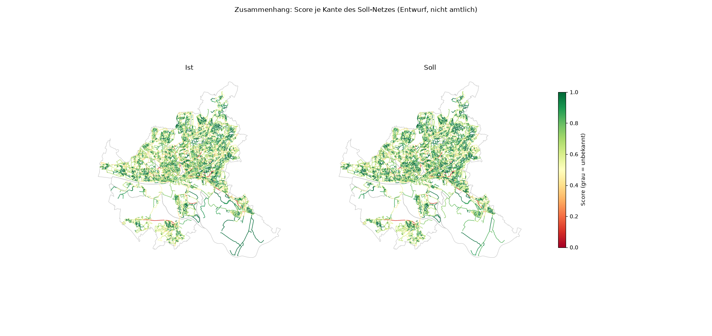
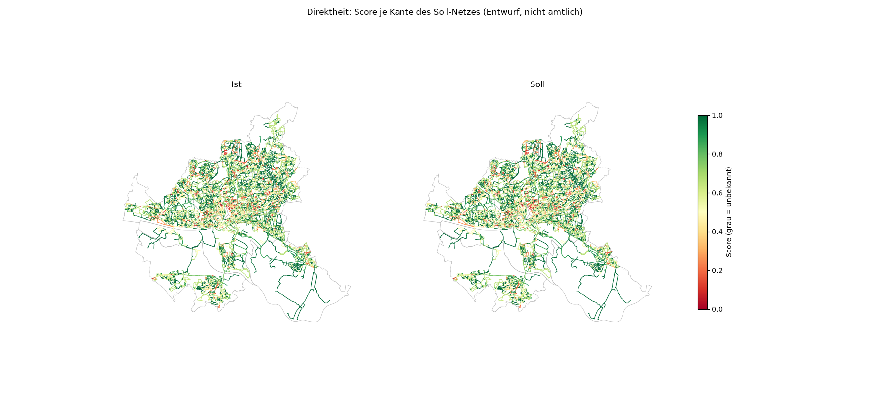
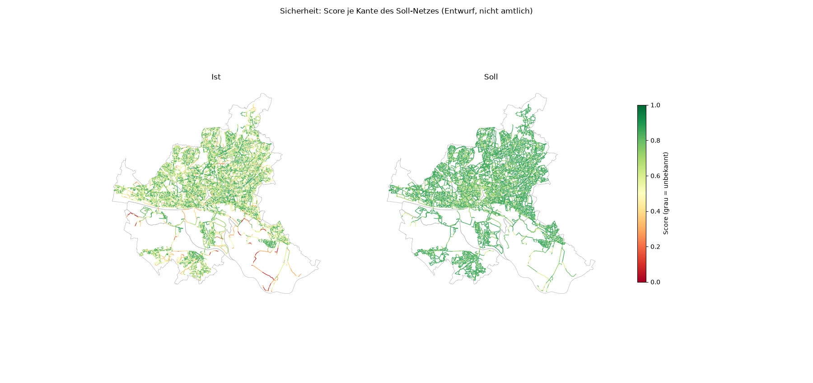
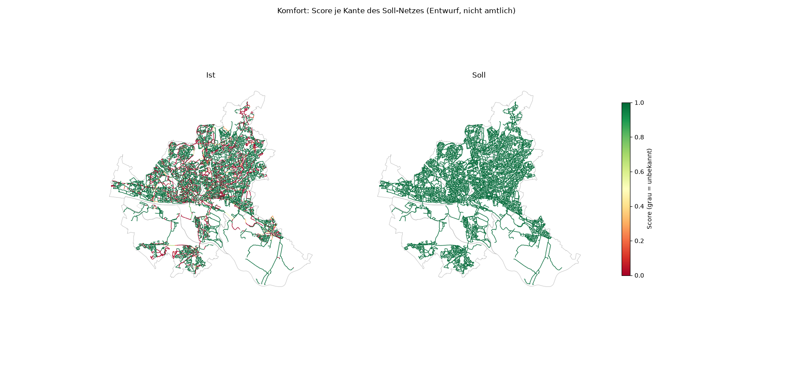
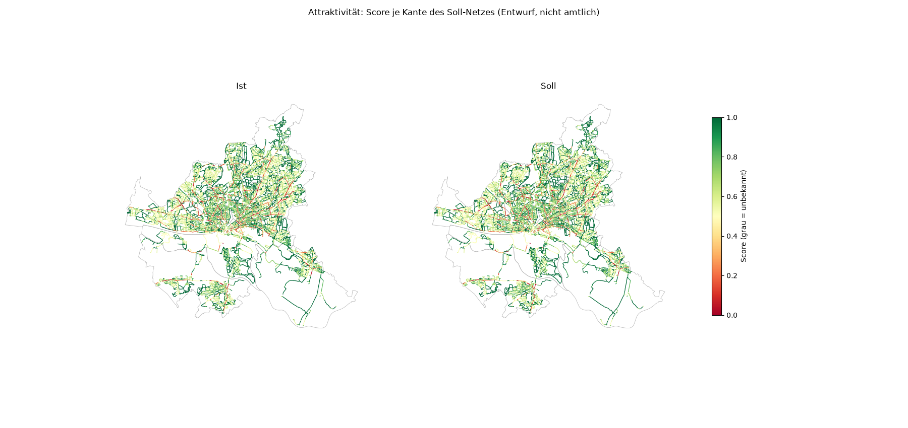
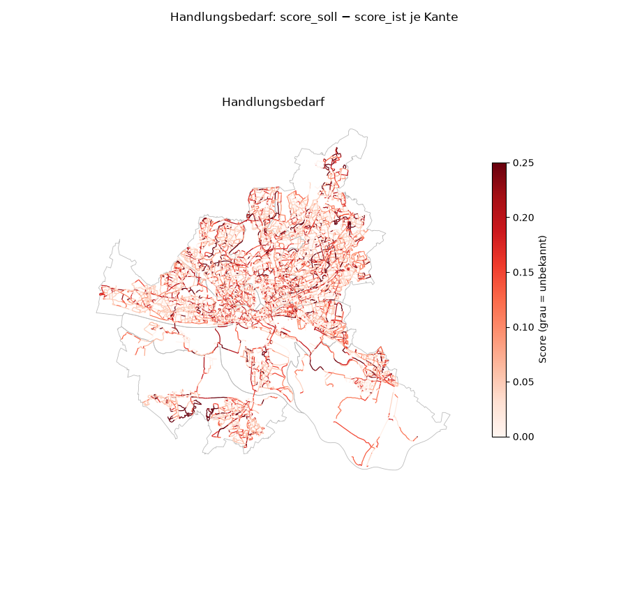

# Fünf Prinzipien: Bewertung des Soll-Radnetzes (Stufe c04)

Erzeugt 2026-11-07T12:08:52+00:00 mit pipeline/c04_principles.py · cycling_rules.yaml 0.6.0 · nicht amtlicher Entwurf. Alle Bewertungsregeln (C-PRI-01…16) und die Gewichte sind Annahmen (source_type assumption, status draft) und vor fachlicher Nutzung zu prüfen.

**score_ist** bewertet den heutigen Zustand der Soll-Route, **score_soll** den Zustand nach regelkonformem Ausbau (Führung nach Trennungsmatrix, Sollbreite, geschlossene Decke, Beleuchtung). Die Differenz ist der Handlungsbedarf. Fehlende Daten senken die confidence, nicht den Score.

## Kurzfassung

- RSV: 84 km, Score Ist 0.56 → Soll 0.68
- HAUPT: 1 862 km, Score Ist 0.67 → Soll 0.77
- BASIS: 1 041 km, Score Ist 0.79 → Soll 0.83
- Führung entspricht heute der Trennungsmatrix auf 49 % der Netzlänge mit bekannter Führung (RSV/HAUPT: 27 %).
- 5051 Routen bewertet; mittlerer Handlungsbedarf (score_soll − score_ist) 0.06, confidence: high 1904, medium 3147, low 0.
- Nicht bewertbar mangels Daten: P-SAF-02 (Knotentypen erst mit Prompt 20 (pipeline/c07_junctions.py)), P-COM-03 (kein Höhenmodell geladen (sources.yaml laserscan ohne Abruf)), P-ATT-02 (keine Lärmkarte (sources.yaml noise_maps ohne Endpunkt, Entscheidung 2026-11-06)).

## Datenlage je Prüfung

Anteil der Länge des Soll-Netzes (RSV, HAUPT, BASIS) mit Wert, unter den Kanten, für die die Prüfung anwendbar ist.

| Prüfung | Prinzip | Datengrundlage | anwendbar (km) | mit Wert |
| --- | --- | --- | ---: | ---: |
| P-COH-01 | Zusammenhang | c03 Maschen | 2 986 | 100 % |
| P-COH-02 | Zusammenhang | Soll-Netz | 2 984 | 100 % |
| P-COH-04 | Zusammenhang | Ist-Führung entlang der Route | 2 984 | 100 % |
| P-DIR-01 | Direktheit | Radgraph (Länge) | 2 984 | 99 % |
| P-DIR-02 | Direktheit | OSM-LSA, Vorfahrt C-GRAPH-05 | 2 984 | 100 % |
| P-DIR-03 | Direktheit | wie P-DIR-02 | 1 945 | 100 % |
| P-SAF-01 | Sicherheit | Ist-Führung (C-PRI-02), Trennungsmatrix | 2 921 | 100 % |
| P-SAF-02 | Sicherheit | – | 2 986 | 0 % |
| P-SAF-03 | Sicherheit | OSM lit | 2 986 | 85 % |
| P-SAF-04 | Sicherheit | Unfallatlas | 2 986 | 100 % |
| P-COM-01 | Komfort | OSM width/cycleway:width | 1 289 | 11 % |
| P-COM-02 | Komfort | OSM surface | 2 986 | 96 % |
| P-COM-03 | Komfort | – | 2 986 | 0 % |
| P-ATT-01 | Attraktivität | ALKIS, OSM-Bäume | 2 986 | 100 % |
| P-ATT-02 | Attraktivität | – | 2 986 | 0 % |
| P-ATT-03 | Attraktivität | DTV 2019 (HVS) | 2 986 | 100 % |

## Netzkennzahlen je Kategorie

Längengewichtete Mittel über die Kanten der Kategorie (Kantenwerte für Direktheit und Zusammenhang aus der Hauptroute der Kante).

| Kategorie | km | Zusammenhang Ist / Soll | Direktheit Ist / Soll | Sicherheit Ist / Soll | Komfort Ist / Soll | Attraktivität Ist / Soll | Gesamt Ist / Soll |
| --- | ---: | ---: | ---: | ---: | ---: | ---: | ---: |
| RSV | 84 | 0.33 / 0.34 | 0.64 / 0.64 | 0.69 / 0.80 | 0.45 / 1.00 | 0.63 / 0.63 | 0.56 / 0.68 |
| HAUPT | 1 862 | 0.69 / 0.71 | 0.66 / 0.66 | 0.64 / 0.82 | 0.69 / 1.00 | 0.70 / 0.70 | 0.67 / 0.77 |
| BASIS | 1 041 | 0.79 / 0.80 | 0.81 / 0.81 | 0.75 / 0.82 | 0.86 / 1.00 | 0.71 / 0.71 | 0.79 / 0.83 |

## Zusammenhang (P-COH)

**P-COH-01 Maschenweite** (aus c03, cycle_mesh_gaps.parquet):

| Ebene | Höchstweite | zu große Maschen | Seite Median | Seite max |
| --- | ---: | ---: | ---: | ---: |
| HAUPT | 600 m | 34 | 979 m | 4 103 m |
| BASIS | 300 m | 410 | 413 m | 4 073 m |

**P-COH-02 Komponenten** (je Ebene mit höheren Ebenen):

| Ebene | Komponenten | Anteil größte Komponente (Länge) |
| --- | ---: | ---: |
| RSV | 6 | 30 % |
| HAUPT | 1 | 100 % |
| BASIS | 1 | 100 % |

**P-COH-03 Abdeckung** (Ziele höchstens 300 m vom RSV/HAUPT-Netz; Zentren fehlen, kein Datensatz):

| Ziele | Anzahl | abgedeckt |
| --- | ---: | ---: |
| Schulen (OSM) | 557 | 96 % |
| Schnellbahnhalte | 375 | 99 % |
| Hochschulen (OSM university) | 41 | 100 % |

**P-COH-04 Kontinuität:** Wechsel der Ist-Führung je km (Median über Routen) 1.10, Soll (Führung und Kategorie) 0.00; Schwelle 1.0 je km (C-PRI-12).

## Direktheit (P-DIR)

**P-DIR-01 Umwegfaktor, Netzstichprobe** (C-PRI-04): je Kategorie 200 OD-Paare, Seed 42, Knoten der größten Komponente der Ebene (mit höheren Ebenen), Luftlinie im Band trip_length_km. Netzweg auf der Ebene gegen kürzesten Weg auf allen befahrbaren Kanten (Länge).

| Kategorie | Band (km) | Paare | ohne Weg | Median | 90-%-Wert | Schwelle | Anteil ≤ Schwelle |
| --- | --- | ---: | ---: | ---: | ---: | ---: | ---: |
| RSV | 5–15 | 200 | 0 | 1.16 | 1.44 | 1.1 | 26 % |
| HAUPT | 2–3 | 200 | 0 | 1.15 | 2.69 | 1.2 | 57 % |
| BASIS | 1–2 | 200 | 0 | 1.05 | 2.05 | 1.3 | 80 % |

**Je Route** (Median über Routen der Kategorie; Halte nach C-PRI-05, Soll = Ist bis Prompt 20):

| Kategorie | Routen | Umwegfaktor | Halte/km | Schwelle Halte | Zeitverlust s/km | Schwelle s/km |
| --- | ---: | ---: | ---: | ---: | ---: | ---: |
| RSV | 23 | 1.11 | 1.6 | 0.5 | 20 | 30 |
| HAUPT | 2114 | 1.11 | 1.0 | 1.0 | 10 | 30 |
| BASIS | 2914 | 1.00 | 0.0 | 2.0 | 0 | – |

## Sicherheit (P-SAF)

**P-SAF-01 Ist-Führung gegen Soll-Führung** (km, Kanten RSV/HAUPT/BASIS):

| Ist \ Soll | Radfahrstreifen | Fahrradstraße | Mischverkehr | eigener Weg | Radweg je Seite | unbekannt |
| --- | ---: | ---: | ---: | ---: | ---: | ---: |
| Radfahrstreifen | 17 | 27 | 17 | 0 | 22 | 0 |
| Fahrradstraße | 0 | 18 | 2 | 0 | 0 | 0 |
| Mischverkehr | 17 | 977 | 603 | 0 | 45 | 48 |
| eigener Weg | 0 | 0 | 0 | 420 | 0 | 0 |
| Radweg je Seite | 56 | 101 | 43 | 0 | 225 | 7 |
| Zweirichtungsradweg | 21 | 104 | 53 | 13 | 139 | 4 |
| unbekannt | 0 | 0 | 0 | 0 | 0 | 5 |

P-SAF-03 Beleuchtung: OSM lit auf 85 % der Netzlänge bekannt; davon beleuchtet 90 %. P-SAF-04 Unfälle mit Radbeteiligung 2021–2025: 7 657 Unfälle an Kanten des Soll-Netzes (je Kante höchstens 15 m entfernt; nur Summen gespeichert).

## Komfort und Attraktivität (P-COM, P-ATT)

- P-COM-01 Breite: anwendbar auf 1 289 km (ohne Mischverkehr), Breite in OSM auf 11 % davon; von diesen erreichen 19 % die Sollbreite.
- P-COM-02 Belag: bekannt auf 96 %; RSV/HAUPT mit geschlossener Decke 67 %.
- P-ATT-01 Grünanteil im 20-m-Puffer: Median 13 % (Ziel 30 %, ALKIS-Grünflächen und OSM-Bäume).
- P-ATT-03: 333 km des Soll-Netzes liegen an Straßen mit DTV > 15 000.

## Top 30 Routen mit dem größten Handlungsbedarf

Rangfolge nach Handlungsbedarf-km = (score_soll − score_ist) × Länge in km (C-PRI-14), damit lange Routen mit mittlerem Defizit vor sehr kurzen Verdichtungsstücken stehen. S/K: Sicherheit und Komfort Ist → Soll.

| # | Route | Kategorie | km | Ist | Soll | Δ | Δ × km | S | K | confidence | Prüfen |
| ---: | --- | --- | ---: | ---: | ---: | ---: | ---: | --- | --- | --- | --- |
| 1 | Innenstadt (Rathausmarkt) – Umsteigeknoten Neugraben (`rt_ef74f810d825e8b0`) | RSV | 23.8 | 0.58 | 0.71 | 0.13 | 3.17 | 0.66 → 0.78 | 0.37 → 1.00 | medium | [Luftbild](https://geoportal-hamburg.de/?MAP/PROJECTION=EPSG:25832&MAP/CENTER=[563960,5924903]&MAP/ZOOMLEVEL=10&MAP/LAYERIDS=19968) · [Panoramax](https://api.panoramax.xyz/#focus=map&map=18/53.469229/9.963550) · [OSM](https://www.openstreetmap.org/?mlat=53.469229&mlon=9.963550#map=18/53.469229/9.963550) |
| 2 | Innenstadt (Rathausmarkt) – Arbeitsplatzschwerpunkt Harburg (300 Tsd. m²) (`rt_ad15aafddcc3fd36`) | RSV | 20.3 | 0.57 | 0.71 | 0.13 | 2.74 | 0.65 → 0.77 | 0.35 → 1.00 | medium | [Luftbild](https://geoportal-hamburg.de/?MAP/PROJECTION=EPSG:25832&MAP/CENTER=[565304,5924573]&MAP/ZOOMLEVEL=10&MAP/LAYERIDS=19968) · [Panoramax](https://api.panoramax.xyz/#focus=map&map=18/53.466099/9.983721) · [OSM](https://www.openstreetmap.org/?mlat=53.466099&mlon=9.983721#map=18/53.466099/9.983721) |
| 3 | Umsteigeknoten Neugraben – Arbeitsplatzschwerpunkt Hamburg-Mitte (379 Tsd. m²) (`rt_1eb91943b8b566de`) | HAUPT | 16.2 | 0.73 | 0.87 | 0.15 | 2.40 | 0.59 → 0.83 | 0.58 → 1.00 | medium | [Luftbild](https://geoportal-hamburg.de/?MAP/PROJECTION=EPSG:25832&MAP/CENTER=[560451,5929363]&MAP/ZOOMLEVEL=10&MAP/LAYERIDS=19968) · [Panoramax](https://api.panoramax.xyz/#focus=map&map=18/53.509731/9.911550) · [OSM](https://www.openstreetmap.org/?mlat=53.509731&mlon=9.911550#map=18/53.509731/9.911550) |
| 4 | Umsteigeknoten Neugraben – Hochschule Technologiezentrum Hamburg-Finkenwerder (`rt_f0fa3169346904cf`) | HAUPT | 15.3 | 0.73 | 0.87 | 0.15 | 2.22 | 0.59 → 0.83 | 0.58 → 1.00 | medium | [Luftbild](https://geoportal-hamburg.de/?MAP/PROJECTION=EPSG:25832&MAP/CENTER=[560443,5928891]&MAP/ZOOMLEVEL=10&MAP/LAYERIDS=19968) · [Panoramax](https://api.panoramax.xyz/#focus=map&map=18/53.505490/9.911337) · [OSM](https://www.openstreetmap.org/?mlat=53.505490&mlon=9.911337#map=18/53.505490/9.911337) |
| 5 | Verdichtung HAUPT: neben Stein-Hardenberg-Straße (`rt_f2a1927097f3667f`) | HAUPT | 13.6 | 0.55 | 0.69 | 0.13 | 1.84 | 0.78 → 0.83 | 0.28 → 1.00 | medium | [Luftbild](https://geoportal-hamburg.de/?MAP/PROJECTION=EPSG:25832&MAP/CENTER=[576935,5942309]&MAP/ZOOMLEVEL=10&MAP/LAYERIDS=19968) · [Panoramax](https://api.panoramax.xyz/#focus=map&map=18/53.623921/10.163255) · [OSM](https://www.openstreetmap.org/?mlat=53.623921&mlon=10.163255#map=18/53.623921/10.163255) |
| 6 | Arbeitsplatzschwerpunkt Hamburg-Mitte (263 Tsd. m²) – Arbeitsplatzschwerpunkt Bergedorf (224 Tsd. m²) (`rt_0bf6efc364e62515`) | HAUPT | 14.9 | 0.74 | 0.86 | 0.12 | 1.79 | 0.57 → 0.78 | 0.67 → 1.00 | medium | [Luftbild](https://geoportal-hamburg.de/?MAP/PROJECTION=EPSG:25832&MAP/CENTER=[569158,5931755]&MAP/ZOOMLEVEL=10&MAP/LAYERIDS=19968) · [Panoramax](https://api.panoramax.xyz/#focus=map&map=18/53.530157/10.043348) · [OSM](https://www.openstreetmap.org/?mlat=53.530157&mlon=10.043348#map=18/53.530157/10.043348) |
| 7 | Innenstadt (Rathausmarkt) – Hochschule HAW Hamburg Energie Campus (`rt_9dab92d8a75510aa`) | RSV | 20.9 | 0.63 | 0.72 | 0.08 | 1.75 | 0.64 → 0.74 | 0.66 → 1.00 | medium | [Luftbild](https://geoportal-hamburg.de/?MAP/PROJECTION=EPSG:25832&MAP/CENTER=[573763,5932232]&MAP/ZOOMLEVEL=10&MAP/LAYERIDS=19968) · [Panoramax](https://api.panoramax.xyz/#focus=map&map=18/53.533816/10.112927) · [OSM](https://www.openstreetmap.org/?mlat=53.533816&mlon=10.112927#map=18/53.533816/10.112927) |
| 8 | Innenstadt (Rathausmarkt) – Hochschule Gebäude D (`rt_b3e5311382ffdee5`) | RSV | 15.3 | 0.61 | 0.72 | 0.11 | 1.74 | 0.68 → 0.77 | 0.42 → 1.00 | medium | [Luftbild](https://geoportal-hamburg.de/?MAP/PROJECTION=EPSG:25832&MAP/CENTER=[565862,5926294]&MAP/ZOOMLEVEL=10&MAP/LAYERIDS=19968) · [Panoramax](https://api.panoramax.xyz/#focus=map&map=18/53.481498/9.992496) · [OSM](https://www.openstreetmap.org/?mlat=53.481498&mlon=9.992496#map=18/53.481498/9.992496) |
| 9 | Arbeitsplatzschwerpunkt Bergedorf (549 Tsd. m²) – Arbeitsplatzschwerpunkt Hamburg-Mitte (263 Tsd. m²) (`rt_c9d2a1f475c68304`) | HAUPT | 14.4 | 0.74 | 0.85 | 0.12 | 1.72 | 0.57 → 0.78 | 0.67 → 1.00 | medium | [Luftbild](https://geoportal-hamburg.de/?MAP/PROJECTION=EPSG:25832&MAP/CENTER=[569012,5931948]&MAP/ZOOMLEVEL=10&MAP/LAYERIDS=19968) · [Panoramax](https://api.panoramax.xyz/#focus=map&map=18/53.531906/10.041192) · [OSM](https://www.openstreetmap.org/?mlat=53.531906&mlon=10.041192#map=18/53.531906/10.041192) |
| 10 | Innenstadt (Rathausmarkt) – Arbeitsplatzschwerpunkt Hamburg-Mitte (231 Tsd. m²) (`rt_b34e65e7db0ca27f`) | HAUPT | 12.9 | 0.70 | 0.83 | 0.13 | 1.68 | 0.56 → 0.76 | 0.58 → 1.00 | medium | [Luftbild](https://geoportal-hamburg.de/?MAP/PROJECTION=EPSG:25832&MAP/CENTER=[564307,5933529]&MAP/ZOOMLEVEL=10&MAP/LAYERIDS=19968) · [Panoramax](https://api.panoramax.xyz/#focus=map&map=18/53.546711/9.970552) · [OSM](https://www.openstreetmap.org/?mlat=53.546711&mlon=9.970552#map=18/53.546711/9.970552) |
| 11 | Innenstadt (Rathausmarkt) – Umsteigeknoten Hamburg-Harburg (`rt_c54fa6f4435a9343`) | RSV | 14.6 | 0.61 | 0.72 | 0.10 | 1.51 | 0.68 → 0.76 | 0.47 → 1.00 | medium | [Luftbild](https://geoportal-hamburg.de/?MAP/PROJECTION=EPSG:25832&MAP/CENTER=[565874,5930076]&MAP/ZOOMLEVEL=10&MAP/LAYERIDS=19968) · [Panoramax](https://api.panoramax.xyz/#focus=map&map=18/53.515492/9.993469) · [OSM](https://www.openstreetmap.org/?mlat=53.515492&mlon=9.993469#map=18/53.515492/9.993469) |
| 12 | Verdichtung HAUPT: Tarpenbek-Kollau-Wanderweg (`rt_3abb134b0ccd0024`) | HAUPT | 10.0 | 0.59 | 0.74 | 0.15 | 1.46 | 0.69 → 0.80 | 0.37 → 1.00 | medium | [Luftbild](https://geoportal-hamburg.de/?MAP/PROJECTION=EPSG:25832&MAP/CENTER=[561619,5941769]&MAP/ZOOMLEVEL=10&MAP/LAYERIDS=19968) · [Panoramax](https://api.panoramax.xyz/#focus=map&map=18/53.621098/9.931609) · [OSM](https://www.openstreetmap.org/?mlat=53.621098&mlon=9.931609#map=18/53.621098/9.931609) |
| 13 | Innenstadt (Rathausmarkt) – Arbeitsplatzschwerpunkt Bergedorf (224 Tsd. m²) (`rt_374f83d55ac09da7`) | HAUPT | 12.5 | 0.70 | 0.81 | 0.12 | 1.45 | 0.55 → 0.76 | 0.64 → 1.00 | medium | [Luftbild](https://geoportal-hamburg.de/?MAP/PROJECTION=EPSG:25832&MAP/CENTER=[570263,5931665]&MAP/ZOOMLEVEL=10&MAP/LAYERIDS=19968) · [Panoramax](https://api.panoramax.xyz/#focus=map&map=18/53.529197/10.059998) · [OSM](https://www.openstreetmap.org/?mlat=53.529197&mlon=10.059998#map=18/53.529197/10.059998) |
| 14 | Innenstadt (Rathausmarkt) – Arbeitsplatzschwerpunkt Harburg (241 Tsd. m²) (`rt_2a3981f4e8e27282`) | RSV | 13.9 | 0.62 | 0.73 | 0.10 | 1.44 | 0.69 → 0.77 | 0.47 → 1.00 | medium | [Luftbild](https://geoportal-hamburg.de/?MAP/PROJECTION=EPSG:25832&MAP/CENTER=[565713,5926950]&MAP/ZOOMLEVEL=10&MAP/LAYERIDS=19968) · [Panoramax](https://api.panoramax.xyz/#focus=map&map=18/53.487410/9.990387) · [OSM](https://www.openstreetmap.org/?mlat=53.487410&mlon=9.990387#map=18/53.487410/9.990387) |
| 15 | Umsteigeknoten Altona – Arbeitsplatzschwerpunkt Hamburg-Mitte (231 Tsd. m²) (`rt_bd033e96360c6110`) | HAUPT | 11.5 | 0.67 | 0.79 | 0.12 | 1.39 | 0.53 → 0.75 | 0.71 → 1.00 | medium | [Luftbild](https://geoportal-hamburg.de/?MAP/PROJECTION=EPSG:25832&MAP/CENTER=[561367,5934211]&MAP/ZOOMLEVEL=10&MAP/LAYERIDS=19968) · [Panoramax](https://api.panoramax.xyz/#focus=map&map=18/53.553196/9.926314) · [OSM](https://www.openstreetmap.org/?mlat=53.553196&mlon=9.926314#map=18/53.553196/9.926314) |
| 16 | Innenstadt (Rathausmarkt) – Umsteigeknoten Bergedorf (`rt_905b5b331dc096e5`) | RSV | 18.9 | 0.64 | 0.71 | 0.07 | 1.37 | 0.63 → 0.73 | 0.74 → 1.00 | medium | [Luftbild](https://geoportal-hamburg.de/?MAP/PROJECTION=EPSG:25832&MAP/CENTER=[573679,5933060]&MAP/ZOOMLEVEL=10&MAP/LAYERIDS=19968) · [Panoramax](https://api.panoramax.xyz/#focus=map&map=18/53.541266/10.111849) · [OSM](https://www.openstreetmap.org/?mlat=53.541266&mlon=10.111849#map=18/53.541266/10.111849) |
| 17 | Innenstadt (Rathausmarkt) – Arbeitsplatzschwerpunkt Bergedorf (549 Tsd. m²) (`rt_be5550ff43b6bffd`) | HAUPT | 12.0 | 0.69 | 0.81 | 0.11 | 1.37 | 0.55 → 0.75 | 0.65 → 1.00 | medium | [Luftbild](https://geoportal-hamburg.de/?MAP/PROJECTION=EPSG:25832&MAP/CENTER=[570037,5931767]&MAP/ZOOMLEVEL=10&MAP/LAYERIDS=19968) · [Panoramax](https://api.panoramax.xyz/#focus=map&map=18/53.530146/10.056618) · [OSM](https://www.openstreetmap.org/?mlat=53.530146&mlon=10.056618#map=18/53.530146/10.056618) |
| 18 | Umsteigeknoten Neugraben – Arbeitsplatzschwerpunkt Hamburg-Mitte (231 Tsd. m²) (`rt_1f65359785a52cea`) | HAUPT | 10.2 | 0.73 | 0.86 | 0.13 | 1.36 | 0.62 → 0.82 | 0.58 → 1.00 | medium | [Luftbild](https://geoportal-hamburg.de/?MAP/PROJECTION=EPSG:25832&MAP/CENTER=[559820,5926567]&MAP/ZOOMLEVEL=10&MAP/LAYERIDS=19968) · [Panoramax](https://api.panoramax.xyz/#focus=map&map=18/53.484673/9.901500) · [OSM](https://www.openstreetmap.org/?mlat=53.484673&mlon=9.901500#map=18/53.484673/9.901500) |
| 19 | Innenstadt (Rathausmarkt) – Arbeitsplatzschwerpunkt Hamburg-Nord (307 Tsd. m²) (`rt_d03f7415e12263b1`) | HAUPT | 12.9 | 0.67 | 0.78 | 0.10 | 1.34 | 0.62 → 0.72 | 0.55 → 1.00 | high | [Luftbild](https://geoportal-hamburg.de/?MAP/PROJECTION=EPSG:25832&MAP/CENTER=[568341,5938658]&MAP/ZOOMLEVEL=10&MAP/LAYERIDS=19968) · [Panoramax](https://api.panoramax.xyz/#focus=map&map=18/53.592300/10.032541) · [OSM](https://www.openstreetmap.org/?mlat=53.592300&mlon=10.032541#map=18/53.592300/10.032541) |
| 20 | Arbeitsplatzschwerpunkt Hamburg-Mitte (278 Tsd. m²) – Arbeitsplatzschwerpunkt Bergedorf (224 Tsd. m²) (`rt_5be88c5238ed113e`) | HAUPT | 7.1 | 0.66 | 0.84 | 0.19 | 1.34 | 0.45 → 0.81 | 0.50 → 1.00 | medium | [Luftbild](https://geoportal-hamburg.de/?MAP/PROJECTION=EPSG:25832&MAP/CENTER=[572709,5930397]&MAP/ZOOMLEVEL=10&MAP/LAYERIDS=19968) · [Panoramax](https://api.panoramax.xyz/#focus=map&map=18/53.517468/10.096597) · [OSM](https://www.openstreetmap.org/?mlat=53.517468&mlon=10.096597#map=18/53.517468/10.096597) |
| 21 | Anbindung Schule/Nahversorgung: Vierländer Eisenbahndamm (`rt_e97c97c7cb138219`) | BASIS | 12.8 | 0.84 | 0.95 | 0.10 | 1.32 | 0.57 → 0.83 | 0.83 → 1.00 | medium | [Luftbild](https://geoportal-hamburg.de/?MAP/PROJECTION=EPSG:25832&MAP/CENTER=[579906,5920392]&MAP/ZOOMLEVEL=10&MAP/LAYERIDS=19968) · [Panoramax](https://api.panoramax.xyz/#focus=map&map=18/53.426511/10.202569) · [OSM](https://www.openstreetmap.org/?mlat=53.426511&mlon=10.202569#map=18/53.426511/10.202569) |
| 22 | Innenstadt (Rathausmarkt) – Arbeitsplatzschwerpunkt Hamburg-Mitte (379 Tsd. m²) (`rt_2017ccd29d0c27dc`) | HAUPT | 13.6 | 0.61 | 0.70 | 0.09 | 1.25 | 0.57 → 0.71 | 0.72 → 1.00 | medium | [Luftbild](https://geoportal-hamburg.de/?MAP/PROJECTION=EPSG:25832&MAP/CENTER=[559900,5934158]&MAP/ZOOMLEVEL=10&MAP/LAYERIDS=19968) · [Panoramax](https://api.panoramax.xyz/#focus=map&map=18/53.552888/9.904158) · [OSM](https://www.openstreetmap.org/?mlat=53.552888&mlon=9.904158#map=18/53.552888/9.904158) |
| 23 | Arbeitsplatzschwerpunkt Bergedorf (549 Tsd. m²) – Arbeitsplatzschwerpunkt Hamburg-Mitte (278 Tsd. m²) (`rt_e3d331b9b5cc9556`) | HAUPT | 6.6 | 0.65 | 0.84 | 0.19 | 1.23 | 0.45 → 0.81 | 0.52 → 1.00 | medium | [Luftbild](https://geoportal-hamburg.de/?MAP/PROJECTION=EPSG:25832&MAP/CENTER=[572886,5930550]&MAP/ZOOMLEVEL=10&MAP/LAYERIDS=19968) · [Panoramax](https://api.panoramax.xyz/#focus=map&map=18/53.518820/10.099305) · [OSM](https://www.openstreetmap.org/?mlat=53.518820&mlon=10.099305#map=18/53.518820/10.099305) |
| 24 | Innenstadt (Rathausmarkt) – Umsteigeknoten Ohlsdorf (`rt_afcaa8af59ac04b9`) | HAUPT | 10.4 | 0.66 | 0.78 | 0.11 | 1.18 | 0.58 → 0.71 | 0.56 → 1.00 | high | [Luftbild](https://geoportal-hamburg.de/?MAP/PROJECTION=EPSG:25832&MAP/CENTER=[568366,5937428]&MAP/ZOOMLEVEL=10&MAP/LAYERIDS=19968) · [Panoramax](https://api.panoramax.xyz/#focus=map&map=18/53.581244/10.032648) · [OSM](https://www.openstreetmap.org/?mlat=53.581244&mlon=10.032648#map=18/53.581244/10.032648) |
| 25 | Arbeitsplatzschwerpunkt Hamburg-Mitte (379 Tsd. m²) – Arbeitsplatzschwerpunkt Hamburg-Mitte (231 Tsd. m²) (`rt_92c799d039928f25`) | HAUPT | 6.9 | 0.72 | 0.89 | 0.17 | 1.15 | 0.55 → 0.83 | 0.63 → 1.00 | medium | [Luftbild](https://geoportal-hamburg.de/?MAP/PROJECTION=EPSG:25832&MAP/CENTER=[558087,5932014]&MAP/ZOOMLEVEL=10&MAP/LAYERIDS=19968) · [Panoramax](https://api.panoramax.xyz/#focus=map&map=18/53.533828/9.876405) · [OSM](https://www.openstreetmap.org/?mlat=53.533828&mlon=9.876405#map=18/53.533828/9.876405) |
| 26 | Umsteigeknoten Hamburg-Harburg – Arbeitsplatzschwerpunkt Harburg (300 Tsd. m²) (`rt_463b00cfca1d45be`) | RSV | 7.4 | 0.52 | 0.68 | 0.15 | 1.14 | 0.60 → 0.81 | 0.33 → 1.00 | high | [Luftbild](https://geoportal-hamburg.de/?MAP/PROJECTION=EPSG:25832&MAP/CENTER=[562896,5925065]&MAP/ZOOMLEVEL=10&MAP/LAYERIDS=19968) · [Panoramax](https://api.panoramax.xyz/#focus=map&map=18/53.470813/9.947549) · [OSM](https://www.openstreetmap.org/?mlat=53.470813&mlon=9.947549#map=18/53.470813/9.947549) |
| 27 | Arbeitsplatzschwerpunkt Harburg (300 Tsd. m²) – Arbeitsplatzschwerpunkt Harburg (241 Tsd. m²) (`rt_a3f51202ca48fa1c`) | RSV | 6.8 | 0.51 | 0.68 | 0.17 | 1.14 | 0.56 → 0.78 | 0.34 → 1.00 | high | [Luftbild](https://geoportal-hamburg.de/?MAP/PROJECTION=EPSG:25832&MAP/CENTER=[562608,5925087]&MAP/ZOOMLEVEL=10&MAP/LAYERIDS=19968) · [Panoramax](https://api.panoramax.xyz/#focus=map&map=18/53.471045/9.943226) · [OSM](https://www.openstreetmap.org/?mlat=53.471045&mlon=9.943226#map=18/53.471045/9.943226) |
| 28 | Innenstadt (Rathausmarkt) – Hochschule HAW - Life Sciences - Campus Bergedorf (`rt_d98d16d4f6df6b74`) | RSV | 18.2 | 0.64 | 0.70 | 0.06 | 1.12 | 0.64 → 0.73 | 0.79 → 1.00 | medium | [Luftbild](https://geoportal-hamburg.de/?MAP/PROJECTION=EPSG:25832&MAP/CENTER=[573373,5933222]&MAP/ZOOMLEVEL=10&MAP/LAYERIDS=19968) · [Panoramax](https://api.panoramax.xyz/#focus=map&map=18/53.542764/10.107268) · [OSM](https://www.openstreetmap.org/?mlat=53.542764&mlon=10.107268#map=18/53.542764/10.107268) |
| 29 | Verdichtung HAUPT: Little Whistler (`rt_08c9b542408be57e`) | HAUPT | 4.3 | 0.53 | 0.79 | 0.26 | 1.12 | 0.42 → 0.83 | 0.07 → 1.00 | high | [Luftbild](https://geoportal-hamburg.de/?MAP/PROJECTION=EPSG:25832&MAP/CENTER=[560773,5923351]&MAP/ZOOMLEVEL=10&MAP/LAYERIDS=19968) · [Panoramax](https://api.panoramax.xyz/#focus=map&map=18/53.455657/9.915248) · [OSM](https://www.openstreetmap.org/?mlat=53.455657&mlon=9.915248#map=18/53.455657/9.915248) |
| 30 | Innenstadt (Rathausmarkt) – Hochschule Technologiezentrum Hamburg-Finkenwerder (`rt_7148f8f41adf68a1`) | HAUPT | 12.7 | 0.60 | 0.69 | 0.09 | 1.12 | 0.57 → 0.71 | 0.72 → 1.00 | medium | [Luftbild](https://geoportal-hamburg.de/?MAP/PROJECTION=EPSG:25832&MAP/CENTER=[560265,5934311]&MAP/ZOOMLEVEL=10&MAP/LAYERIDS=19968) · [Panoramax](https://api.panoramax.xyz/#focus=map&map=18/53.554224/9.909697) · [OSM](https://www.openstreetmap.org/?mlat=53.554224&mlon=9.909697#map=18/53.554224/9.909697) |

Höchster Δ einer Route (ohne Längengewicht): 0.30; Routen mit Δ ≥ 0,2: 198.

## Karten je Prinzip

## Gewichts-Sensitivität (±20 %)

Jedes Gewicht einzeln um ±20% verändert, die übrigen anteilig umgelegt (C-PRI-14). Verglichen mit den Basisgewichten: Überschneidung der Top 30 nach Handlungsbedarf-km, Rangkorrelation (Spearman) aller Routen.

| Gewicht | Basis | Variante | Top-Überschneidung | Spearman |
| --- | ---: | ---: | ---: | ---: |
| Zusammenhang | 0.200 | 0.160 | 29/30 | 0.996 |
| Zusammenhang | 0.200 | 0.240 | 30/30 | 0.996 |
| Direktheit | 0.250 | 0.200 | 30/30 | 1.000 |
| Direktheit | 0.250 | 0.300 | 30/30 | 1.000 |
| Sicherheit | 0.300 | 0.240 | 29/30 | 0.994 |
| Sicherheit | 0.300 | 0.360 | 29/30 | 0.996 |
| Komfort | 0.150 | 0.120 | 30/30 | 0.998 |
| Komfort | 0.150 | 0.180 | 29/30 | 0.999 |
| Attraktivität | 0.100 | 0.080 | 30/30 | 1.000 |
| Attraktivität | 0.100 | 0.120 | 30/30 | 1.000 |

Kleinste Überschneidung: 29/30.

## Handlungsbedarf je Bezirk

| Bezirk | Netz-km | Score Ist | Score Soll | Δ |
| --- | ---: | ---: | ---: | ---: |
| Altona | 421 | 0.70 | 0.78 | 0.08 |
| Bergedorf | 203 | 0.73 | 0.82 | 0.09 |
| Eimsbüttel | 360 | 0.70 | 0.78 | 0.08 |
| Hamburg-Mitte | 485 | 0.72 | 0.80 | 0.08 |
| Hamburg-Nord | 422 | 0.70 | 0.78 | 0.09 |
| Harburg | 267 | 0.69 | 0.79 | 0.10 |
| Wandsbek | 828 | 0.71 | 0.80 | 0.08 |

## Stichprobe: 30 zufällige Kanten (Seed 42, nach Bezirk verteilt)

| Kante | Name | Kategorie | Führung Ist → Soll | Breite / Soll | Belag | lit | Score Ist / Soll | Prüfen |
| --- | --- | --- | --- | ---: | --- | --- | --- | --- |
| `ce_0ed3c31b96f777d3` | Eulenstraße | BASIS | Radfahrstreifen → Mischverkehr | – / 2.25 | asphalt | ja | 0.76 / 0.87 | [Luftbild](https://geoportal-hamburg.de/?MAP/PROJECTION=EPSG:25832&MAP/CENTER=[561321,5933945]&MAP/ZOOMLEVEL=10&MAP/LAYERIDS=19968) · [Panoramax](https://api.panoramax.xyz/#focus=map&map=18/53.550816/9.925561) · [OSM](https://www.openstreetmap.org/?mlat=53.550816&mlon=9.925561#map=18/53.550816/9.925561) |
| `ce_3b54be069f7c9827` | Regerstraße | BASIS | Mischverkehr → Mischverkehr | – / – | asphalt | ja | 0.71 / 0.71 | [Luftbild](https://geoportal-hamburg.de/?MAP/PROJECTION=EPSG:25832&MAP/CENTER=[560048,5935696]&MAP/ZOOMLEVEL=10&MAP/LAYERIDS=19968) · [Panoramax](https://api.panoramax.xyz/#focus=map&map=18/53.566695/9.906692) · [OSM](https://www.openstreetmap.org/?mlat=53.566695&mlon=9.906692#map=18/53.566695/9.906692) |
| `ce_7e7f4b2e04d82cfb` | Alexander-Zinn-Straße | HAUPT | Mischverkehr → Fahrradstraße | – / – | asphalt | ja | 0.76 / 0.80 | [Luftbild](https://geoportal-hamburg.de/?MAP/PROJECTION=EPSG:25832&MAP/CENTER=[558172,5934947]&MAP/ZOOMLEVEL=10&MAP/LAYERIDS=19968) · [Panoramax](https://api.panoramax.xyz/#focus=map&map=18/53.560176/9.878236) · [OSM](https://www.openstreetmap.org/?mlat=53.560176&mlon=9.878236#map=18/53.560176/9.878236) |
| `ce_8d40ea296b29cf47` | Kohlentwiete | HAUPT | Mischverkehr → Fahrradstraße | – / – | asphalt | ja | 0.82 / 0.87 | [Luftbild](https://geoportal-hamburg.de/?MAP/PROJECTION=EPSG:25832&MAP/CENTER=[561475,5935011]&MAP/ZOOMLEVEL=10&MAP/LAYERIDS=19968) · [Panoramax](https://api.panoramax.xyz/#focus=map&map=18/53.560375/9.928103) · [OSM](https://www.openstreetmap.org/?mlat=53.560375&mlon=9.928103#map=18/53.560375/9.928103) |
| `ce_285d165f60d8e485` | Vierländer Eisenbahndamm | BASIS | eigener Weg → eigener Weg | – / 3.00 | asphalt | – | 0.87 / 0.88 | [Luftbild](https://geoportal-hamburg.de/?MAP/PROJECTION=EPSG:25832&MAP/CENTER=[580792,5922104]&MAP/ZOOMLEVEL=10&MAP/LAYERIDS=19968) · [Panoramax](https://api.panoramax.xyz/#focus=map&map=18/53.441768/10.216346) · [OSM](https://www.openstreetmap.org/?mlat=53.441768&mlon=10.216346#map=18/53.441768/10.216346) |
| `ce_4090010ba7901907` | Hackmackbogen | BASIS | Mischverkehr → Mischverkehr | – / – | asphalt | ja | 0.90 / 0.90 | [Luftbild](https://geoportal-hamburg.de/?MAP/PROJECTION=EPSG:25832&MAP/CENTER=[578388,5925930]&MAP/ZOOMLEVEL=10&MAP/LAYERIDS=19968) · [Panoramax](https://api.panoramax.xyz/#focus=map&map=18/53.476514/10.181114) · [OSM](https://www.openstreetmap.org/?mlat=53.476514&mlon=10.181114#map=18/53.476514/10.181114) |
| `ce_19d0a5f5b988c0b8` | Zylberbergstraße | BASIS | Mischverkehr → Mischverkehr | – / – | paving_stones | ja | 0.85 / 0.85 | [Luftbild](https://geoportal-hamburg.de/?MAP/PROJECTION=EPSG:25832&MAP/CENTER=[560177,5944339]&MAP/ZOOMLEVEL=10&MAP/LAYERIDS=19968) · [Panoramax](https://api.panoramax.xyz/#focus=map&map=18/53.644357/9.910312) · [OSM](https://www.openstreetmap.org/?mlat=53.644357&mlon=9.910312#map=18/53.644357/9.910312) |
| `ce_b2694e737db61bd2` | Stellinger Chaussee | HAUPT | Mischverkehr → Fahrradstraße | – / – | asphalt | ja | 0.63 / 0.69 | [Luftbild](https://geoportal-hamburg.de/?MAP/PROJECTION=EPSG:25832&MAP/CENTER=[562660,5939496]&MAP/ZOOMLEVEL=10&MAP/LAYERIDS=19968) · [Panoramax](https://api.panoramax.xyz/#focus=map&map=18/53.600538/9.946889) · [OSM](https://www.openstreetmap.org/?mlat=53.600538&mlon=9.946889#map=18/53.600538/9.946889) |
| `ce_c42b9372b4464802` | Frohmestraße | HAUPT | Radfahrstreifen → Radweg je Seite | – / 2.50 | asphalt | ja | 0.57 / 0.63 | [Luftbild](https://geoportal-hamburg.de/?MAP/PROJECTION=EPSG:25832&MAP/CENTER=[561571,5942666]&MAP/ZOOMLEVEL=10&MAP/LAYERIDS=19968) · [Panoramax](https://api.panoramax.xyz/#focus=map&map=18/53.629164/9.931059) · [OSM](https://www.openstreetmap.org/?mlat=53.629164&mlon=9.931059#map=18/53.629164/9.931059) |
| `ce_c5a73f3db51dbc0b` | Bismarckstraße | BASIS | Mischverkehr → Mischverkehr | – / – | asphalt | ja | 0.87 / 0.93 | [Luftbild](https://geoportal-hamburg.de/?MAP/PROJECTION=EPSG:25832&MAP/CENTER=[564490,5937073]&MAP/ZOOMLEVEL=10&MAP/LAYERIDS=19968) · [Panoramax](https://api.panoramax.xyz/#focus=map&map=18/53.578545/9.974031) · [OSM](https://www.openstreetmap.org/?mlat=53.578545&mlon=9.974031#map=18/53.578545/9.974031) |
| `ce_0cef3785e5ce5bfa` | – | BASIS | eigener Weg → eigener Weg | – / 3.00 | paving_stones | ja | 0.68 / 0.68 | [Luftbild](https://geoportal-hamburg.de/?MAP/PROJECTION=EPSG:25832&MAP/CENTER=[568168,5934182]&MAP/ZOOMLEVEL=10&MAP/LAYERIDS=19968) · [Panoramax](https://api.panoramax.xyz/#focus=map&map=18/53.552094/10.028953) · [OSM](https://www.openstreetmap.org/?mlat=53.552094&mlon=10.028953#map=18/53.552094/10.028953) |
| `ce_236ed06a215809d5` | Legienstraße | HAUPT | Radweg je Seite → Fahrradstraße | – / 2.50 | asphalt | ja | 0.71 / 0.76 | [Luftbild](https://geoportal-hamburg.de/?MAP/PROJECTION=EPSG:25832&MAP/CENTER=[572931,5933997]&MAP/ZOOMLEVEL=10&MAP/LAYERIDS=19968) · [Panoramax](https://api.panoramax.xyz/#focus=map&map=18/53.549793/10.100793) · [OSM](https://www.openstreetmap.org/?mlat=53.549793&mlon=10.100793#map=18/53.549793/10.100793) |
| `ce_b102ede575ea87b7` | Neddermeyerstieg | HAUPT | Mischverkehr → Fahrradstraße | – / – | asphalt | – | 0.77 / 0.86 | [Luftbild](https://geoportal-hamburg.de/?MAP/PROJECTION=EPSG:25832&MAP/CENTER=[573985,5934521]&MAP/ZOOMLEVEL=10&MAP/LAYERIDS=19968) · [Panoramax](https://api.panoramax.xyz/#focus=map&map=18/53.554360/10.116808) · [OSM](https://www.openstreetmap.org/?mlat=53.554360&mlon=10.116808#map=18/53.554360/10.116808) |
| `ce_e4a2bfb31cd568f7` | Kuckuckshorn | HAUPT | Mischverkehr → Fahrradstraße | – / – | asphalt | ja | 0.90 / 0.95 | [Luftbild](https://geoportal-hamburg.de/?MAP/PROJECTION=EPSG:25832&MAP/CENTER=[565853,5927452]&MAP/ZOOMLEVEL=10&MAP/LAYERIDS=19968) · [Panoramax](https://api.panoramax.xyz/#focus=map&map=18/53.491904/9.992602) · [OSM](https://www.openstreetmap.org/?mlat=53.491904&mlon=9.992602#map=18/53.491904/9.992602) |
| `ce_f7d11cd0eb080a2f` | Aue-Hauptdeich | BASIS | Zweirichtungsradweg → Radfahrstreifen | – / 3.00 | asphalt | ja | 0.81 / 0.82 | [Luftbild](https://geoportal-hamburg.de/?MAP/PROJECTION=EPSG:25832&MAP/CENTER=[558790,5930793]&MAP/ZOOMLEVEL=10&MAP/LAYERIDS=19968) · [Panoramax](https://api.panoramax.xyz/#focus=map&map=18/53.522775/9.886778) · [OSM](https://www.openstreetmap.org/?mlat=53.522775&mlon=9.886778#map=18/53.522775/9.886778) |
| `ce_0b0b47063899b7fe` | Rübenkamp | HAUPT | Zweirichtungsradweg → Fahrradstraße | – / 3.50 | asphalt | ja | 0.78 / 0.89 | [Luftbild](https://geoportal-hamburg.de/?MAP/PROJECTION=EPSG:25832&MAP/CENTER=[568476,5939993]&MAP/ZOOMLEVEL=10&MAP/LAYERIDS=19968) · [Panoramax](https://api.panoramax.xyz/#focus=map&map=18/53.604284/10.034875) · [OSM](https://www.openstreetmap.org/?mlat=53.604284&mlon=10.034875#map=18/53.604284/10.034875) |
| `ce_250d5e0344ab21b8` | – | BASIS | eigener Weg → eigener Weg | – / 3.00 | nan | – | 0.81 / 0.86 | [Luftbild](https://geoportal-hamburg.de/?MAP/PROJECTION=EPSG:25832&MAP/CENTER=[564942,5940132]&MAP/ZOOMLEVEL=10&MAP/LAYERIDS=19968) · [Panoramax](https://api.panoramax.xyz/#focus=map&map=18/53.605984/9.981500) · [OSM](https://www.openstreetmap.org/?mlat=53.605984&mlon=9.981500#map=18/53.605984/9.981500) |
| `ce_5bc73c49514f48cc` | Paul-Stritter-Weg | BASIS | Mischverkehr → Mischverkehr | – / – | paving_stones | ja | 0.74 / 0.74 | [Luftbild](https://geoportal-hamburg.de/?MAP/PROJECTION=EPSG:25832&MAP/CENTER=[567820,5941005]&MAP/ZOOMLEVEL=10&MAP/LAYERIDS=19968) · [Panoramax](https://api.panoramax.xyz/#focus=map&map=18/53.613464/10.025182) · [OSM](https://www.openstreetmap.org/?mlat=53.613464&mlon=10.025182#map=18/53.613464/10.025182) |
| `ce_61c90f21ad3b2235` | Grovestraße | BASIS | Mischverkehr → Mischverkehr | – / – | sett | ja | 0.66 / 0.81 | [Luftbild](https://geoportal-hamburg.de/?MAP/PROJECTION=EPSG:25832&MAP/CENTER=[567719,5937375]&MAP/ZOOMLEVEL=10&MAP/LAYERIDS=19968) · [Panoramax](https://api.panoramax.xyz/#focus=map&map=18/53.580853/10.022870) · [OSM](https://www.openstreetmap.org/?mlat=53.580853&mlon=10.022870#map=18/53.580853/10.022870) |
| `ce_d358b1456cbc31ad` | Langenrehm | HAUPT | Mischverkehr → Fahrradstraße | – / – | asphalt | ja | 0.64 / 0.69 | [Luftbild](https://geoportal-hamburg.de/?MAP/PROJECTION=EPSG:25832&MAP/CENTER=[569167,5937242]&MAP/ZOOMLEVEL=10&MAP/LAYERIDS=19968) · [Panoramax](https://api.panoramax.xyz/#focus=map&map=18/53.579462/10.044710) · [OSM](https://www.openstreetmap.org/?mlat=53.579462&mlon=10.044710#map=18/53.579462/10.044710) |
| `ce_0e6f153529954d11` | Kapellenweg | HAUPT | Mischverkehr → Fahrradstraße | – / – | asphalt | ja | 0.76 / 0.82 | [Luftbild](https://geoportal-hamburg.de/?MAP/PROJECTION=EPSG:25832&MAP/CENTER=[565626,5921998]&MAP/ZOOMLEVEL=10&MAP/LAYERIDS=19968) · [Panoramax](https://api.panoramax.xyz/#focus=map&map=18/53.442919/9.988039) · [OSM](https://www.openstreetmap.org/?mlat=53.442919&mlon=9.988039#map=18/53.442919/9.988039) |
| `ce_5d832071e19d07a7` | Winsener Straße | HAUPT | Mischverkehr → Radweg je Seite | – / – | asphalt | ja | 0.60 / 0.70 | [Luftbild](https://geoportal-hamburg.de/?MAP/PROJECTION=EPSG:25832&MAP/CENTER=[565578,5922814]&MAP/ZOOMLEVEL=10&MAP/LAYERIDS=19968) · [Panoramax](https://api.panoramax.xyz/#focus=map&map=18/53.450263/9.987483) · [OSM](https://www.openstreetmap.org/?mlat=53.450263&mlon=9.987483#map=18/53.450263/9.987483) |
| `ce_ff76f2e4f5b6dc34` | Hastedtstraße | HAUPT | Mischverkehr → Fahrradstraße | – / – | asphalt | ja | 0.76 / 0.84 | [Luftbild](https://geoportal-hamburg.de/?MAP/PROJECTION=EPSG:25832&MAP/CENTER=[564620,5923466]&MAP/ZOOMLEVEL=10&MAP/LAYERIDS=19968) · [Panoramax](https://api.panoramax.xyz/#focus=map&map=18/53.456238/9.973197) · [OSM](https://www.openstreetmap.org/?mlat=53.456238&mlon=9.973197#map=18/53.456238/9.973197) |
| `ce_4038135ac485fa5a` | Tilsiter Straße | HAUPT | Radfahrstreifen → Fahrradstraße | – / 2.50 | asphalt | ja | 0.60 / 0.71 | [Luftbild](https://geoportal-hamburg.de/?MAP/PROJECTION=EPSG:25832&MAP/CENTER=[571451,5938400]&MAP/ZOOMLEVEL=10&MAP/LAYERIDS=19968) · [Panoramax](https://api.panoramax.xyz/#focus=map&map=18/53.589569/10.079460) · [OSM](https://www.openstreetmap.org/?mlat=53.589569&mlon=10.079460#map=18/53.589569/10.079460) |
| `ce_5091c3af01ac6170` | Lottbeker Weg | BASIS | Mischverkehr → Mischverkehr | – / – | asphalt | ja | 0.91 / 0.91 | [Luftbild](https://geoportal-hamburg.de/?MAP/PROJECTION=EPSG:25832&MAP/CENTER=[575423,5949868]&MAP/ZOOMLEVEL=10&MAP/LAYERIDS=19968) · [Panoramax](https://api.panoramax.xyz/#focus=map&map=18/53.692074/10.142241) · [OSM](https://www.openstreetmap.org/?mlat=53.692074&mlon=10.142241#map=18/53.692074/10.142241) |
| `ce_78142ad32708410b` | Poppenbütteler Berg | BASIS | Mischverkehr → Radfahrstreifen | – / – | asphalt | ja | 0.80 / 0.89 | [Luftbild](https://geoportal-hamburg.de/?MAP/PROJECTION=EPSG:25832&MAP/CENTER=[571223,5946904]&MAP/ZOOMLEVEL=10&MAP/LAYERIDS=19968) · [Panoramax](https://api.panoramax.xyz/#focus=map&map=18/53.666022/10.077959) · [OSM](https://www.openstreetmap.org/?mlat=53.666022&mlon=10.077959#map=18/53.666022/10.077959) |
| `ce_7f7453d4e2b4dd2a` | Rauchstraße | HAUPT | Mischverkehr → Fahrradstraße | – / – | asphalt | ja | 0.80 / 0.83 | [Luftbild](https://geoportal-hamburg.de/?MAP/PROJECTION=EPSG:25832&MAP/CENTER=[572079,5936315]&MAP/ZOOMLEVEL=10&MAP/LAYERIDS=19968) · [Panoramax](https://api.panoramax.xyz/#focus=map&map=18/53.570741/10.088464) · [OSM](https://www.openstreetmap.org/?mlat=53.570741&mlon=10.088464#map=18/53.570741/10.088464) |
| `ce_a78bdbfcf7e963ae` | Poppenbütteler Weg | BASIS | Zweirichtungsradweg → Radfahrstreifen | – / 3.00 | paving_stones | ja | 0.68 / 0.68 | [Luftbild](https://geoportal-hamburg.de/?MAP/PROJECTION=EPSG:25832&MAP/CENTER=[570653,5945257]&MAP/ZOOMLEVEL=10&MAP/LAYERIDS=19968) · [Panoramax](https://api.panoramax.xyz/#focus=map&map=18/53.651302/10.068960) · [OSM](https://www.openstreetmap.org/?mlat=53.651302&mlon=10.068960#map=18/53.651302/10.068960) |
| `ce_e6f199bb67819a55` | Stubbenweg | BASIS | Mischverkehr → Mischverkehr | – / – | asphalt | ja | 0.91 / 0.91 | [Luftbild](https://geoportal-hamburg.de/?MAP/PROJECTION=EPSG:25832&MAP/CENTER=[574660,5945512]&MAP/ZOOMLEVEL=10&MAP/LAYERIDS=19968) · [Panoramax](https://api.panoramax.xyz/#focus=map&map=18/53.653034/10.129628) · [OSM](https://www.openstreetmap.org/?mlat=53.653034&mlon=10.129628#map=18/53.653034/10.129628) |
| `ce_f853654124f5450a` | Bramfelder Dorfplatz | HAUPT | Radweg je Seite → Fahrradstraße | – / 2.50 | asphalt | ja | 0.61 / 0.63 | [Luftbild](https://geoportal-hamburg.de/?MAP/PROJECTION=EPSG:25832&MAP/CENTER=[571343,5941046]&MAP/ZOOMLEVEL=10&MAP/LAYERIDS=19968) · [Panoramax](https://api.panoramax.xyz/#focus=map&map=18/53.613364/10.078427) · [OSM](https://www.openstreetmap.org/?mlat=53.613364&mlon=10.078427#map=18/53.613364/10.078427) |

## Durchsicht mit Ortskundigen

20 Routen (nach Kategorie geschichtet, Seed 42, C-PRI-15) in `reports/cycle_principles_review.csv` mit Links und leeren Spalten für Einschätzung und Kommentar.

## Hinweise

- Soll-Führung je Kante vorläufig direkt aus der Trennungsmatrix (bevorzugte Führung); Prompt 18 legt Führung und Breite je Abschnitt fest, danach P-SAF-01/P-COM-01 (Soll) mit dessen Ergebnis rechnen.
- Halte und Zeitverlust (P-DIR-02/03) im Soll wie im Ist, bis Prompt 20 Soll-Knotentypen liefert; P-SAF-02 bis dahin unbekannt.
- Unfälle (P-SAF-04) bleiben im Soll unverändert (keine Wirkungsprognose).
- Nachfrage und Netz beruhen auf dem mäßig kalibrierten Modell aus Prompt 15 (reports/cycle_demand.md).

Quellen: OpenStreetMap-Beitragende (ODbL); ALKIS © Freie und Hansestadt Hamburg, LGV (dl-de/by-2.0); Unfallatlas © Statistische Ämter des Bundes und der Länder (dl-de/by-2.0); HVV-GTFS © Hamburger Verkehrsverbund GmbH (dl-de/by-2.0).
