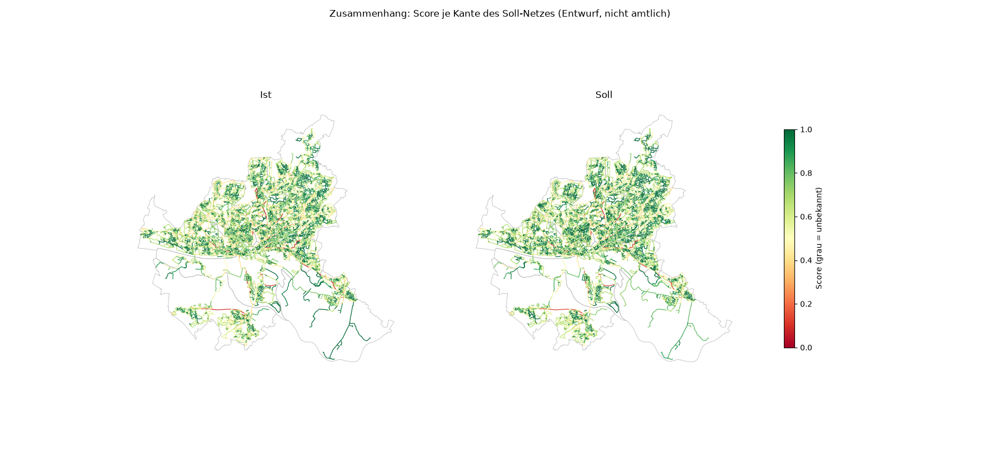
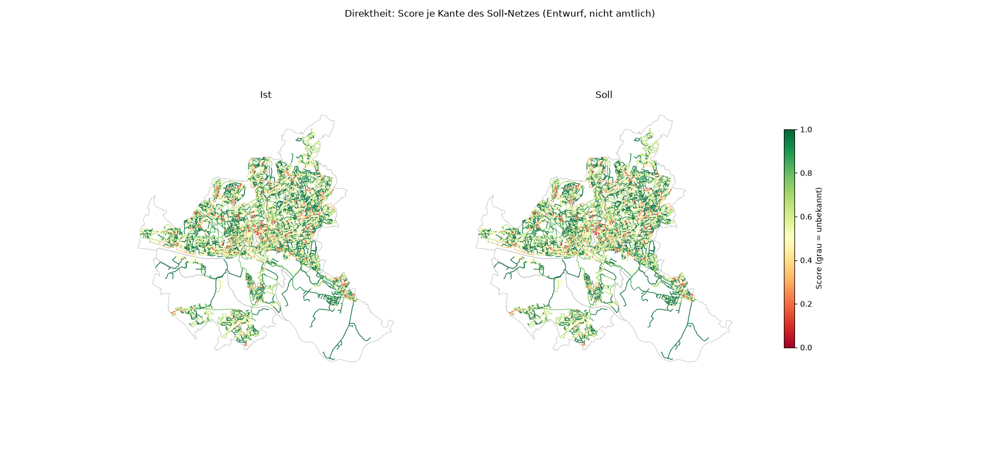

# Fünf Prinzipien: Bewertung des Soll-Radnetzes (Stufe c04)

Erzeugt 2026-11-16T22:46:25+00:00 mit pipeline/c04_principles.py · cycling_rules.yaml 0.13.0 · nicht amtlicher Entwurf. Alle Bewertungsregeln (C-PRI-01…16) und die Gewichte sind Annahmen (source_type assumption, status draft) und vor fachlicher Nutzung zu prüfen.

**score_ist** bewertet den heutigen Zustand der Soll-Route, **score_soll** den Zustand nach regelkonformem Ausbau (Führung nach Trennungsmatrix, Sollbreite, geschlossene Decke, Beleuchtung). Die Differenz ist der Handlungsbedarf. Fehlende Daten senken die confidence, nicht den Score.

## Kurzfassung

- RSV: 73 km, Score Ist 0.57 → Soll 0.69
- HAUPT: 1 810 km, Score Ist 0.67 → Soll 0.78
- BASIS: 1 050 km, Score Ist 0.79 → Soll 0.83
- Führung entspricht heute der Trennungsmatrix auf 49 % der Netzlänge mit bekannter Führung (RSV/HAUPT: 27 %).
- 4933 Routen bewertet; mittlerer Handlungsbedarf (score_soll − score_ist) 0.06, confidence: high 1824, medium 3109, low 0.
- Nicht bewertbar mangels Daten: P-SAF-02 (Knotentypen erst mit Prompt 20 (pipeline/c07_junctions.py)), P-COM-03 (kein Höhenmodell geladen (sources.yaml laserscan ohne Abruf)), P-ATT-02 (keine Lärmkarte (sources.yaml noise_maps ohne Endpunkt, Entscheidung 2026-11-06)).

## Datenlage je Prüfung

Anteil der Länge des Soll-Netzes (RSV, HAUPT, BASIS) mit Wert, unter den Kanten, für die die Prüfung anwendbar ist.

| Prüfung | Prinzip | Datengrundlage | anwendbar (km) | mit Wert |
| --- | --- | --- | ---: | ---: |
| P-COH-01 | Zusammenhang | c03 Maschen | 2 932 | 100 % |
| P-COH-02 | Zusammenhang | Soll-Netz | 2 931 | 100 % |
| P-COH-04 | Zusammenhang | Ist-Führung entlang der Route | 2 931 | 100 % |
| P-DIR-01 | Direktheit | Radgraph (Länge) | 2 931 | 99 % |
| P-DIR-02 | Direktheit | OSM-LSA, Vorfahrt C-GRAPH-05 | 2 931 | 100 % |
| P-DIR-03 | Direktheit | wie P-DIR-02 | 1 883 | 100 % |
| P-SAF-01 | Sicherheit | Ist-Führung (C-PRI-02), Trennungsmatrix | 2 875 | 100 % |
| P-SAF-02 | Sicherheit | – | 2 932 | 0 % |
| P-SAF-03 | Sicherheit | OSM lit | 2 932 | 85 % |
| P-SAF-04 | Sicherheit | Unfallatlas | 2 932 | 100 % |
| P-COM-01 | Komfort | OSM width/cycleway:width | 1 301 | 11 % |
| P-COM-02 | Komfort | OSM surface | 2 932 | 96 % |
| P-COM-03 | Komfort | – | 2 932 | 0 % |
| P-ATT-01 | Attraktivität | ALKIS, OSM-Bäume | 2 932 | 100 % |
| P-ATT-02 | Attraktivität | – | 2 932 | 0 % |
| P-ATT-03 | Attraktivität | DTV 2019 (HVS) | 2 932 | 100 % |

## Netzkennzahlen je Kategorie

Längengewichtete Mittel über die Kanten der Kategorie (Kantenwerte für Direktheit und Zusammenhang aus der Hauptroute der Kante).

| Kategorie | km | Zusammenhang Ist / Soll | Direktheit Ist / Soll | Sicherheit Ist / Soll | Komfort Ist / Soll | Attraktivität Ist / Soll | Gesamt Ist / Soll |
| --- | ---: | ---: | ---: | ---: | ---: | ---: | ---: |
| RSV | 73 | 0.32 / 0.34 | 0.66 / 0.66 | 0.68 / 0.79 | 0.48 / 1.00 | 0.66 / 0.66 | 0.57 / 0.69 |
| HAUPT | 1 810 | 0.68 / 0.71 | 0.66 / 0.66 | 0.64 / 0.82 | 0.70 / 1.00 | 0.73 / 0.73 | 0.67 / 0.78 |
| BASIS | 1 050 | 0.78 / 0.79 | 0.81 / 0.81 | 0.75 / 0.82 | 0.87 / 1.00 | 0.74 / 0.74 | 0.79 / 0.83 |

## Zusammenhang (P-COH)

**P-COH-01 Maschenweite** (aus c03, cycle_mesh_gaps.parquet):

| Ebene | Höchstweite | zu große Maschen | Seite Median | Seite max |
| --- | ---: | ---: | ---: | ---: |
| HAUPT | 600 m | 33 | 899 m | 5 158 m |
| BASIS | 300 m | 408 | 413 m | 4 085 m |

**P-COH-02 Komponenten** (je Ebene mit höheren Ebenen):

| Ebene | Komponenten | Anteil größte Komponente (Länge) |
| --- | ---: | ---: |
| RSV | 7 | 18 % |
| HAUPT | 1 | 100 % |
| BASIS | 1 | 100 % |

**P-COH-03 Abdeckung** (Ziele höchstens 300 m vom RSV/HAUPT-Netz; Zentren fehlen, kein Datensatz):

| Ziele | Anzahl | abgedeckt |
| --- | ---: | ---: |
| Schulen (OSM) | 557 | 95 % |
| Schnellbahnhalte | 375 | 99 % |
| Hochschulen (OSM university) | 41 | 100 % |

**P-COH-04 Kontinuität:** Wechsel der Ist-Führung je km (Median über Routen) 1.02, Soll (Führung und Kategorie) 0.00; Schwelle 1.0 je km (C-PRI-12).

## Direktheit (P-DIR)

**P-DIR-01 Umwegfaktor, Netzstichprobe** (C-PRI-04): je Kategorie 200 OD-Paare, Seed 42, Knoten der größten Komponente der Ebene (mit höheren Ebenen), Luftlinie im Band trip_length_km. Netzweg auf der Ebene gegen kürzesten Weg auf allen befahrbaren Kanten (Länge).

| Kategorie | Band (km) | Paare | ohne Weg | Median | 90-%-Wert | Schwelle | Anteil ≤ Schwelle |
| --- | --- | ---: | ---: | ---: | ---: | ---: | ---: |
| RSV | 5–15 | 200 | 0 | 1.11 | 1.17 | 1.1 | 40 % |
| HAUPT | 2–3 | 200 | 0 | 1.15 | 2.67 | 1.2 | 59 % |
| BASIS | 1–2 | 200 | 0 | 1.05 | 1.88 | 1.3 | 82 % |

**Je Route** (Median über Routen der Kategorie; Halte nach C-PRI-05, Soll = Ist bis Prompt 20):

| Kategorie | Routen | Umwegfaktor | Halte/km | Schwelle Halte | Zeitverlust s/km | Schwelle s/km |
| --- | ---: | ---: | ---: | ---: | ---: | ---: |
| RSV | 22 | 1.08 | 1.7 | 0.5 | 24 | 30 |
| HAUPT | 1994 | 1.10 | 1.1 | 1.0 | 11 | 30 |
| BASIS | 2917 | 1.00 | 0.0 | 2.0 | 0 | – |

## Sicherheit (P-SAF)

**P-SAF-01 Ist-Führung gegen Soll-Führung** (km, Kanten RSV/HAUPT/BASIS):

| Ist \ Soll | Radfahrstreifen | Fahrradstraße | Mischverkehr | eigener Weg | Radweg je Seite | unbekannt |
| --- | ---: | ---: | ---: | ---: | ---: | ---: |
| Radfahrstreifen | 4 | 29 | 15 | 0 | 34 | 0 |
| Fahrradstraße | 0 | 19 | 2 | 0 | 0 | 0 |
| Mischverkehr | 7 | 942 | 583 | 10 | 42 | 39 |
| eigener Weg | 0 | 0 | 0 | 405 | 0 | 0 |
| Radweg je Seite | 12 | 139 | 67 | 3 | 305 | 10 |
| Zweirichtungsradweg | 4 | 75 | 40 | 9 | 127 | 2 |
| unbekannt | 0 | 0 | 0 | 0 | 0 | 5 |

P-SAF-03 Beleuchtung: OSM lit auf 85 % der Netzlänge bekannt; davon beleuchtet 90 %. P-SAF-04 Unfälle mit Radbeteiligung 2021–2025: 7 701 Unfälle an Kanten des Soll-Netzes (je Kante höchstens 15 m entfernt; nur Summen gespeichert).

## Komfort und Attraktivität (P-COM, P-ATT)

- P-COM-01 Breite: anwendbar auf 1 301 km (ohne Mischverkehr), Breite in OSM auf 11 % davon; von diesen erreichen 21 % die Sollbreite.
- P-COM-02 Belag: bekannt auf 96 %; RSV/HAUPT mit geschlossener Decke 68 %.
- P-ATT-01 Grünanteil im 20-m-Puffer: Median 16 % (Ziel 30 %, ALKIS-Grünflächen und OSM-Bäume).
- P-ATT-03: 325 km des Soll-Netzes liegen an Straßen mit DTV > 15 000.

## Top 30 Routen mit dem größten Handlungsbedarf

Rangfolge nach Handlungsbedarf-km = (score_soll − score_ist) × Länge in km (C-PRI-14), damit lange Routen mit mittlerem Defizit vor sehr kurzen Verdichtungsstücken stehen. S/K: Sicherheit und Komfort Ist → Soll.

| # | Route | Kategorie | km | Ist | Soll | Δ | Δ × km | S | K | confidence | Prüfen |
| ---: | --- | --- | ---: | ---: | ---: | ---: | ---: | --- | --- | --- | --- |
| 1 | Innenstadt (Rathausmarkt) – Umsteigeknoten Neugraben (`rt_77f46b744d5361bd`) | RSV | 23.2 | 0.57 | 0.71 | 0.14 | 3.15 | 0.60 → 0.76 | 0.46 → 1.00 | medium | [Luftbild](https://geoportal-hamburg.de/?MAP/PROJECTION=EPSG:25832&MAP/CENTER=[566101,5925610]&MAP/ZOOMLEVEL=10&MAP/LAYERIDS=19968) · [Panoramax](https://api.panoramax.xyz/#focus=map&map=18/53.475323/9.995949) · [OSM](https://www.openstreetmap.org/?mlat=53.475323&mlon=9.995949#map=18/53.475323/9.995949) |
| 2 | Innenstadt (Rathausmarkt) – Arbeitsplatzschwerpunkt Harburg (300 Tsd. m²) (`rt_672ec9569a52b029`) | RSV | 19.8 | 0.56 | 0.70 | 0.14 | 2.72 | 0.58 → 0.75 | 0.46 → 1.00 | high | [Luftbild](https://geoportal-hamburg.de/?MAP/PROJECTION=EPSG:25832&MAP/CENTER=[565693,5927157]&MAP/ZOOMLEVEL=10&MAP/LAYERIDS=19968) · [Panoramax](https://api.panoramax.xyz/#focus=map&map=18/53.489274/9.990120) · [OSM](https://www.openstreetmap.org/?mlat=53.489274&mlon=9.990120#map=18/53.489274/9.990120) |
| 3 | Umsteigeknoten Neugraben – Arbeitsplatzschwerpunkt Hamburg-Mitte (379 Tsd. m²) (`rt_a1437067c8713aec`) | HAUPT | 16.2 | 0.73 | 0.87 | 0.14 | 2.27 | 0.61 → 0.83 | 0.60 → 1.00 | medium | [Luftbild](https://geoportal-hamburg.de/?MAP/PROJECTION=EPSG:25832&MAP/CENTER=[560451,5929359]&MAP/ZOOMLEVEL=10&MAP/LAYERIDS=19968) · [Panoramax](https://api.panoramax.xyz/#focus=map&map=18/53.509694/9.911549) · [OSM](https://www.openstreetmap.org/?mlat=53.509694&mlon=9.911549#map=18/53.509694/9.911549) |
| 4 | Umsteigeknoten Neugraben – Hochschule Technologiezentrum Hamburg-Finkenwerder (`rt_fa57d47917cbb47c`) | HAUPT | 15.3 | 0.74 | 0.87 | 0.14 | 2.08 | 0.61 → 0.83 | 0.61 → 1.00 | medium | [Luftbild](https://geoportal-hamburg.de/?MAP/PROJECTION=EPSG:25832&MAP/CENTER=[560443,5928887]&MAP/ZOOMLEVEL=10&MAP/LAYERIDS=19968) · [Panoramax](https://api.panoramax.xyz/#focus=map&map=18/53.505453/9.911335) · [OSM](https://www.openstreetmap.org/?mlat=53.505453&mlon=9.911335#map=18/53.505453/9.911335) |
| 5 | Innenstadt (Rathausmarkt) – Arbeitsplatzschwerpunkt Hamburg-Mitte (231 Tsd. m²) (`rt_3a0535e6b916dd87`) | HAUPT | 12.9 | 0.70 | 0.83 | 0.13 | 1.73 | 0.56 → 0.76 | 0.56 → 1.00 | medium | [Luftbild](https://geoportal-hamburg.de/?MAP/PROJECTION=EPSG:25832&MAP/CENTER=[564309,5933531]&MAP/ZOOMLEVEL=10&MAP/LAYERIDS=19968) · [Panoramax](https://api.panoramax.xyz/#focus=map&map=18/53.546728/9.970578) · [OSM](https://www.openstreetmap.org/?mlat=53.546728&mlon=9.970578#map=18/53.546728/9.970578) |
| 6 | Innenstadt (Rathausmarkt) – Hochschule Gebäude D (`rt_7bd8042a08c567d2`) | RSV | 14.8 | 0.59 | 0.71 | 0.12 | 1.72 | 0.60 → 0.74 | 0.55 → 1.00 | medium | [Luftbild](https://geoportal-hamburg.de/?MAP/PROJECTION=EPSG:25832&MAP/CENTER=[565276,5929386]&MAP/ZOOMLEVEL=10&MAP/LAYERIDS=19968) · [Panoramax](https://api.panoramax.xyz/#focus=map&map=18/53.509363/9.984309) · [OSM](https://www.openstreetmap.org/?mlat=53.509363&mlon=9.984309#map=18/53.509363/9.984309) |
| 7 | Arbeitsplatzschwerpunkt Hamburg-Mitte (263 Tsd. m²) – Arbeitsplatzschwerpunkt Bergedorf (224 Tsd. m²) (`rt_89d0e0b926b16b75`) | HAUPT | 14.9 | 0.74 | 0.85 | 0.12 | 1.72 | 0.58 → 0.79 | 0.67 → 1.00 | medium | [Luftbild](https://geoportal-hamburg.de/?MAP/PROJECTION=EPSG:25832&MAP/CENTER=[569145,5931763]&MAP/ZOOMLEVEL=10&MAP/LAYERIDS=19968) · [Panoramax](https://api.panoramax.xyz/#focus=map&map=18/53.530232/10.043163) · [OSM](https://www.openstreetmap.org/?mlat=53.530232&mlon=10.043163#map=18/53.530232/10.043163) |
| 8 | Innenstadt (Rathausmarkt) – Hochschule HAW Hamburg Energie Campus (`rt_ca080c31449b50a7`) | RSV | 20.8 | 0.63 | 0.71 | 0.08 | 1.70 | 0.64 → 0.74 | 0.69 → 1.00 | medium | [Luftbild](https://geoportal-hamburg.de/?MAP/PROJECTION=EPSG:25832&MAP/CENTER=[573771,5932181]&MAP/ZOOMLEVEL=10&MAP/LAYERIDS=19968) · [Panoramax](https://api.panoramax.xyz/#focus=map&map=18/53.533358/10.113027) · [OSM](https://www.openstreetmap.org/?mlat=53.533358&mlon=10.113027#map=18/53.533358/10.113027) |
| 9 | Arbeitsplatzschwerpunkt Bergedorf (549 Tsd. m²) – Arbeitsplatzschwerpunkt Hamburg-Mitte (263 Tsd. m²) (`rt_581c9b764c31051f`) | HAUPT | 14.3 | 0.74 | 0.85 | 0.11 | 1.63 | 0.58 → 0.78 | 0.67 → 1.00 | medium | [Luftbild](https://geoportal-hamburg.de/?MAP/PROJECTION=EPSG:25832&MAP/CENTER=[569013,5931962]&MAP/ZOOMLEVEL=10&MAP/LAYERIDS=19968) · [Panoramax](https://api.panoramax.xyz/#focus=map&map=18/53.532038/10.041212) · [OSM](https://www.openstreetmap.org/?mlat=53.532038&mlon=10.041212#map=18/53.532038/10.041212) |
| 10 | Innenstadt (Rathausmarkt) – Umsteigeknoten Hamburg-Harburg (`rt_ee46ed54f42dca23`) | RSV | 13.8 | 0.60 | 0.71 | 0.11 | 1.52 | 0.58 → 0.73 | 0.61 → 1.00 | medium | [Luftbild](https://geoportal-hamburg.de/?MAP/PROJECTION=EPSG:25832&MAP/CENTER=[565247,5929855]&MAP/ZOOMLEVEL=10&MAP/LAYERIDS=19968) · [Panoramax](https://api.panoramax.xyz/#focus=map&map=18/53.513577/9.983962) · [OSM](https://www.openstreetmap.org/?mlat=53.513577&mlon=9.983962#map=18/53.513577/9.983962) |
| 11 | Innenstadt (Rathausmarkt) – Arbeitsplatzschwerpunkt Harburg (241 Tsd. m²) (`rt_873bb10289146c3c`) | RSV | 13.4 | 0.61 | 0.72 | 0.11 | 1.48 | 0.59 → 0.74 | 0.62 → 1.00 | medium | [Luftbild](https://geoportal-hamburg.de/?MAP/PROJECTION=EPSG:25832&MAP/CENTER=[565220,5930044]&MAP/ZOOMLEVEL=10&MAP/LAYERIDS=19968) · [Panoramax](https://api.panoramax.xyz/#focus=map&map=18/53.515279/9.983597) · [OSM](https://www.openstreetmap.org/?mlat=53.515279&mlon=9.983597#map=18/53.515279/9.983597) |
| 12 | Innenstadt (Rathausmarkt) – Umsteigeknoten Bergedorf (`rt_504449be00c9c013`) | RSV | 18.8 | 0.64 | 0.72 | 0.07 | 1.40 | 0.63 → 0.73 | 0.76 → 1.00 | medium | [Luftbild](https://geoportal-hamburg.de/?MAP/PROJECTION=EPSG:25832&MAP/CENTER=[573739,5933030]&MAP/ZOOMLEVEL=10&MAP/LAYERIDS=19968) · [Panoramax](https://api.panoramax.xyz/#focus=map&map=18/53.540989/10.112750) · [OSM](https://www.openstreetmap.org/?mlat=53.540989&mlon=10.112750#map=18/53.540989/10.112750) |
| 13 | Innenstadt (Rathausmarkt) – Arbeitsplatzschwerpunkt Bergedorf (224 Tsd. m²) (`rt_70ad2d7e75c25454`) | HAUPT | 12.5 | 0.70 | 0.81 | 0.11 | 1.39 | 0.57 → 0.76 | 0.64 → 1.00 | medium | [Luftbild](https://geoportal-hamburg.de/?MAP/PROJECTION=EPSG:25832&MAP/CENTER=[570220,5931700]&MAP/ZOOMLEVEL=10&MAP/LAYERIDS=19968) · [Panoramax](https://api.panoramax.xyz/#focus=map&map=18/53.529517/10.059362) · [OSM](https://www.openstreetmap.org/?mlat=53.529517&mlon=10.059362#map=18/53.529517/10.059362) |
| 14 | Arbeitsplatzschwerpunkt Hamburg-Mitte (379 Tsd. m²) – Arbeitsplatzschwerpunkt Altona (226 Tsd. m²) (`rt_9fe1aad7bdd69990`) | HAUPT | 9.8 | 0.74 | 0.88 | 0.14 | 1.38 | 0.64 → 0.82 | 0.65 → 1.00 | medium | [Luftbild](https://geoportal-hamburg.de/?MAP/PROJECTION=EPSG:25832&MAP/CENTER=[560124,5935043]&MAP/ZOOMLEVEL=10&MAP/LAYERIDS=19968) · [Panoramax](https://api.panoramax.xyz/#focus=map&map=18/53.560821/9.907711) · [OSM](https://www.openstreetmap.org/?mlat=53.560821&mlon=9.907711#map=18/53.560821/9.907711) |
| 15 | Umsteigeknoten Neugraben – Arbeitsplatzschwerpunkt Hamburg-Mitte (231 Tsd. m²) (`rt_1f65359785a52cea`) | HAUPT | 10.2 | 0.73 | 0.86 | 0.13 | 1.32 | 0.64 → 0.83 | 0.58 → 1.00 | medium | [Luftbild](https://geoportal-hamburg.de/?MAP/PROJECTION=EPSG:25832&MAP/CENTER=[559820,5926567]&MAP/ZOOMLEVEL=10&MAP/LAYERIDS=19968) · [Panoramax](https://api.panoramax.xyz/#focus=map&map=18/53.484673/9.901500) · [OSM](https://www.openstreetmap.org/?mlat=53.484673&mlon=9.901500#map=18/53.484673/9.901500) |
| 16 | Arbeitsplatzschwerpunkt Hamburg-Mitte (278 Tsd. m²) – Arbeitsplatzschwerpunkt Bergedorf (224 Tsd. m²) (`rt_5be88c5238ed113e`) | HAUPT | 7.1 | 0.66 | 0.84 | 0.18 | 1.30 | 0.46 → 0.81 | 0.50 → 1.00 | medium | [Luftbild](https://geoportal-hamburg.de/?MAP/PROJECTION=EPSG:25832&MAP/CENTER=[572709,5930397]&MAP/ZOOMLEVEL=10&MAP/LAYERIDS=19968) · [Panoramax](https://api.panoramax.xyz/#focus=map&map=18/53.517468/10.096597) · [OSM](https://www.openstreetmap.org/?mlat=53.517468&mlon=10.096597#map=18/53.517468/10.096597) |
| 17 | Innenstadt (Rathausmarkt) – Arbeitsplatzschwerpunkt Bergedorf (549 Tsd. m²) (`rt_552cb2d3f349cda2`) | HAUPT | 12.0 | 0.70 | 0.81 | 0.11 | 1.30 | 0.56 → 0.76 | 0.65 → 1.00 | medium | [Luftbild](https://geoportal-hamburg.de/?MAP/PROJECTION=EPSG:25832&MAP/CENTER=[569983,5931778]&MAP/ZOOMLEVEL=10&MAP/LAYERIDS=19968) · [Panoramax](https://api.panoramax.xyz/#focus=map&map=18/53.530253/10.055804) · [OSM](https://www.openstreetmap.org/?mlat=53.530253&mlon=10.055804#map=18/53.530253/10.055804) |
| 18 | Umsteigeknoten Altona – Arbeitsplatzschwerpunkt Hamburg-Mitte (231 Tsd. m²) (`rt_36dbf1aa84db919b`) | HAUPT | 11.4 | 0.68 | 0.80 | 0.11 | 1.29 | 0.54 → 0.76 | 0.72 → 1.00 | medium | [Luftbild](https://geoportal-hamburg.de/?MAP/PROJECTION=EPSG:25832&MAP/CENTER=[557871,5933500]&MAP/ZOOMLEVEL=10&MAP/LAYERIDS=19968) · [Panoramax](https://api.panoramax.xyz/#focus=map&map=18/53.547203/9.873411) · [OSM](https://www.openstreetmap.org/?mlat=53.547203&mlon=9.873411#map=18/53.547203/9.873411) |
| 19 | Innenstadt (Rathausmarkt) – Arbeitsplatzschwerpunkt Hamburg-Mitte (379 Tsd. m²) (`rt_230c05c97c6320c7`) | HAUPT | 13.7 | 0.62 | 0.71 | 0.09 | 1.26 | 0.55 → 0.71 | 0.74 → 1.00 | medium | [Luftbild](https://geoportal-hamburg.de/?MAP/PROJECTION=EPSG:25832&MAP/CENTER=[559942,5934102]&MAP/ZOOMLEVEL=10&MAP/LAYERIDS=19968) · [Panoramax](https://api.panoramax.xyz/#focus=map&map=18/53.552378/9.904793) · [OSM](https://www.openstreetmap.org/?mlat=53.552378&mlon=9.904793#map=18/53.552378/9.904793) |
| 20 | Verdichtung HAUPT: Niendorfer Gehege (`rt_c0464578be8fb33b`) | HAUPT | 7.2 | 0.63 | 0.80 | 0.17 | 1.22 | 0.58 → 0.81 | 0.52 → 1.00 | medium | [Luftbild](https://geoportal-hamburg.de/?MAP/PROJECTION=EPSG:25832&MAP/CENTER=[560322,5940791]&MAP/ZOOMLEVEL=10&MAP/LAYERIDS=19968) · [Panoramax](https://api.panoramax.xyz/#focus=map&map=18/53.612452/9.911817) · [OSM](https://www.openstreetmap.org/?mlat=53.612452&mlon=9.911817#map=18/53.612452/9.911817) |
| 21 | Hochschule HAW Hamburg Energie Campus – Arbeitsplatzschwerpunkt Bergedorf (549 Tsd. m²) (`rt_7023e4fd86f7ab52`) | HAUPT | 9.6 | 0.75 | 0.87 | 0.13 | 1.21 | 0.60 → 0.80 | 0.64 → 1.00 | medium | [Luftbild](https://geoportal-hamburg.de/?MAP/PROJECTION=EPSG:25832&MAP/CENTER=[577299,5927326]&MAP/ZOOMLEVEL=10&MAP/LAYERIDS=19968) · [Panoramax](https://api.panoramax.xyz/#focus=map&map=18/53.489221/10.165053) · [OSM](https://www.openstreetmap.org/?mlat=53.489221&mlon=10.165053#map=18/53.489221/10.165053) |
| 22 | Arbeitsplatzschwerpunkt Bergedorf (549 Tsd. m²) – Arbeitsplatzschwerpunkt Hamburg-Mitte (278 Tsd. m²) (`rt_e3d331b9b5cc9556`) | HAUPT | 6.6 | 0.66 | 0.83 | 0.18 | 1.18 | 0.45 → 0.81 | 0.52 → 1.00 | medium | [Luftbild](https://geoportal-hamburg.de/?MAP/PROJECTION=EPSG:25832&MAP/CENTER=[572886,5930550]&MAP/ZOOMLEVEL=10&MAP/LAYERIDS=19968) · [Panoramax](https://api.panoramax.xyz/#focus=map&map=18/53.518820/10.099305) · [OSM](https://www.openstreetmap.org/?mlat=53.518820&mlon=10.099305#map=18/53.518820/10.099305) |
| 23 | Hochschule Technologiezentrum Hamburg-Finkenwerder – Arbeitsplatzschwerpunkt Altona (226 Tsd. m²) (`rt_d785a8ba8b2a2946`) | HAUPT | 8.9 | 0.74 | 0.87 | 0.13 | 1.16 | 0.64 → 0.81 | 0.66 → 1.00 | medium | [Luftbild](https://geoportal-hamburg.de/?MAP/PROJECTION=EPSG:25832&MAP/CENTER=[559795,5935378]&MAP/ZOOMLEVEL=10&MAP/LAYERIDS=19968) · [Panoramax](https://api.panoramax.xyz/#focus=map&map=18/53.563869/9.902815) · [OSM](https://www.openstreetmap.org/?mlat=53.563869&mlon=9.902815#map=18/53.563869/9.902815) |
| 24 | Innenstadt (Rathausmarkt) – Hochschule HAW - Life Sciences - Campus Bergedorf (`rt_11e87fdac8f2436f`) | RSV | 18.1 | 0.65 | 0.71 | 0.06 | 1.15 | 0.64 → 0.73 | 0.81 → 1.00 | medium | [Luftbild](https://geoportal-hamburg.de/?MAP/PROJECTION=EPSG:25832&MAP/CENTER=[573432,5933190]&MAP/ZOOMLEVEL=10&MAP/LAYERIDS=19968) · [Panoramax](https://api.panoramax.xyz/#focus=map&map=18/53.542469/10.108153) · [OSM](https://www.openstreetmap.org/?mlat=53.542469&mlon=10.108153#map=18/53.542469/10.108153) |
| 25 | Verdichtung HAUPT: neben Osdorfer Landstraße (`rt_490307bf4b5c6f05`) | HAUPT | 9.2 | 0.58 | 0.70 | 0.12 | 1.13 | 0.60 → 0.76 | 0.52 → 1.00 | medium | [Luftbild](https://geoportal-hamburg.de/?MAP/PROJECTION=EPSG:25832&MAP/CENTER=[554536,5936533]&MAP/ZOOMLEVEL=10&MAP/LAYERIDS=19968) · [Panoramax](https://api.panoramax.xyz/#focus=map&map=18/53.574817/9.823624) · [OSM](https://www.openstreetmap.org/?mlat=53.574817&mlon=9.823624#map=18/53.574817/9.823624) |
| 26 | Innenstadt (Rathausmarkt) – Hochschule Technologiezentrum Hamburg-Finkenwerder (`rt_882c69e031055ce4`) | HAUPT | 12.8 | 0.61 | 0.70 | 0.09 | 1.13 | 0.55 → 0.71 | 0.75 → 1.00 | medium | [Luftbild](https://geoportal-hamburg.de/?MAP/PROJECTION=EPSG:25832&MAP/CENTER=[560387,5933968]&MAP/ZOOMLEVEL=10&MAP/LAYERIDS=19968) · [Panoramax](https://api.panoramax.xyz/#focus=map&map=18/53.551130/9.911472) · [OSM](https://www.openstreetmap.org/?mlat=53.551130&mlon=9.911472#map=18/53.551130/9.911472) |
| 27 | Verdichtung HAUPT: Little Whistler (`rt_08c9b542408be57e`) | HAUPT | 4.3 | 0.53 | 0.79 | 0.26 | 1.12 | 0.42 → 0.83 | 0.07 → 1.00 | high | [Luftbild](https://geoportal-hamburg.de/?MAP/PROJECTION=EPSG:25832&MAP/CENTER=[560773,5923351]&MAP/ZOOMLEVEL=10&MAP/LAYERIDS=19968) · [Panoramax](https://api.panoramax.xyz/#focus=map&map=18/53.455657/9.915248) · [OSM](https://www.openstreetmap.org/?mlat=53.455657&mlon=9.915248#map=18/53.455657/9.915248) |
| 28 | Hochschule HAW Hamburg Energie Campus – Arbeitsplatzschwerpunkt Bergedorf (224 Tsd. m²) (`rt_9dad60d5a9a4dd77`) | HAUPT | 9.2 | 0.75 | 0.87 | 0.12 | 1.10 | 0.60 → 0.80 | 0.65 → 1.00 | medium | [Luftbild](https://geoportal-hamburg.de/?MAP/PROJECTION=EPSG:25832&MAP/CENTER=[577526,5927286]&MAP/ZOOMLEVEL=10&MAP/LAYERIDS=19968) · [Panoramax](https://api.panoramax.xyz/#focus=map&map=18/53.488825/10.168466) · [OSM](https://www.openstreetmap.org/?mlat=53.488825&mlon=10.168466#map=18/53.488825/10.168466) |
| 29 | Arbeitsplatzschwerpunkt Hamburg-Mitte (379 Tsd. m²) – Arbeitsplatzschwerpunkt Hamburg-Mitte (231 Tsd. m²) (`rt_9978d70cbf7eefbe`) | HAUPT | 6.9 | 0.73 | 0.89 | 0.16 | 1.10 | 0.56 → 0.83 | 0.67 → 1.00 | medium | [Luftbild](https://geoportal-hamburg.de/?MAP/PROJECTION=EPSG:25832&MAP/CENTER=[558090,5932012]&MAP/ZOOMLEVEL=10&MAP/LAYERIDS=19968) · [Panoramax](https://api.panoramax.xyz/#focus=map&map=18/53.533804/9.876452) · [OSM](https://www.openstreetmap.org/?mlat=53.533804&mlon=9.876452#map=18/53.533804/9.876452) |
| 30 | Innenstadt (Rathausmarkt) – Umsteigeknoten Ohlsdorf (`rt_7cd2078d0b102ae5`) | RSV | 10.2 | 0.57 | 0.67 | 0.11 | 1.10 | 0.61 → 0.72 | 0.52 → 1.00 | high | [Luftbild](https://geoportal-hamburg.de/?MAP/PROJECTION=EPSG:25832&MAP/CENTER=[568342,5937347]&MAP/ZOOMLEVEL=10&MAP/LAYERIDS=19968) · [Panoramax](https://api.panoramax.xyz/#focus=map&map=18/53.580514/10.032268) · [OSM](https://www.openstreetmap.org/?mlat=53.580514&mlon=10.032268#map=18/53.580514/10.032268) |

Höchster Δ einer Route (ohne Längengewicht): 0.30; Routen mit Δ ≥ 0,2: 177.

## Karten je Prinzip

## Gewichts-Sensitivität (±20 %)

Jedes Gewicht einzeln um ±20% verändert, die übrigen anteilig umgelegt (C-PRI-14). Verglichen mit den Basisgewichten: Überschneidung der Top 30 nach Handlungsbedarf-km, Rangkorrelation (Spearman) aller Routen.

| Gewicht | Basis | Variante | Top-Überschneidung | Spearman |
| --- | ---: | ---: | ---: | ---: |
| Zusammenhang | 0.200 | 0.160 | 29/30 | 0.998 |
| Zusammenhang | 0.200 | 0.240 | 30/30 | 0.998 |
| Direktheit | 0.250 | 0.200 | 30/30 | 1.000 |
| Direktheit | 0.250 | 0.300 | 30/30 | 1.000 |
| Sicherheit | 0.300 | 0.240 | 27/30 | 0.996 |
| Sicherheit | 0.300 | 0.360 | 29/30 | 0.997 |
| Komfort | 0.150 | 0.120 | 29/30 | 0.999 |
| Komfort | 0.150 | 0.180 | 28/30 | 0.999 |
| Attraktivität | 0.100 | 0.080 | 30/30 | 1.000 |
| Attraktivität | 0.100 | 0.120 | 30/30 | 1.000 |

Kleinste Überschneidung: 27/30.

## Handlungsbedarf je Bezirk

| Bezirk | Netz-km | Score Ist | Score Soll | Δ |
| --- | ---: | ---: | ---: | ---: |
| Altona | 421 | 0.70 | 0.78 | 0.08 |
| Bergedorf | 195 | 0.73 | 0.82 | 0.09 |
| Eimsbüttel | 352 | 0.71 | 0.79 | 0.08 |
| Hamburg-Mitte | 477 | 0.71 | 0.80 | 0.08 |
| Hamburg-Nord | 411 | 0.70 | 0.78 | 0.08 |
| Harburg | 267 | 0.69 | 0.79 | 0.10 |
| Wandsbek | 810 | 0.72 | 0.80 | 0.08 |

## Stichprobe: 30 zufällige Kanten (Seed 42, nach Bezirk verteilt)

| Kante | Name | Kategorie | Führung Ist → Soll | Breite / Soll | Belag | lit | Score Ist / Soll | Prüfen |
| --- | --- | --- | --- | ---: | --- | --- | --- | --- |
| `ce_0e844a824c1521f6` | Walderseestraße / Bosselkamp / Gottorpstraße | HAUPT | Mischverkehr → Fahrradstraße | – / – | asphalt | ja | 0.71 / 0.76 | [Luftbild](https://geoportal-hamburg.de/?MAP/PROJECTION=EPSG:25832&MAP/CENTER=[559425,5934781]&MAP/ZOOMLEVEL=10&MAP/LAYERIDS=19968) · [Panoramax](https://api.panoramax.xyz/#focus=map&map=18/53.558544/9.897105) · [OSM](https://www.openstreetmap.org/?mlat=53.558544&mlon=9.897105#map=18/53.558544/9.897105) |
| `ce_3a4b79e11f13cedc` | – | HAUPT | eigener Weg → eigener Weg | 2.00 / 3.50 | compacted | nein | 0.52 / 0.73 | [Luftbild](https://geoportal-hamburg.de/?MAP/PROJECTION=EPSG:25832&MAP/CENTER=[559263,5939045]&MAP/ZOOMLEVEL=10&MAP/LAYERIDS=19968) · [Panoramax](https://api.panoramax.xyz/#focus=map&map=18/53.596880/9.895471) · [OSM](https://www.openstreetmap.org/?mlat=53.596880&mlon=9.895471#map=18/53.596880/9.895471) |
| `ce_7e5e404fc48fcc4b` | Heinrich-Plett-Straße | HAUPT | Radfahrstreifen → Fahrradstraße | – / 2.50 | asphalt | ja | 0.70 / 0.82 | [Luftbild](https://geoportal-hamburg.de/?MAP/PROJECTION=EPSG:25832&MAP/CENTER=[557284,5936208]&MAP/ZOOMLEVEL=10&MAP/LAYERIDS=19968) · [Panoramax](https://api.panoramax.xyz/#focus=map&map=18/53.571608/9.865050) · [OSM](https://www.openstreetmap.org/?mlat=53.571608&mlon=9.865050#map=18/53.571608/9.865050) |
| `ce_8c9cd54ac5a268ba` | neben Schnackenburgallee | HAUPT | Zweirichtungsradweg → Radweg je Seite | – / 3.50 | paving_stones | ja | 0.55 / 0.75 | [Luftbild](https://geoportal-hamburg.de/?MAP/PROJECTION=EPSG:25832&MAP/CENTER=[560841,5936365]&MAP/ZOOMLEVEL=10&MAP/LAYERIDS=19968) · [Panoramax](https://api.panoramax.xyz/#focus=map&map=18/53.572615/9.918788) · [OSM](https://www.openstreetmap.org/?mlat=53.572615&mlon=9.918788#map=18/53.572615/9.918788) |
| `ce_2994d0707bd584a1` | Lohbrügger Weg | HAUPT | Mischverkehr → Fahrradstraße | – / – | asphalt | ja | 0.73 / 0.81 | [Luftbild](https://geoportal-hamburg.de/?MAP/PROJECTION=EPSG:25832&MAP/CENTER=[579928,5928564]&MAP/ZOOMLEVEL=10&MAP/LAYERIDS=19968) · [Panoramax](https://api.panoramax.xyz/#focus=map&map=18/53.499955/10.204987) · [OSM](https://www.openstreetmap.org/?mlat=53.499955&mlon=10.204987#map=18/53.499955/10.204987) |
| `ce_417a3364826a402b` | Reinbeker Weg | HAUPT | Mischverkehr → Fahrradstraße | – / – | unhewn_cobblestone | ja | 0.66 / 0.86 | [Luftbild](https://geoportal-hamburg.de/?MAP/PROJECTION=EPSG:25832&MAP/CENTER=[580865,5927510]&MAP/ZOOMLEVEL=10&MAP/LAYERIDS=19968) · [Panoramax](https://api.panoramax.xyz/#focus=map&map=18/53.490340/10.218832) · [OSM](https://www.openstreetmap.org/?mlat=53.490340&mlon=10.218832#map=18/53.490340/10.218832) |
| `ce_1aa2495a45888ddb` | Duvenacker | HAUPT | Mischverkehr → Fahrradstraße | – / – | asphalt | ja | 0.72 / 0.80 | [Luftbild](https://geoportal-hamburg.de/?MAP/PROJECTION=EPSG:25832&MAP/CENTER=[560402,5940820]&MAP/ZOOMLEVEL=10&MAP/LAYERIDS=19968) · [Panoramax](https://api.panoramax.xyz/#focus=map&map=18/53.612703/9.913036) · [OSM](https://www.openstreetmap.org/?mlat=53.612703&mlon=9.913036#map=18/53.612703/9.913036) |
| `ce_b4a5851c96df7c1e` | neben Kollaustraße | HAUPT | Radweg je Seite → Radweg je Seite | – / 2.50 | paving_stones | ja | 0.58 / 0.74 | [Luftbild](https://geoportal-hamburg.de/?MAP/PROJECTION=EPSG:25832&MAP/CENTER=[563631,5939867]&MAP/ZOOMLEVEL=10&MAP/LAYERIDS=19968) · [Panoramax](https://api.panoramax.xyz/#focus=map&map=18/53.603761/9.961639) · [OSM](https://www.openstreetmap.org/?mlat=53.603761&mlon=9.961639#map=18/53.603761/9.961639) |
| `ce_c63eefbc67eaaeb9` | Duvenacker | HAUPT | Mischverkehr → Fahrradstraße | – / – | asphalt | ja | 0.67 / 0.74 | [Luftbild](https://geoportal-hamburg.de/?MAP/PROJECTION=EPSG:25832&MAP/CENTER=[560438,5940873]&MAP/ZOOMLEVEL=10&MAP/LAYERIDS=19968) · [Panoramax](https://api.panoramax.xyz/#focus=map&map=18/53.613181/9.913580) · [OSM](https://www.openstreetmap.org/?mlat=53.613181&mlon=9.913580#map=18/53.613181/9.913580) |
| `ce_c7b8f072ebcfb4e0` | neben Kollaustraße | HAUPT | Radweg je Seite → Radweg je Seite | – / 2.50 | paving_stones | ja | 0.47 / 0.62 | [Luftbild](https://geoportal-hamburg.de/?MAP/PROJECTION=EPSG:25832&MAP/CENTER=[563674,5939692]&MAP/ZOOMLEVEL=10&MAP/LAYERIDS=19968) · [Panoramax](https://api.panoramax.xyz/#focus=map&map=18/53.602181/9.962256) · [OSM](https://www.openstreetmap.org/?mlat=53.602181&mlon=9.962256#map=18/53.602181/9.962256) |
| `ce_0c9cd7f18ecc8454` | Karl-Arnold-Ring | BASIS | Mischverkehr → Mischverkehr | – / – | asphalt | ja | 0.86 / 0.86 | [Luftbild](https://geoportal-hamburg.de/?MAP/PROJECTION=EPSG:25832&MAP/CENTER=[567821,5926895]&MAP/ZOOMLEVEL=10&MAP/LAYERIDS=19968) · [Panoramax](https://api.panoramax.xyz/#focus=map&map=18/53.486651/10.022141) · [OSM](https://www.openstreetmap.org/?mlat=53.486651&mlon=10.022141#map=18/53.486651/10.022141) |
| `ce_227ca2f3c8e7d46e` | Wunschring | HAUPT | Mischverkehr → Fahrradstraße | – / – | asphalt | – | 0.62 / 0.74 | [Luftbild](https://geoportal-hamburg.de/?MAP/PROJECTION=EPSG:25832&MAP/CENTER=[573949,5935436]&MAP/ZOOMLEVEL=10&MAP/LAYERIDS=19968) · [Panoramax](https://api.panoramax.xyz/#focus=map&map=18/53.562580/10.116490) · [OSM](https://www.openstreetmap.org/?mlat=53.562580&mlon=10.116490#map=18/53.562580/10.116490) |
| `ce_b29c3a6aef934259` | Grevenweg | HAUPT | Radweg je Seite → Radweg je Seite | – / 2.50 | asphalt | ja | 0.75 / 0.75 | [Luftbild](https://geoportal-hamburg.de/?MAP/PROJECTION=EPSG:25832&MAP/CENTER=[568936,5934524]&MAP/ZOOMLEVEL=10&MAP/LAYERIDS=19968) · [Panoramax](https://api.panoramax.xyz/#focus=map&map=18/53.555073/10.040608) · [OSM](https://www.openstreetmap.org/?mlat=53.555073&mlon=10.040608#map=18/53.555073/10.040608) |
| `ce_e847b7f4a2b3d658` | – | HAUPT | eigener Weg → eigener Weg | 2.00 / 4.00 | asphalt | ja | 0.81 / 0.85 | [Luftbild](https://geoportal-hamburg.de/?MAP/PROJECTION=EPSG:25832&MAP/CENTER=[565488,5934841]&MAP/ZOOMLEVEL=10&MAP/LAYERIDS=19968) · [Panoramax](https://api.panoramax.xyz/#focus=map&map=18/53.558358/9.988642) · [OSM](https://www.openstreetmap.org/?mlat=53.558358&mlon=9.988642#map=18/53.558358/9.988642) |
| `ce_fa3b626a8e6d5e01` | Bei der Wollkämmerei | HAUPT | Radweg je Seite → Radweg je Seite | – / 2.50 | asphalt | ja | 0.61 / 0.61 | [Luftbild](https://geoportal-hamburg.de/?MAP/PROJECTION=EPSG:25832&MAP/CENTER=[565473,5928471]&MAP/ZOOMLEVEL=10&MAP/LAYERIDS=19968) · [Panoramax](https://api.panoramax.xyz/#focus=map&map=18/53.501113/9.987078) · [OSM](https://www.openstreetmap.org/?mlat=53.501113&mlon=9.987078#map=18/53.501113/9.987078) |
| `ce_0b207c7070a297f8` | neben Überseering | BASIS | Radweg je Seite → Mischverkehr | 1.00 / 2.00 | asphalt | ja | 0.84 / 0.90 | [Luftbild](https://geoportal-hamburg.de/?MAP/PROJECTION=EPSG:25832&MAP/CENTER=[567359,5940008]&MAP/ZOOMLEVEL=10&MAP/LAYERIDS=19968) · [Panoramax](https://api.panoramax.xyz/#focus=map&map=18/53.604557/10.017992) · [OSM](https://www.openstreetmap.org/?mlat=53.604557&mlon=10.017992#map=18/53.604557/10.017992) |
| `ce_26b7134ede10beb4` | Elsässer Straße | HAUPT | Mischverkehr → Fahrradstraße | – / – | sett | ja | 0.64 / 0.84 | [Luftbild](https://geoportal-hamburg.de/?MAP/PROJECTION=EPSG:25832&MAP/CENTER=[570355,5937554]&MAP/ZOOMLEVEL=10&MAP/LAYERIDS=19968) · [Panoramax](https://api.panoramax.xyz/#focus=map&map=18/53.582117/10.062719) · [OSM](https://www.openstreetmap.org/?mlat=53.582117&mlon=10.062719#map=18/53.582117/10.062719) |
| `ce_6008acfad41648db` | Warnckesweg | HAUPT | Mischverkehr → Fahrradstraße | – / – | asphalt | ja | 0.78 / 0.78 | [Luftbild](https://geoportal-hamburg.de/?MAP/PROJECTION=EPSG:25832&MAP/CENTER=[564449,5940608]&MAP/ZOOMLEVEL=10&MAP/LAYERIDS=19968) · [Panoramax](https://api.panoramax.xyz/#focus=map&map=18/53.610322/9.974150) · [OSM](https://www.openstreetmap.org/?mlat=53.610322&mlon=9.974150#map=18/53.610322/9.974150) |
| `ce_65ea164fb67a0de2` | – | BASIS | eigener Weg → eigener Weg | – / 3.00 | paving_stones | – | 0.57 / 0.59 | [Luftbild](https://geoportal-hamburg.de/?MAP/PROJECTION=EPSG:25832&MAP/CENTER=[566269,5947509]&MAP/ZOOMLEVEL=10&MAP/LAYERIDS=19968) · [Panoramax](https://api.panoramax.xyz/#focus=map&map=18/53.672110/10.003128) · [OSM](https://www.openstreetmap.org/?mlat=53.672110&mlon=10.003128#map=18/53.672110/10.003128) |
| `ce_d8e48d75d11d6009` | Gert-Marcus-Straße | HAUPT | Zweirichtungsradweg → Fahrradstraße | – / 3.50 | paving_stones | ja | 0.69 / 0.89 | [Luftbild](https://geoportal-hamburg.de/?MAP/PROJECTION=EPSG:25832&MAP/CENTER=[564201,5939858]&MAP/ZOOMLEVEL=10&MAP/LAYERIDS=19968) · [Panoramax](https://api.panoramax.xyz/#focus=map&map=18/53.603608/9.970247) · [OSM](https://www.openstreetmap.org/?mlat=53.603608&mlon=9.970247#map=18/53.603608/9.970247) |
| `ce_0e9d0c21509796cb` | Triftstraße | BASIS | Zweirichtungsradweg → Mischverkehr | – / 3.00 | asphalt | ja | 0.73 / 0.73 | [Luftbild](https://geoportal-hamburg.de/?MAP/PROJECTION=EPSG:25832&MAP/CENTER=[563182,5923006]&MAP/ZOOMLEVEL=10&MAP/LAYERIDS=19968) · [Panoramax](https://api.panoramax.xyz/#focus=map&map=18/53.452274/9.951447) · [OSM](https://www.openstreetmap.org/?mlat=53.452274&mlon=9.951447#map=18/53.452274/9.951447) |
| `ce_5d9f7429af412d54` | Eigenheimweg | BASIS | Mischverkehr → Mischverkehr | – / – | asphalt | ja | 0.86 / 0.86 | [Luftbild](https://geoportal-hamburg.de/?MAP/PROJECTION=EPSG:25832&MAP/CENTER=[565473,5922545]&MAP/ZOOMLEVEL=10&MAP/LAYERIDS=19968) · [Panoramax](https://api.panoramax.xyz/#focus=map&map=18/53.447853/9.985850) · [OSM](https://www.openstreetmap.org/?mlat=53.447853&mlon=9.985850#map=18/53.447853/9.985850) |
| `ce_fe316f198c34efab` | Cuxhavener Straße | BASIS | Radweg je Seite → Radweg je Seite | – / 2.00 | asphalt | ja | 0.69 / 0.69 | [Luftbild](https://geoportal-hamburg.de/?MAP/PROJECTION=EPSG:25832&MAP/CENTER=[553830,5924632]&MAP/ZOOMLEVEL=10&MAP/LAYERIDS=19968) · [Panoramax](https://api.panoramax.xyz/#focus=map&map=18/53.467929/9.810913) · [OSM](https://www.openstreetmap.org/?mlat=53.467929&mlon=9.810913#map=18/53.467929/9.810913) |
| `ce_41cc34709744b9f7` | Kätnermoor | HAUPT | Mischverkehr → Fahrradstraße | – / – | asphalt | ja | 0.81 / 0.86 | [Luftbild](https://geoportal-hamburg.de/?MAP/PROJECTION=EPSG:25832&MAP/CENTER=[572513,5942603]&MAP/ZOOMLEVEL=10&MAP/LAYERIDS=19968) · [Panoramax](https://api.panoramax.xyz/#focus=map&map=18/53.627192/10.096479) · [OSM](https://www.openstreetmap.org/?mlat=53.627192&mlon=10.096479#map=18/53.627192/10.096479) |
| `ce_52691702aa28ff26` | Stühmtwiete | HAUPT | Mischverkehr → Fahrradstraße | – / – | asphalt | ja | 0.78 / 0.83 | [Luftbild](https://geoportal-hamburg.de/?MAP/PROJECTION=EPSG:25832&MAP/CENTER=[573365,5943222]&MAP/ZOOMLEVEL=10&MAP/LAYERIDS=19968) · [Panoramax](https://api.panoramax.xyz/#focus=map&map=18/53.632634/10.109503) · [OSM](https://www.openstreetmap.org/?mlat=53.632634&mlon=10.109503#map=18/53.632634/10.109503) |
| `ce_7ad8af14619749ea` | Edwin-Scharff-Ring | HAUPT | Zweirichtungsradweg → Fahrradstraße | – / 3.50 | paving_stones | ja | 0.62 / 0.84 | [Luftbild](https://geoportal-hamburg.de/?MAP/PROJECTION=EPSG:25832&MAP/CENTER=[569255,5941012]&MAP/ZOOMLEVEL=10&MAP/LAYERIDS=19968) · [Panoramax](https://api.panoramax.xyz/#focus=map&map=18/53.613338/10.046866) · [OSM](https://www.openstreetmap.org/?mlat=53.613338&mlon=10.046866#map=18/53.613338/10.046866) |
| `ce_8331a50b1d3bb7f0` | Rüßwisch | BASIS | Mischverkehr → Mischverkehr | – / – | paving_stones | ja | 0.82 / 0.82 | [Luftbild](https://geoportal-hamburg.de/?MAP/PROJECTION=EPSG:25832&MAP/CENTER=[573937,5943436]&MAP/ZOOMLEVEL=10&MAP/LAYERIDS=19968) · [Panoramax](https://api.panoramax.xyz/#focus=map&map=18/53.634481/10.118206) · [OSM](https://www.openstreetmap.org/?mlat=53.634481&mlon=10.118206#map=18/53.634481/10.118206) |
| `ce_ab34d6edeee9da0b` | Grunewaldstraße | HAUPT | Mischverkehr → Fahrradstraße | – / – | nan | – | 0.58 / 0.74 | [Luftbild](https://geoportal-hamburg.de/?MAP/PROJECTION=EPSG:25832&MAP/CENTER=[576264,5937629]&MAP/ZOOMLEVEL=10&MAP/LAYERIDS=19968) · [Panoramax](https://api.panoramax.xyz/#focus=map&map=18/53.581962/10.151966) · [OSM](https://www.openstreetmap.org/?mlat=53.581962&mlon=10.151966#map=18/53.581962/10.151966) |
| `ce_ebc7d7c01ee893c1` | Blomeweg | BASIS | Mischverkehr → Mischverkehr | – / – | asphalt | – | 0.90 / 0.92 | [Luftbild](https://geoportal-hamburg.de/?MAP/PROJECTION=EPSG:25832&MAP/CENTER=[574782,5940402]&MAP/ZOOMLEVEL=10&MAP/LAYERIDS=19968) · [Panoramax](https://api.panoramax.xyz/#focus=map&map=18/53.607091/10.130249) · [OSM](https://www.openstreetmap.org/?mlat=53.607091&mlon=10.130249#map=18/53.607091/10.130249) |
| `ce_fd9b82bf3da96747` | Jaspersdiek | HAUPT | Mischverkehr → Fahrradstraße | – / – | asphalt | ja | 0.70 / 0.75 | [Luftbild](https://geoportal-hamburg.de/?MAP/PROJECTION=EPSG:25832&MAP/CENTER=[571282,5946759]&MAP/ZOOMLEVEL=10&MAP/LAYERIDS=19968) · [Panoramax](https://api.panoramax.xyz/#focus=map&map=18/53.664712/10.078825) · [OSM](https://www.openstreetmap.org/?mlat=53.664712&mlon=10.078825#map=18/53.664712/10.078825) |

## Durchsicht mit Ortskundigen

20 Routen (nach Kategorie geschichtet, Seed 42, C-PRI-15) in `reports/cycle_principles_review.csv` mit Links und leeren Spalten für Einschätzung und Kommentar.

## Hinweise

- Soll-Führung je Kante vorläufig direkt aus der Trennungsmatrix (bevorzugte Führung); Prompt 18 legt Führung und Breite je Abschnitt fest, danach P-SAF-01/P-COM-01 (Soll) mit dessen Ergebnis rechnen.
- Halte und Zeitverlust (P-DIR-02/03) im Soll wie im Ist, bis Prompt 20 Soll-Knotentypen liefert; P-SAF-02 bis dahin unbekannt.
- Unfälle (P-SAF-04) bleiben im Soll unverändert (keine Wirkungsprognose).
- Nachfrage und Netz beruhen auf dem mäßig kalibrierten Modell aus Prompt 15 (reports/cycle_demand.md).

Quellen: OpenStreetMap-Beitragende (ODbL); ALKIS © Freie und Hansestadt Hamburg, LGV (dl-de/by-2.0); Unfallatlas © Statistische Ämter des Bundes und der Länder (dl-de/by-2.0); HVV-GTFS © Hamburger Verkehrsverbund GmbH (dl-de/by-2.0).
