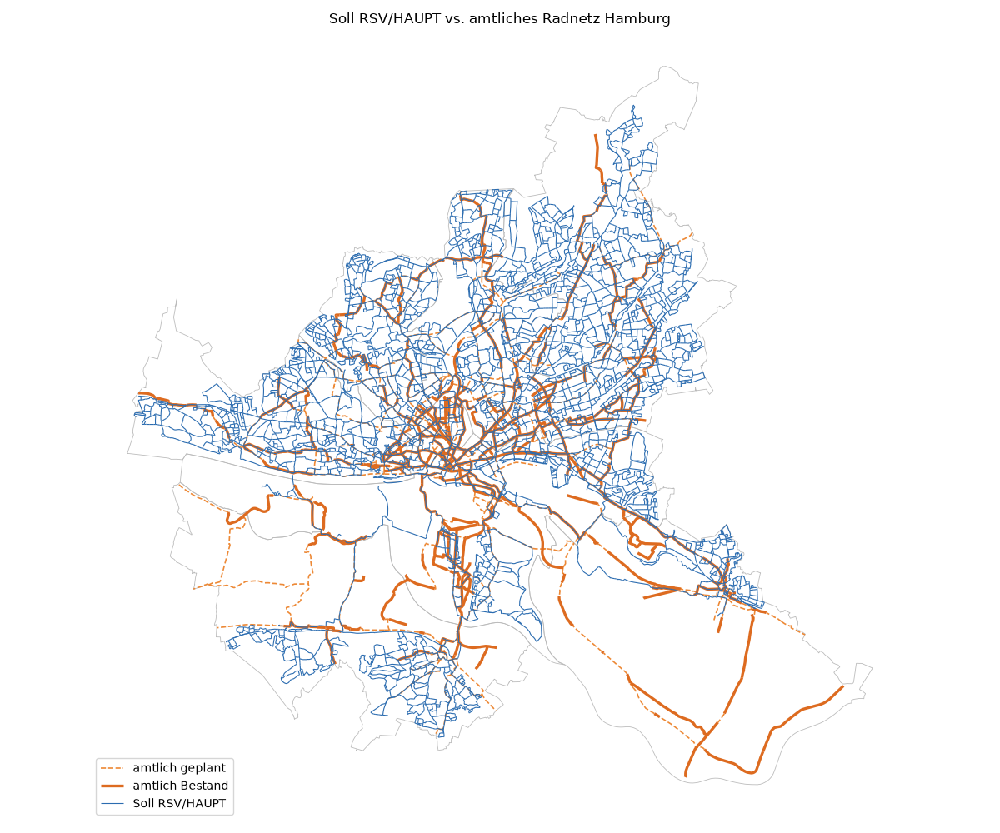

# Validierung Radnetz, Radanlagen, Querschnitte und Knoten (Prompt 21)

Erzeugt 2026-11-15T21:48:45+00:00 mit pipeline/c08_validate_cycling.py · cycling_rules.yaml 0.12.0 · design_rules.yaml 0.10.0 · rules.yaml 0.24.0 · nicht amtlicher Entwurf.

## Kurzfassung

- Amtlicher Bestand 371 km: 58,1 % am Soll RSV/HAUPT, 73,6 % bis BASIS; Soll RSV/HAUPT 1 883 km.
- Zählstellen: Spearman 0,57 an 87 Querschnitten; 93,3 % der 15 stärksten liegen am Soll RSV/HAUPT.
- Sensitivität ±20%: 45 Annahmen, 90 Läufe; größte Wirkung 0,1 % der Länge mit anderer Führung, 0,9 % mit anderer Fahrstreifenzahl, 1,0 % der Knoten mit anderem Typ; „Querschnitt passt?“ reagiert stärker (bis 9,5 % der Länge, am stärksten `cross_section_allocation.elements_min_m.sidewalk.standard`).
- Prüflisten der Prompts 17–20 sind noch nicht ausgefüllt; eine Trefferquote der Regeln fehlt.

## Prüfungen

| Prüfung | Ergebnis | Detail |
| --- | --- | --- |
| Basislauf reproduziert Führungsform (c05) | ok | 100,0 % gleich (sonst Zwischenergebnisse veraltet) |
| Basislauf reproduziert Führungsform nach Querschnitt (c06) | ok | 100,0 % gleich (sonst Zwischenergebnisse veraltet) |
| Basislauf reproduziert Fahrstreifen (c06) | ok | 100,0 % gleich (sonst Zwischenergebnisse veraltet) |
| Basislauf reproduziert fit_class (c06) | ok | 100,0 % gleich (sonst Zwischenergebnisse veraltet) |
| Basislauf reproduziert Knotentyp (c07) | ok | 100,0 % gleich (sonst Zwischenergebnisse veraltet) |
| Regelwerke nach Variation gültig | ok | 0 ungültig |
| Zählstellen-Querschnitte vorhanden | ok | 87 Querschnitte |

## 1. Soll-Radnetz und amtliches Radnetz Hamburg

Amtlich = WFS „Radnetz Hamburg“ (BVM, dl-de/by-2.0), Status Bestand; geplant = In Arbeit, Priorisierte Netzergänzungen/Netzverbesserungen, Netzbedeutende Abschnitte mit Verbesserungspotential. Überdeckung = Länge im Puffer 20 m (C-NET-13) um das jeweils andere Netz; amtliche Linien an den Bezirksgrenzen geschnitten. Das amtliche Netz ist Startpunkt und Vergleichsebene, nicht Ziel (docs/guide_radnetz.md, Abschnitt 1).

- Amtlicher Bestand: 371,3 km; davon 58,1 % am Soll-Netz RSV/HAUPT und 73,6 % am Soll-Netz bis BASIS.
- Soll RSV/HAUPT: 1 882,8 km; davon 12,9 % am amtlichen Bestand, 1 640,7 km zusätzlich.
- Amtlich geplant: 291,8 km; davon 158,1 km am Soll RSV/HAUPT.

| Bezirk | amtlich Bestand km | am Soll RSV/HAUPT | am Soll bis BASIS | fehlt im Soll RSV/HAUPT km | Soll RSV/HAUPT km | davon am Bestand | zusätzlich km | geplant km | geplant am Soll RSV/HAUPT km |
| --- | ---: | ---: | ---: | ---: | ---: | ---: | ---: | ---: | ---: |
| Altona | 37,2 | 78,6 % | 91,2 % | 8,0 | 301,9 | 11,4 % | 267,6 | 36,4 | 26,0 |
| Bergedorf | 57,9 | 22,5 % | 43,0 % | 44,9 | 92,0 | 15,5 % | 77,8 | 30,5 | 5,2 |
| Eimsbüttel | 40,8 | 68,3 % | 86,5 % | 12,9 | 225,0 | 13,5 % | 194,6 | 36,3 | 27,3 |
| Hamburg-Mitte | 105,6 | 52,3 % | 66,1 % | 50,4 | 303,8 | 19,6 % | 244,2 | 58,9 | 32,9 |
| Hamburg-Nord | 48,5 | 69,0 % | 89,2 % | 15,0 | 242,3 | 15,3 % | 205,3 | 45,5 | 26,1 |
| Harburg | 24,0 | 36,8 % | 57,5 % | 15,1 | 177,6 | 5,5 % | 167,9 | 55,1 | 20,6 |
| Wandsbek | 57,3 | 83,6 % | 91,3 % | 9,4 | 540,3 | 10,5 % | 483,4 | 29,2 | 20,1 |
| **Hamburg** | 371,3 | 58,1 % | 73,6 % | 155,7 | 1 882,8 | 12,9 % | 1 640,7 | 291,8 | 158,1 |

Karte und längste Abweichungen (amtlich ohne Soll RSV/HAUPT, Soll RSV/HAUPT ohne amtlichen Bestand): reports/cycle_network.md, Abschnitt „Vergleich mit dem amtlichen Radnetz“.

Lesart: Das Soll-Netz ist mit den Delfter Maschenweiten deutlich dichter als das amtliche Netz (docs/open_questions.md, Prompt 16). Ein hoher Anteil „zusätzlich“ ist deshalb erwartet; wichtig sind die amtlichen Abschnitte, die im Soll fehlen – sie sind Prüffälle für den Netzentwurf.

## 2. Modell und Zählstellen

Wie Prompt 15 (reports/cycle_demand.md): 312 Zählstellen, davon 104 ohne Richtung; 97 Querschnitte mit mindestens 150 gültigen Werktagen 2025. Modellwert = kalibrierte Radfahrten je Werktag (Summe beider Richtungen) der Kanten, die der Querschnitt schneidet. Die Kalibrierung nutzt dieselben Zählstellen; die Werte sind deshalb keine unabhängige Prüfung.

| Kennzahl | Wert |
| --- | ---: |
| Querschnitte mit Zähl- und Modellwert | 87 |
| Spearman (Rang) | 0,57 |
| Pearson (log) | 0,50 |
| mittlere relative Abweichung | 116,4 % |
| Median Zählwert/Modell | 0,74 |
| Anteil innerhalb Faktor 2 | 48,3 % |

Zählwerte nach Soll-Kategorie am Querschnitt (höchste Kategorie der geschnittenen Kanten). Erwartung: höhere Kategorien liegen an stärker befahrenen Querschnitten.

| Soll-Kategorie | Querschnitte | Median Zählwert Rad/Werktag | Median Modell | geom. Mittel Zählwert/Modell |
| --- | ---: | ---: | ---: | ---: |
| RSV | 18 | 2 443 | 5 173 | 0,50 |
| HAUPT | 51 | 1 307 | 1 420 | 0,82 |
| BASIS | 18 | 1 105 | 278 | 3,04 |
| ERSCHL | 10 | 1 330 | 51 | 3,66 |
| none | 0 | – | – | – |

Die 15 stärksten Zählstellen und ihre Soll-Kategorie:

| Zählstelle | Bezirk | Zählwert | Modell | Soll-Kategorie | Prüfen |
| --- | --- | ---: | ---: | --- | --- |
| Verkehrszählstelle 6247950 | Eimsbüttel | 6 975 | 7 839 | RSV | [Luftbild](https://geoportal-hamburg.de/?MAP/PROJECTION=EPSG:25832&MAP/CENTER=[565581,5935158]&MAP/ZOOMLEVEL=10&MAP/LAYERIDS=19968) · [Panoramax](https://api.panoramax.xyz/#focus=map&map=18/53.561198/9.990111) · [OSM](https://www.openstreetmap.org/?mlat=53.561198&mlon=9.990111#map=18/53.561198/9.990111) |
| Verkehrszählstelle 7433950 | Eimsbüttel | 4 771 | 5 739 | RSV | [Luftbild](https://geoportal-hamburg.de/?MAP/PROJECTION=EPSG:25832&MAP/CENTER=[564392,5937393]&MAP/ZOOMLEVEL=10&MAP/LAYERIDS=19968) · [Panoramax](https://api.panoramax.xyz/#focus=map&map=18/53.581429/9.972625) · [OSM](https://www.openstreetmap.org/?mlat=53.581429&mlon=9.972625#map=18/53.581429/9.972625) |
| Verkehrszählstelle 7431960 | Eimsbüttel | 4 691 | 5 799 | RSV | [Luftbild](https://geoportal-hamburg.de/?MAP/PROJECTION=EPSG:25832&MAP/CENTER=[565958,5934960]&MAP/ZOOMLEVEL=10&MAP/LAYERIDS=19968) · [Panoramax](https://api.panoramax.xyz/#focus=map&map=18/53.559375/9.995765) · [OSM](https://www.openstreetmap.org/?mlat=53.559375&mlon=9.995765#map=18/53.559375/9.995765) |
| Verkehrszählstelle 0285940 | Hamburg-Mitte | 4 473 | 3 580 | HAUPT | [Luftbild](https://geoportal-hamburg.de/?MAP/PROJECTION=EPSG:25832&MAP/CENTER=[564094,5934710]&MAP/ZOOMLEVEL=10&MAP/LAYERIDS=19968) · [Panoramax](https://api.panoramax.xyz/#focus=map&map=18/53.557355/9.967573) · [OSM](https://www.openstreetmap.org/?mlat=53.557355&mlon=9.967573#map=18/53.557355/9.967573) |
| Verkehrszählstelle 0311970 | Hamburg-Nord | 4 367 | 7 693 | RSV | [Luftbild](https://geoportal-hamburg.de/?MAP/PROJECTION=EPSG:25832&MAP/CENTER=[568484,5936662]&MAP/ZOOMLEVEL=10&MAP/LAYERIDS=19968) · [Panoramax](https://api.panoramax.xyz/#focus=map&map=18/53.574344/10.034262) · [OSM](https://www.openstreetmap.org/?mlat=53.574344&mlon=10.034262#map=18/53.574344/10.034262) |
| Verkehrszählstelle 0287980 | Altona | 4 332 | 6 133 | HAUPT | [Luftbild](https://geoportal-hamburg.de/?MAP/PROJECTION=EPSG:25832&MAP/CENTER=[561943,5934498]&MAP/ZOOMLEVEL=10&MAP/LAYERIDS=19968) · [Panoramax](https://api.panoramax.xyz/#focus=map&map=18/53.555708/9.935064) · [OSM](https://www.openstreetmap.org/?mlat=53.555708&mlon=9.935064#map=18/53.555708/9.935064) |
| Verkehrszählstelle 6999940 | Hamburg-Mitte | 4 331 | 8 443 | RSV | [Luftbild](https://geoportal-hamburg.de/?MAP/PROJECTION=EPSG:25832&MAP/CENTER=[564528,5933856]&MAP/ZOOMLEVEL=10&MAP/LAYERIDS=19968) · [Panoramax](https://api.panoramax.xyz/#focus=map&map=18/53.549627/9.973947) · [OSM](https://www.openstreetmap.org/?mlat=53.549627&mlon=9.973947#map=18/53.549627/9.973947) |
| Verkehrszählstelle 7432970 | Eimsbüttel | 4 305 | 5 818 | HAUPT | [Luftbild](https://geoportal-hamburg.de/?MAP/PROJECTION=EPSG:25832&MAP/CENTER=[564238,5936758]&MAP/ZOOMLEVEL=10&MAP/LAYERIDS=19968) · [Panoramax](https://api.panoramax.xyz/#focus=map&map=18/53.575747/9.970165) · [OSM](https://www.openstreetmap.org/?mlat=53.575747&mlon=9.970165#map=18/53.575747/9.970165) |
| Verkehrszählstelle 7297940 | Altona | 4 016 | 598 | BASIS | [Luftbild](https://geoportal-hamburg.de/?MAP/PROJECTION=EPSG:25832&MAP/CENTER=[561881,5933891]&MAP/ZOOMLEVEL=10&MAP/LAYERIDS=19968) · [Panoramax](https://api.panoramax.xyz/#focus=map&map=18/53.550256/9.934011) · [OSM](https://www.openstreetmap.org/?mlat=53.550256&mlon=9.934011#map=18/53.550256/9.934011) |
| Verkehrszählstelle 6304980 | Altona | 3 910 | 4 905 | HAUPT | [Luftbild](https://geoportal-hamburg.de/?MAP/PROJECTION=EPSG:25832&MAP/CENTER=[562903,5934520]&MAP/ZOOMLEVEL=10&MAP/LAYERIDS=19968) · [Panoramax](https://api.panoramax.xyz/#focus=map&map=18/53.555792/9.949558) · [OSM](https://www.openstreetmap.org/?mlat=53.555792&mlon=9.949558#map=18/53.555792/9.949558) |
| Verkehrszählstelle 0259920 | Hamburg-Mitte | 3 893 | 8 504 | HAUPT | [Luftbild](https://geoportal-hamburg.de/?MAP/PROJECTION=EPSG:25832&MAP/CENTER=[564671,5935349]&MAP/ZOOMLEVEL=10&MAP/LAYERIDS=19968) · [Panoramax](https://api.panoramax.xyz/#focus=map&map=18/53.563027/9.976414) · [OSM](https://www.openstreetmap.org/?mlat=53.563027&mlon=9.976414#map=18/53.563027/9.976414) |
| Verkehrszählstelle 6408960 | Hamburg-Mitte | 3 889 | 3 296 | HAUPT | [Luftbild](https://geoportal-hamburg.de/?MAP/PROJECTION=EPSG:25832&MAP/CENTER=[565573,5934977]&MAP/ZOOMLEVEL=10&MAP/LAYERIDS=19968) · [Panoramax](https://api.panoramax.xyz/#focus=map&map=18/53.559573/9.989954) · [OSM](https://www.openstreetmap.org/?mlat=53.559573&mlon=9.989954#map=18/53.559573/9.989954) |
| Verkehrszählstelle 6283960 | Eimsbüttel | 3 763 | 816 | RSV | [Luftbild](https://geoportal-hamburg.de/?MAP/PROJECTION=EPSG:25832&MAP/CENTER=[565829,5934833]&MAP/ZOOMLEVEL=10&MAP/LAYERIDS=19968) · [Panoramax](https://api.panoramax.xyz/#focus=map&map=18/53.558246/9.993786) · [OSM](https://www.openstreetmap.org/?mlat=53.558246&mlon=9.993786#map=18/53.558246/9.993786) |
| Verkehrszählstelle 7433910 | Eimsbüttel | 3 678 | 5 252 | RSV | [Luftbild](https://geoportal-hamburg.de/?MAP/PROJECTION=EPSG:25832&MAP/CENTER=[564317,5937483]&MAP/ZOOMLEVEL=10&MAP/LAYERIDS=19968) · [Panoramax](https://api.panoramax.xyz/#focus=map&map=18/53.582254/9.971509) · [OSM](https://www.openstreetmap.org/?mlat=53.582254&mlon=9.971509#map=18/53.582254/9.971509) |
| Verkehrszählstelle 0307930 | Hamburg-Nord | 3 197 | 3 336 | HAUPT | [Luftbild](https://geoportal-hamburg.de/?MAP/PROJECTION=EPSG:25832&MAP/CENTER=[567445,5935569]&MAP/ZOOMLEVEL=10&MAP/LAYERIDS=19968) · [Panoramax](https://api.panoramax.xyz/#focus=map&map=18/53.564655/10.018337) · [OSM](https://www.openstreetmap.org/?mlat=53.564655&mlon=10.018337#map=18/53.564655/10.018337) |

Von den 15 stärksten Zählstellen liegen 93,3 % am Soll RSV/HAUPT.
Prüffälle (stark befahren, aber nicht im Soll RSV/HAUPT; Modellwert meist weit unter dem Zählwert, siehe Lesart in Prompt 15): Verkehrszählstelle 7297940 (BASIS, 4 016 gezählt, 598 modelliert).

## 3. Sensitivität der Annahmen (±20%)

Alle Zahlenwerte mit source_type assumption in cycling_rules.yaml und design_rules.yaml (177 Werte; source_type gilt auch für Einträge darunter), je einzeln um −20% und +20% (delta aus rules.yaml V-SENS-01). Neu gerechnet werden Führungsform (c05), Soll-Querschnitt (c06) und Knotentyp (c07) auf ihren gespeicherten Eingangswerten; Werte einer späteren Stufe rechnen nur ab dieser Stufe neu. Führung und Fahrstreifen als Anteil der Länge aller Straßenabschnitte, Knoten als Anteil der Knotenpunkte. Führung = Führungsform nach Prompt 19 (inklusive Fallback).

- Variiert: 45 Werte, 90 Läufe; davon 33 mit einer Änderung.
- Nicht neu gerechnet (andere Stufen): 96 Werte – siehe unten.
- Nicht variiert: 35 Zähl- oder Kennwerte (Seeds, Seitenzahl, Linientypen, Fahrstreifen-Vorgaben), 1 Werte gleich 0.
- Ungültige Regelwerke nach Variation: 0.

### Wirkung je Annahme (alle mit Änderung, höchstens 25; sortiert nach größter Wirkung)

Spalten je Richtung: Führung, Fahrstreifen und „Querschnitt passt?“ (fit_class) als Anteil der Länge, Knoten als Anteil der Knotenpunkte. Sollbreiten wirken vor allem über „Querschnitt passt?“.

| Annahme | Wert | ab Stufe | −: Führung | −: Fahrstr. | −: passt? | −: Knoten | +: Führung | +: Fahrstr. | +: passt? | +: Knoten |
| --- | ---: | --- | ---: | ---: | ---: | ---: | ---: | ---: | ---: | ---: |
| `cross_section_allocation.elements_min_m.sidewalk.standard` (design) | 3,00 | c06 | 0,06 % | 0,44 % | 9,49 % | 0,00 % | 0,04 % | 0,45 % | 6,32 % | 0,00 % |
| `cross_section_allocation.elements_min_m.sidewalk.min` (design) | 2,50 | c06 | 0,01 % | 0,00 % | 5,83 % | 0,00 % | 0,13 % | 0,00 % | 8,00 % | 0,00 % |
| `widths_m.project_target.cycle_street_carriageway.with_motor_traffic` (cycling) | 4,75 | c05 | 0,00 % | 0,00 % | 4,90 % | 0,00 % | 0,00 % | 0,00 % | 4,89 % | 0,00 % |
| `lanes.lane_width_m.GOW50.general` (design) | 3,25 | c06 | 0,00 % | 0,94 % | 1,05 % | 0,00 % | 0,00 % | 0,77 % | 0,88 % | 0,00 % |
| `cross_section_allocation.elements_min_m.loading_zone` (design) | 2,50 | c06 | 0,01 % | 0,06 % | 1,05 % | 0,00 % | 0,00 % | 0,04 % | 0,49 % | 0,00 % |
| `junctions.method.[J-M-02].dtv_share_entering.value` (design) | 0,50 | c07 | 0,00 % | 0,00 % | 0,00 % | 0,99 % | 0,00 % | 0,00 % | 0,00 % | 0,67 % |
| `cross_section_allocation.elements_min_m.parking_parallel` (design) | 2,00 | c06 | 0,00 % | 0,00 % | 0,69 % | 0,00 % | 0,00 % | 0,00 % | 0,56 % | 0,00 % |
| `cross_section_allocation.elements_min_m.tree_strip` (design) | 2,00 | c06 | 0,00 % | 0,35 % | 0,63 % | 0,00 % | 0,00 % | 0,29 % | 0,61 % | 0,00 % |
| `junctions.thresholds.roundabout_min_radius.value` (design) | 20,00 | c07 | 0,00 % | 0,00 % | 0,00 % | 0,61 % | 0,00 % | 0,00 % | 0,00 % | 0,50 % |
| `widths_m.project_target.cycle_street_carriageway.value` (cycling) | 4,00 | c05 | 0,00 % | 0,00 % | 0,57 % | 0,00 % | 0,00 % | 0,00 % | 0,30 % | 0,00 % |
| `junctions.thresholds.roundabout_max_dtv.value` (design) | 25 000,00 | c07 | 0,00 % | 0,00 % | 0,00 % | 0,38 % | 0,00 % | 0,00 % | 0,00 % | 0,45 % |
| `widths_m.project_target.separated_oneway.HAUPT` (cycling) | 2,50 | c05 | 0,05 % | 0,14 % | 0,32 % | 0,00 % | 0,03 % | 0,21 % | 0,41 % | 0,00 % |
| `lanes.rules.[L-02].peak_h_dir_from_dtv.factor` (design) | 0,06 | c06 | 0,00 % | 0,29 % | 0,34 % | 0,00 % | 0,00 % | 0,05 % | 0,06 % | 0,00 % |
| `junctions.thresholds.turbo_max_dtv.value` (design) | 35 000,00 | c07 | 0,00 % | 0,00 % | 0,00 % | 0,31 % | 0,00 % | 0,00 % | 0,00 % | 0,10 % |
| `junctions.thresholds.turbo_min_radius.value` (design) | 30,00 | c07 | 0,00 % | 0,00 % | 0,00 % | 0,31 % | 0,00 % | 0,00 % | 0,00 % | 0,24 % |
| `lanes.rules.[L-02].lane_capacity_veh_h.value` (design) | 900,00 | c06 | 0,00 % | 0,05 % | 0,06 % | 0,00 % | 0,00 % | 0,27 % | 0,26 % | 0,00 % |
| `lanes.rules.[L-02].target_vc.value` (design) | 0,85 | c06 | 0,00 % | 0,05 % | 0,06 % | 0,00 % | 0,00 % | 0,27 % | 0,26 % | 0,00 % |
| `lanes.rules.[L-04].bus_lane_trigger.value` (design) | 20,00 | c06 | 0,00 % | 0,26 % | 0,07 % | 0,00 % | 0,00 % | 0,16 % | 0,03 % | 0,00 % |
| `cross_section_allocation.elements_min_m.buffer_cycle_carriageway` (design) | 0,75 | c06 | 0,01 % | 0,12 % | 0,25 % | 0,00 % | 0,06 % | 0,10 % | 0,21 % | 0,00 % |
| `junctions.thresholds.crossing_signal_min_dtv.value` (design) | 12 000,00 | c07 | 0,00 % | 0,00 % | 0,00 % | 0,06 % | 0,00 % | 0,00 % | 0,00 % | 0,22 % |
| `widths_m.project_target.separated_oneway.ERSCHL` (cycling) | 2,00 | c05 | 0,00 % | 0,15 % | 0,18 % | 0,00 % | 0,00 % | 0,06 % | 0,15 % | 0,00 % |
| `lanes.lane_width_m.median_min_m.value` (design) | 2,00 | c06 | 0,00 % | 0,12 % | 0,12 % | 0,00 % | 0,00 % | 0,13 % | 0,13 % | 0,00 % |
| `cross_section_allocation.elements_min_m.bus_lane` (design) | 3,50 | c06 | 0,00 % | 0,00 % | 0,11 % | 0,00 % | 0,00 % | 0,00 % | 0,11 % | 0,00 % |
| `widths_m.project_target.separated_oneway.BASIS` (cycling) | 2,00 | c05 | 0,00 % | 0,06 % | 0,11 % | 0,00 % | 0,00 % | 0,02 % | 0,05 % | 0,00 % |
| `widths_m.project_target.cycle_lane.BASIS` (cycling) | 2,25 | c05 | 0,00 % | 0,00 % | 0,05 % | 0,00 % | 0,00 % | 0,00 % | 0,00 % | 0,00 % |

Ohne Wirkung bei ±20% (12): `separation_matrix.rules.[S-04].motor_peak_hour_share.value`, `separation_matrix.mixed_rural_max_dtv.value`, `cycle_street.max_motor_vehicles_day.value`, `facility_assignment.rules.[C-FAC-02].dtv_proxy.proxy_betweenness.value`, `widths_m.project_target.separated_twoway.RSV`, `widths_m.project_target.separated_twoway.HAUPT`, `widths_m.project_target.separated_twoway.BASIS`, `widths_m.project_target.separated_twoway.ERSCHL`, `widths_m.project_target.separated_twoway.none`, `widths_m.project_target.cycle_lane.HAUPT`, `widths_m.project_target.cycle_lane.none`, `cross_section_allocation.elements_min_m.tram.value`

### Robustheit je Abschnitt und Knoten

- Abschnitte, deren Führungsform sich in mindestens einem der 90 Läufe ändert: 91 von 36 526 (0,2 %).
- Abschnitte mit geänderter Fahrstreifenzahl in mindestens einem Lauf: 1 240 (3,4 %).
- Knotenpunkte mit geändertem Soll-Typ in mindestens einem Lauf: 378 von 14 312 (2,6 %).
- Die Steckbriefe der Webseite nennen je Abschnitt und Knoten die Zahl der Läufe mit Änderung und bis zu 3 auslösende Annahmen.

### Nicht neu gerechnet

Diese Annahmen wirken über Nachfragemodell, Netzentwurf, Prinzipien oder die Knotenbildung. Ein Lauf bräuchte eine neue Umlegung bzw. Geometrie (Stunden je Lauf); sie bleiben hier fest. Wirkung der Nachfrage-Annahmen auf die Kalibrierung: docs/open_questions.md (Prompt 15, Sensitivitätsläufe 2026-11-05); Gewichte der Prinzipien: reports/cycle_principles.md.

| Abschnitt | Annahmen | warum nicht neu gerechnet |
| --- | ---: | --- |
| `cycle_categories` | 7 | Kategoriebeschreibung, Prinzipien (Prompt 17) |
| `cycle_graph` | 6 | Radgraph (Prompt 15) |
| `demand_model` | 20 | Nachfragemodell (Prompt 15) – je Lauf eine neue Umlegung |
| `junctions` | 1 | andere Stufe |
| `junctions.method` | 7 | Knotenbildung und Platz (J-M-01, J-M-03) – Geometrie, nicht neu gebildet |
| `network_design` | 20 | Netzentwurf (Prompt 16) – je Lauf eine neue Umlegung |
| `principle_scoring` | 9 | Prinzipienprüfung (Prompt 17) |
| `principle_weights` | 5 | Prinzipienprüfung (Prompt 17); Gewichts-Sensitivität in reports/cycle_principles.md |
| `principles` | 11 | Prinzipienprüfung (Prompt 17), keine Wirkung auf Führung, Fahrstreifen, Knoten |
| `routing_impedance` | 10 | Routenwahl und Netzentwurf (Prompts 15–16) – je Lauf eine neue Umlegung |

## 4. Stichproben aus den Prompts 17–20

| Stichprobe | Bericht | Umfang | Stand der Durchsicht |
| --- | --- | --- | --- |
| Prompt 18 – Führungsform | reports/cycle_facility.md | 30 je Soll-Führung | Durchsicht ausstehend (keine Ergebnisspalten) |
| Prompt 19 – Soll-Querschnitt | reports/cross_section_soll.md | 70 Skizzen (30 Zufall, 20 breiteste, 20 schmalste) | Durchsicht ausstehend (keine Ergebnisspalten) |
| Prompt 20 – Knotenpunkte | reports/junctions.md | 30 Zufall, Prüfliste je Soll-Typ | 0 von 286 bewertet – Durchsicht ausstehend |
| Prompt 17 – Routen (Prinzipien) | reports/cycle_principles_review.csv | 20 Routen | 0 von 20 bewertet |

Ohne ausgefüllte Prüflisten lässt sich die Trefferquote der Regeln nicht angeben. Die Durchsicht durch Ortskundige ist der wichtigste nächste Schritt (docs/open_questions.md).

### 30 neue Zufallsstichproben (Abschnitte im Soll-Radnetz, über Bezirke verteilt, Seed 42)

Zum Prüfen gegen Luftbild und Panoramax; dieselben Abschnitte mit Spalten für die Bewertung in reports/validation_cycling_review.csv.

| segment_id | Bezirk | Name | Rad | Soll-Führung | Ist-Führung | Fahrstreifen Soll/Ist | Querschnitt | Prüfen |
| --- | --- | --- | --- | --- | --- | --- | --- | --- |
| `seg_0b524ddbc0ea74cc` | Altona | Franzosenkoppel | HAUPT | Fahrradstraße | Radweg für beide Richtungen | Misch/1 | passt in die Straße | [Luftbild](https://geoportal-hamburg.de/?MAP/PROJECTION=EPSG:25832&MAP/CENTER=[557477,5940372]&MAP/ZOOMLEVEL=10&MAP/LAYERIDS=19968) · [Panoramax](https://api.panoramax.xyz/#focus=map&map=18/53.609005/9.868730) · [OSM](https://www.openstreetmap.org/?mlat=53.609005&mlon=9.868730#map=18/53.609005/9.868730) |
| `seg_316384979428b96d` | Altona | Johanniskrautweg | ERSCHL | Rad auf der Fahrbahn | Rad auf der Fahrbahn | Misch/1 | passt nicht in die Straße | [Luftbild](https://geoportal-hamburg.de/?MAP/PROJECTION=EPSG:25832&MAP/CENTER=[557198,5936871]&MAP/ZOOMLEVEL=10&MAP/LAYERIDS=19968) · [Panoramax](https://api.panoramax.xyz/#focus=map&map=18/53.577574/9.863885) · [OSM](https://www.openstreetmap.org/?mlat=53.577574&mlon=9.863885#map=18/53.577574/9.863885) |
| `seg_6bbea75c264a0686` | Altona | Unzerstraße | HAUPT | Fahrradstraße | Rad auf der Fahrbahn | Misch/1 | passt in die Straße | [Luftbild](https://geoportal-hamburg.de/?MAP/PROJECTION=EPSG:25832&MAP/CENTER=[562992,5934030]&MAP/ZOOMLEVEL=10&MAP/LAYERIDS=19968) · [Panoramax](https://api.panoramax.xyz/#focus=map&map=18/53.551380/9.950802) · [OSM](https://www.openstreetmap.org/?mlat=53.551380&mlon=9.950802#map=18/53.551380/9.950802) |
| `seg_796e6a0cbb08eb13` | Altona | Hartmutkoppel | ERSCHL | Rad auf der Fahrbahn | Rad auf der Fahrbahn | Misch/1 | passt mit Abstrichen | [Luftbild](https://geoportal-hamburg.de/?MAP/PROJECTION=EPSG:25832&MAP/CENTER=[550668,5938213]&MAP/ZOOMLEVEL=10&MAP/LAYERIDS=19968) · [Panoramax](https://api.panoramax.xyz/#focus=map&map=18/53.590310/9.765487) · [OSM](https://www.openstreetmap.org/?mlat=53.590310&mlon=9.765487#map=18/53.590310/9.765487) |
| `seg_25cce71fa1530030` | Bergedorf | Brookdeich | ERSCHL | Rad auf der Fahrbahn | Fahrradstraße | Misch/1 | passt nicht in die Straße | [Luftbild](https://geoportal-hamburg.de/?MAP/PROJECTION=EPSG:25832&MAP/CENTER=[581607,5926280]&MAP/ZOOMLEVEL=10&MAP/LAYERIDS=19968) · [Panoramax](https://api.panoramax.xyz/#focus=map&map=18/53.479170/10.229692) · [OSM](https://www.openstreetmap.org/?mlat=53.479170&mlon=10.229692#map=18/53.479170/10.229692) |
| `seg_33a30f1a8403af78` | Bergedorf | Fersenweg | ERSCHL | – | Rad auf der Fahrbahn | –/– | nicht bewertet | [Luftbild](https://geoportal-hamburg.de/?MAP/PROJECTION=EPSG:25832&MAP/CENTER=[579768,5919303]&MAP/ZOOMLEVEL=10&MAP/LAYERIDS=19968) · [Panoramax](https://api.panoramax.xyz/#focus=map&map=18/53.416753/10.200227) · [OSM](https://www.openstreetmap.org/?mlat=53.416753&mlon=10.200227#map=18/53.416753/10.200227) |
| `seg_510646fd727152e5` | Bergedorf | Altengammer Hauptdeich | ERSCHL | – | Rad auf der Fahrbahn | –/– | nicht bewertet | [Luftbild](https://geoportal-hamburg.de/?MAP/PROJECTION=EPSG:25832&MAP/CENTER=[586612,5922124]&MAP/ZOOMLEVEL=10&MAP/LAYERIDS=19968) · [Panoramax](https://api.panoramax.xyz/#focus=map&map=18/53.441020/10.303942) · [OSM](https://www.openstreetmap.org/?mlat=53.441020&mlon=10.303942#map=18/53.441020/10.303942) |
| `seg_b937903465cf5b00` | Eimsbüttel | Sandkrugweg | ERSCHL | Rad auf der Fahrbahn | Rad auf der Fahrbahn | Misch/1 | passt mit Abstrichen | [Luftbild](https://geoportal-hamburg.de/?MAP/PROJECTION=EPSG:25832&MAP/CENTER=[559130,5942337]&MAP/ZOOMLEVEL=10&MAP/LAYERIDS=19968) · [Panoramax](https://api.panoramax.xyz/#focus=map&map=18/53.626482/9.894085) · [OSM](https://www.openstreetmap.org/?mlat=53.626482&mlon=9.894085#map=18/53.626482/9.894085) |
| `seg_cb3513dab9af667f` | Eimsbüttel | Rahweg | HAUPT | Fahrradstraße | Rad auf der Fahrbahn | Misch/1 | passt mit Abstrichen | [Luftbild](https://geoportal-hamburg.de/?MAP/PROJECTION=EPSG:25832&MAP/CENTER=[564572,5943818]&MAP/ZOOMLEVEL=10&MAP/LAYERIDS=19968) · [Panoramax](https://api.panoramax.xyz/#focus=map&map=18/53.639154/9.976671) · [OSM](https://www.openstreetmap.org/?mlat=53.639154&mlon=9.976671#map=18/53.639154/9.976671) |
| `seg_f49ea34515d25699` | Eimsbüttel | Edmund-Siemers-Allee | ERSCHL | eigener Radweg auf beiden Seiten | Rad auf der Fahrbahn | 1/4 | passt in die Straße | [Luftbild](https://geoportal-hamburg.de/?MAP/PROJECTION=EPSG:25832&MAP/CENTER=[565371,5935345]&MAP/ZOOMLEVEL=10&MAP/LAYERIDS=19968) · [Panoramax](https://api.panoramax.xyz/#focus=map&map=18/53.562902/9.986974) · [OSM](https://www.openstreetmap.org/?mlat=53.562902&mlon=9.986974#map=18/53.562902/9.986974) |
| `seg_0a2e095e1a9902bb` | Hamburg-Mitte | Eiffestraße | HAUPT | eigener Radweg auf beiden Seiten | Radweg für beide Richtungen | 1/2 | passt mit Abstrichen | [Luftbild](https://geoportal-hamburg.de/?MAP/PROJECTION=EPSG:25832&MAP/CENTER=[569220,5934247]&MAP/ZOOMLEVEL=10&MAP/LAYERIDS=19968) · [Panoramax](https://api.panoramax.xyz/#focus=map&map=18/53.552545/10.044845) · [OSM](https://www.openstreetmap.org/?mlat=53.552545&mlon=10.044845#map=18/53.552545/10.044845) |
| `seg_1ad2cf5ed8af6a4a` | Hamburg-Mitte | Billbrookdeich | ERSCHL | Rad auf der Fahrbahn | Rad auf der Fahrbahn | Misch/1 | passt in die Straße | [Luftbild](https://geoportal-hamburg.de/?MAP/PROJECTION=EPSG:25832&MAP/CENTER=[571565,5932625]&MAP/ZOOMLEVEL=10&MAP/LAYERIDS=19968) · [Panoramax](https://api.panoramax.xyz/#focus=map&map=18/53.537650/10.079862) · [OSM](https://www.openstreetmap.org/?mlat=53.537650&mlon=10.079862#map=18/53.537650/10.079862) |
| `seg_877d9282eba06763` | Hamburg-Mitte | Reiherstiegdeich | ERSCHL | Rad auf der Fahrbahn | Rad auf der Fahrbahn | Misch/– | passt nicht in die Straße | [Luftbild](https://geoportal-hamburg.de/?MAP/PROJECTION=EPSG:25832&MAP/CENTER=[564675,5930089]&MAP/ZOOMLEVEL=10&MAP/LAYERIDS=19968) · [Panoramax](https://api.panoramax.xyz/#focus=map&map=18/53.515753/9.975383) · [OSM](https://www.openstreetmap.org/?mlat=53.515753&mlon=9.975383#map=18/53.515753/9.975383) |
| `seg_b1303be8355a0682` | Hamburg-Mitte | Hohe-Schaar-Straße | ERSCHL | eigener Radweg auf beiden Seiten | eigener Radweg auf beiden Seiten | 1/2 | passt nicht in die Straße | [Luftbild](https://geoportal-hamburg.de/?MAP/PROJECTION=EPSG:25832&MAP/CENTER=[565049,5926206]&MAP/ZOOMLEVEL=10&MAP/LAYERIDS=19968) · [Panoramax](https://api.panoramax.xyz/#focus=map&map=18/53.480810/9.980215) · [OSM](https://www.openstreetmap.org/?mlat=53.480810&mlon=9.980215#map=18/53.480810/9.980215) |
| `seg_bf5e1cd5f07e6d24` | Hamburg-Mitte | Kirchdorfer Straße | BASIS | Rad auf der Fahrbahn | Rad auf der Fahrbahn | Misch/1 | passt in die Straße | [Luftbild](https://geoportal-hamburg.de/?MAP/PROJECTION=EPSG:25832&MAP/CENTER=[567574,5927347]&MAP/ZOOMLEVEL=10&MAP/LAYERIDS=19968) · [Panoramax](https://api.panoramax.xyz/#focus=map&map=18/53.490744/10.018503) · [OSM](https://www.openstreetmap.org/?mlat=53.490744&mlon=10.018503#map=18/53.490744/10.018503) |
| `seg_0c3028de9006fbc4` | Hamburg-Nord | Brombeerweg | ERSCHL | eigener Radweg auf beiden Seiten | eigener Radweg auf beiden Seiten | 2/2 | passt in die Straße | [Luftbild](https://geoportal-hamburg.de/?MAP/PROJECTION=EPSG:25832&MAP/CENTER=[567901,5942596]&MAP/ZOOMLEVEL=10&MAP/LAYERIDS=19968) · [Panoramax](https://api.panoramax.xyz/#focus=map&map=18/53.627747/10.026756) · [OSM](https://www.openstreetmap.org/?mlat=53.627747&mlon=10.026756#map=18/53.627747/10.026756) |
| `seg_26d260caf83e1fa1` | Hamburg-Nord | Bi de Börner / Hogenlietgrund | BASIS | Rad auf der Fahrbahn | Rad auf der Fahrbahn | Misch/1 | passt in die Straße | [Luftbild](https://geoportal-hamburg.de/?MAP/PROJECTION=EPSG:25832&MAP/CENTER=[567588,5947099]&MAP/ZOOMLEVEL=10&MAP/LAYERIDS=19968) · [Panoramax](https://api.panoramax.xyz/#focus=map&map=18/53.668259/10.023003) · [OSM](https://www.openstreetmap.org/?mlat=53.668259&mlon=10.023003#map=18/53.668259/10.023003) |
| `seg_5c11219c3ba2d5e0` | Hamburg-Nord | Krohnskamp | HAUPT | Fahrradstraße | eigener Radweg auf beiden Seiten | Misch/1 | passt in die Straße | [Luftbild](https://geoportal-hamburg.de/?MAP/PROJECTION=EPSG:25832&MAP/CENTER=[566990,5938322]&MAP/ZOOMLEVEL=10&MAP/LAYERIDS=19968) · [Panoramax](https://api.panoramax.xyz/#focus=map&map=18/53.589458/10.012057) · [OSM](https://www.openstreetmap.org/?mlat=53.589458&mlon=10.012057#map=18/53.589458/10.012057) |
| `seg_61d64d6ca2cb1e1e` | Hamburg-Nord | Borsteler Chaussee | HAUPT | Fahrradstraße | eigener Radweg auf beiden Seiten | Misch/1 | passt in die Straße | [Luftbild](https://geoportal-hamburg.de/?MAP/PROJECTION=EPSG:25832&MAP/CENTER=[564392,5940950]&MAP/ZOOMLEVEL=10&MAP/LAYERIDS=19968) · [Panoramax](https://api.panoramax.xyz/#focus=map&map=18/53.613395/9.973365) · [OSM](https://www.openstreetmap.org/?mlat=53.613395&mlon=9.973365#map=18/53.613395/9.973365) |
| `seg_0a154061c799b07d` | Harburg | Breitscheidweg | ERSCHL | Rad auf der Fahrbahn | Rad auf der Fahrbahn | Misch/1 | nicht bewertet | [Luftbild](https://geoportal-hamburg.de/?MAP/PROJECTION=EPSG:25832&MAP/CENTER=[562809,5924262]&MAP/ZOOMLEVEL=10&MAP/LAYERIDS=19968) · [Panoramax](https://api.panoramax.xyz/#focus=map&map=18/53.463614/9.946078) · [OSM](https://www.openstreetmap.org/?mlat=53.463614&mlon=9.946078#map=18/53.463614/9.946078) |
| `seg_9716d9588710d862` | Harburg | Zu den Baumhöfen | HAUPT | Fahrradstraße | Rad auf der Fahrbahn | Misch/1 | passt in die Straße | [Luftbild](https://geoportal-hamburg.de/?MAP/PROJECTION=EPSG:25832&MAP/CENTER=[554238,5924276]&MAP/ZOOMLEVEL=10&MAP/LAYERIDS=19968) · [Panoramax](https://api.panoramax.xyz/#focus=map&map=18/53.464690/9.817005) · [OSM](https://www.openstreetmap.org/?mlat=53.464690&mlon=9.817005#map=18/53.464690/9.817005) |
| `seg_b3cdb4a4da9883aa` | Harburg | Cuxhavener Straße | BASIS | eigener Radweg auf beiden Seiten | eigener Radweg auf beiden Seiten | 1/2 | passt mit Abstrichen | [Luftbild](https://geoportal-hamburg.de/?MAP/PROJECTION=EPSG:25832&MAP/CENTER=[554432,5924870]&MAP/ZOOMLEVEL=10&MAP/LAYERIDS=19968) · [Panoramax](https://api.panoramax.xyz/#focus=map&map=18/53.470010/9.820029) · [OSM](https://www.openstreetmap.org/?mlat=53.470010&mlon=9.820029#map=18/53.470010/9.820029) |
| `seg_378e6f28f9019cb5` | Wandsbek | Neubertbogen | ERSCHL | Rad auf der Fahrbahn | Rad auf der Fahrbahn | Misch/1 | passt in die Straße | [Luftbild](https://geoportal-hamburg.de/?MAP/PROJECTION=EPSG:25832&MAP/CENTER=[574469,5936868]&MAP/ZOOMLEVEL=10&MAP/LAYERIDS=19968) · [Panoramax](https://api.panoramax.xyz/#focus=map&map=18/53.575382/10.124685) · [OSM](https://www.openstreetmap.org/?mlat=53.575382&mlon=10.124685#map=18/53.575382/10.124685) |
| `seg_9a36970945ab1a82` | Wandsbek | Am Pulverhof | ERSCHL | Rad auf der Fahrbahn | eigener Radweg auf beiden Seiten | Misch/1 | passt nicht in die Straße | [Luftbild](https://geoportal-hamburg.de/?MAP/PROJECTION=EPSG:25832&MAP/CENTER=[575147,5938975]&MAP/ZOOMLEVEL=10&MAP/LAYERIDS=19968) · [Panoramax](https://api.panoramax.xyz/#focus=map&map=18/53.594217/10.135427) · [OSM](https://www.openstreetmap.org/?mlat=53.594217&mlon=10.135427#map=18/53.594217/10.135427) |
| `seg_9e2d6f2a140eb3e4` | Wandsbek | Gleiwitzer Bogen | HAUPT | Fahrradstraße | Rad auf der Fahrbahn | Misch/1 | passt mit Abstrichen | [Luftbild](https://geoportal-hamburg.de/?MAP/PROJECTION=EPSG:25832&MAP/CENTER=[575522,5936316]&MAP/ZOOMLEVEL=10&MAP/LAYERIDS=19968) · [Panoramax](https://api.panoramax.xyz/#focus=map&map=18/53.570272/10.140445) · [OSM](https://www.openstreetmap.org/?mlat=53.570272&mlon=10.140445#map=18/53.570272/10.140445) |
| `seg_b659f59af0e5ffb2` | Wandsbek | Bilenbargstieg | ERSCHL | Rad auf der Fahrbahn | Rad auf der Fahrbahn | Misch/1 | passt mit Abstrichen | [Luftbild](https://geoportal-hamburg.de/?MAP/PROJECTION=EPSG:25832&MAP/CENTER=[571799,5949319]&MAP/ZOOMLEVEL=10&MAP/LAYERIDS=19968) · [Panoramax](https://api.panoramax.xyz/#focus=map&map=18/53.687648/10.087230) · [OSM](https://www.openstreetmap.org/?mlat=53.687648&mlon=10.087230#map=18/53.687648/10.087230) |
| `seg_c4733a4227455bfb` | Wandsbek | Hohenberne | HAUPT | Fahrradstraße | Rad auf der Fahrbahn | Misch/1 | passt nicht in die Straße | [Luftbild](https://geoportal-hamburg.de/?MAP/PROJECTION=EPSG:25832&MAP/CENTER=[575116,5943297]&MAP/ZOOMLEVEL=10&MAP/LAYERIDS=19968) · [Panoramax](https://api.panoramax.xyz/#focus=map&map=18/53.633060/10.135999) · [OSM](https://www.openstreetmap.org/?mlat=53.633060&mlon=10.135999#map=18/53.633060/10.135999) |
| `seg_c89c3798fa94763c` | Wandsbek | Eulenkrugstraße | HAUPT | Fahrradstraße | eigener Radweg auf beiden Seiten | Misch/1 | passt in die Straße | [Luftbild](https://geoportal-hamburg.de/?MAP/PROJECTION=EPSG:25832&MAP/CENTER=[578338,5944672]&MAP/ZOOMLEVEL=10&MAP/LAYERIDS=19968) · [Panoramax](https://api.panoramax.xyz/#focus=map&map=18/53.644951/10.185054) · [OSM](https://www.openstreetmap.org/?mlat=53.644951&mlon=10.185054#map=18/53.644951/10.185054) |
| `seg_5bef1054e9a495e5` | – | Mühlenweg | ERSCHL | Rad auf der Fahrbahn | Rad auf der Fahrbahn | Misch/– | nicht bewertet | [Luftbild](https://geoportal-hamburg.de/?MAP/PROJECTION=EPSG:25832&MAP/CENTER=[565656,5919296]&MAP/ZOOMLEVEL=10&MAP/LAYERIDS=19968) · [Panoramax](https://api.panoramax.xyz/#focus=map&map=18/53.418635/9.987923) · [OSM](https://www.openstreetmap.org/?mlat=53.418635&mlon=9.987923#map=18/53.418635/9.987923) |
| `seg_b54044019067ecbc` | – | Elbdeich | ERSCHL | Rad auf der Fahrbahn | Rad auf der Fahrbahn | Misch/– | nicht bewertet | [Luftbild](https://geoportal-hamburg.de/?MAP/PROJECTION=EPSG:25832&MAP/CENTER=[570390,5923616]&MAP/ZOOMLEVEL=10&MAP/LAYERIDS=19968) · [Panoramax](https://api.panoramax.xyz/#focus=map&map=18/53.456842/10.060113) · [OSM](https://www.openstreetmap.org/?mlat=53.456842&mlon=10.060113#map=18/53.456842/10.060113) |

## 5. Offene Fragen und Grenzen

### Offene Fragen zum Radnetz (docs/open_questions.md)

32 offene Punkte:

- Projekt-Sollbreiten (`widths_m.project_target`) zwischen ERA-Regelmaß und NL-Hauptnetz festlegen – Verkehrsplaner*in
- CROW-Ontwerpwijzer 2016 im Original: Umwegfaktor, Breiten nach Intensität, Fahrradstraßen-Kriterien prüfen – Verkehrsplaner*in
- ERA 2010 Bild 7 (Belastungsbereiche) und Neufassung ERA prüfen; S-04 anpassen – Verkehrsplaner*in
- Kapazitätsschwellen L-02 (900 Kfz/h je Fahrstreifen, v/c 0,85) und Kreisverkehrsgrenzen (25.000/35.000 Kfz/24h) mit HBS abgleichen – Verkehrsplaner*in
- Vorrang Radverkehr am Kreisverkehr (CROW vs. SWOV vs. StVO/VwV) – Entscheidung und Rechtsprüfung – Team
- Hamburger Standards (ReStra, PLAST Radverkehr) als zusätzliche Quelle `hamburg` einpflegen – GIS/Verkehrsplanung
- Metadaten-Ergänzungen in 0.1.1 freigeben (Werte unverändert): als `assumption` markiert wurden RSV `trip_length_km` [5, 15], `principle_weights`, `lanes.default_per_direction`, L-02, L-04; PL-01 war `swov_crow` ohne Quelle und ist jetzt `assumption` (CROW-Quelle ergänzen?); PL-03 hat die Quelle ERA_2010 erhalten (Trennstreifen buffer_to_parking) – Verkehrsplaner*in
- ETW60 außerorts: Ist `mixed` bei DTV ≤ `mixed_rural_max_dtv` nur erlaubt oder die Soll-Führung? Goldener Fall s14 deckt nur DTV > 2 500 ab – Verkehrsplaner*in
- Prompt 15 (cycling_rules.yaml 0.2.0): neue Annahmen freigeben – Verkehrsplaner*in - Widerstand Ist (C-IMP-01…08): Zuordnung der Kanten zu den bestehenden Faktoren; Tempo-Grenze 30 km/h; C-IMP-05 (früher auch C-IMP-06, zusammengelegt) Hauptstraße Tempo 30 ohne Radstreifen hat keinen eigenen Faktor (vorläufig 1,25 wie mit Radstreifen) - Radgraph (C-GRAPH-01…06): nur cycleway sowie path/footway/pedestrian/bridleway mit bicycle=yes|designated|permissive; highway=track/service außerhalb der Straßenabschnitte bleiben draußen, auch mit Radfreigabe. Aufnehmen? Fähren: Wartezeit 450 s pauschal (aus GTFS-Takt ableiten?), Anbindung ≤ 400 m; Radgeschwindigkeit 15 km/h - Nachfrage (C-DEM-01…07): Zonen 500 m; Zielgewichte Geschossfläche 0,40 / Geschäfte 0,20 / Schulen 0,15 / Hochschulen 0,10 / Schnellbahn 0,15; β = 0,25/km im Band 0,5–15 km; 3 Läufe mit σ = 0,1; mindestens 150 Werktage je Zählstelle; Querschnitt ±25 m, Winkel ≥ 45°; Konfidenz: 500 m, Faktor 2, 2 km Grenzabstand, 50 Rad/Tag
- Prompt 16 (cycling_rules.yaml 0.3.0): neue Annahmen C-NET-01…13 freigeben – Verkehrsplaner*in - Korridorpunkte: Innenstadt = Rathausmarkt (Koordinate gesetzt); Umsteigeknoten = ≥ 2 Verkehrsmittel im Umkreis 250 m; nur OSM amenity=university; Arbeitsplatzschwerpunkte = Zonen ab 98-%-Quantil der Geschossfläche; Zusammenfassen ab 500 m; Paare = 4 nächste bis 15 km plus Innenstadt - Soll-Widerstand je cat_final (Faktoren aus routing_impedance), Bonus Nachfrage bis −30 % ab 2.000 Rad/Werktag, Bonus amtliches Radnetz × 0,8 (alle Status) - RSV: Lücken bis 500 m überbrückt; Barrieren Bahn/Flüsse/Kanäle; Ausschlussflächen ≥ 5 ha (Wasser, Wald, Parks, Friedhöfe, Flughafen); Kernbereich der Verdichtung 0,5; 40 Runden; Mindestlänge Teilungsroute 50 m - BASIS-Anbindung von Schulen und Nahversorgung (supermarket, convenience, bakery, butcher, greengrocer, chemist) ab 150 m - P-ATT-03: Läufe ab 300 m, höchstens 60 m an der Hauptstraße zum Anschließen/Queren; Kontinuität: Lücken bis 200 m angehoben
- Prompt 16: Hochschulen aus OSM enthalten Einzelgebäude und Institute („Gebäude D“, „Institut für Theoretische Physik“); amtliche Hochschulstandorte würden Korridorpunkte bereinigen (siehe Daten: Hochschulen) – GIS
- 83 km Straßen tragen in OSM einen Radweg (separated_cycle_track_present), der Radgraph hat aber weder begleitenden noch parallelen Weg (Kante mit Faktor C-IMP-07). Tags prüfen oder Radweg in c01 aus dem Straßen-Tag ableiten – GIS – 2026-11-08 (Review 2026-11 F26, rules.yaml 0.20.0): Ist-Führung zählt sie als Radweg (S-FEAT-13 = C-FAC-05), jetzt 107,7 km als Prüfliste `track_tag_only` in reports/ist_facility.md; Widerstand in c01 bleibt C-IMP-07 bis zur Tag-Prüfung
- Prompt 17 (cycling_rules.yaml 0.4.0): neue Annahmen C-PRI-01…16 freigeben – Verkehrsplaner*in - Score-Formen je Prüfung (C-PRI-01), Prinzip-Score = Mittel der Prüfungen mit gleichem Gewicht; Teilerfüllung der Trennungsmatrix 0,5 (C-PRI-03: Zweirichtungs- statt Einrichtungsradweg, Mischverkehr statt Fahrradstraße, Radweg statt eigener Trasse) - Begleitende Radwege ersetzen die Führung der Straße daneben (C-PRI-02); eigene Wege ohne Sollbreite vorläufig wie Zweirichtungsradweg (C-PRI-08) - Umweg-Stichprobe 200 OD-Paare je Kategorie, Seed 42, Band trip_length_km (C-PRI-04); Halte an LSA und bei Wartepflicht wie im Radgraphen, auch an Routenenden (C-PRI-05) - Grünanteil: ALKIS-Nutzungen (Wald, Gehölz, Sport/Freizeit/Erholung, Friedhof, Landwirtschaft, Heide, Moor, Sumpf) und OSM-Bäume mit 4 m Kronenradius, Ziel 30 % im 20-m-Puffer (C-PRI-10); Wechsel der Führung höchstens 1 je km (C-PRI-12); confidence high ab 0,8, medium ab 0,6 (C-PRI-13) - Rangfolge des Handlungsbedarfs nach Δ × km statt Δ allein (C-PRI-14), sonst stehen 100–500 m lange Verdichtungsstücke vorn
- Prompt 17: Lärm (P-ATT-02), Steigung (P-COM-03) und Knotentyp (P-SAF-02) sind nicht bewertet; confidence liegt daher höchstens bei 0,84. Lärmkarte (sources.yaml noise_maps) und Straßenbaumkataster (street_trees) als Endpunkte ermitteln? – GIS
- Prompt 17: Breite ist nur auf 11 % der Netzlänge mit Radanlage in OSM erfasst (width, cycleway:width); P-COM-01 stützt sich fast nur auf den Belag. Breiten aus Querschnitten (Prompt 19) oder Ortsbegehung? – GIS
- Prompt 17: 20 Routen zur Durchsicht mit Ortskundigen in reports/cycle_principles_review.csv eintragen (Spalten reviewer, assessment, comment) – Team
- Prompt 18 (cycling_rules.yaml 0.5.0): neue Annahmen C-FAC-01…07 freigeben – Verkehrsplaner*in - Kfz-DTV fehlt auf 99,9 % der ETW30-Abschnitte (nur HVS-Zählung 2019). Fahrradstraßen-Bedingung (C-FAC-02) und S-04 (C-FAC-03) gelten ohne DTV vorläufig als erfüllt (Entscheidung Projektteam 2026-11-06, Flag `dtv_unknown`, confidence medium; 3 452 km). Kfz-Mengen für Erschließungsstraßen beschaffen oder schätzen? - Kfz-Spitzenstundenanteil 0,10 (S-04, früher C-FAC-03) aus der Notiz zu L-02 übernommen; mit HBS abgleichen. „Radverkehr dominant“ = Rad/h (beide Richtungen) ≥ Kfz/h - cycle_cat_final je Abschnitt = höchste Kategorie seiner Kanten und begleitenden Radwege; Radverkehr = Maximum über die Kanten (Näherung) - Lücke „zu schmal“ gegen die Projekt-Sollbreite (nicht gegen das DE-Minimum); Ist-Breite ist nur auf 119 km bekannt - Begleitende Radwege auf beiden Straßenseiten zählen als Radweg je Seite, auch wenn sie in beiden Richtungen befahrbar sind (C-FAC-05; weicht von C-PRI-02 ab, c04 zählt sie als Zweirichtungsradweg). C-PRI-02 angleichen? – 2026-11-08: angeglichen (S-FEAT-13, cycling_rules 0.11.0, F26/E9)
- Prompt 19 (design_rules.yaml 0.2.0): neue Annahmen PRF-01…07 freigeben (Entscheidungen prstolpe 2026-11-06: Busse aus GTFS-Stundenmaximum, Zusatzbausteine nach Ist, Fallback nach D1/D2) – Verkehrsplaner*in - PRF-01: Ist-Fahrstreifen = max(amtlich in/gegen), sonst OSM lanes/2; Einrichtungsverkehr = eine amtliche Richtung 0 und bahnigkeit ≠ 2; bei bahnigkeit 2 ganzes Profil mit beiden Richtungen (Bedeutung von bahnigkeit unbestätigt, siehe oben); ohne DTV an GOW50 Soll = Ist (höchstens 2) - PRF-02: Spitzenstunde der Busse aus der Abfahrtsstunde an der ersten Haltestelle; auf langen Linien liegt der Abschnitt bis zu einer Stunde später. Genauer: Zeit an der nächstgelegenen Haltestelle (stop_times je Haltestelle) – lohnt der Aufwand? - PRF-03: Gehwege beidseitig; Baumstreifen beidseitig an GOW50/GOW30; Ladezone einseitig bei shop_frontage_share ≥ 0,4 (Schwelle aus C-G30-01); Parken nur, wo OSM parking erfasst ist; Zweirichtungsradweg links - PRF-04: GOW30-Fahrbahn = untere Grenze der CROW-Profile (5,80 m bis DTV 6 000, sonst 8,40 m), Radfahrstreifen zusätzlich – oder liegen sie innerhalb der CROW-Spanne? Einrichtungsstraßen: GOW 3,25 m je Fahrstreifen, ETW 4,00 m (Fahrradstraßen-Fahrbahn, Rad in Gegenrichtung) – beides ohne Quelle - PRF-04: Für SW, GOW80 und ETW60 fehlen Profilregeln (Fahrstreifenbreiten außerorts, Gehwege außerorts); derzeit kommen GOW80/ETW60 in cat_final nicht vor - PRF-06: Trennstreifen PL-04 nur 0,75 m (elements_min_m); die Annahme 1,00 m bei GOW50 mit Bus steht nur im Text von PL-04 – als Wert aufnehmen?
- Prompt 19: 362 von 523 km GOW30 haben ein DTV über dem breiten CROW-GOW30-Profil (> 10 000 Kfz/Tag; Flag gow30_dtv_above_profile in reports/cross_section_soll.md). Passt die Einstufung dieser Hauptverkehrsstraßen als GOW30, oder braucht GOW30 mit hoher Belastung eigene Fahrbahnbreiten? – Verkehrsplaner*in – 2026-11-07: siehe rules.yaml 0.14.0 (C-G30-01 Obergrenze, C-G50-02) – 2026-11-07: Obergrenze wieder zurückgenommen (rules.yaml 0.15.0): Umfeld vor heutiger Verkehrsmenge; Regel später verbessern (prstolpe) – Variante mit Obergrenze als Kompromiss gesichert: docs/variants.md (Tag variante-gow50-kompromiss)
- Prompt 20 (design_rules.yaml 0.3.0): neue Annahmen J-M-01…07 und die Zuordnung JC-01…05 (applies_to) freigeben – Verkehrsplaner*in - Kategoriepaar: Prompt 20 nennt „die beiden ranghöchsten Arme“; wörtlich wäre jede Einmündung an einer GOW50 ein Paar GOW50+GOW50 (Kreisverkehr/LSA). Gewählt ist die N6-Lesart (durchgehender Zug zählt einmal). So gemeint? - Clusterradius 25 m über verbindende Abschnitte; 63 Knotenpunkte sind größer als 50 m (bis 187 m, Ketten in dichten Netzen). Zusätzlich eine Obergrenze der Ausdehnung? - Richtungsfahrbahnen: gleicher Name, gleicher DTV, Richtung ≤ 30° = ein Arm. Bestätigen, dass der amtliche DTV auf beiden Richtungsfahrbahnen der Querschnittswert ist - Platz: Suchradius 40 m, umschlossene Inseln zählen als Fläche; Turbokreisverkehr nutzt dieselbe Platzschwelle wie der einstreifige (roundabout_min_radius). Eigener Wert für Turbokreisverkehre? - Unbekannte Bedingung (DTV oder Platz fehlt) → Kreisverkehr bzw. erste Wahl der Zeile mit confidence low; Alternative wäre „kein Soll-Typ“ - JC-03 auch an LSA-, Plateau- und eingefärbten Knoten im RSV/HAUPT-Netz und an jeder Radwegfurt mit Vorrang; JC-04 nur, wenn die Radroute die GOW quert (nicht längs); JC-05 an jeder geschützten LSA-Kreuzung
- Prompt 20: ETW_ERF hat keine eigene Zeile; über category_alias wie ETW30 behandelt. N6 sieht an ETW–ETW_ERF-Knoten Gehwegüberfahrten vor (rund 900 Netzknoten weichen ab). Eigene Zeilen J-xx für ETW_ERF (z. B. continuous_footway_exit)? – Verkehrsplaner*in
- Prompt 20: roundabout_single_lane_cycle_yield (Rad wartepflichtig) wird von keiner Zeile vergeben; laut JC-01 gilt der Vorrang innerorts. Für GOW80/ETW60 (außerorts, derzeit nicht in cat_final) vorsehen? – Verkehrsplaner*in
- Prompt 20: Ist-Typ: Ampeln im Umkreis 30 m (N6) treffen auch Nebenknoten neben einer LSA-Kreuzung (z. B. 1 159 Gehwegüberfahrten mit Ist „LSA“). Kleinerer Radius für Knotenpunkte ohne eigene Ampel? – GIS
- Prompt 20: Hamburg hat keine Straßenbahn; J-11 greift nicht. Stadtbahn-/U5-Planungen später als tram_present einspielen? – Team
- Prompt 20: 30 Knotenpunkte je Soll-Typ im Orthophoto prüfen (reports/junctions_review.csv, Spalten reviewer, assessment, comment) – Team
- Prompt 21: „Querschnitt passt?“ hängt vor allem an den Gehwegbreiten (`elements_min_m.sidewalk.standard` 3,00 m und `min` 2,50 m; ±20 % ändern die Passung auf bis zu 7,7 % der Länge) und an der Fahrbahn der Fahrradstraße (`cycle_street_carriageway` 4,00 m). Werte mit ReStra/RASt bestätigen – Verkehrsplaner*in
- Prompt 21: Zwei der 15 stärksten Zählstellen liegen nicht im Soll RSV/HAUPT (7297940 Altona: BASIS, 4 016 Rad/Werktag gezählt, 61 modelliert; 6283960 Eimsbüttel: ERSCHL, 3 763 gezählt, 326 modelliert). Lage der Zählstellen und Netz an diesen Stellen prüfen – Team
- Prompt 21: 30 Zufallsstichproben in reports/validation_cycling_review.csv (Spalten reviewer, assessment, comment) und die Prüflisten der Prompts 17 und 20 ausfüllen; erst dann gibt es eine Trefferquote der Regeln – Team
- Prompt 21: Externer Fachreview des Validierungsberichts (reports/validation_cycling.md, Abschnitt „Hinweise für den externen Fachreview“) organisieren – Team
- cycling_rules.yaml 0.6.0: Referenzdichte 4 400 Einwohner/km² (C-NET-07 density_scaling) an CBS-Zahlen für Delft prüfen; Brutto- (Delft) gegen Nettodichte (Masche ohne Ausschlussflächen) – Verkehrsplaner*in
- design_rules.yaml 0.5.0: ETW30-Mischfahrbahn 4,75 m (Begegnung Lkw/Pkw bei verminderter Geschwindigkeit) am Original RASt 06 Bild 17 prüfen – Verkehrsplaner*in
- Prompt 21: Veröffentlichung: site-data.tar.gz (jetzt rund 510 MB data/out, davon tiles/cycling.pmtiles 27 MB, tiles/junctions.pmtiles 3 MB, 16 285 Knoten-Steckbriefe) an das Release data-latest hängen und nach dem Deployment `web/scripts/check-range.sh` gegen die Seite laufen lassen – Team

### Grenzen

- Radverkehrsstärken sind modelliert und mit denselben Zählstellen kalibriert, mit denen hier verglichen wird; die Kalibrierungsgüte ist mäßig (Abschnitt 2). DB Rad+ ist eine nicht repräsentative Stichprobe.
- Die Sensitivität rechnet nur die Stufen c05–c07 neu. Annahmen des Nachfragemodells, des Netzentwurfs, der Prinzipien und der Knotenbildung bleiben fest (Abschnitt 3); ihre Wirkung auf Führung, Fahrstreifen und Knoten ist damit nicht erfasst. Die Variation ist einzeln (eine Annahme je Lauf), Wechselwirkungen fehlen.
- Kfz-Mengen gibt es nur für Hauptverkehrsstraßen (Stand 2019). Ohne Zählung gelten Bedingungen der Fahrradstraße und von S-04 vorläufig als erfüllt (Flag dtv_unknown); die Sensitivität der Kfz-Schwellen wirkt deshalb nur dort, wo gezählt wurde.
- Ist-Führung, Ist-Breite und Ist-Knotentyp stammen aus OpenStreetMap; Breiten sind dort selten erfasst.
- Straßenraumbreite aus Kataster (ALKIS), nicht vor Ort gemessen; Knotentypen setzen Platz und Leistungsfähigkeit voraus, die nur grob geschätzt sind.
- Der Vergleich mit dem amtlichen Radnetz misst Lagegleichheit im Puffer, nicht die Qualität der Führung.
- Ohne ausgefüllte Prüflisten gibt es keine Trefferquote der Regeln (Abschnitt 4).
- Der Entwurf ersetzt keine Planung; er macht Netzlogik und Raumansprüche sichtbar (docs/guide_radnetz.md, Abschnitt 7).

## Hinweise für den externen Fachreview

- Passen die Kategorien des Soll-Netzes zu den stärksten Zählstellen und zum amtlichen Radnetz (Abschnitte 1–2)?
- Sind die Annahmen mit großer Wirkung (Abschnitt 3) fachlich begründbar, oder brauchen sie eine Quelle?
- Stimmen die Zufallsstichproben (Abschnitt 4) mit Luftbild und Ortskenntnis überein?
- Fehlen Grenzen oder Prüfungen, die vor einer Veröffentlichung nötig sind?

Rückmeldungen bitte als Eintrag in docs/open_questions.md oder als GitHub-Issue.

## Lizenz

Radnetz Hamburg: © Freie und Hansestadt Hamburg, Behörde für Verkehr und Mobilitätswende (dl-de/by-2.0). Zählstellen: laut Quelle (config/sources.yaml). OSM-Ableitungen: ODbL 1.0.

